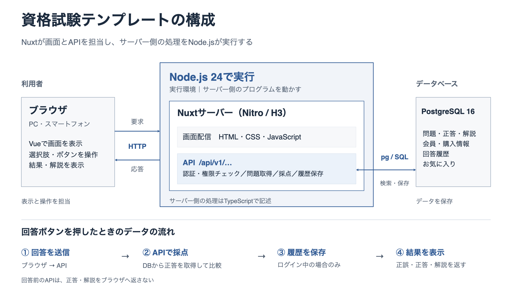

# 資格試験の演習サービス・テンプレート

試験別の設定と問題データを差し替えて、新しい資格試験の学習サービスを作るためのテンプレートです。Nuxt 4・Nitro（TypeScript API）・PostgreSQL 16で構成し、認証にBetter Auth、DB操作にPrisma、マイグレーションにPrisma Migrateを使用します。単一選択・正答1件の問題を1問ずつ演習できます。

初期状態は架空の「サンプル資格試験」です。2セット×3問の自作サンプルを収録し、課金機能は無効です。実在する試験の問題・利用者・決済情報・認証情報は含みません。

## できること

- ログインせずに問題を解き、回答後に正誤・正答・解説・出典を確認する
- 会員登録・ログイン、回答履歴の保存、お気に入りの登録
- 管理者による問題の作成・編集・公開・削除
- 文章・引用・穴埋め・表・プログラムを含む問題の表示
- 任意で、一回払いの会員購入と有料問題の利用制限を有効にする

複数正答・記述式・制限時間付きの受験セッション・試験全体の採点は追加機能です。選択肢の件数とラベルは設定できますが、各問題の正答は1件です。

## アーキテクチャ



図は画面・API・DBの配置を示します。業務DB操作はPrisma、認証のDB接続はBetter AuthのPrismaアダプターを使用します。回数制限と障害通知を含む詳細は[API・DB・運用の概要](docs/architecture.md)を参照してください。

## 使用ライブラリ

直接管理している依存ライブラリと、Nuxtに含まれる主要な実行基盤をまとめています。バージョンの指定は[package.json](frontend/package.json)、実際にインストールされるバージョンは[package-lock.json](frontend/package-lock.json)を参照してください。

### アプリケーション

| ライブラリ・基盤 | パッケージ名 | このテンプレートでの役割 |
| --- | --- | --- |
| Nuxt | `nuxt` | ページ・ルーティング・サーバー描画と、フロントエンド／APIを統合するフレームワーク |
| Vue | `vue` | 画面コンポーネントと状態管理 |
| Nitro | `nitropack`（Nuxt経由） | `frontend/server/api/`のファイル名・HTTPメソッドによるAPI振り分けと、Node.js向けサーバーの生成 |
| H3 | `h3` | APIのHTTPリクエスト・レスポンス、ルーティングの処理 |
| Nuxt UI | `@nuxt/ui` | 共通UI・アイコン、UForm/UFormFieldによる入力検証・項目別エラー表示 |
| Tailwind CSS | `tailwindcss` | Nuxt UIを含む画面のスタイル基盤 |
| Better Auth | `better-auth` | 会員登録・ログイン、パスワード処理、DBセッションとCookieによる認証 |
| rate-limiter-flexible | `rate-limiter-flexible` | 公式PostgreSQLストアの原子的な回数制限。認証はBetter Auth標準の`customStorage.consume`から同じストアを利用 |
| Sentry Node SDK | `@sentry/node` | 許可した固定メッセージだけを送る障害通知。HTTPリクエスト・利用者・例外の自動収集は無効 |
| Prisma Client | `@prisma/client` | 型付きのDB操作・関連データ・トランザクション。Better Authも公式Prismaアダプター経由で利用 |
| PostgreSQLアダプター | `@prisma/adapter-pg`・`pg` | PrismaのPostgreSQL接続。回数制限ライブラリの専用接続、復元演習、カタログ照合にも`pg`を利用 |
| Zod | `zod` | 設定・問題・表示ブロック・認証フォームの検証、TypeScriptの型推論と設定JSON Schemaの生成 |
| Stripe SDK | `stripe` | 課金を有効にした場合の一回払い決済とWebhook署名の検証 |

### 開発・検証

`devDependencies`に指定しているパッケージです。ビルド時に画面へ組み込むアイコンデータも含みます。

| ライブラリ | パッケージ名 | このテンプレートでの役割 |
| --- | --- | --- |
| Prisma CLI / Migrate | `prisma` | Prisma ClientとマイグレーションSQLの生成、適用履歴・チェックサム・ロックの管理 |
| TypeScript | `typescript` | 型付きコードの記述と静的な型検査 |
| vue-tsc | `vue-tsc` | Vueコンポーネントを含む型検査 |
| Playwright | `@playwright/test` | PC・スマートフォンのブラウザ操作を自動検証 |
| Lucideのアイコンデータ | `@iconify-json/lucide` | Nuxt UIで使うアイコンをローカルに用意 |
| 型定義 | `@types/node`・`@types/pg` | Node.jsとPostgreSQLクライアントのTypeScript用型定義 |

実行環境はNode.js、DBはPostgreSQL、開発環境の構成管理はDocker Composeです。DockerではNode.js 24とPostgreSQL 16を使用します。単体・APIテストはNode.js標準の`node:test`で実行します。

## 依存ライブラリの更新

[Dependabot設定](.github/dependabot.yml)で、npmライブラリ、Dockerfile・Composeのイメージ、GitHub Actionsの更新を毎週月曜09:00（日本時間）に確認します。設定をGitHubの既定ブランチへ反映すると、更新がある場合にPRが作成されます。

Nuxt・UI関連と開発ツールのマイナー／パッチ更新はそれぞれまとめ、認証・DB・検証・決済ライブラリとメジャー更新は個別のPRで確認します。更新提案はGitHub上で実行され、ローカルのDockerを起動する必要はありません。

PRは既存CIと変更内容を確認して手動で取り込みます。公開直後の通常更新には3日間の待機期間を設け、自動マージは設定していません。セキュリティ更新の有効化、既存パッチと競合した場合の手順は[依存ライブラリのセキュリティ対応](docs/dependency-security.md#dependabotによる更新提案)を参照してください。

## 起動

DockerとDocker Composeを用意し、このリポジトリのルートで実行します。

```bash
cp .env.example .env
docker compose up -d --build
```

`.env.example`はローカル開発用です。本番では`APP_ENV=production`を設定し、DBパスワードと`BETTER_AUTH_SECRET`（64文字以上のランダムな値）を独自に設定し、`BETTER_AUTH_URL`を実際のHTTPSオリジンへ変更してください。開発時にポートを変更する場合も、このURLと`CORS_ORIGINS`を合わせます。

初回は依存関係とPrisma Clientを準備し、Prisma Migrateでマイグレーションを実行します。開発環境で問題と選択肢が空の場合に限り、同梱のサンプル問題を取り込みます。再起動や再度のseedで既存問題を上書きしません。本番では自動seedを実行しません。

| 画面・接続先 | 初期値 |
| --- | --- |
| 学習画面 | http://localhost:3100 |
| 管理ログイン | http://localhost:3100/admin/login |
| APIの稼働確認 | http://localhost:3100/api/v1/health |
| 開発用PostgreSQL | localhost:55432 |

既存の開発環境と分離するため、Composeプロジェクト名・DB・ボリューム・ポートを独立させています。複数の派生サービスを同時に動かす場合は、各サービスの`.env`で`COMPOSE_PROJECT_NAME`を固有の値にし、公開ポート・接続URLを変更し、`config/exam.json`の`site.id`も異なる値にしてください。ログインCookieはこの識別子で分離します。

画面とAPIは同じNuxtプロセスから配信します。`3101`は以前のAPI接続用に同じプロセスへ接続する互換ポートです。Composeのサービス名は`frontend`と`db`です。

停止には次のコマンドを使います。DBを残したまま停止します。

```bash
docker compose down
```

## 管理者を作る

既定の管理者や共通パスワードは用意していません。メールアドレスと名前を設定し、8〜128文字のパスワードを入力して作成します。

```bash
export ADMIN_EMAIL='admin@example.test'
export ADMIN_NAME='管理者'
printf '管理者パスワード: '
stty -echo
read -r ADMIN_PASSWORD
stty echo
printf '\n'
export ADMIN_PASSWORD
docker compose exec \
  -e ADMIN_EMAIL -e ADMIN_NAME -e ADMIN_PASSWORD frontend npm run admin:create
unset ADMIN_PASSWORD
```

同じメールアドレスが登録済みの場合は作成を拒否します。既存の一般ユーザーを自動で管理者へ変更しません。

## 別の資格試験へ変更する

1. [`config/exam.json`](config/exam.json)で、サービスごとに一意な`site.id`と、試験名・ロゴ・配色・分類・セット数・問題数・選択肢ラベルを設定する。
2. [`content/questions.json`](content/questions.json)を、対象資格向けに確認した問題・解説・出典に差し替える。
3. 新しい空のDBで起動して、問題・管理画面・PCとスマートフォンの表示を確認する。
4. 利用規約・プライバシーポリシー・問い合わせ先を、そのサービスの実際の運用に合わせて仕上げる。

設定変更時の再起動方法、問題JSONの形式、既存DBがある場合の手順は、[カスタマイズ手順](docs/customization.md)を参照してください。設定変更と問題データの変更は別操作です。JSONファイルを編集しても、すでにDBに保存された問題は更新されません。

## 課金を使う場合

`payments.enabled`の初期値は`false`です。この状態では公開問題を全て無料で演習でき、ログインユーザーはお気に入りを利用できます。

`true`にすると、無料セットの範囲と会員の利用資格をAPI側で検査します。販売開始はさらに環境変数のフラグとStripe・販売者情報の設定で制御します。設定ファイルで課金機能を有効にするだけでは販売を開始しません。対応する購入方式は一回払いで、定期購読は含みません。[設定手順](docs/customization.md#課金を有効にする)を確認してください。

## 進捗とエージェントの作業支援

[共通ハーネス](docs/workflow/README.md)で、複数の文脈、依頼範囲、受入条件、別担当レビュー、上限付きの再評価、依存グラフ、引き継ぎ記録を管理できます。Node.js標準機能だけで動き、アプリやDBを起動せずに状態を確認できます。 設計の説明は[Qiita向けの記事案](docs/articles/ai-agent-harness.md)も参照してください。

```bash
node scripts/context.mjs status
node scripts/context.mjs start development
node scripts/context.mjs next
node scripts/context.mjs graph --format mermaid
```

派生サービスは世代0・空のタスク一覧から始めます。ローカル専用資料の既定配置は`local-only/`で、保護対象は設定できます。進捗の確認からテスト・サーバー・コミット・公開を自動実行することはありません。タスクの追加、完了判定、フックの明示的な導入方法は[運用説明](docs/workflow/README.md)を参照してください。

## 検証と構成

設定・問題・表示ブロックの検証ルールは共有のZodスキーマを使用します。`config/exam.schema.json`はそこから生成する編集支援用ファイルです。設定値の変更では再生成は不要で、ルールを変更した場合は`npm run schema:generate`で更新します。

設定と初期問題の検査は、対応するNode.jsと依存ライブラリを用意して実行します。

```bash
npm --prefix frontend ci
npm --prefix frontend run schema:check
node --experimental-strip-types scripts/check-template.mjs
```

Node.jsは`frontend/package.json`の対応バージョンを使用します。DockerはNode.js 24を使用します。APIと画面のテストはTypeScriptで実行します。APIの検証には開発用と別のDBを作成し、接続先を明示します。

```bash
# 初回のみ、独立したテストDBを作成する。
docker compose exec db sh -c 'createdb -U "$POSTGRES_USER" exam_practice_test'
docker compose exec -e APP_ENV=test -e DB_NAME=exam_practice_test frontend \
  sh -c 'npm run db:migrate && npm run test:server'
docker compose exec frontend \
  sh -c 'npm test && npm run typecheck && npm run build'
```

認証はBetter AuthのDBセッションとHttpOnly Cookieを使い、ブラウザで独自トークンを保存しません。新しい派生サービスは空のDBから開始してください。旧版のユーザー・パスワード・ログイン状態の引き継ぎは対象外です。既存の問題DBを更新する場合の注意点は[移行手順](docs/migration.md)を参照してください。

ブラウザ操作はPlaywrightでPC・スマートフォンの両方を検証します。`frontend`で`npm run test:e2e`を実行すると、ビルド後に独立した一時DBとローカルサーバーを用意して確認し、終了時に一時DBを削除します。接続先の指定と初回準備は[検証の実行方法](docs/testing.md)を参照してください。GitHub Actionsでも単体・API・型検査・ビルドに加えて実行します。

- [カスタマイズ手順](docs/customization.md)
- [API・DB・運用の概要](docs/architecture.md)
- [DB移行・バックアップ・復元演習](docs/migration.md)
- [検証結果と依存関係の確認事項](docs/verification.md)
- [共有スキーマとブラウザテストの実行方法](docs/testing.md)
- [サンプル問題について](content/README.md)

テンプレートから作成したリポジトリは、それぞれ独立したサービスとして管理します。テンプレート側の更新は自動反映されないため、採用する修正を確認して各サービスへ取り込んでください。

依存ライブラリの修正内容と監査表示については、[セキュリティ対応](docs/dependency-security.md)を参照してください。
