# 美術検定2級 模擬試験1（非公式）

全85問・4択・60分。美術史26問＋活用5問は図版を参照。解答・解説は別冊。カラー表示・印刷を推奨。

## 大問1 古代から中世へ、作品と役割

古代から中世の造形は、信仰や社会のあり方を映している。制作の目的、作品の時代、表現の媒体をそれぞれ区別して考える。

### 問1

古代エジプトで、墓の内部に食物や召使いの姿が描かれた理由として、最も適切なものはどれか。

ア．生前の王の事績を年代順に並べ、後の王に統治の手本を示そうとした。
イ．死後の王が生活を続けるために、必要なものを備えようとした。
ウ．墓を訪れる人に食物を分配するため、納めた物品の数量を記録しようとした。
エ．神殿で行う収穫の儀礼を、墓の壁面で代行しようとした。

### 問2

古代ギリシア建築の柱頭について、表のA・Bに対応する柱式の組合せとして、正しいものはどれか。

| 欄 | 柱頭に見られる特徴 |
| --- | --- |
| A | 左右に渦巻状の装飾を置く。 |
| B | アカンサスの葉をかたどった装飾を置く。 |

ア．A：ドーリア式　B：コリント式
イ．A：イオニア式　B：ドーリア式
ウ．A：イオニア式　B：コリント式
エ．A：コリント式　B：イオニア式

### 問3

ラヴェンナの教会堂に残る壁面装飾を調べるため、「モザイク」という技法の説明を付ける。正しい説明はどれか。

ア．銅板の溝にインクを詰め、紙を押し当てて刷る。
イ．小さな色石やガラス片を並べ、面を構成する。
ウ．木の板に卵を使った絵具を塗り、細い筆線を重ねる。
エ．湿った漆喰の壁に、水で溶いた顔料を塗る。

### 問4

図の聖母子像について、伝統的な表現と新しい表現の関係を述べたものとして、最も適切なのはどれか。

図1

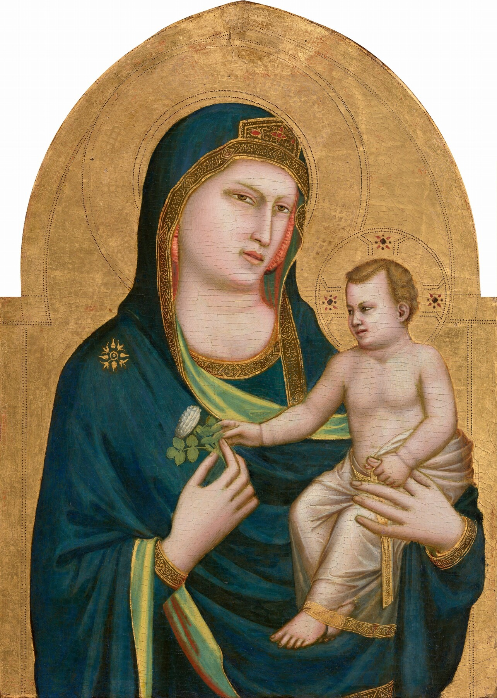

ア．金地と光輪を用いつつ、明暗による体の量感や、指を握るしぐさを表している。
イ．建築の奥行きを一点透視図法で統一し、母子をその中心に置いている。
ウ．金色の背景を自然の空として描き、遠くの山々を小さく並べている。
エ．母子を左右対称に離して置き、互いに触れ合わない姿で表している。

## 大問2 ルネサンスの仕事場

建築家・彫刻家・画家たちは、都市や注文主の要望に応えながら新しい表現を探った。作者、作品、地域の特徴を関連付けて答える。

### 問5

フィレンツェのサンタ・マリア・デル・フィオーレ大聖堂の大円蓋の完成に大きく関わった建築家は誰か。

ア．ブルネレスキ
イ．アルベルティ
ウ．ブラマンテ
エ．ドナテッロ

### 問6

図の騎士が表している人物として、最も適切なのはどれか。馬・武器・足元の生き物を手がかりに考えよう。

図1

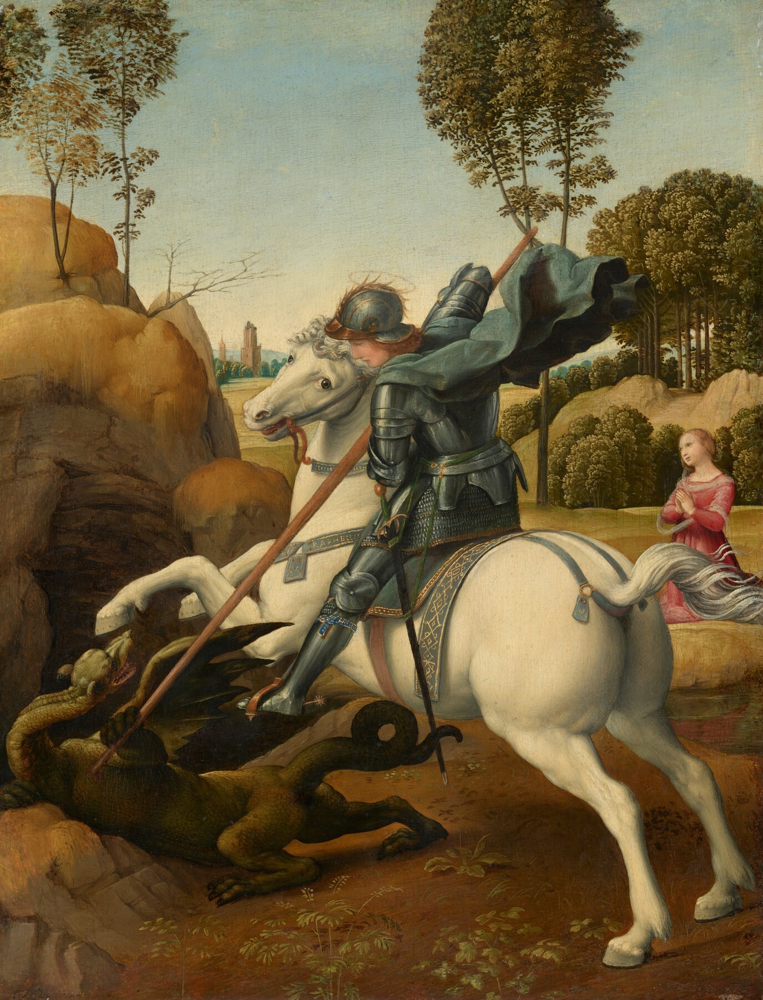

ア．メドゥーサの首を掲げる英雄ペルセウス
イ．翼を広げ、悪魔を踏みつける大天使ミカエル
ウ．外套を切り分けて貧者に与える聖マルティヌス
エ．竜を退治する聖ゲオルギウス

### 問7

図の肖像画を描いた画家はだれか。人物の輪郭や赤い衣服のひだの表現にも注目しよう。

図1

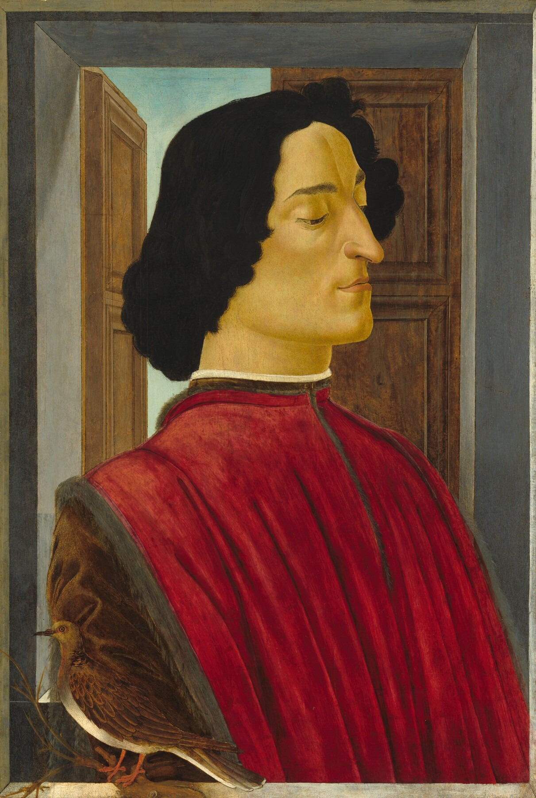

ア．アントニオ・デル・ポッライウォーロ
イ．サンドロ・ボッティチェリ
ウ．ピエロ・デッラ・フランチェスカ
エ．ドメニコ・ギルランダイオ

### 問8

図の肖像画で、衣服と人物の見せ方を説明したものとして、最も適切なのはどれか。

図1

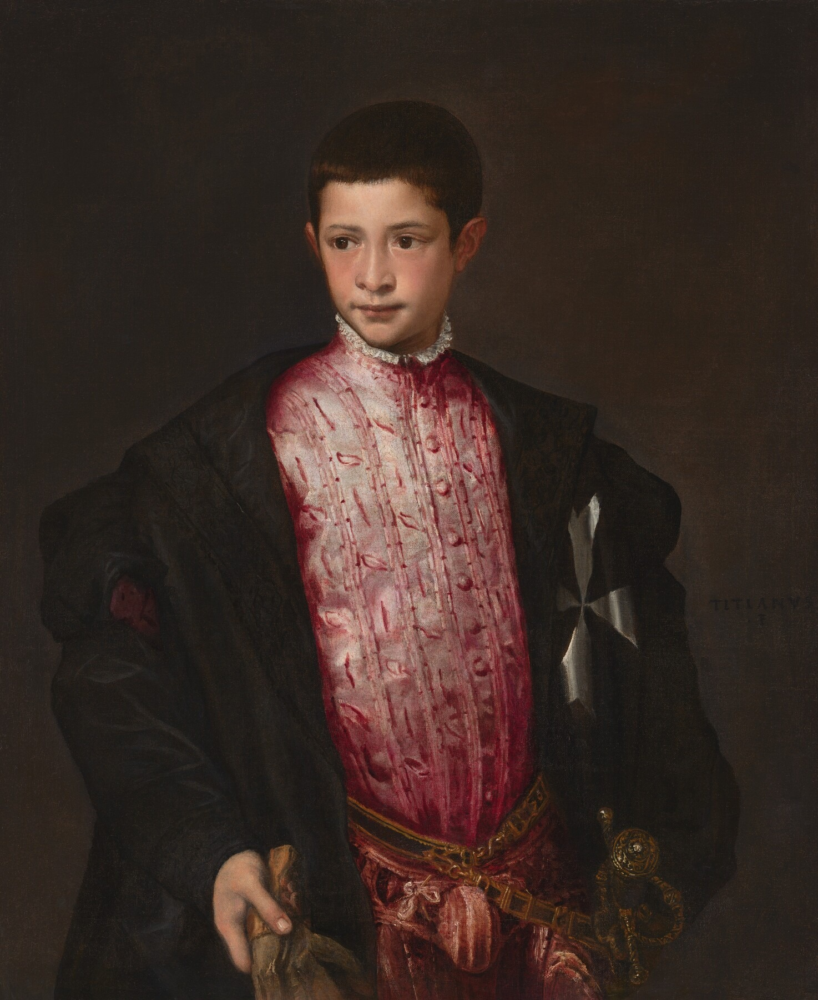

ア．明るい背景に暗い胴衣を重ね、少年の顔を逆光で暗く沈めている。
イ．顔・外套・胴衣を同じ明るさにそろえ、肌と布の質感の違いを抑えている。
ウ．赤い胴衣を明暗の変化のない色面にし、布の光沢を表さずに描いている。
エ．暗い外套と赤い胴衣を対比させ、光沢や布のひだの明暗によって質感を描き分けている。

## 大問3 16世紀の異なる表現

同じ16世紀にも、知識人の肖像と、複雑な人体表現を追う彫刻が並んで生まれた。題材や鑑賞の仕方から、作品の特徴を読み取る。

### 問9

図の肖像画の作者として、最も適切なのはだれか。顔の観察と、毛皮・装身具・手袋の細かな描写を手がかりに考えよう。

図1

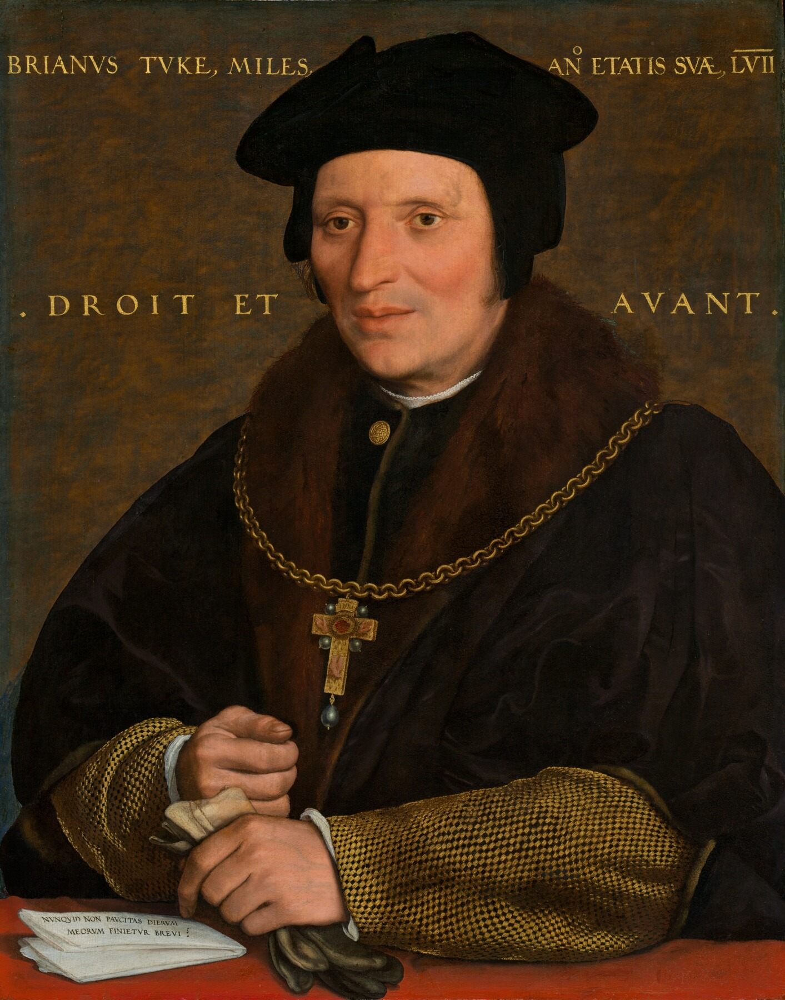

ア．アルブレヒト・デューラー
イ．クエンティン・マサイス
ウ．ハンス・ホルバイン（子）
エ．ルーカス・クラナハ（父）

### 問10

ジャンボローニャの「サビニの女の略奪」を鑑賞する際、作品の構成を確かめる方法として最も適切なものはどれか。

ア．周囲を回り、複数の身体がらせん状につながる様子を確かめる。
イ．上方からだけ見て、人物を円の周囲に等間隔に置く配置を確かめる。
ウ．背後だけから見て、石の外面に浅く彫られた人物の輪郭を確かめる。
エ．正面に立ち、三人の身体が同一平面で左右対称に並ぶ様子を確かめる。

## 大問4 近世の風景と暮らし

近世のヨーロッパでは、風景、宗教的な物語、室内の日常などがさまざまに描かれた。作品の主題、空間の組み立て方、制作や鑑賞の場に注目して考えなさい。

### 問11

図の風景画にみられる奥行きの表現と、その用語の組合せとして、最も適切なのはどれか。

図1

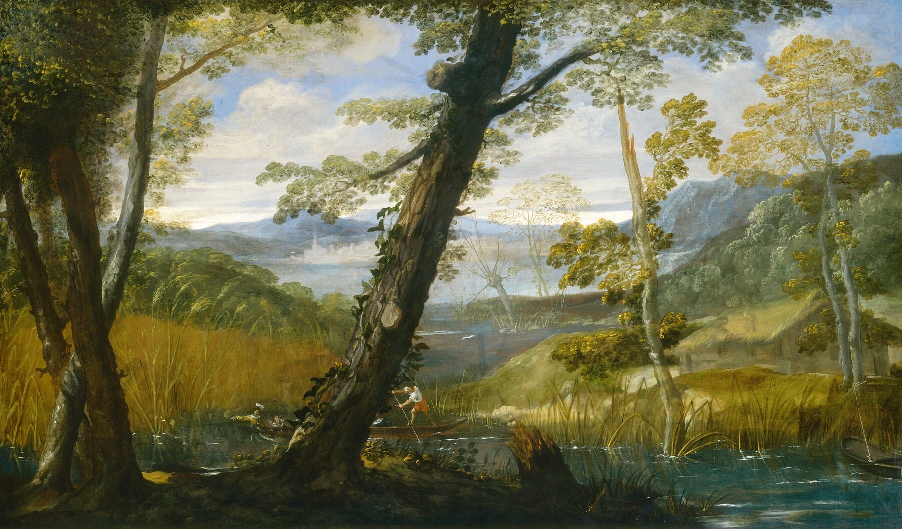

ア．街角の建物の二方向の水平な縁を、それぞれ別の消失点へ向かわせる―二点透視図法
イ．建物の屋根を取り去り、室内を斜め上から見下ろすように示す―吹抜屋台
ウ．室内の床の格子を、奥の一つの消失点へ向かって収束させる―一点透視図法
エ．近景の木々を濃く、遠くの山々を淡く青みがかった色にする―空気遠近法

### 問12

図に表されている場面として、最も適切なのはどれか。人物の行為と、頭上に描かれたものに注目しよう。

図1

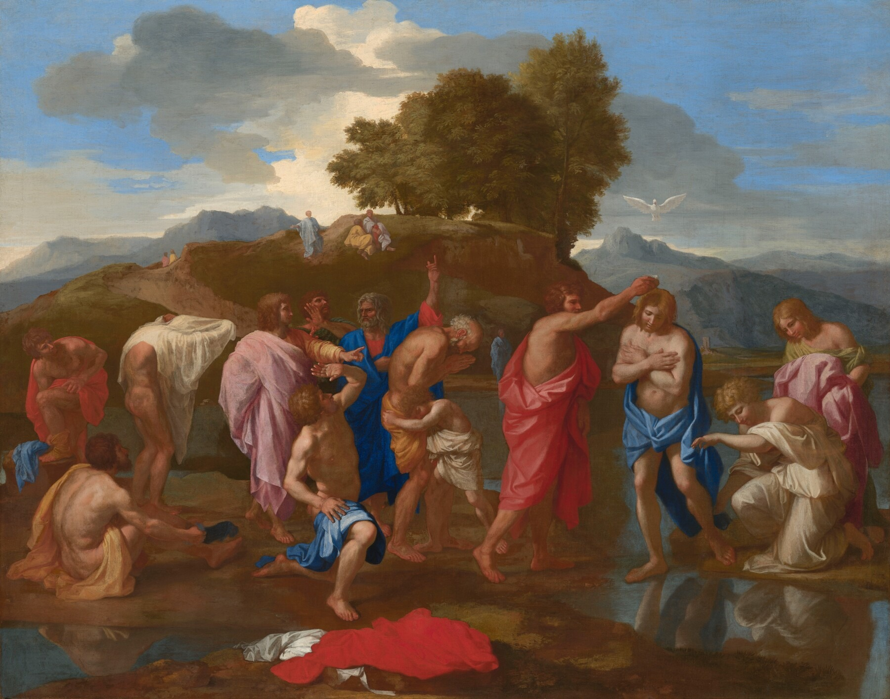

ア．キリストが山上で光り輝く姿を見せる「変容」
イ．復活したキリストが弟子に姿を現す「エマオの晩餐」
ウ．キリストが弟子の足を洗う「洗足」
エ．ヨハネがキリストの頭に水を注ぐ「洗礼」

### 問13

図の室内画で、光と人物を説明したものとして、最も適切なのはどれか。

図1

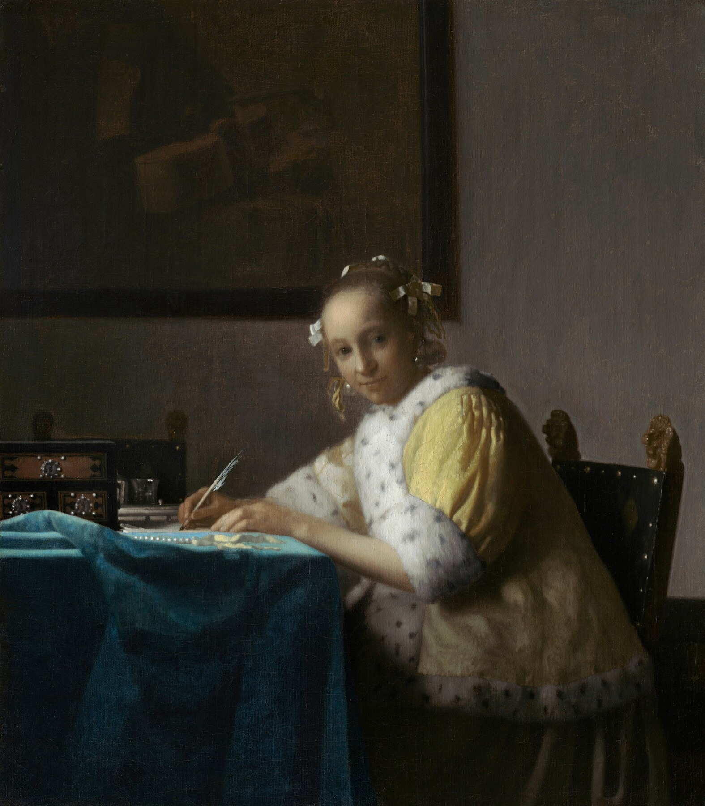

ア．卓上のろうそくが唯一の光源となり、顔を下方から赤く照らしている。
イ．画面左側からの柔らかな光が、顔や黄色い上着、卓上の品を照らしている。
ウ．背景から人物まで同じ明るさにそろえ、光が来る方向を示していない。
エ．人物の背後の窓が強い逆光を生み、顔と両手を黒い影に沈めている。

### 問14

次のうち、17世紀スペインの宮廷画家ベラスケスの作品として正しいものはどれか。

ア．「聖母子と諸聖人」
イ．「大工聖ヨセフ」
ウ．「ラス・メニーナス」
エ．「夜警」

## 大問5 18世紀の主題と都市

画家の活動は、宮廷の装飾から市民の生活、旅行者が求める都市景観へと広がった。主題と作者、表現の媒体を対応させる。

### 問15

図の主題と絵画の分野の組合せとして、最も適切なのはどれか。

図1

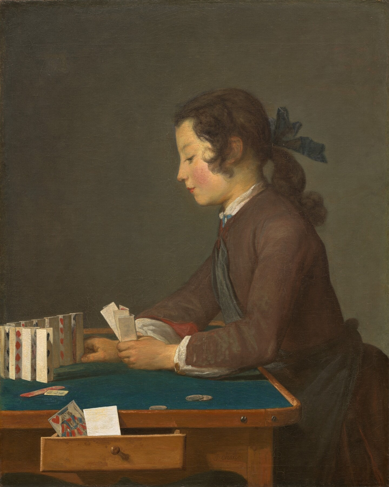

ア．古代の英雄が勝利を示す場面―歴史画
イ．王侯が権威の象徴を示す場面―公式肖像画
ウ．若者がカードを立てる遊びに集中する場面―風俗画
エ．机上のカードと硬貨だけを主役にした場面―静物画

### 問16

図のような都市景観の描き方を説明したものとして、最も適切なのはどれか。

図1

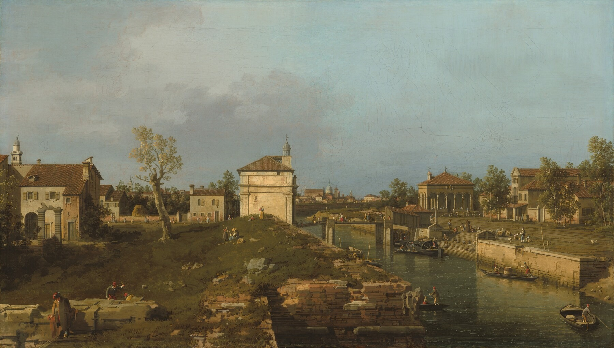

ア．建物や運河の配置を明瞭に示し、小さな人々の活動も組み込んで都市の眺めを表している。
イ．近景の建物を荒い色の点に分解し、輪郭が見分けられないほど光の効果を強めている。
ウ．実在の建物を描かず、巨大な地下牢の内部を空想的に組み立てている。
エ．主な建物を平行な線で重ね、近くと遠くで大きさを変えずに表している。

### 問17

18世紀イギリス美術の紹介文で、ホガースの仕事として最も適切なものはどれか。

ア．ローマの古代建築を、精密なエッチングに表した。
イ．宮廷肖像の衣装や自然を、軽やかな筆致で描いた。
ウ．ヴェネツィアの運河と建物を、都市景観として描いた。
エ．市民の生活や社会を、風刺的で物語性のある画面に描いた。

## 大問6 19世紀の美術と社会の変化

古代の再評価、市民社会の成立、産業と交通の発達は、美術の題材や制作環境にも変化をもたらした。

### 問18

18世紀半ば以降の新古典主義を理解する手掛かりとして、古代の生活と美術への関心を高めた出来事はどれか。

ア．ポンペイなどの遺跡の発掘が進んだこと。
イ．ロンドンで工業製品を集めた万国博覧会が開かれたこと。
ウ．パリで民間の画廊が公式展に代わって増えていったこと。
エ．アカデミーの公式展覧会が一般に公開されるようになったこと。

### 問19

図の肖像画について、輪郭と絵肌を説明したものとして、最も適切なのはどれか。

図1

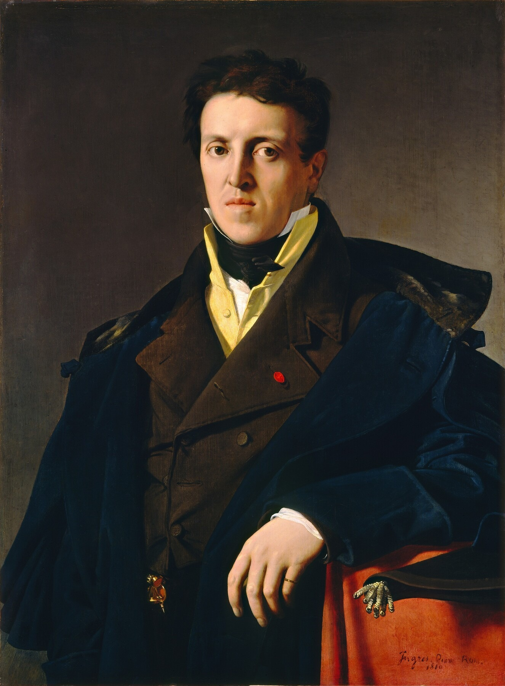

ア．顔を鮮やかな原色の平面に置き換え、肌の明暗を省いている。
イ．画面全体を幾何学的な小面へ分割し、一人の顔を複数の方向から重ねている。
ウ．色を厚い短い筆触に分け、顔と服の輪郭を周囲の光へ溶かしている。
エ．顔や手の輪郭を明確にし、目立つ筆触を抑えた滑らかな描写で形を整えている。

### 問20

図の夜景にみられる光の扱いと、その作者の組合せとして、最も適切なのはどれか。

図1

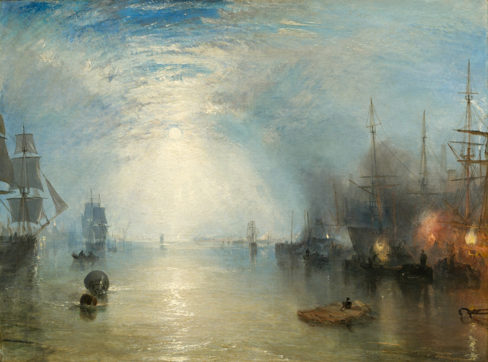

ア．冷たい月光と暖かな火の光を対比させ、水面の反射や煙を表す―ターナー
イ．冷たい月光と暖かな火の光を対比させ、水面の反射や煙を表す―コンスタブル
ウ．光の反射を抑え、建築の輪郭を均一な明るさで際立たせる―コンスタブル
エ．光の反射を抑え、建築の輪郭を均一な明るさで際立たせる―ターナー

### 問21

1851年のロンドン万国博覧会の水晶宮について、設計者と主要な構造材料の組合せとして正しいものはどれか。

ア．シャルル・ガルニエ／鉄とガラス
イ．ジョゼフ・パクストン／石と漆喰
ウ．ジョゼフ・パクストン／鉄とガラス
エ．シャルル・ガルニエ／石と漆喰

## 大問7 新しい都市と美術家たち

19世紀後半の美術家たちは、自然や都市生活、身近な人物をそれぞれの方法で表した。集団に共通する傾向と個々の作家の違いを区別する。

### 問22

図の人物の表し方として、最も適切なのはどれか。顔の向きと、形を描く筆触を確認しよう。

図1

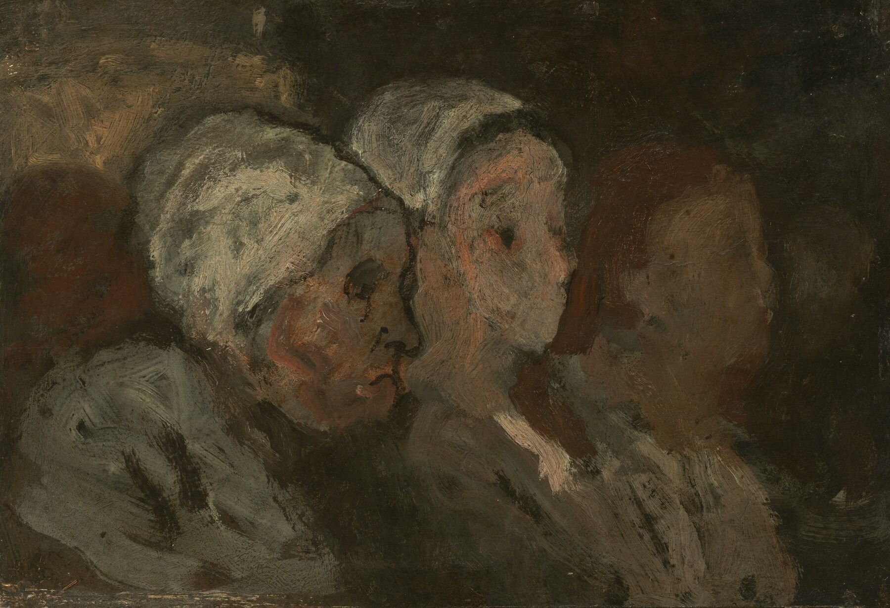

ア．人物を一人ずつ正面向きに並べ、画面全体を左右対称に整えている。
イ．人物の横顔を互いに逆の方向へ向け、中央に大きな空間を設けている。
ウ．横顔の人物を重なるように近くから捉え、筆触と明暗のかたまりで顔や衣服を表している。
エ．顔や衣服を均一に細かく描き、すべての輪郭を同じ強さの線で囲んでいる。

### 問23

図の画面構成の説明として、最も適切なのはどれか。

図1

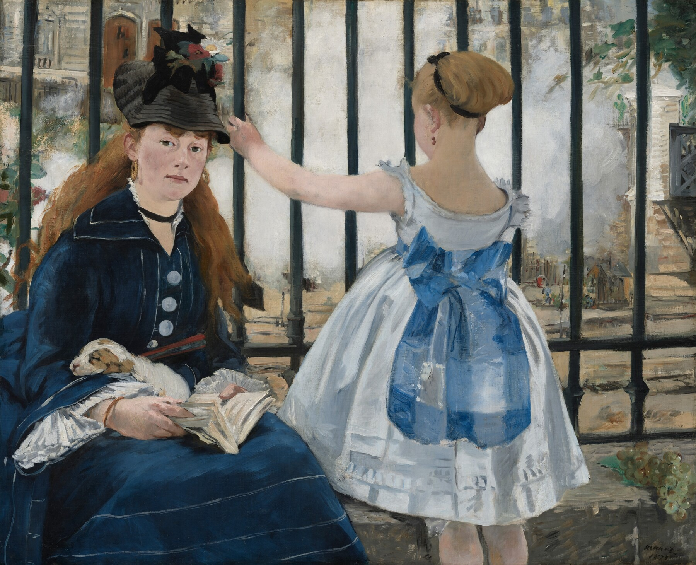

ア．女性も少女も同じ方向を向き、同じ姿勢の反復によって整然とした群像を作っている。
イ．女性と少女の間に線路を通し、画面中央の機関車を最も大きく描いている。
ウ．人物を小さく遠景へ退かせ、鉄道の全景を見渡せる高い視点から描いている。
エ．こちらを見る女性と背を向ける少女を対比させ、背後の鉄柵と白い蒸気で奥の眺めを部分的に遮っている。

### 問24

図の彫刻の造形について、最も適切な説明はどれか。

図1

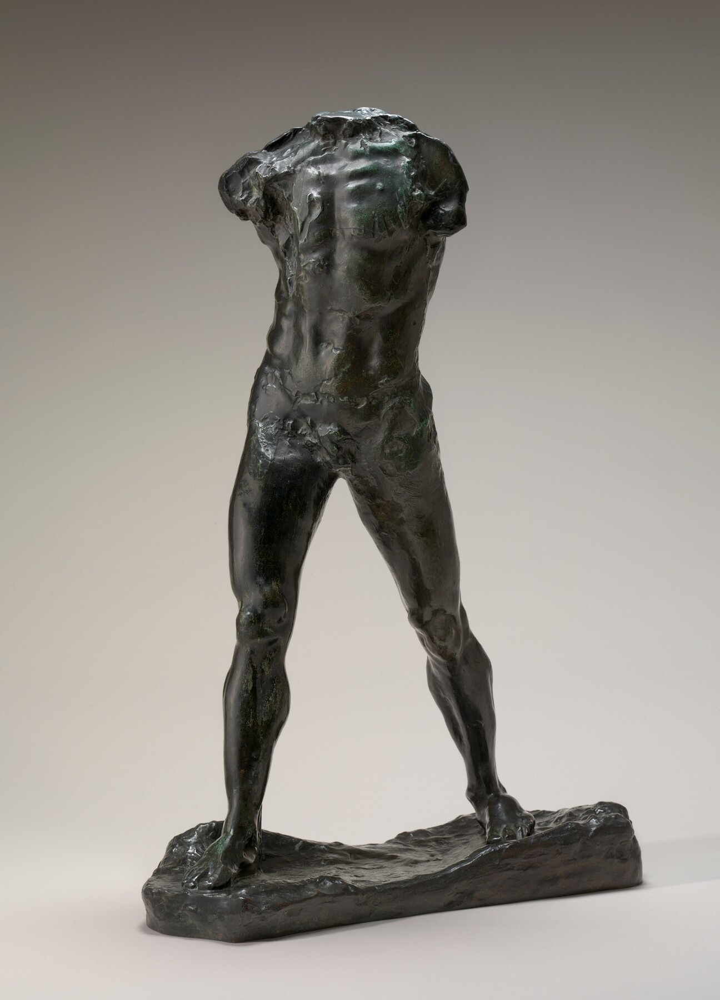

ア．頭部と腕を備えない人体で、胴体の傾きや開いた脚によって歩行の動きを示している。
イ．翼と装身具を加え、特定の神であることを持物によって示している。
ウ．両足をそろえて直立させ、衣服の左右対称なひだを中心に表している。
エ．全身を滑らかな球と円柱に置き換え、筋肉や皮膚の起伏をなくしている。

## 大問8 世紀末の表現の分岐

対象を写すことに加え、画面の構成や内面の世界が意識されるようになった。似た時期の運動でも、重視した目的や方法は同じではない。

### 問25

ナビ派の絵画観について、最も適切なものはどれか。

ア．絵を物語や遠近法の再現としてだけでなく、色を配置した平面として捉えた。
イ．絵の価値を、写真と区別できないほど精密に対象を写すことだけに求めた。
ウ．屋外制作を義務付け、記憶や想像を使った室内での制作を認めなかった。
エ．色彩を排し、古代彫刻の輪郭を黒一色で転写することを共通の規則とした。

### 問26

図の花と花瓶、背景の色彩の関係について、最も適切なのはどれか。

図1

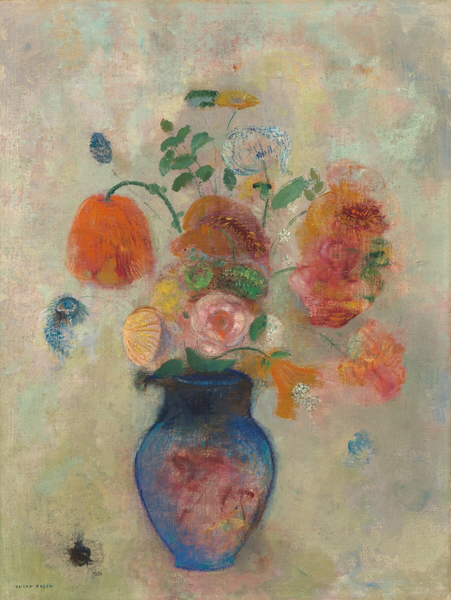

ア．花も花瓶も同じ濃い青で統一し、背景の色を均一な白にしている。
イ．青い花瓶に赤や橙、黄などの花を対比させ、背景にも淡い色の変化を広げている。
ウ．花瓶を赤一色で塗り、白い花だけを黒い背景に浮かび上がらせている。
エ．花と背景を無彩色にそろえ、花瓶の青だけを画面の唯一の色にしている。

### 問27

パリの地下鉄入口に植物のような曲線を取り入れたエクトル・ギマールの仕事は、どの美術・デザインの動向に位置付けられるか。

ア．アール・ヌーヴォー
イ．新古典主義
ウ．アーツ・アンド・クラフツ運動
エ．構成主義

## 大問9 20世紀初頭の前衛美術

色彩、形、空間の表し方をめぐり、複数の運動が同時期に展開した。運動名だけでなく、参加した作家や制作方法も手掛かりにする。

### 問28

初期にフォーヴィスムの仲間として活動し、のちに太い黒い輪郭線を用いて、宗教的な人物像などを描いた画家は誰か。

ア．アンドレ・ドラン
イ．アンリ・マティス
ウ．ジョルジュ・ルオー
エ．モーリス・ド・ヴラマンク

### 問29

キュビスムで使われたパピエ・コレの制作例として、最も適切なものはどれか。

ア．絵具の付いた面を別の紙に押し当て、偶然の模様を転写する。
イ．金属板を針で刻み、溝に入れたインクを紙に移す。
ウ．木目のある板の上に紙を置き、こすって模様を浮かび上がらせる。
エ．新聞紙などの紙片を画面に貼り、描いた形と組み合わせる。

### 問30

ドイツの表現主義について、表のA・Bに当てはまる集団名の組合せとして、正しいものはどれか。

| 欄 | 結成と関係する画家 |
| --- | --- |
| A | 1905年／キルヒナー、ノルデら |
| B | 1911年／カンディンスキー、フランツ・マルクら |

ア．A：ブリュッケ　B：ナビ派
イ．A：ブリュッケ　B：青騎士
ウ．A：ナビ派　B：青騎士
エ．A：青騎士　B：ブリュッケ

### 問31

20世紀ロシアの前衛美術について、表のA・Bに対応する動向の組合せとして、正しいものはどれか。

| 欄 | 作家・作品 |
| --- | --- |
| A | マレーヴィチ「黒い四辺形」 |
| B | タトリン「第三インターナショナル記念塔」 |

ア．A：デ・ステイル　B：構成主義
イ．A：構成主義　B：シュプレマティスム
ウ．A：シュプレマティスム　B：デ・ステイル
エ．A：シュプレマティスム　B：構成主義

## 大問10 美術を作り、学ぶ方法の更新

20世紀前半には、制作の材料や手順、彫刻の形、美術教育のあり方まで問い直された。各試みの具体的な内容から考える。

### 問32

ダダに関係するシュヴィッタースの「メルツ」の説明として、最も適切なものはどれか。

ア．街で集めた紙片や廃物などを取り込み、作品を構成した。
イ．別々の場所の写真を組み合わせ、一つの写真像に合成した。
ウ．既製の便器を選び、署名と題名を与えて作品として提示した。
エ．木目などを紙にこすり取り、現れた形を像の手掛かりにした。

### 問33

ブランクーシの彫刻「空間の鳥」を考える際、作者が目指したことに最も近いものはどれか。

ア．鳥の外見を細部まで再現し、生物学の標本と同じ正確さを得ること。
イ．飛ぶ鳥の各瞬間の姿を重ね、複数の翼の連続で速度を示すこと。
ウ．羽や足の細部を写すより、飛翔する鳥の本質を簡潔な形に表すこと。
エ．平らな金属片を接合し、風によって鳥の形が動く構造を作ること。

### 問34

バウハウスの初期の教育を説明する文として、最も適切なものはどれか。

ア．宮廷画家の資格を与えるため、歴史画だけを実技の対象にした。
イ．建築家の養成だけを行い、画家や工芸家を教師に迎えなかった。
ウ．美術と工芸を結び、芸術家と職人の隔たりを縮めようとした。
エ．機械生産を一貫して禁止し、すべての時期に中世の工法だけを教えた。

## 大問11 戦後美術の素材とイメージ

第二次世界大戦後、ヨーロッパとアメリカで異なる表現が展開した。絵具の扱い、画面に選ぶ像、日常の物との関係を比較する。

### 問35

フォートリエの「人質」シリーズなど、戦後ヨーロッパで非定形の表現を追求した動向として、最も適切なものはどれか。

ア．新印象主義
イ．フォト・リアリズム
ウ．デ・ステイル
エ．アール・アンフォルメル

### 問36

抽象表現主義の中でも、マーク・ロスコの絵画を説明する文として最も適切なものはどれか。

ア．印刷された漫画の一場面を、輪郭や網点ごと拡大した。
イ．規則的な小さな色点だけで、屋外風景を再現した。
ウ．同じ形の金属の箱を、工場で作って等間隔に設置した。
エ．大きな色面の関係を通して、広がりや深い感覚を生み出した。

### 問37

標的や旗などのよく知られた記号を画面に用い、「標的と石膏」などを制作したネオ・ダダの作家は誰か。

ア．ジャスパー・ジョーンズ
イ．ロイ・リキテンスタイン
ウ．ロバート・ラウシェンバーグ
エ．マーク・ロスコ

### 問38

ヌーヴォー・レアリスムに関わる作家と制作方法の対応として、正しいものはどれか。

ア．アルマン：同種の物を集めて提示する／スペーリ：幾何学的な錯視を描く
イ．アルマン：食卓上の物の配置を固定する／スペーリ：同種の物を集めて提示する
ウ．アルマン：幾何学的な錯視を描く／スペーリ：食卓上の物の配置を固定する
エ．アルマン：同種の物を集めて提示する／スペーリ：食卓上の物の配置を固定する

## 大問12 見ること・動くこと・考えること

1960年代前後には、視覚的な効果や運動、場所、概念に着目した作品が増えた。作品の具体的な仕組みから、異なる動向を区別する。

### 問39

実際には静止した幾何学模様が、見る人に揺れや動きを感じさせる。このような視覚効果を中心にしたライリーやヴァザルリの仕事は、何と呼ばれるか。

ア．アール・ブリュット
イ．オプ・アート
ウ．キネティック・アート
エ．ランド・アート

### 問40

キネティック・アートの例について、作者と動きの仕組みの対応として正しいものはどれか。

ア．カルダー：風などで動くモビール／ティンゲリー：錯視を生む平面の模様
イ．カルダー：風などで動くモビール／ティンゲリー：モーターを備えた機械
ウ．カルダー：モーターを備えた機械／ティンゲリー：風などで動くモビール
エ．カルダー：錯視を生む平面の模様／ティンゲリー：モーターを備えた機械

### 問41

次の説明A・Bに対応する作家の組合せとして、正しいものはどれか。

| 欄 | 説明 |
| --- | --- |
| A | 文字などを用い、物の造形より伝える概念を重視する。 |
| B | 湖の岸に土や岩を組み、場所と結び付いた大規模な作品を作る。 |

ア．A：ジョセフ・コスース　B：ロバート・スミッソン
イ．A：ジョセフ・コスース　B：ドナルド・ジャッド
ウ．A：ドナルド・ジャッド　B：ロバート・スミッソン
エ．A：ロバート・スミッソン　B：ジョセフ・コスース

## 大問13 古代の素材と造形

日本の古代美術を考える手がかりには、形や文様だけでなく、材料や制作の工程もある。農耕社会の祭器から寺院の仏像へと対象を広げ、それぞれの造形を支えた技術を確かめよう。

### 問42

弥生時代に青銅で作られ、表面に狩猟や農耕の様子を表した作例もある。豊作を祈る祭りに使われたと考えられる、この造形はどれか。

ア．銅鏡
イ．埴輪
ウ．土偶
エ．銅鐸

### 問43

白鳳期の造像には金銅仏だけでなく、新たな素材・技法の展開も見られる。次の二作例について、技法の組合せが正しいものはどれか。A：薬師寺金堂の薬師三尊像　B：當麻寺金堂の弥勒仏像

ア．A：塑造　B：金銅仏
イ．A：金銅仏　B：塑造
ウ．A：金銅仏　B：乾漆造
エ．A：乾漆造　B：塑造

### 問44

興福寺の阿修羅像は脱活乾漆造による天平彫刻である。この技法の構造を説明する文として適切なものはどれか。

ア．一本の木から頭部と体の主要部を彫り出し、必要な部分を別材で補う。
イ．心土を除いた布と漆の殻を、内部の木の骨組などで支える。
ウ．像の形に彫った木の心材を残し、その表面に木屎漆などを盛り上げる。
エ．木の芯に粘土を付けて肉付けし、土の表面を仕上げる。

## 大問14 仏像と物語絵画

日本の仏教美術と物語絵画を取り上げる。仏像の姿と信仰上の役割、物語を描くための画面や場面の構成に注目して考えなさい。

### 問45

図1の像の頭部や服装を観察し、その姿の分類と特徴の組合せとして最も適切なものを選びなさい。

図1

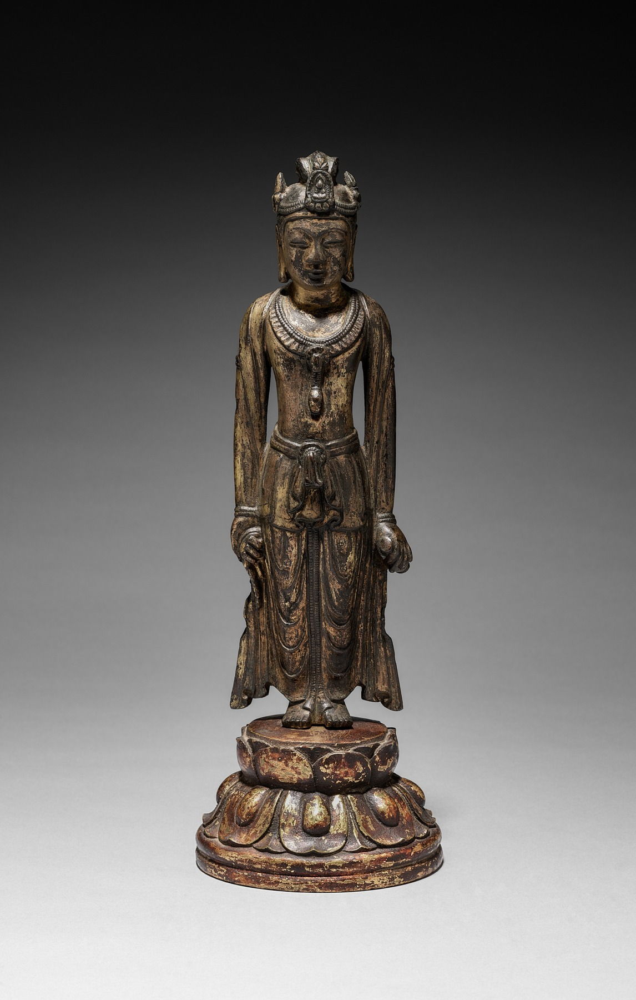

ア．明王形 — 怒りの表情を示し、炎を背にした姿。
イ．天部形 — 甲冑をまとい、武器を手にした姿。
ウ．如来形 — 螺髪を表し、装身具を付けずに僧衣をまとう姿。
エ．菩薩形 — 冠や胸飾りなどの装身具を付けた姿。

### 問46

ある絵巻の一続きの画面に、同じ人物が「出発前」「移動中」「到着後」の姿で繰り返し登場している。出来事の時間を一つの画面へまとめる、この表現を何というか。

ア．吹抜屋台
イ．異時同図法
ウ．引目鉤鼻
エ．たらしこみ

### 問47

次の鑑賞記録A・Bがそれぞれよく当てはまる作品の組合せはどれか。A：宮廷文学の人物の心情を、選び抜かれた場面の構図や色彩から味わう。B：貴族をめぐる事件の推移を、連続する画面の動きや人物の躍動感から追う。

ア．A：源氏物語絵巻　B：鳥獣人物戯画
イ．A：伴大納言絵巻　B：源氏物語絵巻
ウ．A：源氏物語絵巻　B：伴大納言絵巻
エ．A：鳥獣人物戯画　B：伴大納言絵巻

## 大問15 中世の信仰と表現

鎌倉時代から室町時代にかけて、寺院の再建、中国文化の受容、武家の支援などが美術の展開に関わった。建築や絵画を、宗教と社会の両面から見直してみよう。

### 問48

鎌倉時代の南都復興について、建物と建築様式の対応が正しいものはどれか。

ア．東大寺南大門：大仏様　興福寺北円堂：和様
イ．東大寺南大門：大仏様　興福寺北円堂：禅宗様
ウ．東大寺南大門：和様　興福寺北円堂：大仏様
エ．東大寺南大門：禅宗様　興福寺北円堂：和様

### 問49

図1の両手の位置と指の形に注目し、印相の名称と、それに結び付く仏の働きの組合せとして最も適切なものを選びなさい。

図1

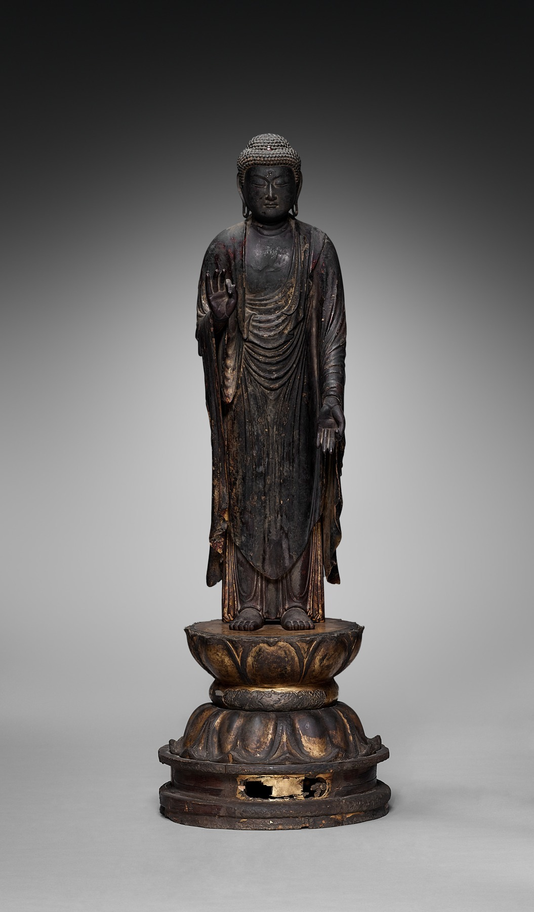

ア．智拳印 — 大日如来の智慧を象徴する。
イ．来迎印 — 阿弥陀如来が臨終の人を極楽浄土に迎えることを表す。
ウ．弥陀定印 — 阿弥陀如来が瞑想に入っていることを表す。
エ．説法印 — 阿弥陀如来が極楽浄土で教えを説くことを表す。

### 問50

金閣の建築は、異なる様式の要素を重ねた点にも特徴がある。公式テキストの説明に即して、1階・2階・3階の特徴を順に並べたものはどれか。

ア．和様の仏堂風／住宅風／禅宗風
イ．住宅風／禅宗風／和様の仏堂風
ウ．禅宗風／和様の仏堂風／住宅風
エ．住宅風／和様の仏堂風／禅宗風

### 問51

図1は16世紀前半から中頃の日本の絵画である。岩と波の描き方を比較した説明として、最も適切なものを選びなさい。

図1

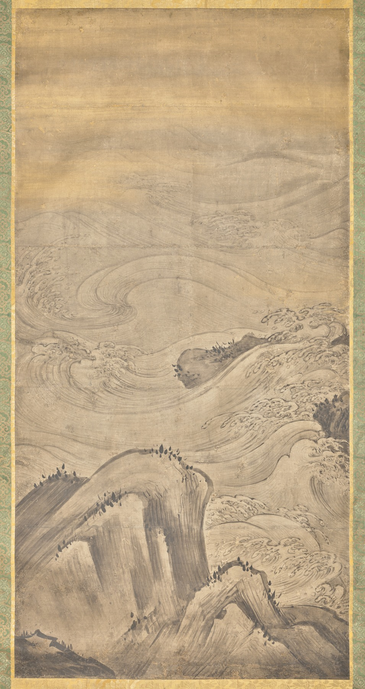

ア．岩肌は同じ濃さの輪郭線だけで描き、波には水平な直線を規則正しく並べている。
イ．岩肌は細かな点の集積だけで描き、波は輪郭を引かず淡いにじみだけで示している。
ウ．岩肌には墨の濃淡や筆の跡を生かし、波には流れるような曲線を繰り返している。
エ．岩肌には明確な筆の跡を残さず、波全体を濃い墨の面で塗りつぶしている。

### 問52

図1の四つの画面のつながりに注目し、この絵の構成と、もとの用途の関係を説明したものとして最も適切なものを選びなさい。

図1

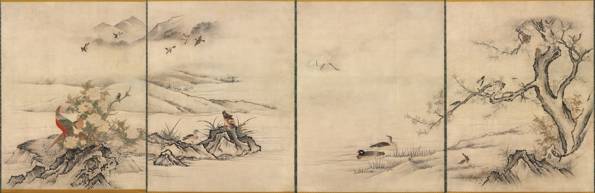

ア．同じ鳥を場面ごとに登場させて時間の経過を示し、絵巻として順に開いて鑑賞する。
イ．中央に礼拝対象を左右対称に配し、仏堂の本尊を荘厳するために用いる。
ウ．各画面の中央に独立した主役を置き、四季を一図ずつ別々に鑑賞する画帖とする。
エ．水辺や樹木を画面の境を越えて連続させ、建築の内部を彩る襖絵とする。

## 大問16 近世初期の都市と住まい

桃山時代から江戸時代前期には、城郭や別邸の整備とともに、都市や人々の暮らしを描く絵画も発達した。建築の意匠と絵画の画題を比べ、異なる使い方や関心が造形にどう表れたかを考えてみよう。

### 問53

図1は17世紀前半の京都で制作された、古典文学に着想を得た絵画である。画面の観察と美術史的な位置付けを組み合わせた説明として、最も適切なものを選びなさい。

図1

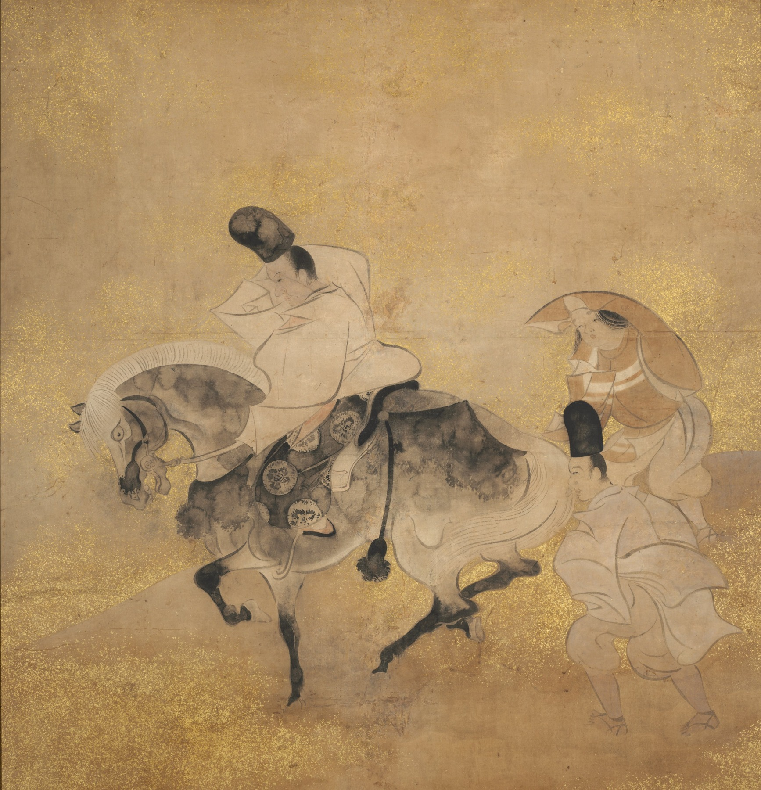

ア．金の地に人物と馬を簡潔に配し、古典的な主題を装飾的に再構成する、琳派につながる表現を示している。
イ．街路と多数の建物を高所から細密に描き、都市の名所や人々の営みを一覧できるようにしている。
ウ．建物の屋根を取り去って室内を見せ、吹抜屋台によって宮廷の生活を詳しく語っている。
エ．遠近に連なる山々を淡墨で重ね、中国の山水画を手本とする奥深い自然空間を表している。

### 問54

桂離宮のように、書院造に茶室の要素を採り入れ、簡素な材料や洗練された意匠を生かした建築は、一般にどの系統に位置付けられるか。

ア．大仏様
イ．権現造
ウ．数寄屋建築
エ．禅宗様

## 大問17 江戸時代の学びと出版

江戸時代の絵画は、国内の伝統を受け継ぐだけでなく、中国や西洋の表現を学びながら多様化した。出版の発達によって、絵を作る人、技術を支える人、作品を手にする人の関係も広がった。

### 問55

図1の竹や岩の筆致と、画面左上の文字に注目し、表現の特徴と結び付く絵画の動向の組合せとして最も適切なものを選びなさい。

図1

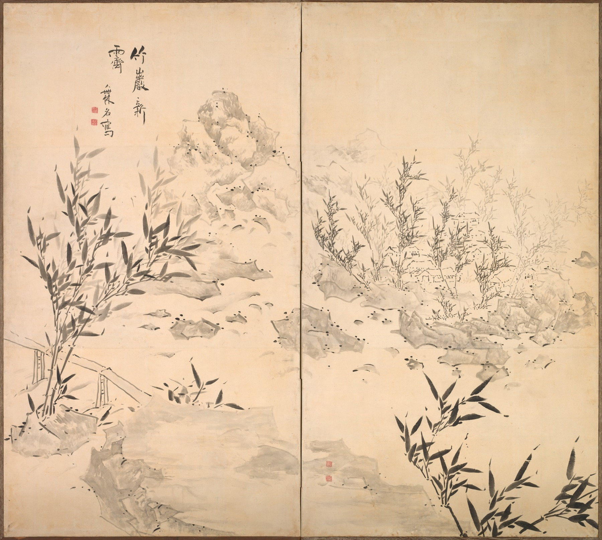

ア．一方向の光と影で物の量感を統一する — 西洋油彩画の明暗法を学ぶ洋風画。
イ．輪郭の内側を均一な鮮色で塗り分ける — 伝統的なやまと絵の濃彩表現。
ウ．書と通じる筆の動きを生かし、墨の濃淡で山水を表す — 中国の文人文化に学ぶ南画。
エ．金地の上に少数の草花を平面的に反復する — 文様性を強めた琳派の装飾表現。

### 問56

江戸時代の洋風画と蘭学の関係について、A・Bに当てはまる人物の組合せはどれか。A：『解体新書』の解剖図を描いた。B：銅版画や油彩画を手がけ、西洋の遠近法や明暗法を研究した。

ア．A：渡辺崋山　B：司馬江漢
イ．A：小田野直武　B：司馬江漢
ウ．A：司馬江漢　B：小田野直武
エ．A：小田野直武　B：渡辺崋山

### 問57

図1の人物の取り上げ方を、浮世絵の画面形式を表す用語と結び付けた説明として最も適切なものを選びなさい。

図1

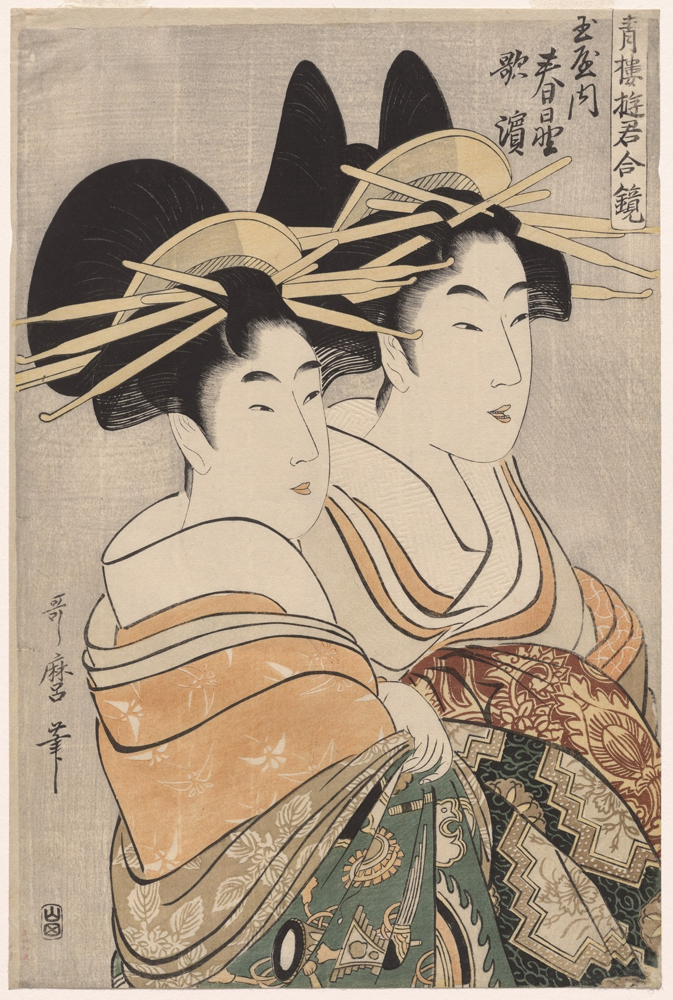

ア．建物の線を奥の一点に集め、室内の奥行きを強調する浮絵。
イ．人物の全身と足元までを収め、立ち姿の身振りを見せる全身像。
ウ．顔や上半身を大きくとらえ、表情や髪形に目を向けさせる大首絵。
エ．一つの風景の中に大勢の人物を小さく配し、名所のにぎわいを見せる名所絵。

### 問58

図1は江戸時代後期の浮世絵である。画面に見られる構図の特徴と作品の分野の組合せとして、最も適切なものを選びなさい。

図1

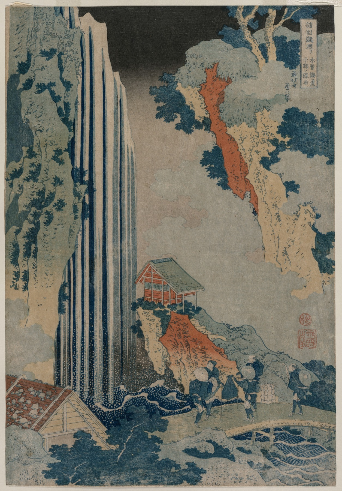

ア．斜めに走る雨の線と橋を渡る群衆を対比させる — 天候の変化を主題とする名所絵。
イ．縦長の画面に滝の落差を強調し、手前の小さな旅人と対比させる — 各地の景勝地を取り上げる名所絵。
ウ．舞台上の人物を大きくとらえ、身振りと表情を強調する — 歌舞伎の人気を背景とする役者絵。
エ．低い水平線の上に空を大きく取り、遠景の山を際立たせる — 山岳を主題とする名所絵。

## 大問18 近代の教育と美術家

明治以降には、美術教育や展覧会の制度が整えられる一方、既存の枠に収まりきらない試みも現れた。学校、美術団体、作品の表現を関連付けると、近代美術の変化を捉えやすくなる。

### 問59

明治政府が開いた工部美術学校では、イタリアから招かれた専門家が指導した。人物と分野の組合せが正しいものはどれか。

ア．フォンタネージ：絵画　ラグーザ：彫刻　カペレッティ：建築
イ．フォンタネージ：建築　ラグーザ：彫刻　カペレッティ：絵画
ウ．フォンタネージ：絵画　ラグーザ：建築　カペレッティ：彫刻
エ．フォンタネージ：彫刻　ラグーザ：絵画　カペレッティ：建築

### 問60

明治後期の日本画で、横山大観や菱田春草らの試みが「朦朧体」と呼ばれた。その特徴を説明する文はどれか。

ア．混ぜない色を細かな点で置き、見る人の目の中で色が混ざる効果を求めた。
イ．輪郭線を目立たせず、ぼかしを用いて空気や光の広がりを表そうとした。
ウ．くっきりした輪郭で色面を囲み、形の平面的な対比を強調しようとした。
エ．対象を幾何学的な面へ分解し、複数の視点を一つの画面に組み込もうとした。

### 問61

次の三つの出来事を古いものから順に並べたものはどれか。A：工部美術学校の開校　B：東京美術学校の開校　C：文部省美術展覧会（文展）の開始

ア．A→C→B
イ．A→B→C
ウ．B→A→C
エ．C→B→A

### 問62

1918年に京都で結成され、村上華岳や土田麦僊らが日本画の新しい表現を追究した団体はどれか。

ア．国画創作協会
イ．二科会
ウ．独立美術協会
エ．白馬会

### 問63

村山知義や柳瀬正夢らが1923年に結成し、雑誌の発行などを通じて、既成の美術の枠へ挑んだ前衛グループはどれか。

ア．草土社
イ．マヴォ
ウ．国画創作協会
エ．アクション

## 大問19 戦後の新しい制作

第二次世界大戦後の日本では、分野を横断する活動や、完成した物体だけに価値を置かない制作が広がった。各運動が何を共通の関心としていたかを考え、その違いを整理しよう。

### 問64

戦後の活動を整理した次のメモで、A・Bに入る団体名の組合せはどれか。A：1951年に生まれ、美術と音楽の総合を目指した。B：1954年、吉原治良のもとに集まった若い美術家たちによって結成された。

ア．A：実験工房　B：具体美術協会
イ．A：パンリアル美術協会　B：具体美術協会
ウ．A：パンリアル美術協会　B：ネオ・ダダイズム・オルガナイザーズ
エ．A：実験工房　B：ネオ・ダダイズム・オルガナイザーズ

### 問65

関根伸夫や李禹煥らに関わる「もの派」を捉える説明として、最も適切なものはどれか。

ア．規格化した金属などを単純な幾何形体に組み、作家の手の痕跡を抑えて物体として提示した。
イ．廃品や既製品を集めて接合し、それぞれの用途を組み替えた複合体を制作した。
ウ．建造物や自然環境を布などで覆い、見慣れた対象の姿を一時的に変化させた。
エ．素材への加工を抑え、石や木などの物と、それらが置かれた場の関係を示した。

### 問66

河原温が1966年から制作した日付だけの絵画を考えるとき、作品の位置付けとして最も適切なものはどれか。

ア．制作を記録するルールや考え方が作品の核心となる、コンセプチュアル・アート
イ．形態を単純化し、作者の手の痕跡を抑えた立体を示す、ミニマル・アート
ウ．商品や広告の図像を取り込み、大衆消費社会との関係を示す、ポップ・アート
エ．自然素材への加工を抑え、物と物や場との関係を示す、もの派

## 大問20 1980年代以降の表現と批評

1980年代以降、絵画の再評価、記憶の問題、展示の場に生まれる人間関係など、美術の焦点は多方向へ広がった。表現の外見だけでなく、作品が扱う問題や批評上の概念にも注目して答えなさい。

### 問67

写真と照明を組み合わせた祭壇状の展示を通して、個人の不在や集団の記憶を扱うクリスチャン・ボルタンスキーについて、最も適切な説明はどれか。

ア．映画館や劇場の内部を長時間露光で撮影する。
イ．合成樹脂や金属を組み合わせ、有機的な形の彫刻を制作する。
ウ．個人に由来する記録を用い、失われた人の存在を想起させる。
エ．取り壊される建築の内部を撮影し、都市の変化を記録する。

### 問68

1980年代初頭のネオ・エクスプレッショニスムについて、各国での動向との対応を最も適切に示したものはどれか。

ア．イタリアのトランスアヴァンギャルディア、日本のニュー・ペインティングなどに呼応し、絵画の情動的な表現が再び注目された。
イ．イタリアのアルテ・ポーヴェラ、日本のもの派などに呼応し、絵画を離れた素材の提示だけが中心となった。
ウ．イタリアの未来派、日本の白馬会などに呼応し、速度や機械の表現が初めて絵画に導入された。
エ．イタリアのメタフィジカ絵画、日本の新興写真などに呼応し、1930年代の写真技法が共通の名称となった。

### 問69

展覧会で料理をふるまい、訪れた人々が集まって会話する状況そのものを作品の重要な要素とする企画を考える。ブリオーが論じたリレーショナル・アートの観点から、この企画の説明として最も適切なものはどれか。

ア．鑑賞者が映像装置を操作すれば、会話の有無にかかわらず同じ概念であるとする。
イ．完成した物体の材質と寸法だけを、作品の唯一の内容として記録する。
ウ．写真が外部の現実を正確に再現しているかどうかだけを評価する。
エ．作品を介して人と人との関係が生まれることに注目する。

## 大問21 中国の1990年代の美術動向

### 問70

1990年代の中国美術を調べたメモA・Bを、対応する動向と結び付けた組合せとして最も適切なものはどれか。

| メモ | 注目した特徴 |
| --- | --- |
| A | 政治宣伝に由来する図像を、既存のイメージとして絵画に取り込む。 |
| B | 社会に向けた醒めた態度や不信感を、皮肉を交えて表現する。 |

ア．A＝社会主義リアリズム／B＝ポリティカル・ポップ
イ．A＝シニカル・リアリズム／B＝ポリティカル・ポップ
ウ．A＝社会主義リアリズム／B＝トランスアヴァンギャルディア
エ．A＝ポリティカル・ポップ／B＝シニカル・リアリズム

## 大問22 多文化主義と国際展の視点

### 問71

1990年代以降の国際美術展で論じられたマルチカルチュラリズムの方向に最も近い企画方針はどれか。

ア．作家の出身地域だけを作品の意味とみなし、個々の表現や社会的背景の違いを省く。
イ．各地域の作品は同じ発展段階を順番に通ると仮定し、欧州の様式の年代だけに置き換える。
ウ．欧米中心の枠組みを問い直し、異なる地域や文化の表現をそれぞれの背景とともに紹介する。
エ．欧米以外の作品も、キリスト教の図像体系だけを唯一の基準として分類する。

## 大問23 アジアの物語・山水・交流

アジアの美術では、物語が図像の主題となり、山水の表現が理論としてまとめられ、王朝や交易の変化が造形に表れた。異なる文化圏の事物を一つの時代にまとめず、それぞれの背景と対応させなさい。

### 問72

古代インドの物語をもとにする造形や図像を調べる際、ともに重要な叙事詩として確認すべき組合せはどれか。

ア．『ギルガメシュ叙事詩』と『ラーマーヤナ』
イ．『ラーマーヤナ』と『マハーバーラタ』
ウ．『イーリアス』と『オデュッセイア』
エ．『マハーバーラタ』と『イーリアス』

### 問73

図の構成の特徴と作者の組合せとして、最も適切なのはどれか。岩や竹と、広く残された部分の関係に注目しよう。

図1

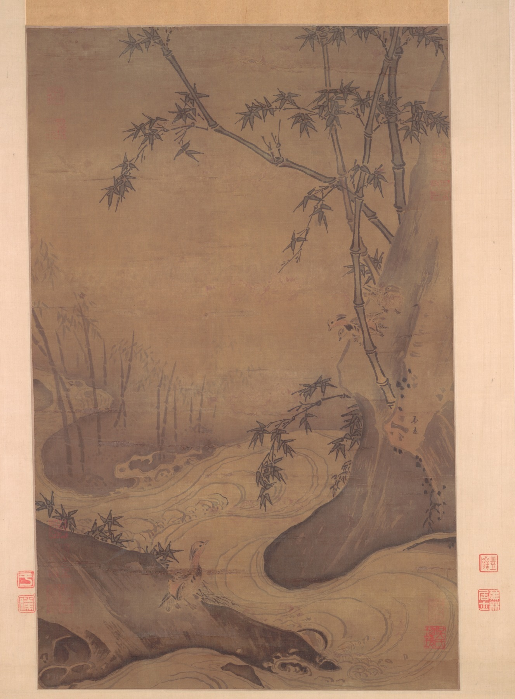

ア．中央に巨大な山をそびえさせ、左右に小さな峰々を従える―范寛
イ．中央に巨大な山をそびえさせ、左右に小さな峰々を従える―馬遠
ウ．岩や竹を主に右側や下部に配し、その間に広い余白を生かす―馬遠
エ．岩や竹を主に右側や下部に配し、その間に広い余白を生かす―范寛

### 問74

朝鮮半島の美術について、時代と作例の性格を適切に対応させた組合せはどれか。

ア．三国時代＝高句麗・新羅・百済の文化／高麗＝三国時代より前に青磁を完成させた王朝
イ．三国時代＝高句麗・新羅・百済の文化／高麗＝仏教美術や青磁の発達
ウ．三国時代＝高句麗・高麗・朝鮮の文化／高麗＝儒教を基盤とする王朝の成立
エ．三国時代＝高句麗・新羅・百済の文化／高麗＝白磁を代表とする朝鮮王朝の別名

## 大問24 工芸の制作と近代デザイン

工芸の特徴は装飾の見た目だけで決まらない。技法、工房と産業の関係、輸出や生活環境との結び付きにも注目し、制作と社会の関係を整理しなさい。

### 問75

初代宮川香山に対応する作例として、最も適切なものはどれか。

ア．《舟橋蒔絵硯箱》のように、古典文学の主題を金銀の意匠へと構成した漆工。
イ．《八橋蒔絵螺鈿硯箱》のように、橋や草花を蒔絵と螺鈿で表した漆工。
ウ．《褐釉蟹貼付台付鉢》のように、器面へ写実的な動植物の立体装飾を付けた陶磁器。
エ．《白釉黒流描大皿》のように、流し描きによる釉の模様を生かした日用の陶器。

### 問76

染織の技法を調べた二つの記録がある。A・Bに入る技法名の組合せとして最も適切なものはどれか。

| 記録 | 制作工程 |
| --- | --- |
| A | 文様を切り抜いた型紙を使い、同じ模様を繰り返す。 |
| B | 布へ輪郭線を手描きし、その線に沿って糊で防染してから文様へ彩色する。型紙による反復ではない。 |

ア．A＝友禅染／B＝型染
イ．A＝型染／B＝絞染
ウ．A＝型染／B＝友禅染
エ．A＝絞染／B＝友禅染

### 問77

1907年にミュンヘンで設立され、芸術家や建築家に加えて産業界の参加者も含み、工業生産に適したデザインを追究した組織はどれか。

ア．バウハウス
イ．ウィーン分離派
ウ．グラスゴー派
エ．ドイツ工作連盟

### 問78

1899年に制作された図のポスターについて、表現の特徴と版種の組合せとして、最も適切なのはどれか。

図1

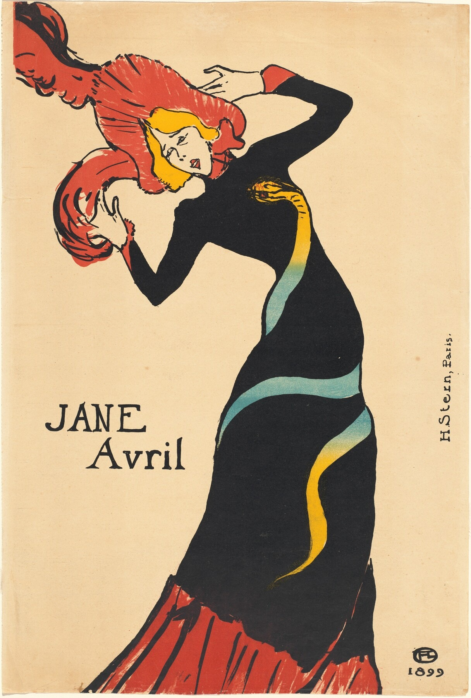

ア．写真の細かな階調を印刷し、その写真の上へ文字を重ねる―写真製版
イ．細かな交差する線で明暗を重ね、人物と文字を別々の枠に収める―銅版画
ウ．大きな色面と曲線で人物を簡潔に示し、文字と一つの画面を作る―リトグラフ
エ．大きな色面と曲線で人物を簡潔に示し、文字と一つの画面を作る―木版画

## 大問25 産業施設を転用した美術の場

### 問79

産業施設を美術の場へ転用した事例について、施設と以前の用途を正しく対応させた組合せはどれか。

ア．テート・モダン＝工場／ディア・ビーコン＝発電所
イ．テート・モダン＝発電所／ディア・ビーコン＝工場
ウ．テート・モダン＝発電所／ディア・ビーコン＝駅舎
エ．テート・モダン＝駅舎／ディア・ビーコン＝工場

## 大問26 日本の展覧会と公立美術館の歩み

### 問80

日本の美術展と美術館の歩みについて、A・Bの出来事を適切に結び付けた説明はどれか。

| 記号 | 記録 |
| --- | --- |
| A | 1888年、上野の列品館で開催された美術の展覧会。 |
| B | 1926年、上野に開館した公立美術館。 |

ア．Aは日本美術協会美術展覧会、Bは東京府美術館で、展覧会の開催と専用の場の成立という異なる出来事である。
イ．Aは東京府美術館、Bは日本美術協会美術展覧会で、美術館の開館が先に起きた。
ウ．Aは文部省美術展覧会、Bは日本美術協会の設立で、いずれも政府による同じ制度の開始である。
エ．Aは日本美術協会の設立、Bは東京ビエンナーレの開始で、いずれも戦後の国際展にあたる。

## 大問27 同じ主題の作品を比較する

### 問81

美術館の講座で、図A・Bの主題と背景を比較する。作品記録によると、Aは1470年頃のテンペラ／板、Bは1505年頃の油彩／板である。図の観察と記録に合う説明として、最も適切なのはどれか。

図A

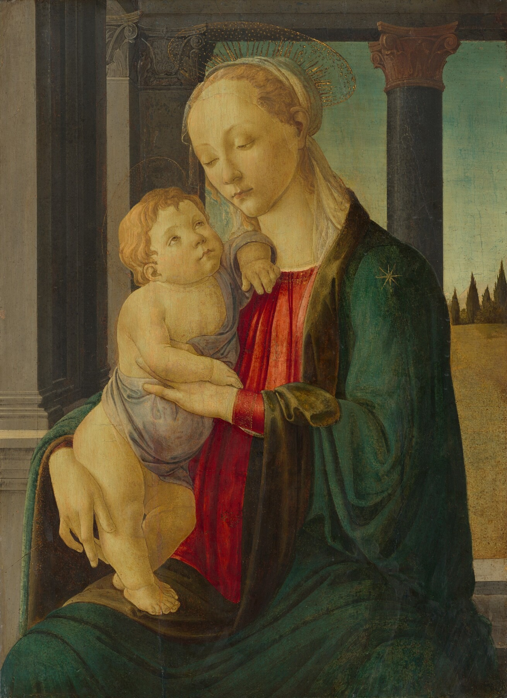

図B

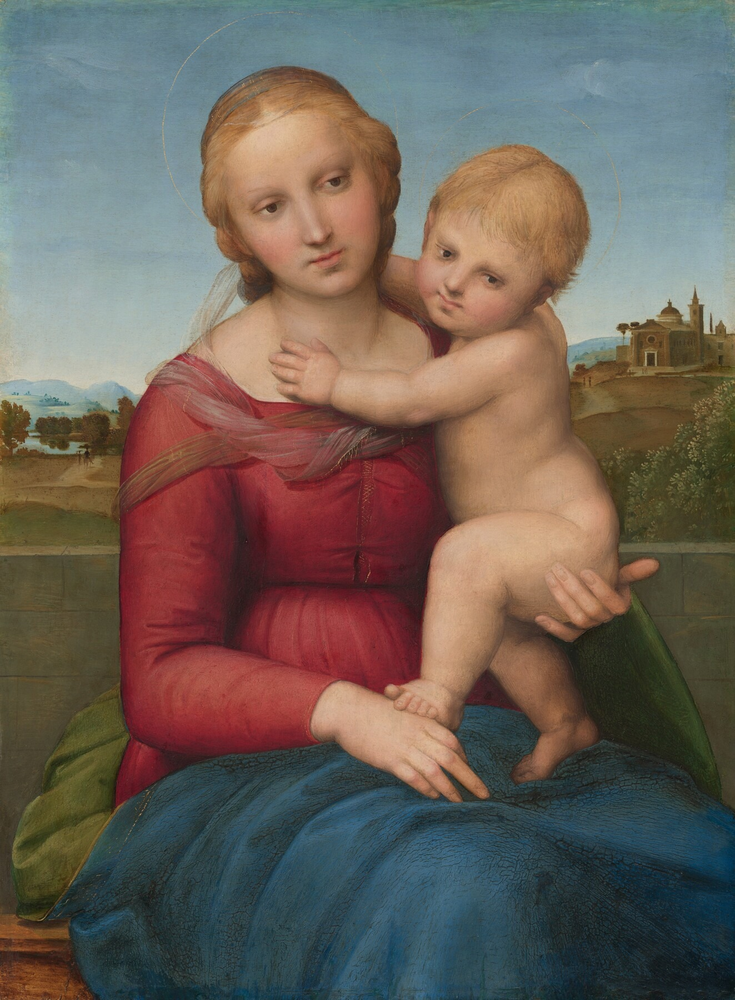

ア．両方とも光輪をもつ女性と幼子を主題とする。Aでは柱や梁が母子を囲み、Bでは背後に風景が広がる。主題と支持体は共通するが、画材と構成には違いがある。
イ．両方とも光輪をもつ女性と幼子を主題とする。Aでは母子の背後に建築がなく、Bでは大きな柱や梁が母子を囲む。主題と支持体は共通するが、構成には違いがある。
ウ．両方とも成人女性だけを描いた肖像画である。Aには柱や梁があり、Bには遠景があるが、二人の幼子は背景に置かれて主題には関わらない。
エ．両方とも光輪をもつ女性と幼子を主題とする。Aでは幼子が女性から離れ、Bでは母子が触れ合う。Aの支持体は紙、Bの支持体は板である。

## 大問28 連作にみる光と色彩を読み取る

### 問82

図A・Bは、同じ作者が同じ橋を描いた2点で、いずれも1904年の油彩画である。講座の説明として、2点の観察に最もよく合うのはどれか。

図A

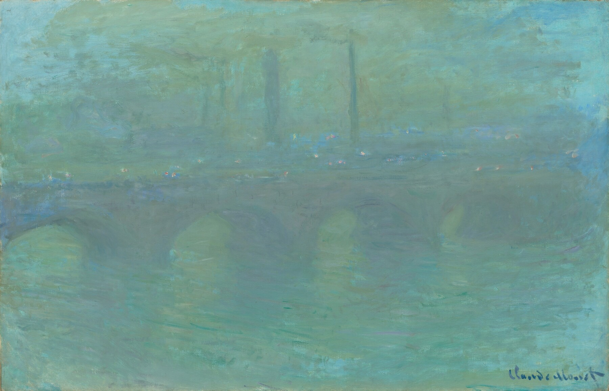

図B

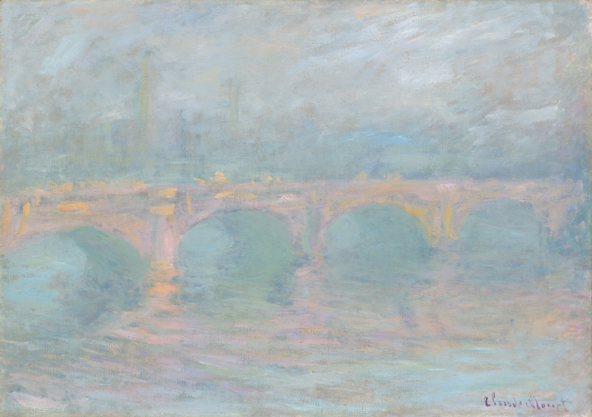

ア．Aでは青緑が画面を覆い、Bでは橋や水面に桃色や黄・橙色が加わる。Bでは橋のアーチをすべて消して水と空だけを残している。
イ．Aでは橋に桃色や橙色が目立ち、Bでは青緑が画面を覆う。同じ主題を繰り返し、光や大気による印象の違いを表そうとしている。
ウ．Aでは橋に桃色や橙色が目立ち、Bでは青緑が画面を覆う。Aでは橋を残し、Bでは橋をすべて取り去って別の場所の川を表している。
エ．Aでは青緑が画面を覆い、Bでは橋や水面に桃色や黄・橙色が加わる。橋の主題は共通するが、光や大気の印象の違いを色で表している。

## 大問29 画面の形と表装の記録を照合する

### 問83

図A・Bは同じ画家の作品で、描かれた部分を中心に示している。次の目録の記録と照合し、形式の組合せとして最も適切なものを選ぼう。
【目録】竹と岩を描く作品：二曲一隻、墨／紙。湖・島・橋を描く作品：掛幅、墨・淡彩／紙。後者は本紙が縦58×横133cm、表装全体が縦170.5×横140.3cm。

図A

図B

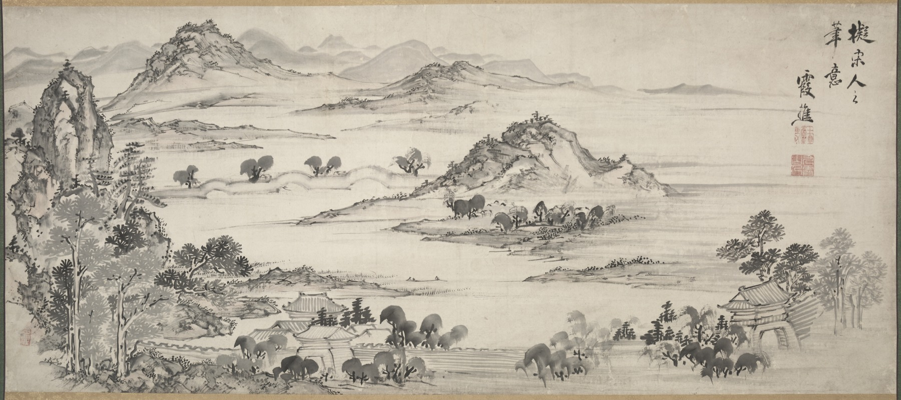

ア．A―二曲一隻の屏風、B―掛幅
イ．A―手巻の絵巻、B―掛幅
ウ．A―掛幅、B―二曲一隻の屏風
エ．A―二曲一隻の屏風、B―手巻の絵巻

## 大問30 構図の比較と影響関係の推論

### 問84

図A・Bの構図を比べた生徒が、「BはAを見て作られたのではないか」と考えた。目録ではAは1834〜35年、Bは1833年の作品である。図の観察と、この2点の制作年から述べられることの組合せとして、最も適切なのはどれか。

図A

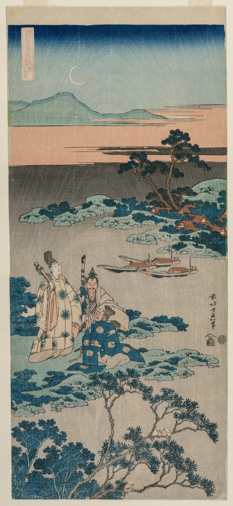

図B

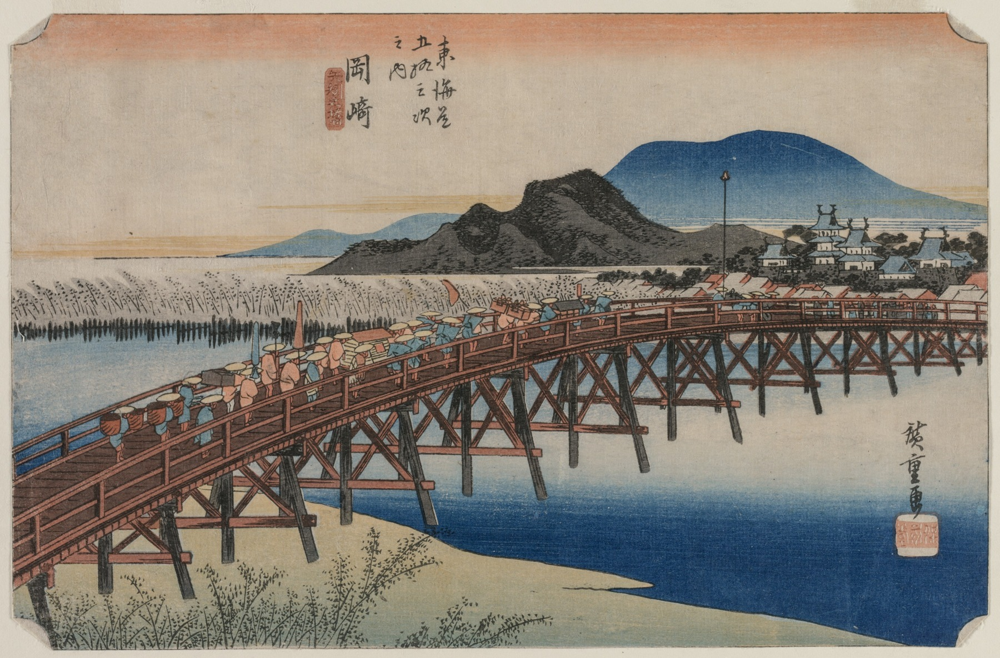

ア．Aは縦長の画面に月・人物・松を重ね、Bは横長の画面に橋を大きく斜めに通す。Bの方が早く、この2点だけでAからBへの影響は示せない。
イ．Aは横長の画面に橋を大きく斜めに通し、Bは縦長の画面に月・人物・松を重ねる。Aの方が早く、その構図がBへ伝わったと判断できる。
ウ．Aは横長の画面に橋を大きく斜めに通し、Bは縦長の画面に月・人物・松を重ねる。Bの方が早く、この2点だけでAからBへの影響は示せない。
エ．Aは縦長の画面に月・人物・松を重ね、Bは横長の画面に橋を大きく斜めに通す。Aの方が早く、その構図がBへ伝わったと判断できる。

## 大問31 人物の手元と暮らしの場面を読む

### 問85

美術館のワークショップで、図A・Bの人物が手にしているものと行為を比べる。記録によると、Aは1869年のキャンバスに描いた油彩画、Bは1798年頃の多色木版画である。図の観察に基づく説明として、最も適切なのはどれか。

図A

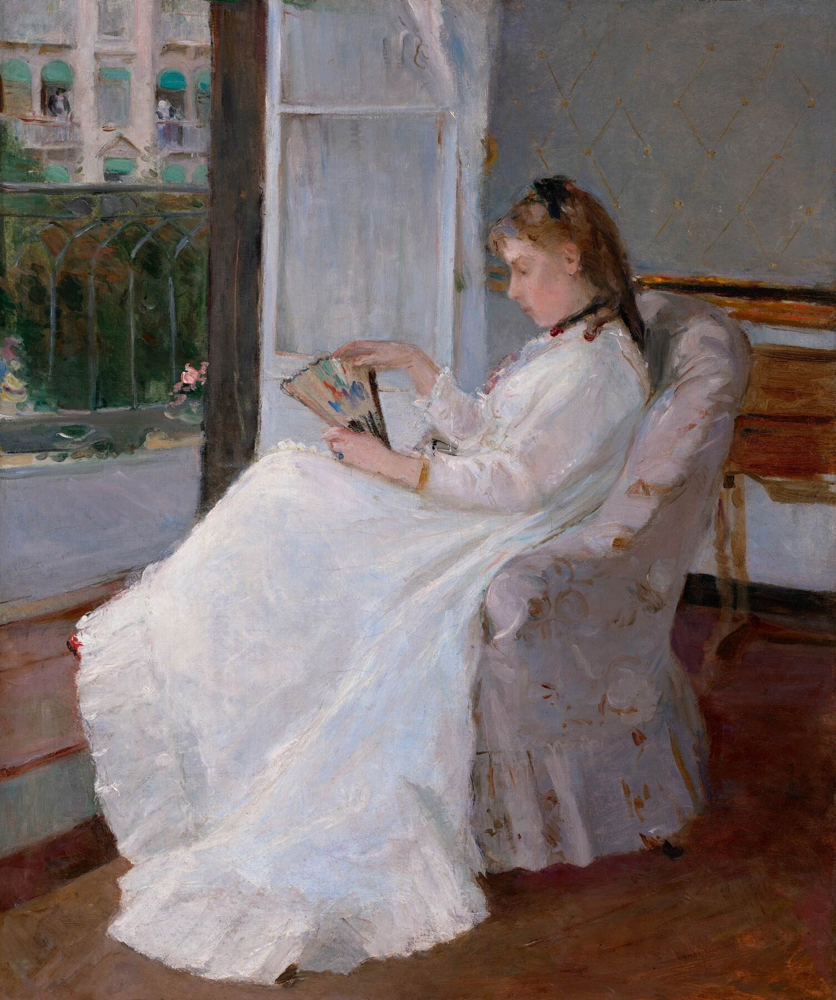

図B

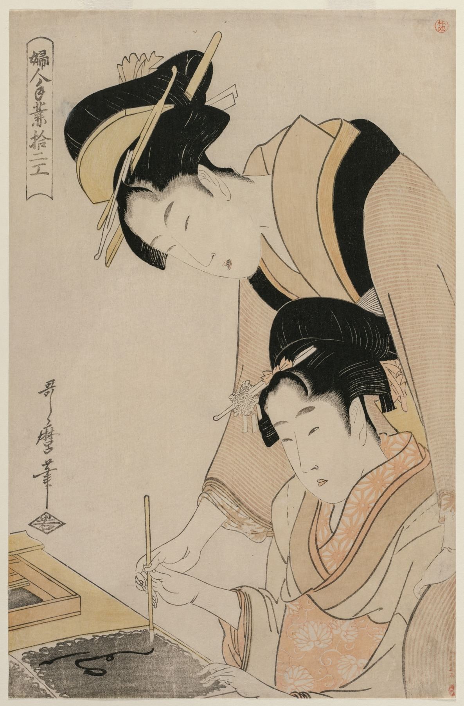

ア．Aの女性は絵のある扇を手にし、Bでは大人が子どもの針を持つ手を導いて縫物を教えている。道具は異なるが、どちらも室内の行為を描く。
イ．Aの女性は絵のある扇を手にし、Bでは大人が子どもの筆を持つ手を導いている。道具は異なるが、どちらも室内の身近な行為を描く。
ウ．Aの女性は本の頁をめくり、Bでは大人が子どもの針を持つ手を導いて縫物を教えている。どちらも読書や家事に集中する場面である。
エ．Aの女性は本の頁をめくり、Bでは大人が子どもの筆を持つ手を導いている。どちらも手元に目を向けた場面である。
