# 美術検定2級 模擬試験2（非公式）

全85問・4択・60分。美術史80問＋活用5問。図版はカラー表示・印刷を推奨。

## 大問1 古代と中世の造形・役割

作品や活動の記録を読み、時代、素材、主題、表現の方法を対応させて考えなさい。図版がある問いは、その画面も確かめなさい。

### 問1

古代文明の文字と美術の関係について、くさび形文字を用いた地域として適切なものを選びなさい。

ア．イタリア半島中部のエトルリア

イ．ナイル川流域のエジプト

ウ．エーゲ海のクレタ島

エ．ティグリス川・ユーフラテス川流域のメソポタミア

### 問2

ギリシア彫刻の三つの傾向を示す。A「強いねじれと劇的な感情」、B「正面性を残す身体とアルカイック・スマイル」、C「重心の移動と均衡のとれた身体」。各記述と様式の組合せとして、適切なものを選びなさい。

ア．A＝ヘレニズム、B＝アルカイック、C＝クラシック

イ．A＝クラシック、B＝アルカイック、C＝ヘレニズム

ウ．A＝ヘレニズム、B＝クラシック、C＝アルカイック

エ．A＝アルカイック、B＝ヘレニズム、C＝クラシック

### 問3

中世西ヨーロッパの教会で、厚い石壁と比較的小さな窓、半円アーチなどを特徴とする建築様式はどれか。

ア．ロマネスク

イ．初期キリスト教のバシリカ式

ウ．ビザンティン

エ．ゴシック

### 問4

図1の幼児と母親、その近くの人物の関係を説明したものはどれか。

図1

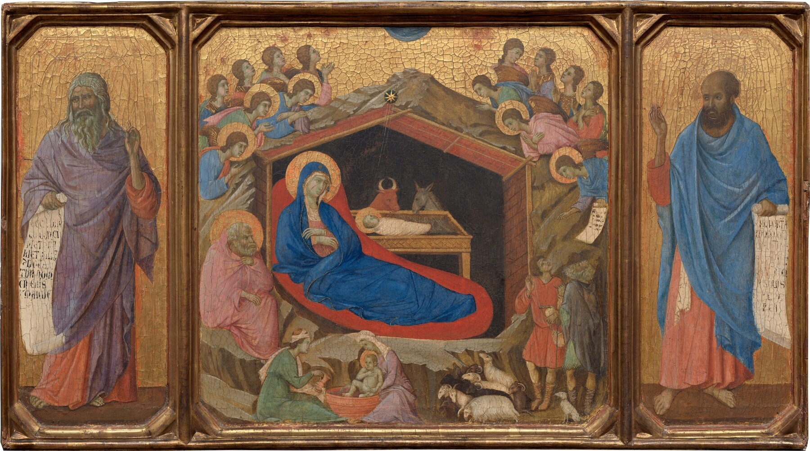

ア．幼児を祭壇の上へ差し出し、母親と祭司が向き合って儀礼を行う。

イ．幼児を母親の膝に立たせ、贈り物を持つ来訪者が周囲から礼拝する。

ウ．幼児を飼葉桶に寝かせ、横たわる母親と、誕生後の世話をする小さな人物を描く。

エ．幼児を抱く母親を高い玉座へ置き、前景の人物が礼拝する。

## 大問2 ルネサンスの素材と表現

作品や活動の記録を読み、時代、素材、主題、表現の方法を対応させて考えなさい。図版がある問いは、その画面も確かめなさい。

### 問5

初期ルネサンスが発展したフィレンツェについて、芸術を支えた都市の背景として適切な説明を選びなさい。

ア．商工業で蓄積された富が、富裕な家や都市の芸術支援へ結び付いた。

イ．教皇庁の恒常的な所在地として、教皇による大規模な造営が集中した。

ウ．公国の宮廷を中心に、君主の軍事的な権力と結びつく都市造営が進んだ。

エ．潟に築かれた海洋都市として、東方交易と海上支配で繁栄した。

### 問6

図1では、左の部屋の寝台と周囲の人物、右の入口で差し出される物が描かれる。場面の性格として最も適切なものを選びなさい。

図1

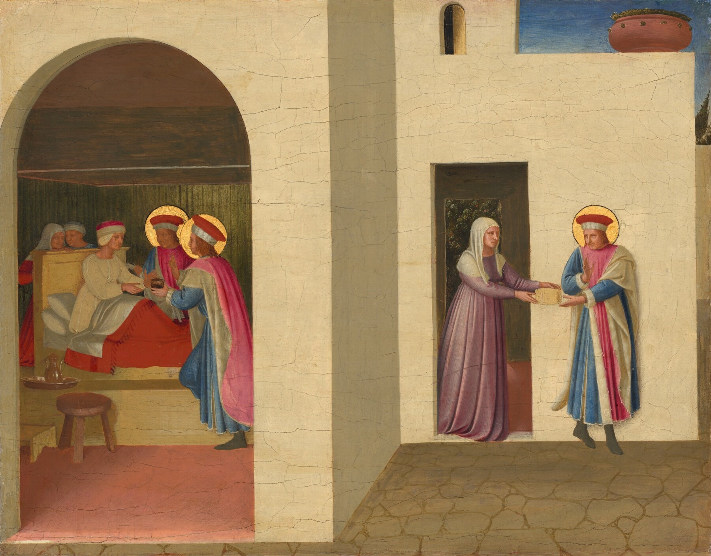

ア．亡くなった人を囲む遺族と、遺品を受け渡す場面

イ．病人を癒やした聖人たちと、癒やされた女性の感謝を表す場面

ウ．幼子の誕生を祝う家族と、洗礼に用いる品を用意する場面

エ．旅人を宿へ迎える家族と、出発に際して荷物を託す場面

### 問7

図1の主題と場面の組立てを、背後の建築の意味も含めて説明したものはどれか。

図1

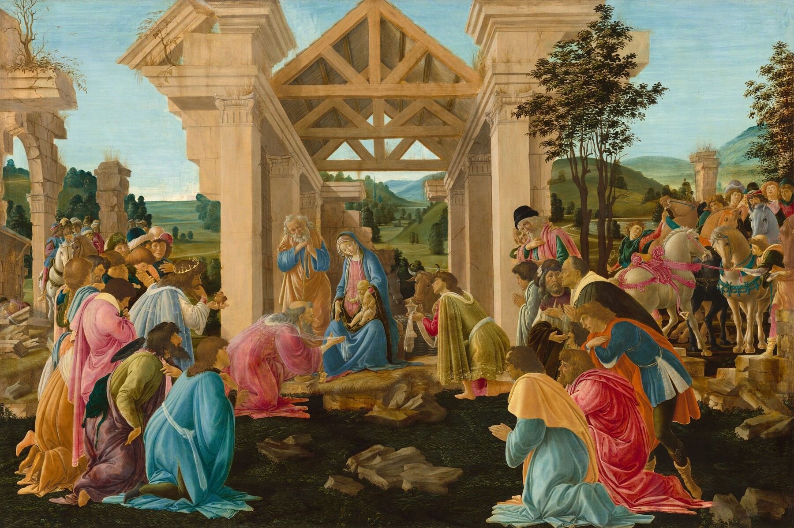

ア．博士たちが幼児を礼拝する姿を現役の神殿に置き、当時の異教儀礼を記録する。

イ．幼児を祝福する聖家族を現役の神殿に置き、建築の正面に沿って同じ姿勢の人物を並べる。

ウ．幼児を神殿へ捧げる儀礼を古代の廃墟に置き、祭司が幼児を受け取る動作を中心にする。

エ．博士たちが幼児を礼拝する姿を古代の廃墟に置き、キリスト教と古代の世界との関係を示す。

### 問8

図1で中心の女性と関係付けられている物や人物の組合せはどれか。主題を読むため、女性の顔の近くに注目しなさい。

図1

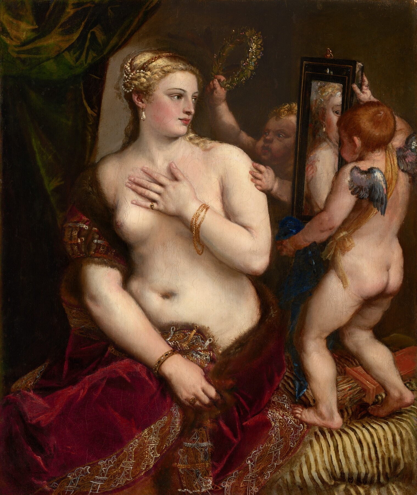

ア．弓と鹿――狩猟を司るディアナの図像

イ．鏡と翼のある幼児――美や愛をめぐるヴィーナスの図像

ウ．兜と盾――知恵や戦いを司るミネルヴァの図像

エ．麦の穂と鎌――豊穣を司るケレスの図像

## 大問3 16世紀の技法と活動

作品や活動の記録を読み、時代、素材、主題、表現の方法を対応させて考えなさい。図版がある問いは、その画面も確かめなさい。

### 問9

図1の人物と室内の関係に、最もよく合う説明はどれか。

図1

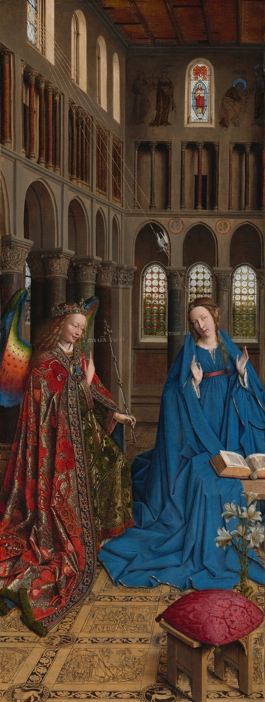

ア．床や窓、衣服の細部を描き分け、聖なる出来事を具体的な教会の内部に置く。

イ．床と窓の奥行きを整える一方、人物の衣服や手は室内と異なる単純な輪郭にまとめる。

ウ．床や窓、衣服を同じ明るさでつなぎ、光が物の表面を分ける効果を抑える。

エ．人物の衣服は細かく描くが、床と窓は奥行きを作らず装飾の帯として並ぶ。

### 問10

ルネサンスの工房と学習の系譜を整理する。レオナルド・ダ・ヴィンチやペルジーノが修業した工房の親方と、後にペルジーノに学んだ画家の組合せとして、適切なものを選びなさい。

ア．親方＝ギルランダイオ、後の画家＝ティツィアーノ

イ．親方＝ギルランダイオ、後の画家＝ラファエロ

ウ．親方＝ヴェロッキオ、後の画家＝ラファエロ

エ．親方＝ヴェロッキオ、後の画家＝ティツィアーノ

## 大問4 17世紀の主題と制作

作品や活動の記録を読み、時代、素材、主題、表現の方法を対応させて考えなさい。図版がある問いは、その画面も確かめなさい。

### 問11

図1の人物と周囲の動物は、旧約聖書のどの主題を読む手掛かりになるか。

図1

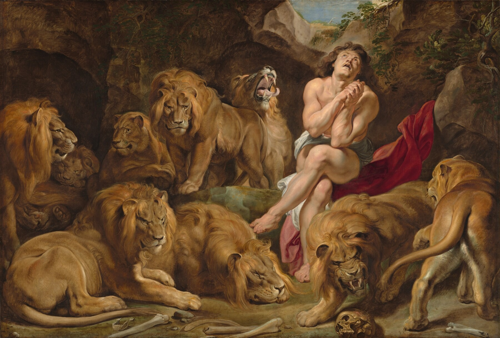

ア．洪水に備え、動物を箱舟へ導いたノア

イ．獅子の口を裂いて力を示したサムソン

ウ．魚に呑まれたのち、陸へ戻されたヨナ

エ．ライオンの穴に投げ込まれ、神の加護で救われたダニエル

### 問12

図1の顔と衣服・背景を比べ、絵具の表面が表情へ与える効果を選びなさい。

図1

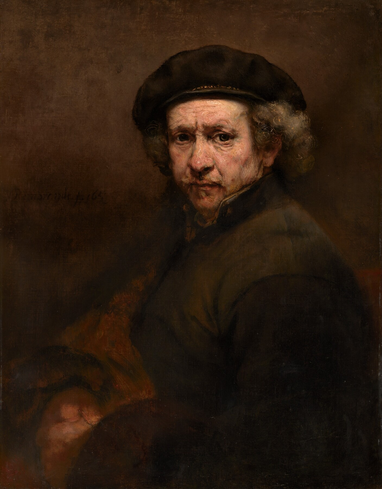

ア．顔と衣服に同じ細い輪郭線を重ね、明暗より線の均一な流れによって表情を整える。

イ．顔の絵具を滑らかに均し、衣服と背景に残した強い起伏へ視線を移す。

ウ．顔と背景の明るさを近づけ、衣服の光沢を顔よりも強い焦点にする。

エ．顔に残る絵具の起伏や筆跡を、暗くなじむ衣服・背景と対照させて表情を際立たせる。

### 問13

図1の背後の絵は《最後の審判》とされる。女性が手に持つ物とこの絵中画を結び付ける解釈として、最も適切なものを選びなさい。

図1

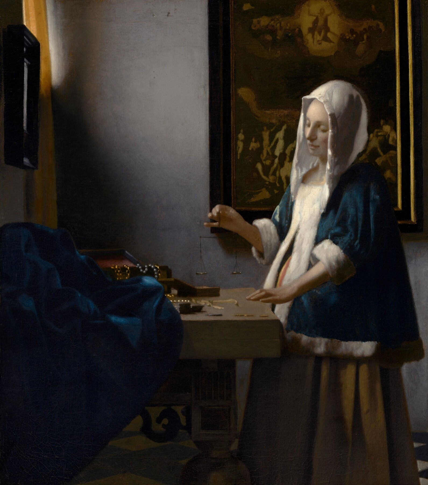

ア．手鏡へ自分を映す行為を、審判へ向けて自分を省みることに重ねる。

イ．祈祷書を読む行為を、信仰を通して救済を願うことに重ねる。

ウ．手の天秤で量る行為を、自分の行いを省みて判断することに重ねる。

エ．手の髑髏を見つめる行為を、死後の審判への備えに重ねる。

### 問14

対抗宗教改革期のカトリック美術に、劇的な光や身ぶり、見る者へ迫る構成が用いられた背景として適切な説明を選びなさい。

ア．市民市場の需要に応え、暮らしの器物や仕事を独立した主題へ広げた。

イ．宮廷の親密な室内に、神話の遊戯や優雅な娯楽を装飾的に描いた。

ウ．宮殿と庭園を大きな秩序へ統合し、絶対王政の世俗的な権威を示した。

エ．聖書や聖人の物語を感覚に訴え、信仰を喚起する役割が求められた。

## 大問5 18世紀の社会と表現

作品や活動の記録を読み、時代、素材、主題、表現の方法を対応させて考えなさい。図版がある問いは、その画面も確かめなさい。

### 問15

図1で少年が作っている物と、その物がヨーロッパ美術で担うことのある意味の組合せはどれか。

図1

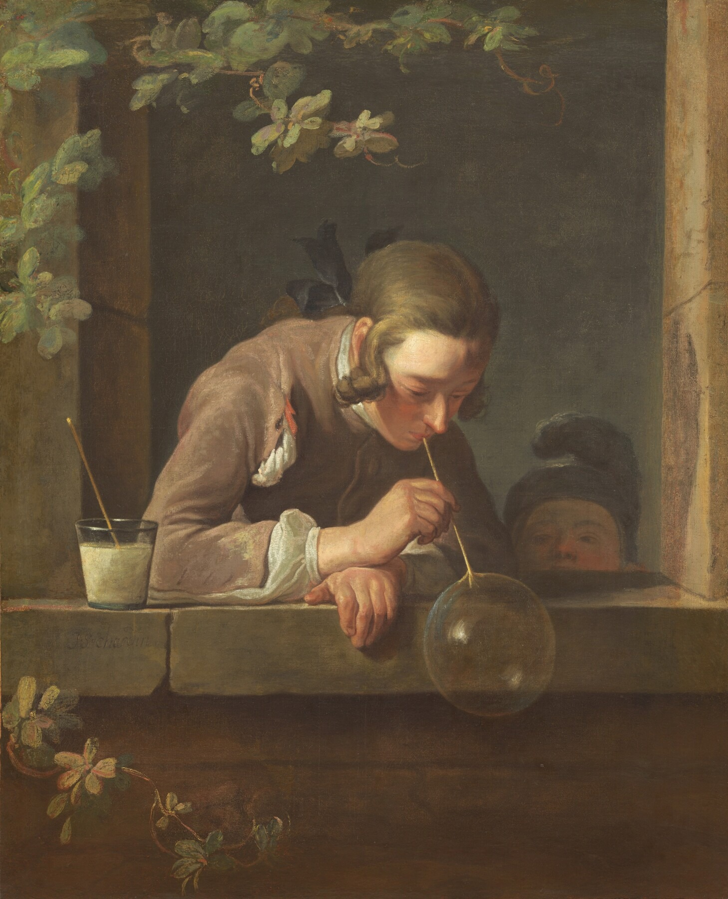

ア．オリーブの枝――平和

イ．月桂冠――勝利や名誉

ウ．シャボン玉――命や幸福のはかなさ

エ．錨――希望や揺るぎなさ

### 問16

図1の身体・視線・本の関係がつくる状態はどれか。

図1

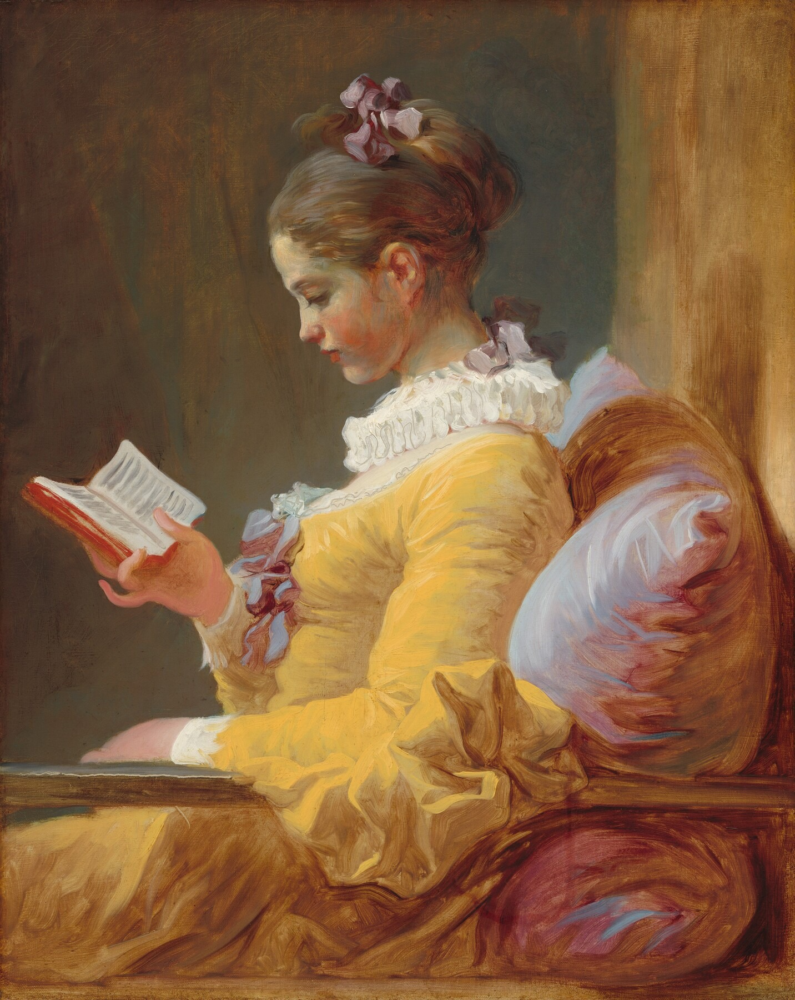

ア．本に視線を向けながら、上体を後ろへひねって立ち上がろうとする。

イ．視線を本へ落とし、身体をまとめた姿で読書へ注意を向ける。

ウ．本を胸へ閉じ、顔をこちらへ返して読書を中断する。

エ．視線を本から外し、開いた本を手前の鑑賞者へ見せようとする。

### 問17

18世紀のイギリスで王立美術アカデミーの初代院長となり、肖像画でも知られる画家は誰か。

ア．ウィリアム・ホガース

イ．ジョシュア・レノルズ

ウ．トマス・ゲインズバラ

エ．ジョゼフ・ライト

## 大問6 19世紀前半の美術

作品や活動の記録を読み、時代、素材、主題、表現の方法を対応させて考えなさい。図版がある問いは、その画面も確かめなさい。

### 問18

新古典主義の歴史画が、古代の物語を通じて表そうとした理念として最も適切なものを選びなさい。

ア．人体と衣装を正確に描く技術の修練を、物語の倫理的な内容に優先する姿勢

イ．理性や節度、市民的な徳や義務

ウ．神話的な遊戯と宮廷の優雅な快楽

エ．個人の悪夢や説明しがたい不安

### 問19

図1で、時計、短くなったろうそく、机上の書類は、人物をどのように見せるために組み合わされているか。

図1

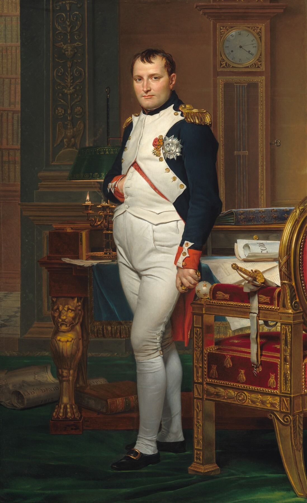

ア．天体の位置を計算して観測を続ける、自然科学の研究者

イ．夜を徹して立法や執務にあたる、勤勉な統治者

ウ．帳簿と商品見本を確かめながら取引する、都市の商人

エ．収集した古典作品を比べながら鑑定する、美術の愛好家

### 問20

図1の空と水面の色、建物や舟の輪郭の関係はどれか。

図1

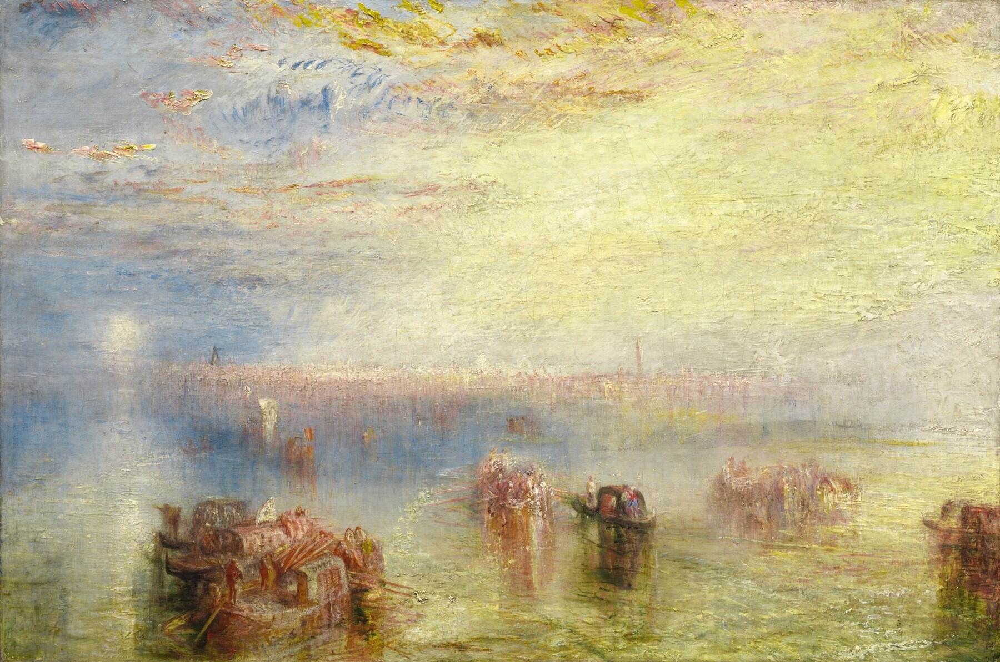

ア．空の黄を水面から分け、水には建物の輪郭を硬い同形の反映として重ねる。

イ．空の黄や淡い紫が水面へも広がり、建物や舟の輪郭を柔らかな色の中へつなぐ。

ウ．空の光を建物へ集中させ、水面を光の影響を受けない暗い帯として区切る。

エ．空と水面の青を一続きにし、建物と舟を明瞭な黒い外縁でその上へ置く。

### 問21

19世紀の歴史主義的な建築について、過去の様式と近代社会の用途の関係を説明したものはどれか。

ア．柱と梁で支える構造を生かし、装飾より機能に基づく普遍的な形式を追求する。

イ．植物に似た曲線を構造や内装へ広げ、建物全体を一つの有機的な造形にする。

ウ．鉄とガラスの構造を生かし、部材の規格化で大空間を効率よく建設する。

エ．駅や議事堂などの新しい用途に、ゴシックなど過去の様式を選び直して用いる。

## 大問7 近代の都市と鑑賞

作品や活動の記録を読み、時代、素材、主題、表現の方法を対応させて考えなさい。図版がある問いは、その画面も確かめなさい。

### 問22

図1の二人の注意は、紙や周囲の道具とどう結びつくか。

図1

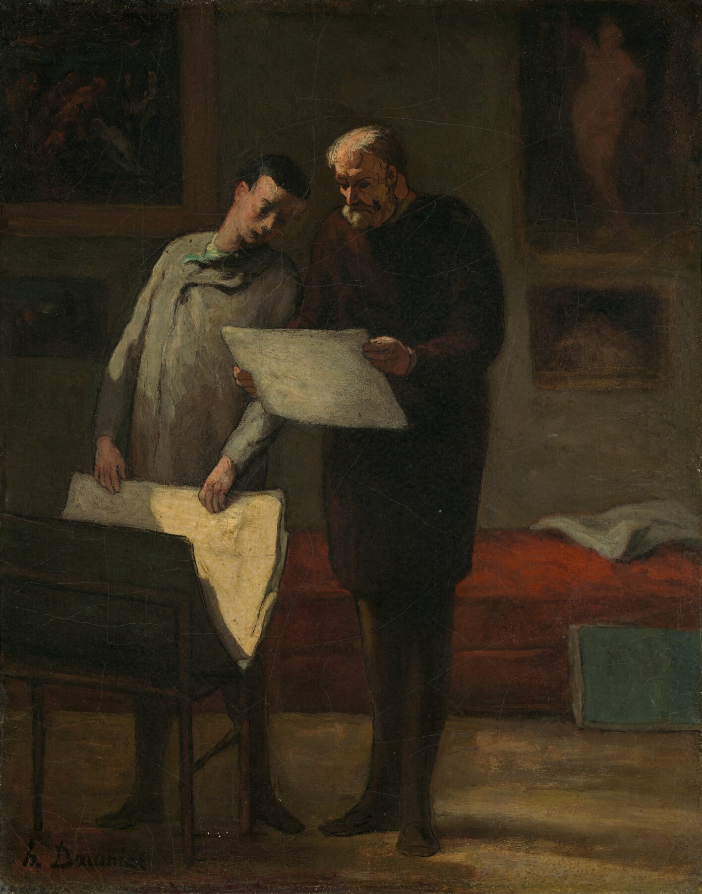

ア．若者が持つ紙を年長の人物へ示し、年長の人物は背後の絵へ目を移す。

イ．年長の人物が持つ紙へ二人の視線が向かい、手前の画材とともに作品を検討する場をつくる。

ウ．年長の人物が持つ紙を二人が別々に見せ合い、背後の絵と同じ高さへ掲げる。

エ．年長の人物が持つ紙を若者へ返し、若者は視線を外して制作を再開する。

### 問23

図1の舞台を見る位置を、手前の踊り手・背景・画面の端から説明したものはどれか。

図1

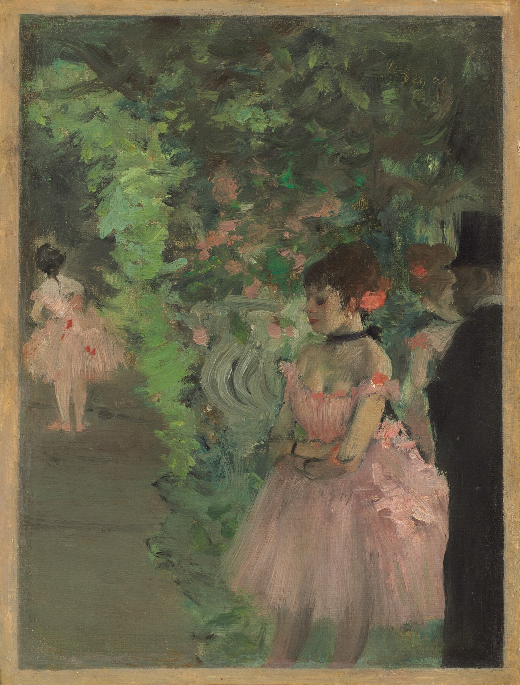

ア．舞台の側方に近い位置から、袖にいる踊り手と舞台の奥を重ねて捉える。

イ．客席の正面から、舞台上の踊り手を左右対称の一列として捉える。

ウ．舞台袖の床に近い視点から、踊り手の全身を重ならない間隔で見上げる。

エ．舞台の中央から客席へ向かい、観客の反応を画面の中心に捉える。

### 問24

図1の頭部・腕・脚の関係を正確に述べたものはどれか。

図1

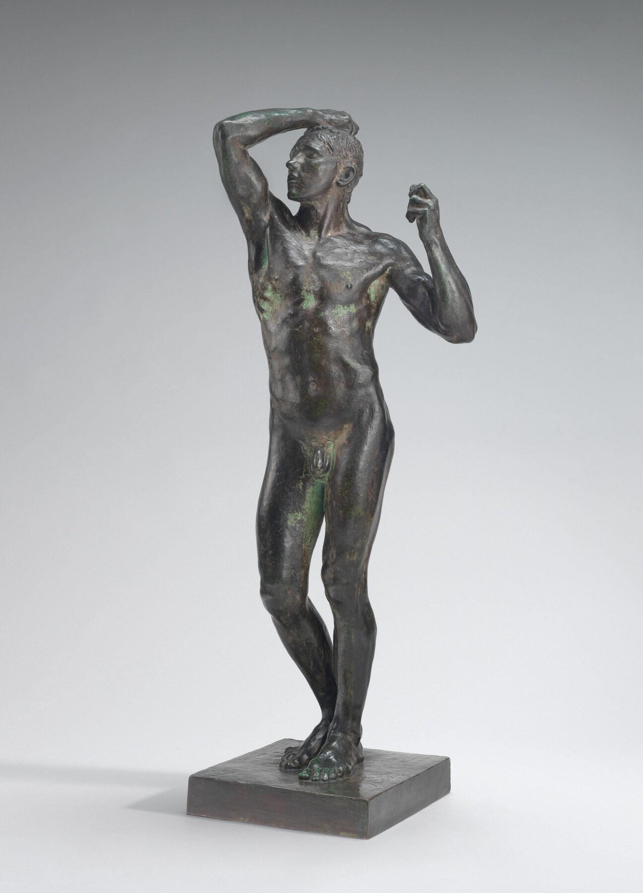

ア．頭を傾け、片手を胸に添えたまま、膝を曲げて身体を低く沈める立像である。

イ．頭部と両腕を欠き、前後に開いた脚と胴体だけで歩行を表す立像である。

ウ．頭部と四肢がそろい、片腕を頭へ上げ、左右の脚に異なる緊張を持たせた立像である。

エ．両腕を水平に伸ばし、左右の脚をそろえて正面性を強めた立像である。

## 大問8 世紀末の多様な制作

作品や活動の記録を読み、時代、素材、主題、表現の方法を対応させて考えなさい。図版がある問いは、その画面も確かめなさい。

### 問25

19世紀半ばのイギリスで結成されたラファエル前派について、既存の美術教育との関係と、描く主題への関心を適切に組み合わせたものを選びなさい。

ア．アカデミーの定型へ反発――近代都市の一瞬の光と余暇の主題

イ．アカデミーの定型を理想とする――近代都市の一瞬の光と余暇の主題

ウ．アカデミーの定型へ反発――自然の細密な観察と中世・文学の主題

エ．アカデミーの定型を理想とする――自然の細密な観察と中世・文学の主題

### 問26

図1の海や岸の色を近くで見て、その置き方を説明したものはどれか。

図1

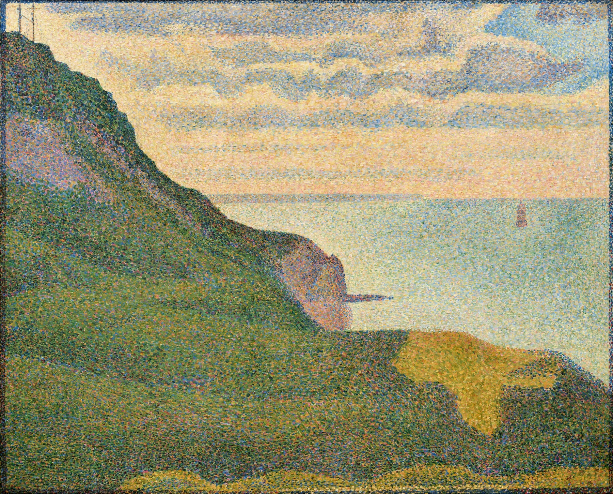

ア．絵具を画面で十分に混ぜ、筆跡を均して滑らかな連続する明暗へつなぐ。

イ．輪郭で囲んだ広い色面を平らに塗り、面の内側で色をほぼ変えずにまとめる。

ウ．小さな色点を分けて置き、並んだ色が離れて見ると混ざる効果を用いる。

エ．長く曲がる筆跡を重ね、海や岸を一方向へ流れる色の帯として組み立てる。

### 問27

アール・ヌーヴォーと同時代の建築家ガウディについて、活動地域と造形の傾向を述べた説明はどれか。

ア．スペインで活動し、植物などを思わせる有機的な形を独自の建築へ展開した。

イ．ウィーンで活動し、分離派の展示館を幾何学的な形にまとめた。

ウ．シカゴで活動し、高層建築の構造と用途に応じた外観を追求した。

エ．ブリュッセルで活動し、鉄やガラスによる曲線的な住宅空間をつくった。

## 大問9 20世紀初頭の変化

作品や活動の記録を読み、時代、素材、主題、表現の方法を対応させて考えなさい。図版がある問いは、その画面も確かめなさい。

### 問28

1905年、パリでフォーヴィスムという呼称が生まれる契機となった展覧会はどれか。

ア．サロン・ド・ラ・ローズ・クロワ

イ．サロン・ドートンヌ

ウ．フランス芸術家協会のサロン

エ．サロン・デ・ザンデパンダン

### 問29

分析的キュビスムの画面の組立てを説明したものとして、最も適切なものを選びなさい。

ア．対象の動きを連続する形として重ね、速度や時間の経過を強調する。

イ．色の小点を規則的に並べ、離れて見ると光学的に混ざるようにする。

ウ．対象を小さな面へ分解し、異なる方向から見た形を一つの画面に組み込む。

エ．対象の輪郭を保ち、瞬間の光による色の変化を細かな筆触で捉える。

### 問30

カンディンスキーが音楽を手掛かりに考えた、絵画の色・形と対象の関係はどれか。

ア．色や形を楽器の配置へ対応させ、音源の位置を目に見える図として記録する。

イ．色や形の効果を物の固有色へ戻し、見慣れた対象を正確に区別しやすくする。

ウ．色や形の響き合いが、具体的な対象の再現を離れて感情へ働きかける。

エ．色や形を旋律の記号へ置き換え、作品ごとに同じ音を再現する規則を固定する。

### 問31

モンドリアンの新造形主義で、線と色面が均衡をつくる方法はどれか。

ア．水平・垂直の線と三原色を、左右同じ大きさの色面の対称形へそろえる。

イ．水平・垂直の線は保ちながら、自然の固有色の変化を細かく写して量感を整える。

ウ．三原色と白・黒は保ちながら、線を中心から放射させて回転する均衡をつくる。

エ．水平・垂直の線と三原色、白・黒の関係を、非対称の配置のなかで調整する。

## 大問10 制作と教育の試み

作品や活動の記録を読み、時代、素材、主題、表現の方法を対応させて考えなさい。図版がある問いは、その画面も確かめなさい。

### 問32

戦時下のダダの発祥地と、詩の朗読や即興的な催しを行った拠点の組合せはどれか。

ア．チューリヒ――ギャラリー・ダダ

イ．パリ―キャバレー・ヴォルテール

ウ．チューリヒ―キャバレー・ヴォルテール

エ．ミュンヘン―キャバレー・ヴォルテール

### 問33

ヘンリー・ムーアの横たわる人体と自然の形の関係を説明したものはどれか。

ア．骨や貝、風景を思わせる形を人体へ結びつけ、有機的な量塊として表す。

イ．人体の各部を解剖学的な比率へ戻し、自然物に似る形を人物の表面の細部へ移す。

ウ．骨や貝の表面を人体から分離し、自然物を分類して並べる標本として表す。

エ．人体を単一の卵形へ閉じ、横たわる姿勢の手脚の関係を薄めて純化する。

### 問34

柱と梁の架構で主要な荷重を受ける展示棟で、柱梁を残し、展示室の内壁を移して窓を広げる改修を考える。計画の可否を判断する構造上の説明として最も適切なものはどれか。

ア．内壁・外壁が主要な荷重を負わないかを確かめ、架構を維持する条件で壁と開口の自由を考える。

イ．架構を残せば荷重は壁へ移るため、内壁を連続させて窓を小さくする条件で自由を考える。

ウ．内壁を移す自由と外壁の開口を分け、柱梁架構であっても窓の上の荷重は外壁に集まると考える。

エ．窓を広げる部分の柱を減らし、その分を仕切壁の厚みで補うことを架構の維持と考える。

## 大問11 戦後美術の展開

作品や活動の記録を読み、時代、素材、主題、表現の方法を対応させて考えなさい。図版がある問いは、その画面も確かめなさい。

### 問35

デュビュッフェが重視したアール・ブリュットについて、適切な説明を選びなさい。

ア．広告や漫画など大衆文化のイメージを、絵画や立体へ取り込む考え方

イ．工業製品に近い単純な形を反復し、配置された空間との関係を問う考え方

ウ．幾何学模様を規則的に配置し、視覚的な錯覚を生み出す考え方

エ．職業的な美術教育や美術界の規範の外で生まれた表現を評価する考え方

### 問36

抽象表現主義のなかでデ・クーニングが展開した絵画を説明したものを選びなさい。

ア．画面を大きな色面で静かに区切り、輪郭のない矩形を重ねた。

イ．人物の形を幾何学的な面へ分け、身振りより規則的な構成の反復を中心にする。

ウ．定規で引いた縞に合わせ、キャンヴァスの外形を変形させた。

エ．激しい筆触や崩された形のなかに、女性などの人物像を残した。

### 問37

ラウシェンバーグの「コンバイン」が、従来の絵画と彫刻の関係を広げた方法として適切なものを選びなさい。

ア．絵画の面と日用品などの実物を結び付け、平面と立体を交差させた。

イ．既製品を選び直して題を与え、その形を変えずに作品として提示した。

ウ．廃車などを圧縮し、工業製品を密集した一つの量塊へ変えた。

エ．写真や印刷物の切抜きを貼り込み、二次元の画面を組み立てた。

### 問38

フレイヴィンの蛍光灯による作品で、工業製品と展示空間の関係はどのように変わるか。

ア．照明の管を顔料で覆い、光よりも表面の手仕事の痕跡で周囲との関係をつくる。

イ．照明の管の輪郭を壁へ写し、消灯した形と同じ境界を色の広がりの基準にする。

ウ．照明の光を展示物の表面へ集め、装置を見えない裏方として作品から分離する。

エ．既製の照明の光が壁や周囲にも及び、装置の配置と光の広がりを一緒に作品へ含める。

## 大問12 作品と鑑賞の関係

作品や活動の記録を読み、時代、素材、主題、表現の方法を対応させて考えなさい。図版がある問いは、その画面も確かめなさい。

### 問39

ドナルド・ジャッドのミニマル・アートに対応する説明を選びなさい。

ア．広告の人物を切り抜き、夢のような不意の組合せをつくる。

イ．工業的に制作された単位を反復し、配置と空間の関係を重視する。

ウ．筆の動きで感情を強く表し、絵具の痕跡に作家の身体を刻む。

エ．街頭の行為を一度の出来事として行い、観客との応答を中心にする。

### 問40

マチューナスらのフルクサスで、イベントと出版物・マルティプルの関係を説明したものはどれか。

ア．イベントの指示を収集家向けの一品へ仕上げ、複製品はその指示から独立した別系列とする。

イ．出版物をイベントの上演記録へ統一し、記録以外の小品をイベントの周辺へ分ける。

ウ．出来事の実行と小出版物や複製品の流通を結び、芸術の領域や接し方を広げる。

エ．イベントで完結した作品を出版では原寸に復元し、流通品をその完成形の代用品とする。

### 問41

ルウィットのウォール・ドローイング第289番を、前回とは寸法の異なる壁に、別の担当者が描くことになった。計画には格子、線の始点、本数が記されているが、各線の具体的な長さと終点となる格子点の配置は記されていない。この再展示で、作品の作者と実行者の判断をどのように扱うのが適切か。

ア．ルウィットを作者とし、定められた線の本数を守りながら、始点と終点の配置を実行者が新しい壁に合わせて組み直す。始点の変更も計画の実行に含める。

イ．ルウィットを作者とし、未指定の長さや終点は前回の完成写真を規準とする。計画が同じでも、見かけの配置が変われば別作品として扱う。

ウ．ルウィットを作者とし、定められた始点と本数を守りながら、未指定の長さや終点を実行者が判断する。前回と見かけが違っても同じ計画の実行となり得る。

エ．未指定の長さや終点を決めた担当者を、新たな構想上の作者とする。ルウィットの計画を参照していても、担当者の判断を含む制作は担当者の新作として扱う。

## 大問13 古代日本の素材と形

日本の作品と美術の活動を取り上げる。作品の形や材料、制作と受容の記録を、問われた事項へ対応させて考えなさい。

### 問42

縄文時代の火焔型土器に見られる、口縁の立体的な突起を作る方法として、最も適切なのはどれか。

ア．厚く作った口縁を薄く削り、平滑な曲面に整える。

イ．細い棒で器面に線を刻み、平たい口縁に文様を作る。

ウ．粘土を型に押し当て、浅い凹凸を器面全体へ写し取る。

エ．粘土の紐や塊を器に貼り付け、突起を立体的に作る。

### 問43

主題の記録と作品の組合せとして正しいものはどれか。A：飢えた虎に身を与える釈迦の前世の物語。B：金堂の壁面に表された諸仏の浄土。

ア．A：天寿国繡帳／B：高松塚古墳壁画

イ．A：天寿国繡帳／B：法隆寺金堂壁画

ウ．A：玉虫厨子／B：高松塚古墳壁画

エ．A：玉虫厨子／B：法隆寺金堂壁画

### 問44

仏像の頭部と体幹の主要部を、一本の木から彫り出す造り方はどれか。

ア．脱活乾漆造

イ．寄木造

ウ．一木造

エ．木心乾漆造

## 大問14 信仰と物語の造形

日本の作品と美術の活動を取り上げる。作品の形や材料、制作と受容の記録を、問われた事項へ対応させて考えなさい。

### 問45

図1の脚の組み方と手の位置を説明したものとして、最も適切なのはどれか。

図1

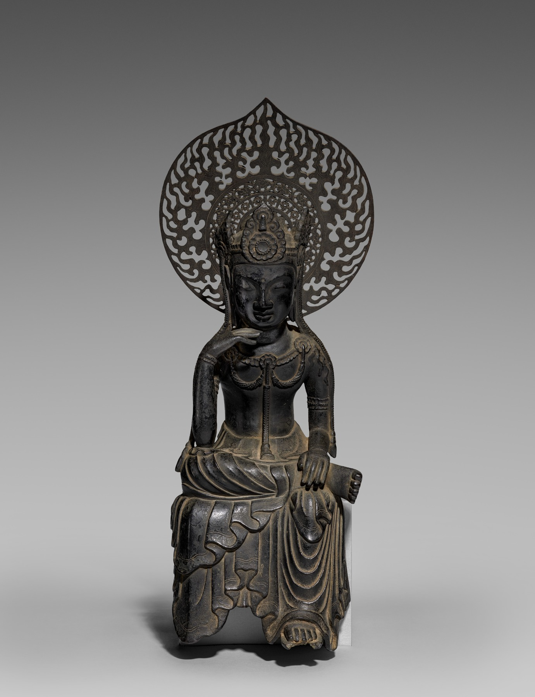

ア．結跏趺坐像：両足を組み、左右の足裏を上へ向ける。

イ．半跏思惟像：一方の足を他方の膝にのせ、手を顔へ寄せる。

ウ．倚像：両足をそろえて下ろし、椅子に腰かける。

エ．交脚像：両足首を交差させ、下へ垂らす。

### 問46

平安期の物語絵巻にみられる「引目鉤鼻」と、その表現の読み方の組合せとして適切なものはどれか。

ア．目鼻をにじむ墨で示す／濃淡の重なりから人物の立体感を読む

イ．目鼻の凹凸を細かな陰影で示す／顔貌を個人ごとに描き分ける

ウ．目鼻を細い線で簡略に示す／顔だけでなく姿勢・衣装や場面の関係から情趣を読む

エ．顔を描かず衣装だけを示す／登場人物の名を詞書の位置だけで判別する

### 問47

記録A・Bに合う絵巻の組合せはどれか。
A：兎や蛙などを、動きのある墨線で人のように描く。
B：鉢に乗って倉が飛ぶ場面など、命蓮をめぐる霊験を画面の連続で伝える。

ア．A：餓鬼草紙／B：華厳宗祖師絵伝

イ．A：鳥獣人物戯画甲巻／B：信貴山縁起絵巻

ウ．A：地獄草紙／B：信貴山縁起絵巻

エ．A：鳥獣人物戯画甲巻／B：一遍聖絵

## 大問15 中世から近世への表現

日本の作品と美術の活動を取り上げる。作品の形や材料、制作と受容の記録を、問われた事項へ対応させて考えなさい。

### 問48

鎌倉時代に中国から伝わった建築の特徴について、禅宗様の窓と大仏様の構造を正しく対応させたものはどれか。

ア．禅宗様―上下に開閉する蔀戸を特色とする／大仏様―柱の表面に取り付ける長押だけを主体とする構造

イ．禅宗様―上下に開閉する蔀戸を特色とする／大仏様―柱を水平に貫く貫を用いた構造

ウ．禅宗様―花頭窓／大仏様―柱を水平に貫く貫を用いた構造

エ．禅宗様―花頭窓／大仏様―柱の表面に取り付ける長押だけを主体とする構造

### 問49

図の像について、両手の持物と、それに結び付く意味の説明がともに適切なものはどれか。

図

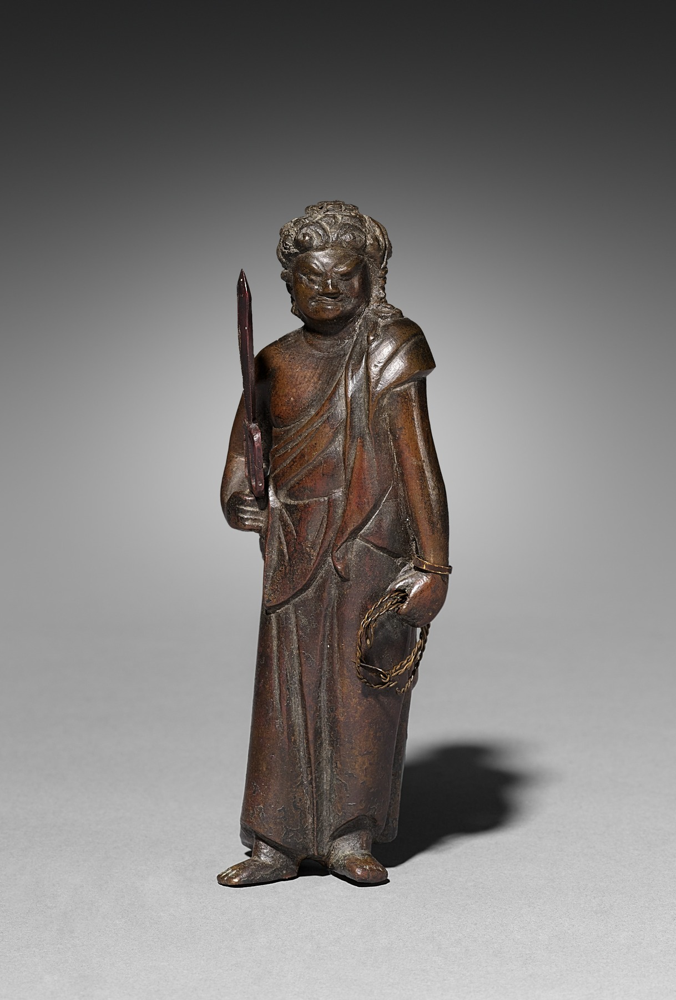

ア．剣と羂索を持つ。剣は煩悩を断つ智慧を表し、羂索は経や真言を唱えた回数を数えるための持物である。

イ．剣と羂索を持つ。剣は煩悩を断つ智慧を表し、羂索は迷う人を正しい道へ導く働きを表す。

ウ．剣と数珠を持つ。剣は煩悩を断つ智慧を表し、数珠は経や真言を唱えた回数を数えるための持物である。

エ．金剛杵と羂索を持つ。金剛杵は煩悩を打ち砕く智慧を表し、羂索は迷う人を正しい道へ導く働きを表す。

### 問50

東求堂同仁斎について、室の広さ・設備・建築史上の位置づけが適切なものはどれか。

ア．四畳半／床の間と帳台構／書院造の初期形式

イ．六畳／付書院と違棚／書院造の初期形式

ウ．四畳半／付書院と違棚／寝殿造の主屋の形式

エ．四畳半／付書院と違棚／書院造の初期形式

### 問51

図の経巻の表面について、色と文字の関係を適切に述べたものはどれか。

図1

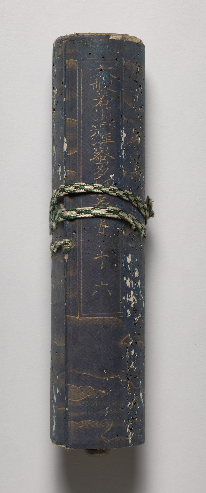

ア．金地に墨字を配し、文字の黒さと地の反射を対比している

イ．濃い地に金字を配し、明暗の対比で経典を荘厳している

ウ．濃い地に銀字を配し、金泥で描いた界線の中へ収めている

エ．淡い紙に墨書し、文字の周囲を金銀の切箔で散らしている

### 問52

屏風の建物を見る視点と、雲形の部分が場面に果たす役割の説明として適切なものはどれか。

図1

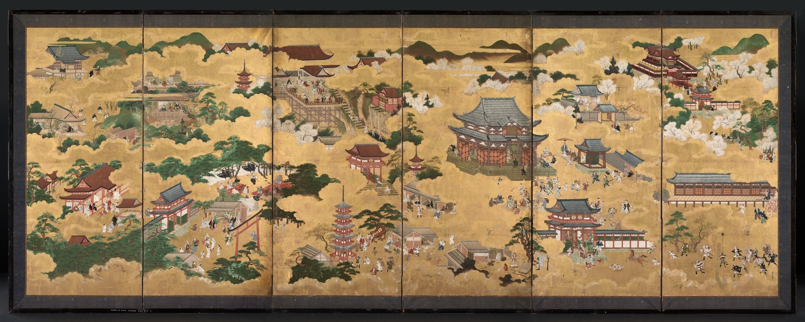

ア．建物を上から見下ろし、金雲で場面を隠しながら異なる地点をつなぐ

イ．建物を上から見下ろし、金雲で同一地点の朝から夜までを区切る

ウ．地上の同じ高さから建物を見て、雲形を地平線として奥行きをそろえる

エ．建物を正面から見て、金雲で寺社の標高を順に示す

## 大問16 近世の制作と生活

日本の作品と美術の活動を取り上げる。作品の形や材料、制作と受容の記録を、問われた事項へ対応させて考えなさい。

### 問53

人物の持物と相互の関係から、図の場面に最もよく合う説明はどれか。

図1

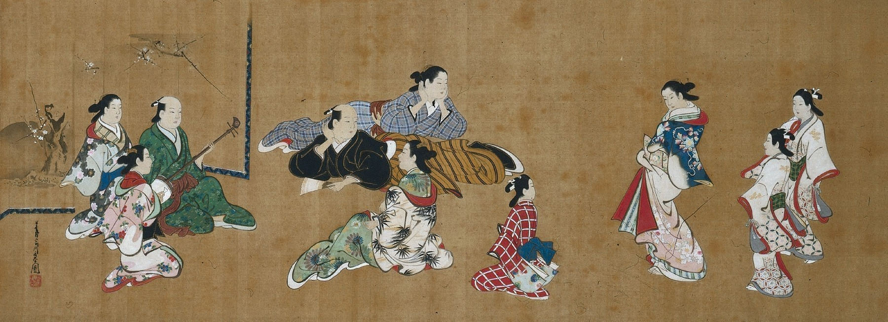

ア．芝居の舞台に役者が並び、客席へ向けて見得を切る

イ．遊興の座敷で奏楽する人物と客を交えた人々の関係を描く

ウ．祭礼の道筋に観客が並び、行列の進行を見守る

エ．婚礼の座敷で新郎新婦を中心に三三九度を行う

### 問54

草庵茶室に設けられる、客が体をかがめて入る低く小さな入口を何というか。

ア．花頭窓

イ．にじり口

ウ．貴人口

エ．付書院

## 大問17 江戸時代の絵画と出版

日本の作品と美術の活動を取り上げる。作品の形や材料、制作と受容の記録を、問われた事項へ対応させて考えなさい。

### 問55

上下に掲載した一対の屏風で、墨と余白による季節・時間の表し方として適切なものはどれか。

図1

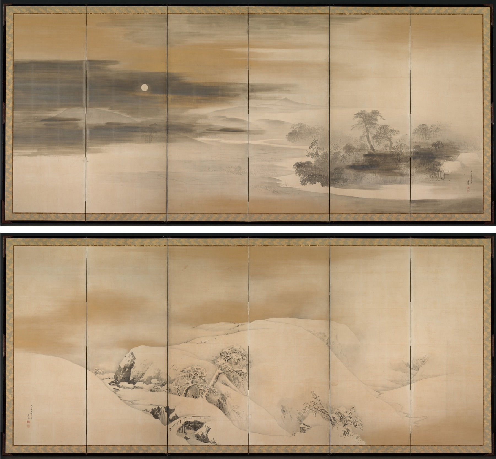

ア．上は白い雪を中心に置き、下は濃い夜空に月を浮かべる

イ．上も下も空を濃い墨で覆い、月と雪を濃淡のない輪郭線で区切る

ウ．上は夜空を濃くして月を際立たせ、下は淡い墨と白い部分で雪景を表す

エ．上は淡い空に月の濃い輪郭を置き、下は濃い墨で雪の面を埋める

### 問56

円山応挙の眼鏡絵と亜欧堂田善の洋風表現について、制作・鑑賞の方法が適切なものはどれか。

ア．応挙：レンズを通す鑑賞を意識した透視図法／田善：腐食した銅版の溝にインクを詰めて刷る

イ．応挙：銅板を腐食させた遠近図／田善：木版の色を重ねた眼鏡絵

ウ．応挙：肉眼の正面鑑賞に向けた等角図法／田善：腐食した銅版の溝にインクを詰めて刷る

エ．応挙：レンズを通す鑑賞を意識した透視図法／田善：銅版の凸部にインクを付けて刷る

### 問57

図の版本挿絵を観察し、刷りの色や線と面の使い方に基づく技法の分類として最も適切なものを選べ。

図1

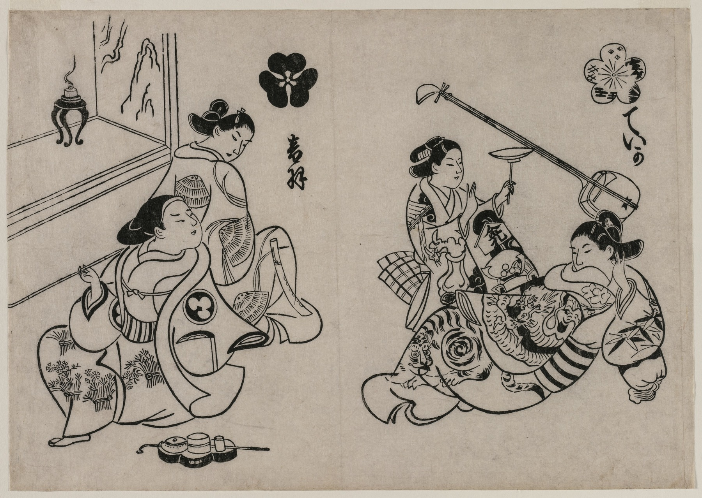

ア．墨摺絵

イ．合羽摺絵

ウ．紅摺絵

エ．錦絵

### 問58

空や川に重なる線と、道の人々の姿勢・持物を説明したものはどれか。

図1

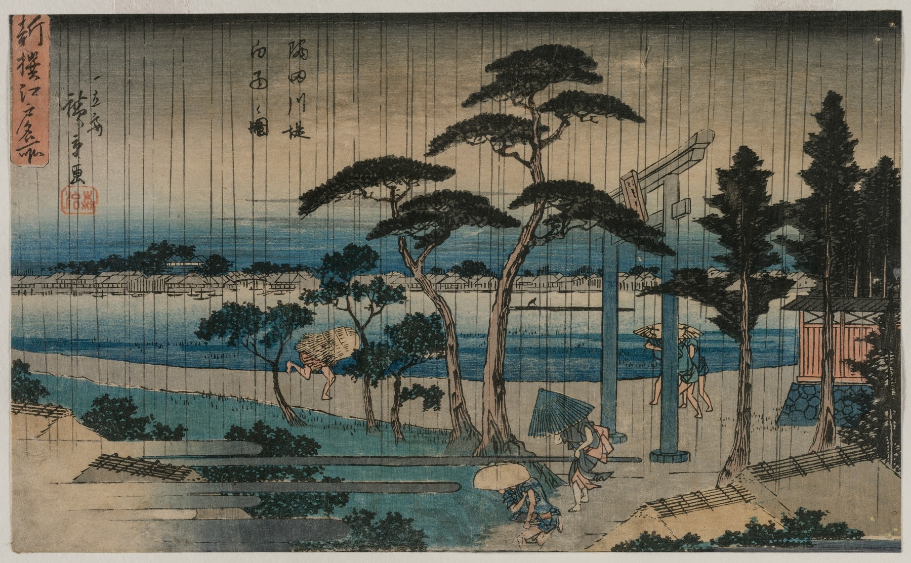

ア．横に走る線が風の強さを示し、人々は傘を閉じて列を整える

イ．縦方向の細線が木々の影を示し、人々は日傘で日差しを避ける

ウ．斜めの線が強い雨を示し、人々は橋の中央から一斉に走り出す

エ．縦方向の細線が雨を示し、傘を差す人などの動作が天候と結び付く

## 大問18 近代日本の制度と制作

日本の作品と美術の活動を取り上げる。作品の形や材料、制作と受容の記録を、問われた事項へ対応させて考えなさい。

### 問59

明治期の美術の再評価と教育について、人物と活動の対応が適切なものはどれか。

ア．フェノロサ：日本美術の再評価／岡倉天心：白馬会の創設／橋本雅邦：美術学校の日本画指導

イ．フェノロサ：西洋画科の実技指導／岡倉天心：日本美術院の運営／橋本雅邦：明治美術会の洋画指導

ウ．フェノロサ：日本画の実技指導／岡倉天心：美術学校の運営／橋本雅邦：日本美術の調査を通じた講義

エ．フェノロサ：日本美術の再評価／岡倉天心：美術学校・日本美術院の運営／橋本雅邦：日本画の制作と指導

### 問60

浅井忠《春畝》に結び付く明治洋画の特徴として、最も適切なものはどれか。

ア．大きな色面と強い変形によって、人物の主観的な印象を押し出す

イ．土色を基調とする色調と写実によって、農作業の人々と土地を描く

ウ．明るい外光と軽い筆触で、屋外の色を鮮やかに表す

エ．細密な筆触と輪郭で、静物の硬さや手触りを丹念に追う

### 問61

龍池会・日本美術協会・日本美術院の関係と歩みを説明した文として、適切なものはどれか。

ア．龍池会が日本美術協会へ改称した後、日本美術院が別に創立され、岡倉天心の存命中に横山大観らが日本美術院を再興した。

イ．日本美術院が創立された後、龍池会が日本美術協会へ改称され、岡倉天心の没後に横山大観らが日本美術院を再興した。

ウ．龍池会が日本美術院へ改称した後、日本美術協会が別に創立され、岡倉天心の没後に横山大観らが日本美術院を再興した。

エ．龍池会が日本美術協会へ改称した後、日本美術院が別に創立され、岡倉天心の没後に横山大観らが日本美術院を再興した。

### 問62

黒田清輝や久米桂一郎らを中心に、明るい外光表現を掲げて1896年に結成された洋画団体はどれか。

ア．明治美術会

イ．独立美術協会

ウ．白馬会

エ．草土社

### 問63

フュウザン会の作家たちが目指した表現に最も近い説明はどれか。

ア．人体の比例と明暗を整え、官展のアカデミックな完成を目指す

イ．細密な写実によって、身近な対象の質感や存在感を追究する

ウ．強い色彩や自由な変形を通じ、作家それぞれの個性を押し出す

エ．古典の仏画の図様を参照し、日本画の線と色の刷新を図る

## 大問19 戦後日本の美術活動

日本の作品と美術の活動を取り上げる。作品の形や材料、制作と受容の記録を、問われた事項へ対応させて考えなさい。

### 問64

読売アンデパンダン展とネオ・ダダイズム・オルガナイザーズの関係を適切に説明したものはどれか。

ア．前者は審査で選ぶ官設展、後者はそこへの入選を条件とする研究会である

イ．前者は無審査の発表の場、後者は廃物や行為などを用いて活動したグループである

ウ．前者は共同制作する集団、後者は作品の搬入を無審査で受け付けた展覧会である

エ．前者は日本画の刷新を目指す団体、後者はその洋画部門として発足した

### 問65

白髪一雄の絵画制作で、身体と絵具の関係を適切に説明したものはどれか。

ア．ロープにつかまり、床の画面の絵具を足で動かして身体の動きを跡へ変える

イ．キャンバスを切り開き、その切れ目から背後の空間を見せる

ウ．電球やコードを身にまとい、点滅する光を身体と結び付ける

エ．板の上に置いた紙を身体で突き破り、その裂け目を作品として残す

### 問66

1970年の大阪万博で、丹下健三による会場構成と関わるシンボルゾーンに『太陽の塔』を制作した美術家は誰か。

ア．岡本太郎

イ．菊竹清訓

ウ．イサム・ノグチ

エ．丹下健三

## 大問20 現代美術の媒体と批評

現代美術の実践と批評について、媒体、制作の過程、鑑賞や社会との関係に注目して考えなさい。

### 問67

ジェニー・ホルツァーの《トゥルーイズムズ》以後の言葉を用いる実践について、公共空間での提示方法と鑑賞者との関係を捉えた説明はどれか。

ア．手書きの文を原寸で転写し、筆跡に現れる作者個人の身振りを広告の印刷文字と対照させる。

イ．報道の文章を発生日時の順に保存し、情報を作品から独立した資料目録へ整理する。

ウ．断言的な短文を広告にも使われる表示媒体へ置き、日常に流れる言葉の権威や受け取られ方を揺さぶる。

エ．同じ語句を発音順に反復し、言葉の意味より声の音程と演奏者の身体を中心に示す。

### 問68

シンディ・シャーマンの《アンタイトルド・フィルム・スティル》を、写真と演技の関係から解説する。映画にありそうな場面や女性像の型が生まれる制作方法として、適切なのはどれか。

ア．既存映画から静止画を選び、実際の配役と撮影地を添えて年代順に再編集する。

イ．作家自身が衣装や姿勢を変えて役柄を演じ、架空の映画の一場面のように撮影する。

ウ．映画俳優への聞き取りをもとに、本人が演じた代表的な役の肖像写真を集める。

エ．日常の通行人を連続撮影し、同じ人物の生活を長期間追った記録として並べる。

### 問69

ハンス・ハーケは1974年の《ソロモン・R・グッゲンハイム美術館理事会》で、理事の氏名・生年・職業を一覧として提示した。この資料の用い方を美術史上の実践と結びつけた説明として、最も適切なものはどれか。

ア．制度批判の実践。理事の職業を手掛かりに、美術館とその活動を支える経済的な関係を鑑賞の対象へ含める。

イ．アプロプリエーションの実践。公表済みの資料を転用することで、原資料の作者と借用した作家の作者性の違いを中心に問う。

ウ．制度批判の実践。理事個人の経歴を材料とし、各人の道徳性を評価することを作品の中心に置く。

エ．サイト・スペシフィックな実践。氏名の内容より展示室の寸法や形状へ配列を対応させ、建築的な空間の性格を中心に問う。

## 大問21 日本とアジアの表現活動

### 問70

蔡國強（ツァイ・グオチャン）が、紙上のドローイングと屋外の大規模な表現の両方で用いてきた素材・制作行為を選ぶ。素材の作用が痕跡や一時的な出来事を生むという点に注目すると、どれが最も適切か。

ア．火薬を用い、その燃焼・爆発を描画や出来事へ取り込む。

イ．木炭を粉にし、布でこすることで濃淡を紙へ定着させる。

ウ．染料を含む水を布に流し、浸透する色の広がりを残す。

エ．感光紙に物を置き、露光してその輪郭を写真として残す。

## 大問22 作品と社会の関係

### 問71

《無限の網》の絵画や、反復するモチーフと鏡を用いた空間作品で知られる日本の作家は誰か。

ア．塩田千春

イ．村上隆

ウ．奈良美智

エ．草間彌生

## 大問23 アジアの書画と工芸

アジアの造形と文化の交流について、材料、主題、表現や資料の役割を照合して考えなさい。

### 問72

ガンダーラの仏教彫刻に見られる、身体の量感や衣の深いひだを交流史から説明する。造形との関係が特に深いものはどれか。

ア．古代ギリシア・ローマ系の人物彫刻

イ．古代インドの動植物を組み合わせた装飾文様

ウ．ササン朝ペルシアの王権を示す金銀器

エ．中国の漢代に見られる墓室の画像石

### 問73

図は8世紀頃の中国の陶製の馬である。頭部・胴・脚の色の境界と表面の状態をそれぞれ観察し、技法・使用の背景と結びつけた説明を選べ。

図1

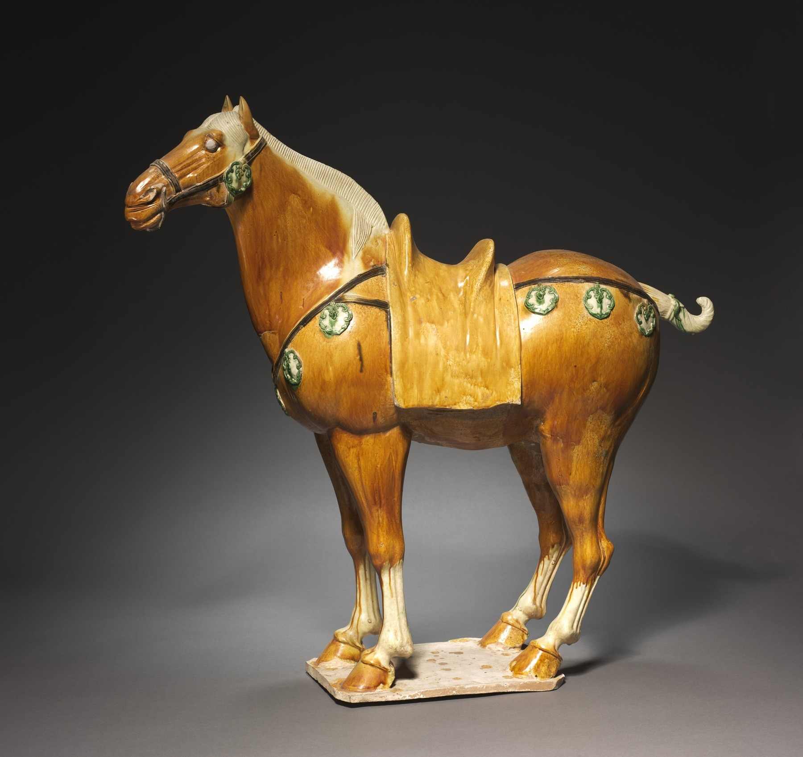

ア．褐色を中心に緑や白が加わる。元代の染付で、青の釉下彩を発達させた作例である。

イ．褐色を中心に緑や白が加わる。唐三彩の明器で、墓へ納める副葬品として制作された。

ウ．褐色を中心に緑や白が加わる。唐三彩の置物で、宮廷の室内を飾る調度として制作された。

エ．緑と白が地を均等に覆い、褐色は細い輪郭線に限られる。唐三彩の明器である。

### 問74

《蘭亭序》に関する作者と書体の組合せとして、最も適切なものはどれか。

ア．王羲之―行書

イ．王羲之―篆書

ウ．王献之―行書

エ．顔真卿―楷書

## 大問24 工芸の技法とデザイン

工芸とデザインを取り上げる。制作の工程、材料、形や文様を、資料の記録と区別しながら考えなさい。

### 問75

蒔絵の工程A「金粉を蒔いた文様を漆で塗り込み、研いで再び現す」、B「下地で盛り上げた文様に金粉を蒔く」に合う技法名はどれか。

ア．A：高蒔絵／B：研出蒔絵

イ．A：平蒔絵／B：高蒔絵

ウ．A：研出蒔絵／B：平蒔絵

エ．A：研出蒔絵／B：高蒔絵

### 問76

磁器と炻器の素地について、典型的な性質の組合せとして適切なものはどれか。

ア．磁器―白い釉による白さを特徴とする／炻器―低温で焼いた多孔質胎

イ．磁器―白く薄手では透光性もある／炻器―低温で焼いた多孔質胎

ウ．磁器―白い釉による白さを特徴とする／炻器―緻密で一般に不透明

エ．磁器―白く薄手では透光性もある／炻器―緻密で一般に不透明

### 問77

モリスの活動を、工芸改革の運動と本の造形を刷新する出版活動から整理する。関係が合う組合せを選べ。

ア．ドイツ工作連盟―ダヴズ・プレス

イ．ドイツ工作連盟―ケルムスコット・プレス

ウ．アーツ・アンド・クラフツ―ケルムスコット・プレス

エ．アーツ・アンド・クラフツ―ダヴズ・プレス

### 問78

図はウェッジウッドの《ポートランドの壺》である。地と人物像の関係を観察し、ジャスパーウェアの装飾法と合う説明を選べ。

図1

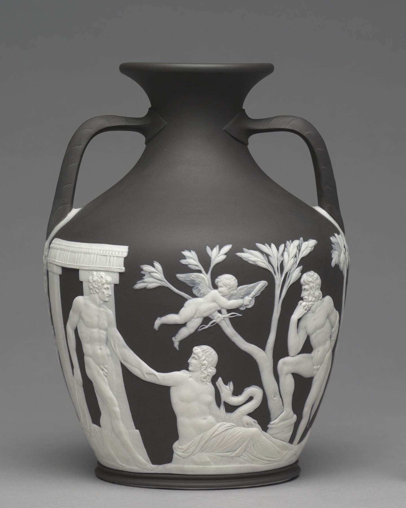

ア．暗い地に白い人物像が浮く。別につくった人物像の浮彫を器体へ付ける。

イ．白い地に暗い人物像が浮く。暗色の釉の一部を削り、白い素地を見せる。

ウ．暗い地に白い人物像が浮く。暗色の釉の一部を削り、白い素地を見せる。

エ．白い地に暗い人物像が浮く。別につくった人物像の浮彫を器体へ付ける。

## 大問25 美術館の成立と収集

### 問79

美術館の成立を「誰の収集が、どの政治的変化を経て公開されたか」という観点から年表にまとめる。王侯の収集品を基礎とし、フランス革命期の1793年に一般へ公開された施設を選ぶ。都市の所在だけでなく、王室のコレクションを公共の美術館へ転じた歴史に照らすと、該当するのはどれか。

ア．ルーヴル美術館

イ．プティ・パレ美術館

ウ．ポンピドゥー・センター

エ．オルセー美術館

## 大問26 展覧会とコレクションの制度

### 問80

官展の審査とは異なる発表の場として生まれた、パリのアンデパンダン展を紹介する。Aに創設年、Bに出品と褒賞をめぐる基本方針を入れる。創設年と運営方針はそれぞれ独立に確かめる。落選展との混同にも注意したとき、正しい組合せはどれか。

ア．A：1863年／B：無審査・褒賞あり

イ．A：1884年／B：無審査・褒賞あり

ウ．A：1863年／B：無審査・無褒賞

エ．A：1884年／B：無審査・無褒賞

## 大問27 線の版画と粉の描画

### 問81

紙の作品を、目録①「エッチングにドライポイント等を併用」、②「紙にパステル」へ対応させる。空・帽子・衣の細部を見て、目録と観察が合う説明を選べ。

図A

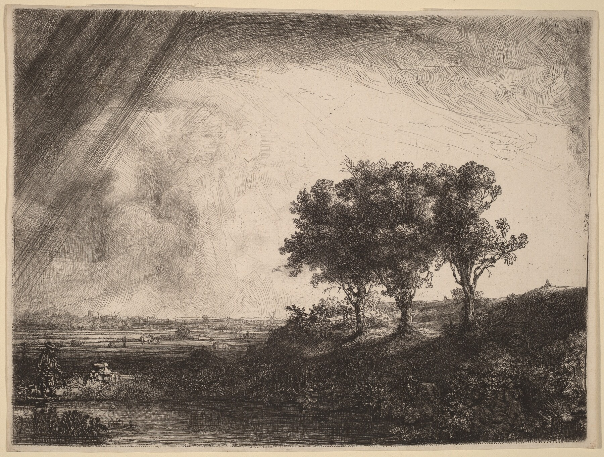

図B

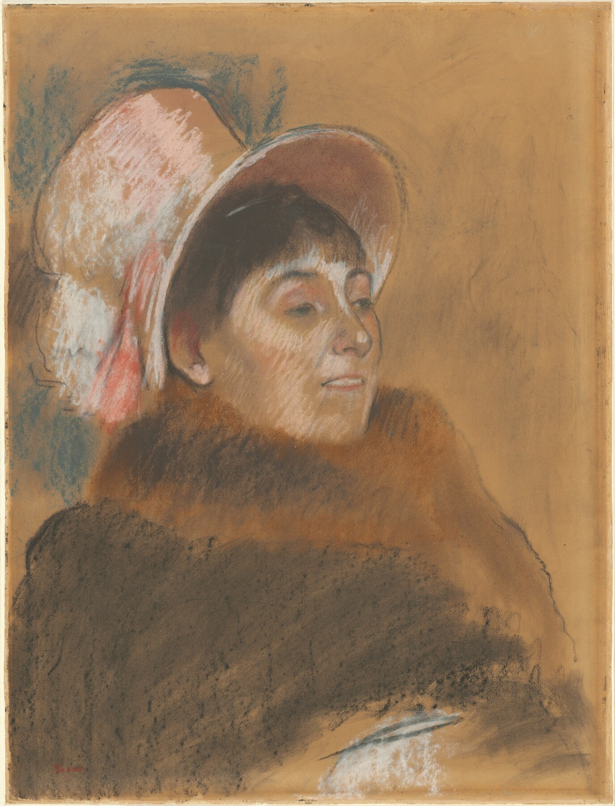

ア．A→①、B→②。Aの左上の空は斜線が密で、Bの帽子の白や赤は紙の上に加えた描画材として読む。

イ．A→②、B→①。Aの左上の空は斜線が密で、Bの帽子の白や赤は紙の上に加えた描画材として読む。

ウ．A→①、B→②。Aの左上の空は斜線が密で、Bの帽子の白は紙を塗らず残した箇所として読む。

エ．A→①、B→②。Aの中央の明るい空が左上より線密度が高く、Bの帽子の白や赤は加えた描画材として読む。

## 大問28 航海の場面と寓意の人物

### 問82

二点の絵について、人物と周囲の物の関係を観察メモへ記す。場面の名称を決める前に、船縁・頭部の高さ・腕と持物の関係を図で確かめた記録として適切なものを選べ。

図A

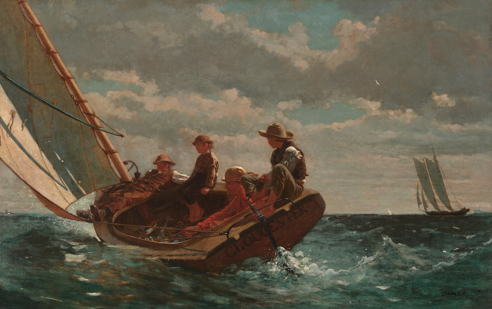

図B

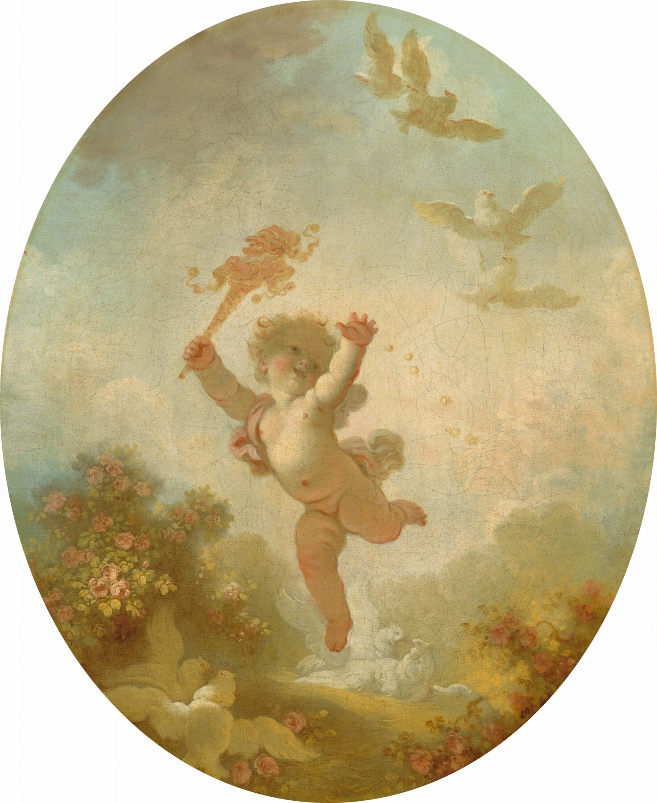

ア．Aでは水平な船縁の上に人物の頭が同じ高さで並ぶ。Bでは棒状の持物を両手で胸の前に支える。

イ．Aでは水平な船縁の上に人物の頭が同じ高さで並ぶ。Bでは棒状の持物を片手で斜めに掲げ、もう一方の腕も上げる。

ウ．Aでは斜めに通る船縁の上に人物の頭が異なる高さで並ぶ。Bでは棒状の持物を片手で斜めに掲げ、もう一方の腕も上げる。

エ．Aでは斜めに通る船縁の上に人物の頭が異なる高さで並ぶ。Bでは棒状の持物を両手で胸の前に支える。

## 大問29 夢に描かれた二つの時間

### 問83

二点の浮世絵を解説カードへ対応させる。①は「幼い頃を夢見る女性」、②は「婚礼の行列を夢見る女性」である。上方の小場面の人物や道具と、下方の人物との間を区切る線を観察する。対応と画面の組み立て方の説明が、両方とも適切なものはどれか。

図A

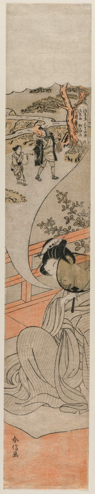

図B

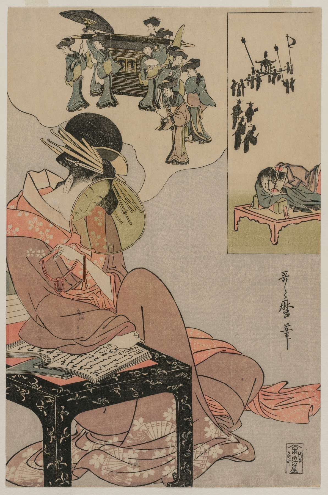

ア．A→①、B→②。小場面を直線的な窓枠で囲み、下方の人物から見える戸外の景色として続けている。

イ．A→①、B→②。上方の小場面を雲形の境界で囲み、下方の人物がいる空間と分けている。

ウ．A→②、B→①。小場面を直線的な窓枠で囲み、下方の人物から見える戸外の景色として続けている。

エ．A→②、B→①。上方の小場面を雲形の境界で囲み、下方の人物がいる空間と分けている。

## 大問30 現在と当初の支持体

### 問84

目録①は「男性肖像、テンペラ。現在の硬質繊維板へカンヴァスから移替え、そのカンヴァスは板から移替え」、②は「街路、板に油彩」と記す。図と目録を照合し、当初の支持体・現在の支持体・写真から確認できる範囲を区別した編集案を選べ。

図A

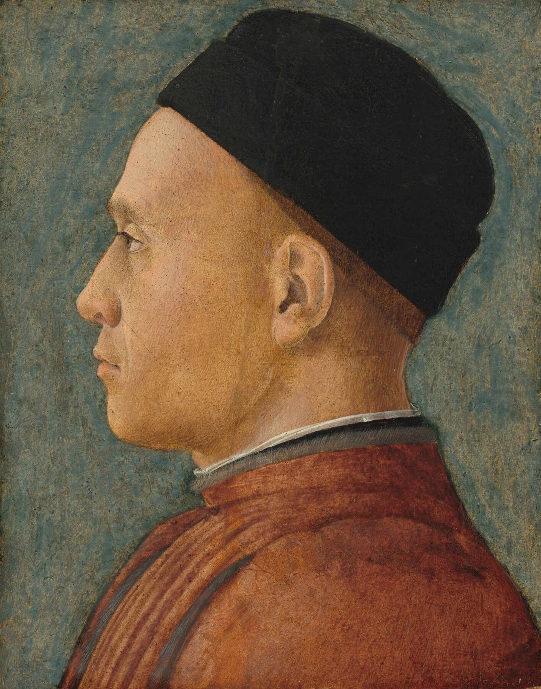

図B

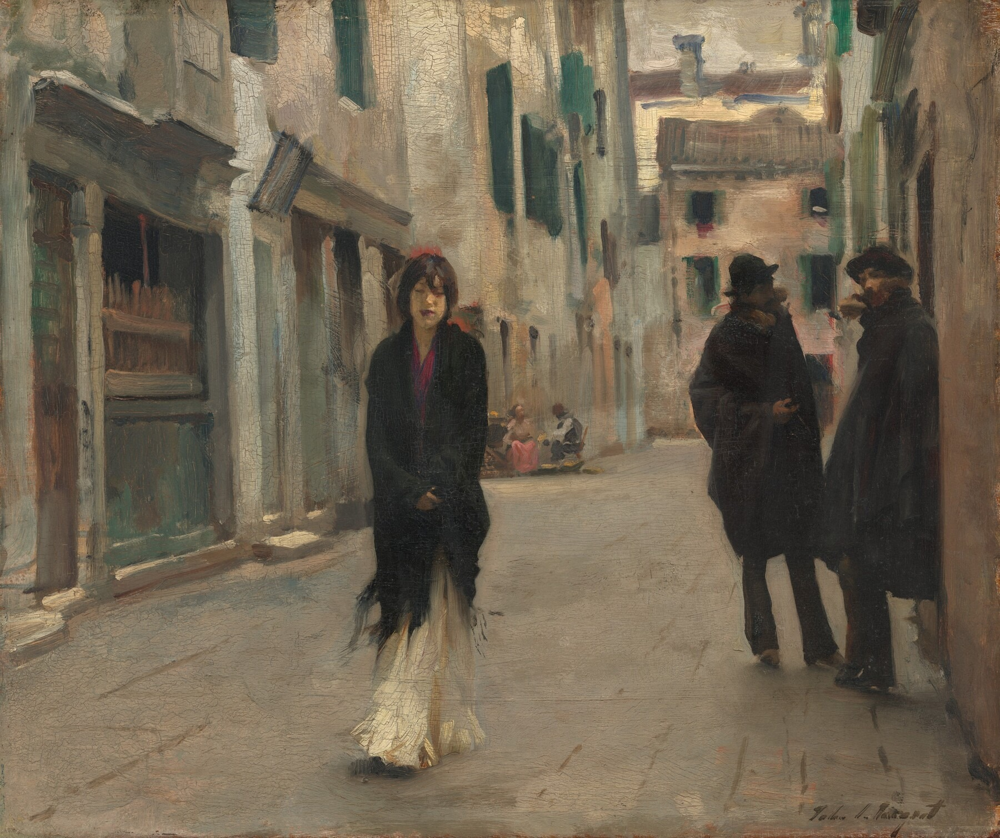

ア．A→①、B→②。Aは当初が板で現在は硬質繊維板。帽子の縁が耳を横切る横顔は見えるが、写真の表面だけで移替え手順を確認したとはしない。

イ．A→①、B→②。Aは当初がカンヴァスで現在は硬質繊維板。耳を露わにした横顔は見えるが、写真の表面だけで移替え手順を確認したとはしない。

ウ．A→②、B→①。Bは当初が板で現在は硬質繊維板。写真の表面だけで移替え手順を確認したとはしない。

エ．A→①、B→②。Aは当初が板で現在は硬質繊維板。耳を露わにした横顔は見えるが、写真の表面だけで移替え手順を確認したとはしない。

## 大問31 作品の用途と描かれた行為

### 問85

二点の版画について、画面の内容と作品の使われ方を分けて解説する。日本語の詩歌を添える花籠の図は「私的な贈答などのために制作された摺物」と記録される。各図で描かれた物や手・口の位置も確かめ、資料から分かる制作目的と、実際に見える行為を混同しない説明を選べ。

図A

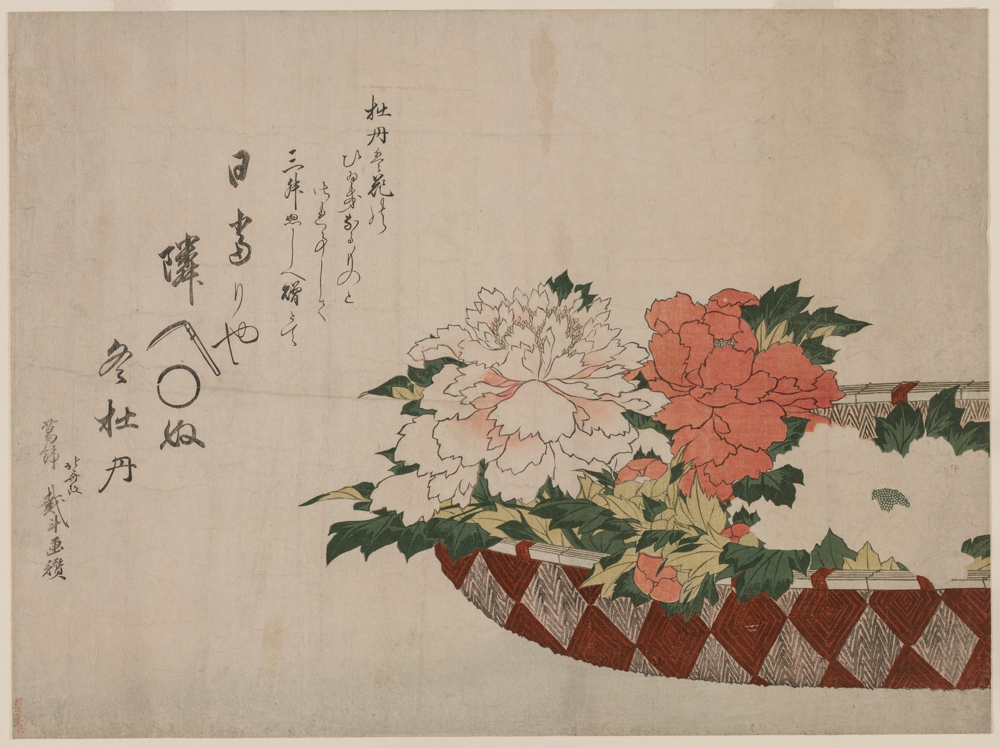

図B

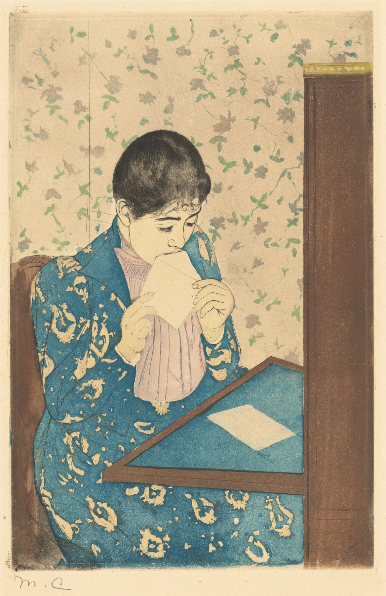

ア．Aの花籠と詩歌は画面の要素、贈答は版画の用途である。Bでは女性が筆で手紙へ文字を書き込む。

イ．Aは花籠を相手へ贈る行為を描いた場面と読める。Bでは女性が手紙の封へ口を寄せる。

ウ．Aの花籠と詩歌は画面の要素、贈答は版画の用途である。Bでは女性が手紙の封へ口を寄せる。

エ．Aは花籠を相手へ贈る行為を描いた場面と読める。Bでは女性が筆で手紙へ文字を書き込む。
