# 美術検定2級 模擬試験3（非公式）

全85問・4択・60分。美術史80問＋活用5問。図版はカラー表示・印刷を推奨。

## 大問1 古代と中世の造形・役割

作品や活動の記録を読み、時代、素材、主題、表現の方法を対応させて考えなさい。図版がある問いは、その画面も確かめなさい。

### 問1

古代エジプトの美術とともに用いられた、人物や動物などの形を記号にした文字はどれか。

ア．線文字B

イ．ヒエログリフ

ウ．ラテン文字

エ．くさび形文字

### 問2

ローマ帝政の記念柱の浮彫で、同じ皇帝が別の戦争場面へ繰り返し現れ、人物の尺度も遠近だけでは決まらない。これを描写の未熟さに還元せず理解する説明はどれか。

ア．出来事を連ねる記録性と、各場面を皇帝の権威へ結びつける記念的な機能を読む。

イ．現実の戦争の記録から離れ、皇帝を古代神話の登場人物として同一の場面へ集める。

ウ．同じ時刻の一場面を複数の視点から描き、皇帝を周囲の兵士と同じ日常的な役割へ戻す。

エ．戦争の順序より風景の見え方を優先し、皇帝の尺度を視点の移動の記録として読む。

### 問3

ゴシックの大聖堂で、高い身廊の側圧を外側へ受け渡すために用いられた、壁の外のアーチ状の構造はどれか。

ア．リブ・ヴォールト

イ．飛梁（フライング・バットレス）

ウ．尖頭アーチ

エ．控壁（バットレス）

### 問4

図1の背後と衣文・翼の線から、人物の造形を説明したものを選びなさい。

図1

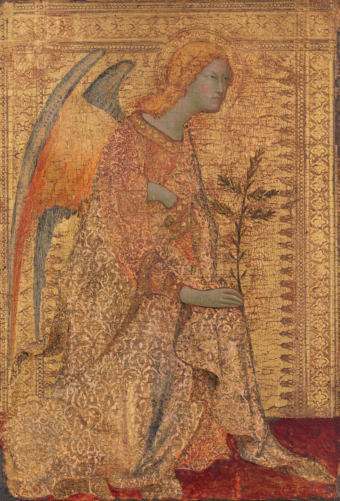

ア．金色の背景の前で、衣文と翼を同じ厚い面へまとめ、身体の重い量感を強める。

イ．金色の背景の前で、細く流れる衣文と翼の線が、優雅で装飾的な姿をつくる。

ウ．金色の背景と衣服を同じ線の反復へまとめ、顔と手も模様の中へ均等に置く。

エ．金色の背景を弱め、翼の明暗を室内の光源へそろえることで、奥へ続く空間をつくる。

## 大問2 ルネサンスの素材と表現

作品や活動の記録を読み、時代、素材、主題、表現の方法を対応させて考えなさい。図版がある問いは、その画面も確かめなさい。

### 問5

ルネサンス期に広がった人体彫刻の新たな役割を、建築装飾との関係から確かめる観点はどれか。

ア．正面の浅い起伏を追い、人体が連続する物語の帯へ組み込まれる関係を確かめる。

イ．入口の上部へ視点を上げ、建築の対称的な区画に人体が従う関係を確かめる。

ウ．像の周囲へ回り、身体そのものの形や存在がつくる空間を確かめる。

エ．建築の柱間に視点を固定し、人体を壁面の枠の尺度へ合わせて確かめる。

### 問6

図1の二人物と建築の関係を、前後の空間に注目して説明したものはどれか。

図1

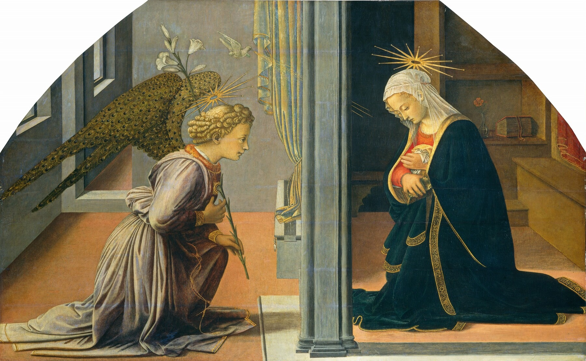

ア．二人の間に背後の戸口を置き、手前の柱状の仕切りを画面の端へ寄せる。

イ．手前の大きな柱状の仕切りを二人の背後へ置き、二人を同じ側へ重ねる。

ウ．手前の大きな柱状の仕切りを挟んで二人が向き合い、床や開口部が背後へ続く。

エ．二人を手前と奥へ一列に置き、床や開口部の線を横へ平行に広げる。

### 問7

図1の二人の幼児と母親の視線・手の関係を、持物の意味も含めて説明したものはどれか。

図1

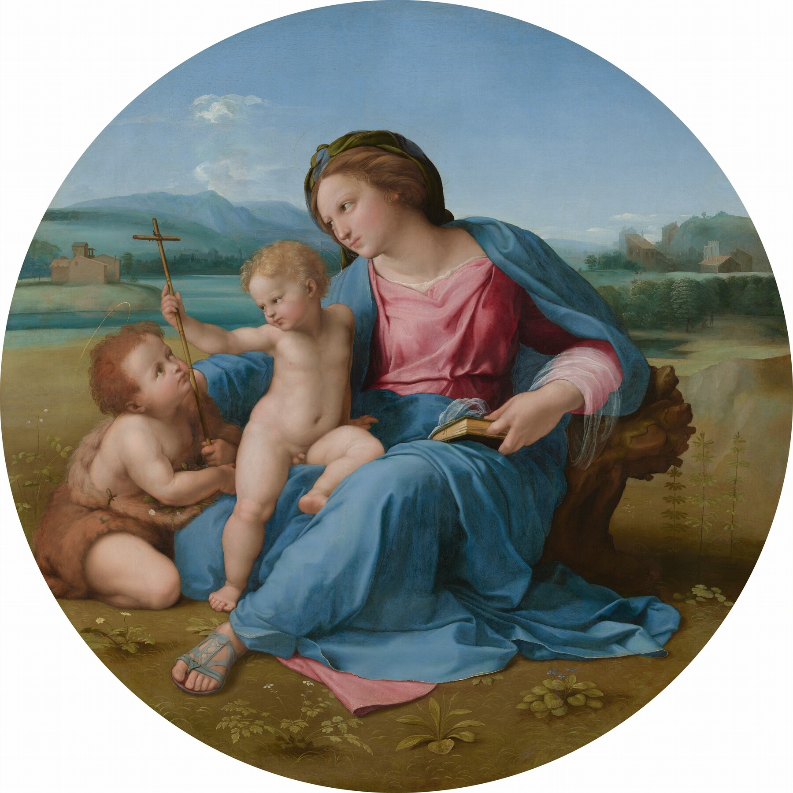

ア．毛皮を着る幼児が示す十字架へもう一人が手を伸ばし、母親も注意を向けて将来の受難を暗示する。

イ．二人の幼児が十字架を母親へ差し出し、母親が自分の受難の象徴としてそれを受け取る。

ウ．母親が十字架を二人の幼児から遠ざけ、幼児は書物へ注意を移して受難を避けようとする。

エ．毛皮を着る幼児が十字架を受け取る側となり、母親の視線はその幼児の将来の殉教へ集まる。

### 問8

図1の顔の輪郭と陰影の境は、どのような処理で周囲につながるか。

図1

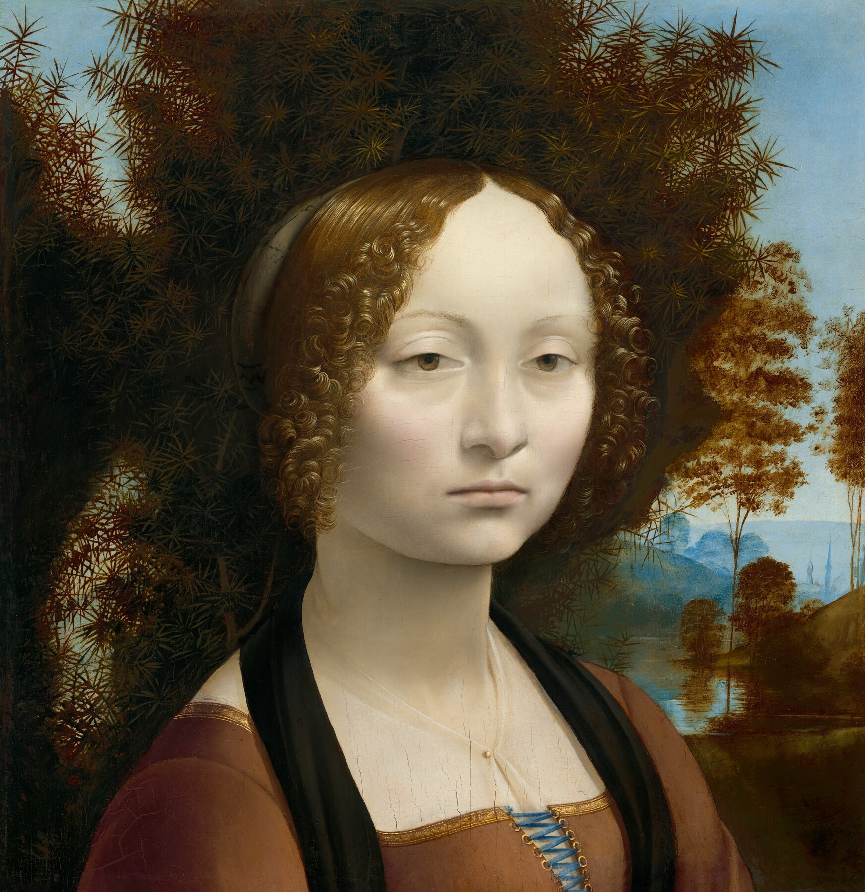

ア．暗部の輪郭を背景から硬く切り、明部の輪郭を同じ強さで反復する処理。

イ．輪郭の縁を明るい線でそろえ、明部と暗部を一定の幅に区切る処理。

ウ．輪郭と陰影の縁を短い線の重なりで刻み、同じ密度の線で顔を包む処理。

エ．細い輪郭線で縁を固定せず、柔らかな明暗の移行によって形を周囲へつなぐ処理。

## 大問3 16世紀の技法と活動

作品や活動の記録を読み、時代、素材、主題、表現の方法を対応させて考えなさい。図版がある問いは、その画面も確かめなさい。

### 問9

図1の右上に見える年記とモノグラムを、作者・制作年の記録へ対応させたものを選びなさい。

図1

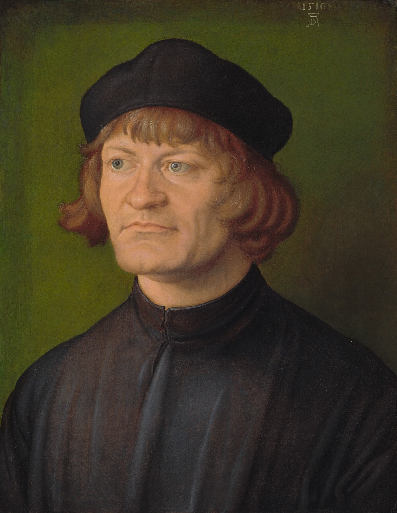

ア．ハンス・ホルバイン（子）、1526年

イ．アルブレヒト・デューラー、1526年

ウ．アルブレヒト・デューラー、1516年

エ．ハンス・ホルバイン（子）、1516年

### 問10

マニエリスムの造形を、盛期ルネサンスの均衡のとれた人体や安定した構成と比較する。人体の比例と構図の二点で、変化を適切に述べたものはどれか。

ア．人体を均衡のとれた自然な比例へ近づける傾向――ねじれや複雑な配置を強める傾向

イ．人体を長く引き伸ばす傾向――左右対称の静かな配置を整える傾向

ウ．人体を均衡のとれた自然な比例へ近づける傾向――左右対称の静かな配置を整える傾向

エ．人体を長く引き伸ばす傾向――ねじれや複雑な配置を強める傾向

## 大問4 17世紀の主題と制作

作品や活動の記録を読み、時代、素材、主題、表現の方法を対応させて考えなさい。図版がある問いは、その画面も確かめなさい。

### 問11

図1の前景の人物と、奥の明るい人物群は、どのような物語の関係に置かれているか。

図1

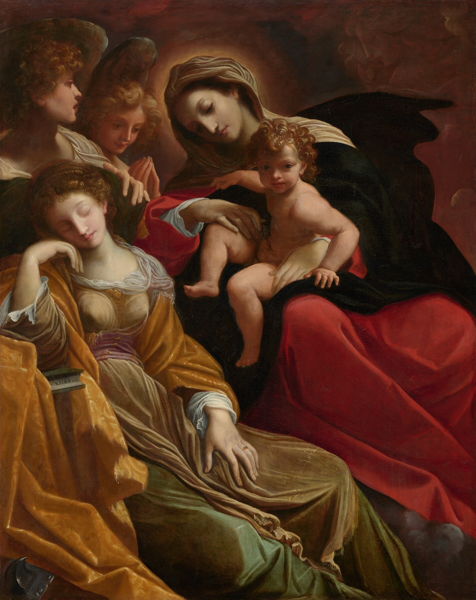

ア．神殿を訪れた母親が、幼子を司祭へ預けている。

イ．眠る人物が、聖母子の現れる夢を見ている。

ウ．跪く聖母が、天使から受胎の知らせを聞いている。

エ．目覚めた人物が、墓から起き上がるキリストを迎えている。

### 問12

図1の身体と周囲の暗部の関係を説明したものはどれか。

図1

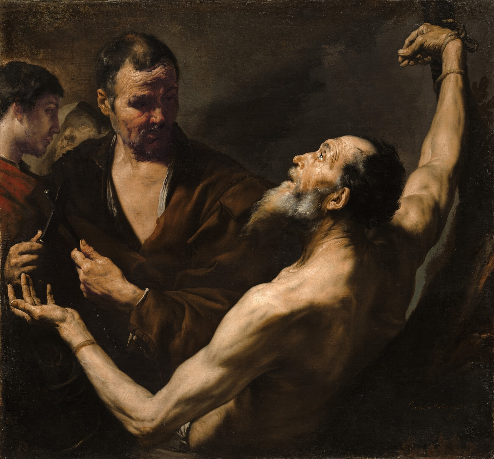

ア．身体の外縁を周囲より暗く囲み、内部の明暗を平らな面へそろえる。

イ．身体の明部を細かな反射の光へ分け、周囲の人物へ均等に散らす。

ウ．身体を強い明部として暗い周囲から浮かせ、筋肉や皺の緊張を劇的に見せる。

エ．身体と周囲の暗さを近づけ、輪郭を背景へ沈めて緊張を和らげる。

### 問13

図1の襟・袖の描き方と腕の置き方は、人物の印象へどう結びつくか。

図1

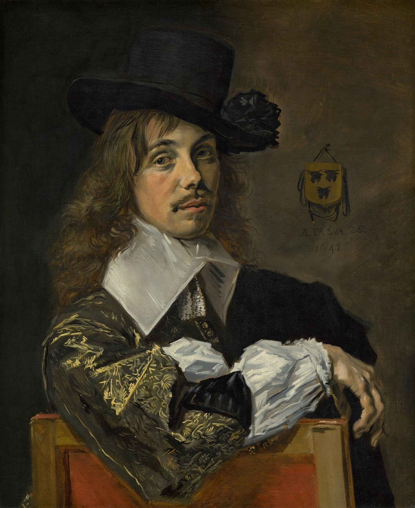

ア．襟や袖に軽快な筆跡を残し、椅子へ腕を預けた姿とともにくつろぎと活気を生む。

イ．襟や袖を暗部へ沈め、腕を顔の前へ集めて、鑑賞者との距離を閉じる。

ウ．襟や袖を輪郭の細線で区切り、腕を左右同じ高さへそろえて静かな対称性を生む。

エ．襟や袖の筆跡を均し、椅子へ腕を預けた姿にも儀礼的な硬さを与える。

### 問14

アカデミーで歴史画が高く評価された考え方を、他のジャンルとの関係から説明したものはどれか。

ア．特定の人物の顔と身分を似せて残す点を、物語に登場する人物の行為より重んじた。

イ．人物の行為に知的・道徳的内容を与える点を、個人の容貌や物の再現より重んじた。

ウ．自然の場所を忠実に記録する点を、人間の行為を組み立てる構想より重んじた。

エ．物の色や材質を細かく描き分ける点を、人間の行為に意味を与える構想より重んじた。

## 大問5 18世紀の社会と表現

作品や活動の記録を読み、時代、素材、主題、表現の方法を対応させて考えなさい。図版がある問いは、その画面も確かめなさい。

### 問15

図1の人物群を見て、衣服や立ち方、背景に最もよく合う場面を選びなさい。

図1

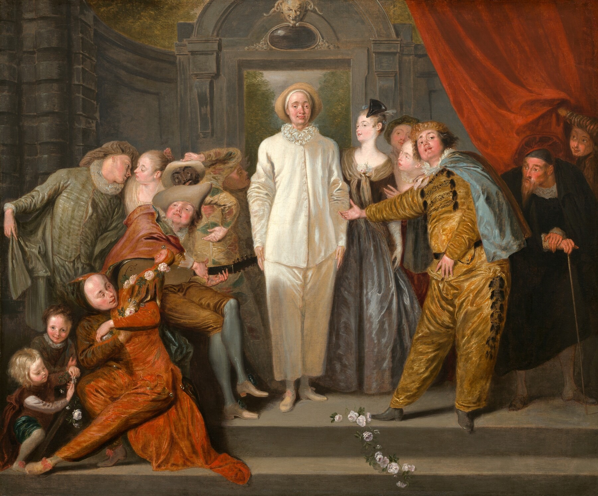

ア．舞台衣装を着けた喜劇の役者たちが、観客に向けて並ぶ場面

イ．家族が食卓を囲み、日常の食事をとる場面

ウ．兵士が旗と武器を持ち、都市の門を守る場面

エ．農民が畑で道具を持ち、収穫の仕事をする場面

### 問16

図1は天井画のための構想である。建築と人物、空の関係がつくる効果を選びなさい。

図1

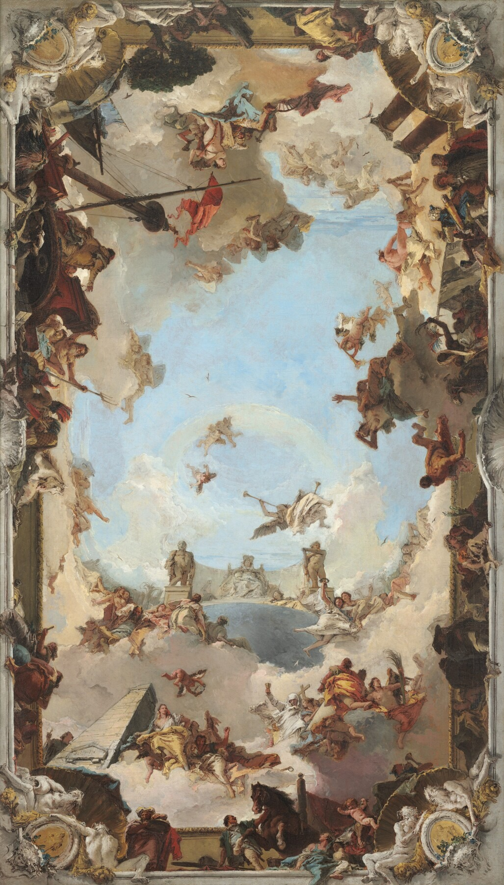

ア．建築の輪郭を人物の手前へ重ね、人物や空を閉じた壁画の正面へ収める。

イ．建築の開口を見下ろす位置へ鑑賞者を置き、人物や雲を床面の近い高さへ並べる。

ウ．建築の開口を仰ぐ位置へ鑑賞者を置き、人物や雲が天井の先の空へ続くように見せる。

エ．建築と人物を同じ正面の面へそろえ、空の奥行きを室内の壁面へ引き戻す。

### 問17

18世紀のグランド・ツアーについて、旅行者と目的の関係を説明したものはどれか。

ア．職人が各地の親方の工房を巡り、仕事をしながら技能を広げる修業

イ．依頼を受けた画家が宮廷を訪ね、君主や家族の肖像を制作する滞在

ウ．富裕層の子弟がイタリアなどを巡り、古典文化や美術の教養を深める旅行

エ．賞を得た若い画家が、官費によってローマに滞在して制作を学ぶ留学

## 大問6 19世紀前半の美術

作品や活動の記録を読み、時代、素材、主題、表現の方法を対応させて考えなさい。図版がある問いは、その画面も確かめなさい。

### 問18

ロマン主義の絵画が主題を広げた方向として、最も適切なものを選びなさい。

ア．個人の内面を抑え、歴史上の人物の姿を均衡した規範として示す。

イ．古代の人物の行いを、理性や市民的な徳を示す規範として描く。

ウ．近代都市の生活を、短い筆触による一瞬の光の印象として描く。

エ．同時代の事件や異国の物語を、強い感情を伴う劇的な場面として描く。

### 問19

図1では木々と草地の間に聖堂が捉えられ、空や自然の観察が風景に結び付けられる。この作品の作者を選びなさい。

図1

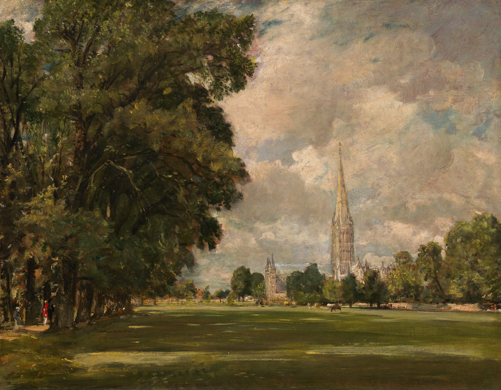

ア．ジャン＝バティスト＝カミーユ・コロー

イ．カスパー・ダーヴィト・フリードリヒ

ウ．ジョン・コンスタブル

エ．ジョゼフ・マロード・ウィリアム・ターナー

### 問20

図1の前景の人物と、室内の物や奥の人物の関係を説明したものはどれか。

図1

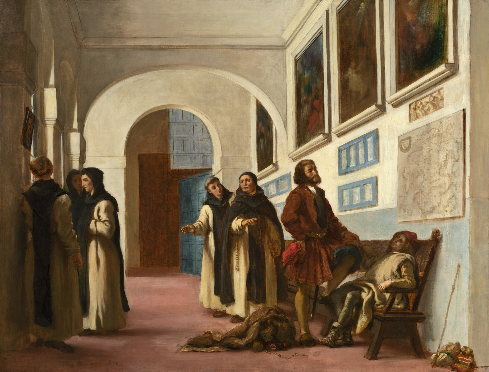

ア．父が子を抱いて室内の奥へ進み、修道士たちが入口で二人を迎える姿を示す。

イ．父と子を壁の地図の近くへ置き、奥で話す修道士たちと同じ室内にいる姿を示す。

ウ．父と子を壁の地図から背け、修道士の机を二人の注意の中心に据える。

エ．父と子を壁の地図の前へ立たせ、奥の修道士たちがその説明を聞く姿を示す。

### 問21

1874年に始まる印象派の展覧会について、発表の仕組みを説明したものを選びなさい。

ア．国家が、国際的な博覧会の美術部門として各国の作品を集めて展示した。

イ．個人の収集家が、所蔵する古典作品を選んで公開する展示を開いた。

ウ．作家たちが、サロンの審査を受ける官展とは別に自主的な展覧会を開いた。

エ．美術アカデミーが、会員の候補者を選ぶために作品を審査して展示した。

## 大問7 近代の都市と鑑賞

作品や活動の記録を読み、時代、素材、主題、表現の方法を対応させて考えなさい。図版がある問いは、その画面も確かめなさい。

### 問22

図1の岩、水、樹木の表面は、絵具の置き方によってどう描き分けられているか。

図1

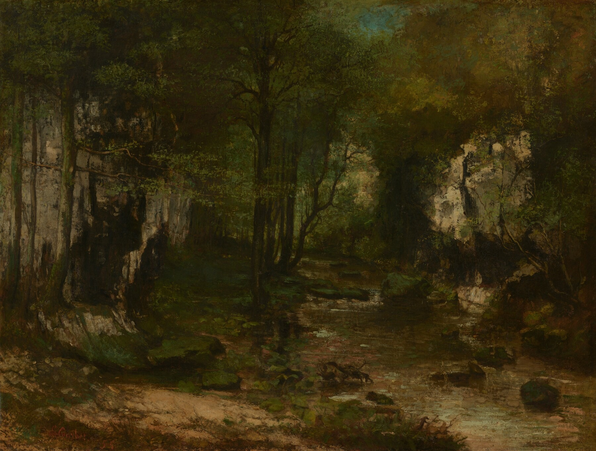

ア．岩と水の境を硬い均一線で囲い、その内側を同じ厚みの平らな色面へそろえる。

イ．同じ薄い絵具を全体へ滑らかに重ね、岩と水、葉を共通の柔らかな明暗へ均す。

ウ．水の長い平行線を岩と葉へも繰り返し、異なる物の表面を同じ流れへまとめる。

エ．絵具の厚みや不規則な置き方を変え、岩の硬さや水・葉の手触りを物質的に示す。

### 問23

図1の足先・手・視線の関係から、踊り子の見せ方を説明したものはどれか。

図1

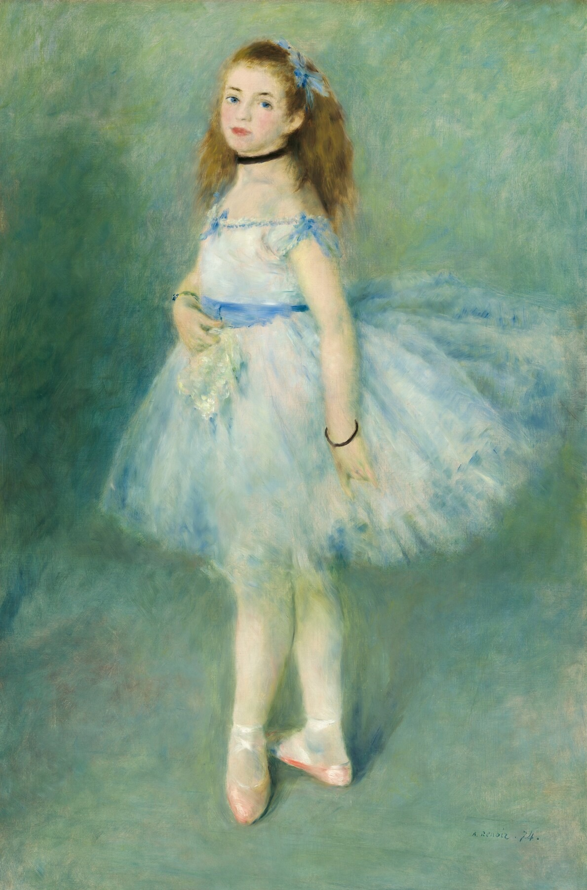

ア．足先と顔を同じ横へ向け、片手でスカートを上げて、踊りの途中で移動する姿を示す。

イ．足先を横へ向けて立ち、片手をスカートの近くに置きながら、顔と視線を鑑賞者へ返す。

ウ．足先を後ろへ上げ、両手を頭上へ伸ばしながら、顔と視線を上の手へ向ける。

エ．足先を正面にそろえ、両手を胸の前で重ねながら、顔を横へそらして静止する。

### 問24

図1の腕と脚の配置に最もよく対応する説明を選びなさい。

図1

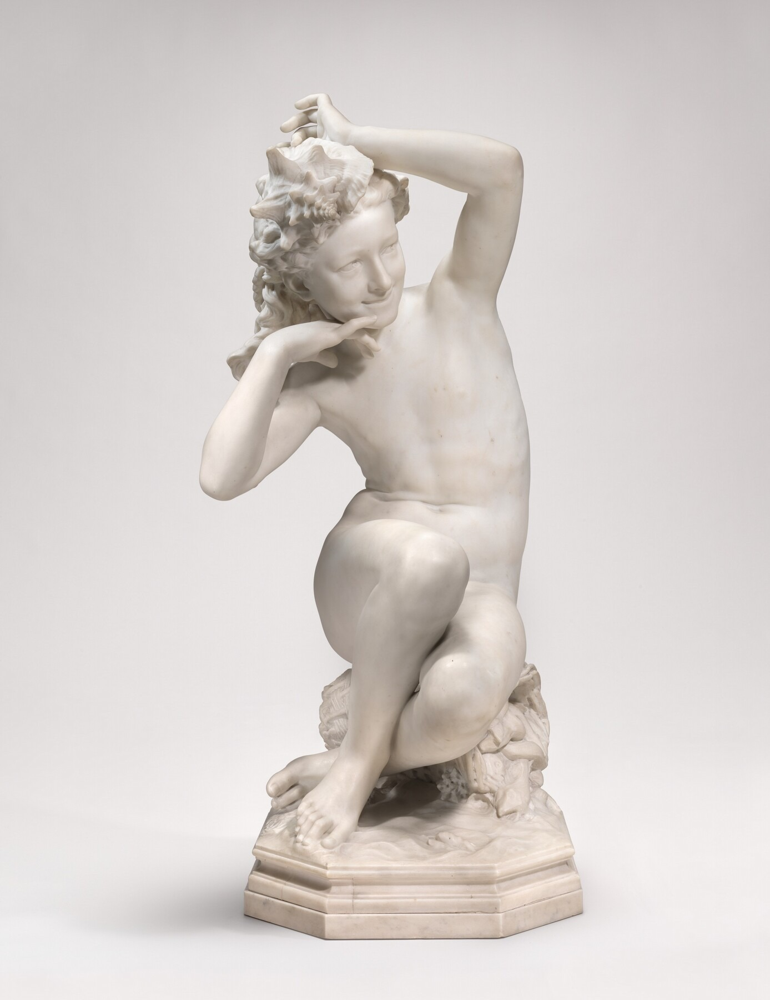

ア．両手を膝の上で重ね、両脚をそろえて正面性の強い直立した座り方をつくる。

イ．片手を頭上へ上げたまま、もう一方を膝へ伸ばし、上体を正面へまっすぐ起こす。

ウ．片腕を頭上へ掲げ、反対の手を顎へ寄せ、曲げた脚とともに曲線の連なりをつくる。

エ．両腕を前へ伸ばし、片膝を地面につけて、正面の対象を押す動作をつくる。

## 大問8 世紀末の多様な制作

作品や活動の記録を読み、時代、素材、主題、表現の方法を対応させて考えなさい。図版がある問いは、その画面も確かめなさい。

### 問25

世紀末のサロメの主題が諸芸術へ広がった関係を整理する。ワイルドの戯曲の挿絵で知られる作家と、この戯曲に基づくオペラを作曲した人物の組合せはどれか。

ア．モロー――リヒャルト・シュトラウス

イ．ビアズリー――ワーグナー

ウ．モロー――ワーグナー

エ．ビアズリー――リヒャルト・シュトラウス

### 問26

図1の樹木と建物の描き方について、形を支える色の使い方を説明したものを選びなさい。

図1

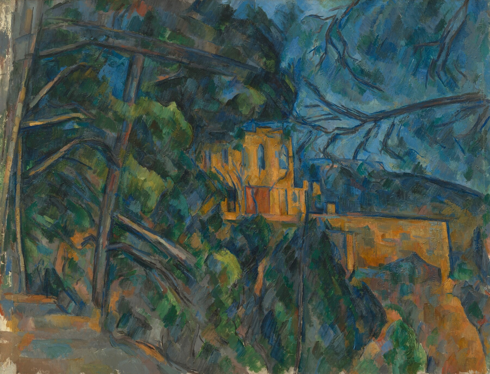

ア．人物の動きを連続した形へ重ね、建物より速度の印象を前面に出す。

イ．輪郭を取り巻く同じ幅の線だけで、幹や壁の内側の色を省略する。

ウ．幹や壁、屋根を異なる方向の色面で組み立て、風景の形を構築的に捉える。

エ．幹と壁を明暗の細かな段階で滑らかにつなぎ、色面の方向の差を目立たなくする。

### 問27

クリムトらが1897年に結成し、独自の展示の場を設けたウィーンの美術運動はどれか。

ア．バウハウス

イ．ウィーン工房

ウ．ドイツ工作連盟

エ．ウィーン分離派

## 大問9 20世紀初頭の変化

作品や活動の記録を読み、時代、素材、主題、表現の方法を対応させて考えなさい。図版がある問いは、その画面も確かめなさい。

### 問28

フォーヴィスムに加わったのち、古典の研究を通して落ち着いた構成や伝統的な人物画などへ向かった画家は誰か。

ア．ジョルジュ・ルオー

イ．ラウル・デュフィ

ウ．モーリス・ド・ヴラマンク

エ．アンドレ・ドラン

### 問29

レジェの絵画に見られる、機械文明と関わる造形の特徴として適切なものを選びなさい。

ア．児童画に通じる細い線や記号によって、幻想的な形の世界をつくる。

イ．水平・垂直と三原色の矩形だけから、普遍的な均衡を追求する。

ウ．円筒などの量感ある形を組み合わせ、機械的・建築的なリズムをつくる。

エ．黒い輪郭で人物を包み、宗教的な苦悩をステンドグラスのように表す。

### 問30

ドイツ表現主義で、見える形や色を変えることと、表したい内容の関係はどれか。

ア．形や色を均衡した古典的比例へ戻し、感情の差を共通の理想像へ整える。

イ．形や色を自然の固有色へそろえ、内面の感情から独立した客観的な記録へ近づける。

ウ．形や色を光学的な混色の単位へ分け、個人の感情より知覚の共通法則を再現する。

エ．形や色を内面の感情や精神的な緊張へ結びつけ、外観の再現を変える。

### 問31

デ・ステイルで1917年に始まった雑誌の役割を、絵画と他分野の関係から説明したものはどれか。

ア．雑誌を絵画の作品目録にし、建築・デザインの制作は別の理論に基づく活動へ分ける。

イ．雑誌を工房の実習記録にし、統一された校長の下で各分野を学ぶ学校の制度をつくる。

ウ．雑誌を展覧会の出品者の年鑑にし、各分野で異なる個人の内面を記録することを中心にする。

エ．造形の理念を雑誌で共有し、絵画から建築・デザインへ共通する原理の展開を図る。

## 大問10 制作と教育の試み

作品や活動の記録を読み、時代、素材、主題、表現の方法を対応させて考えなさい。図版がある問いは、その画面も確かめなさい。

### 問32

デュシャンのレディ・メイドが、作品の価値や独創性へ向けた問いとして適切な説明を選びなさい。

ア．木片や廃材などを組み立て、異なる実物から新しい立体を構成する。

イ．新聞紙などを画面に貼り、描いた物と実物の表面を同じ面に組み合わせる。

ウ．構想を文章の指示として示し、別の人の手による実行で画面を成立させる。

エ．既製品を選び、題や提示の仕方を変えることが、作品を成立させうるかを問う。

### 問33

バーバラ・ヘップワースの彫刻における、穴や糸を用いた造形の意味として最も適切なものを選びなさい。

ア．量塊の形を磨き、一体として完結した卵形などへ単純化する。

イ．鋼材などを切断・接合し、台座を外れた床面へ開放的に広げる。

ウ．立体の内部の空間を、穴や張られた糸によって周囲や表面とつなぐ。

エ．薄い金属片を吊り下げ、空気や釣合いによる実際の動きをつくる。

### 問34

ライトのプレーリー・ハウスを整理する。外観の方向と室内の構成を、それぞれ適切に組み合わせた説明を選びなさい。

ア．高くそびえる垂直性を強める――部屋の間を緩やかにつなぐ開放的な平面

イ．低く長い水平性を強める――厚い壁で同じ大きさの小室を並べる平面

ウ．高くそびえる垂直性を強める――厚い壁で同じ大きさの小室を並べる平面

エ．低く長い水平性を強める――部屋の間を緩やかにつなぐ開放的な平面

## 大問11 戦後美術の展開

作品や活動の記録を読み、時代、素材、主題、表現の方法を対応させて考えなさい。図版がある問いは、その画面も確かめなさい。

### 問35

ポロックのドリッピングを、制作中の身体と絵具の関係から説明したものを選びなさい。

ア．床の画面へ絵具を滴らせ、歩くなどの身体の動きを痕跡として残す。

イ．大きな矩形の色面を重ね、縁が柔らかく見える空間をつくる。

ウ．薄めた絵具を布の繊維へ浸透させ、染みた色と支持体を一体化する。

エ．厚く重ねた絵具などを削り、物の表面に似た荒い質感をつくる。

### 問36

ステラのシェイプト・キャンヴァスで、絵画の支持体と画面の形はどのような関係にあるか。

ア．支持体そのものの外形を変え、縞や画面の構成と結び付ける。

イ．写真のイメージを版で反復し、一つの画面に同じ像を並べる。

ウ．薄めた絵具を布へ染み込ませ、色と支持体の表面を一体化する。

エ．長方形の画面全体へ絵具を滴らせ、中心のない痕跡の網をつくる。

### 問37

リチャード・ハミルトンの活動と、ポップ・アートの成立の関係を説明したものを選びなさい。

ア．イギリスで広告や消費生活のイメージをコラージュし、ポップの先駆的な作品をつくった。

イ．フランスで自動車を圧縮し、工業製品を量塊へ変える運動を進めた。

ウ．イタリアで自然素材を配置し、素材の劣化や変化を作品に取り込んだ。

エ．ドイツで写真や消費社会の像を絵画へ取り込み、資本主義リアリズムを展開した。

### 問38

フランケンサーラーのソーク・ステインで、絵具と布の関係はどのようになるか。

ア．絵具を布へ短い斑点で置き、粒の隙間から地を残して距離による混色を求める。

イ．薄めた絵具を下塗りした布へ重ね、地と分かれた薄い膜の層で色をつなぐ。

ウ．粘度のある絵具を布の上へ盛り、地と分かれた起伏の影で色を分ける。

エ．薄めた絵具を未下塗りの布へ染み込ませ、色と繊維の表面を結びつける。

## 大問12 作品と鑑賞の関係

作品や活動の記録を読み、時代、素材、主題、表現の方法を対応させて考えなさい。図版がある問いは、その画面も確かめなさい。

### 問39

1960年代以後に広がったフォト・リアリズムに対応する説明を選びなさい。

ア．既製の蛍光灯の光によって、周囲の空間を変える。

イ．絵具の強い身ぶりによって、対象の形を崩す。

ウ．最低限の幾何学的な単位を空間へ反復配置する。

エ．写真の像を写し取ったような精緻な絵画を制作する。

### 問40

ジョン・ケージの考え方に近い、音楽と日常の音の関係を選びなさい。

ア．周囲の音を楽器で模倣して整え、再現できる旋律へ置き換えて日常の音を完成する。

イ．演奏中の偶然を失敗として記録し、次回は同じ結果を得る手順へ改める。

ウ．周囲の音を採集して共通の音程へ直し、偶然の違いを作曲家の統一した響きへ戻す。

エ．演奏中に生じる周囲の音や偶然にも耳を向け、音楽として聴く範囲を問い直す。

### 問41

《ライトニング・フィールド》を、固定視点からの落雷映像で紹介する案が出た。柱群の形と現地での鑑賞を踏まえ、作品の条件を失わずに補うべき説明はどれか。

ア．柱は地形に応じて長さを変え、先端を水平にそろえる。映像を記録と区別し、歩行や長い滞在に伴う光と場所の経験を伝える。

イ．柱ごとの長さの差を示し、同じ視点からの一度の落雷で形の変化を完結させることを、現地での体験の目標として示す。

ウ．柱の先端は地形に平行に上下する。映像を記録と区別し、長い滞在で光の変化を経験する条件を伝える。

エ．先端の水平面を示せば、落雷を撮影した瞬間を現地体験の規準にできるため、映像の固定視点を作品の鑑賞条件として示す。

## 大問13 古代日本の素材と形

日本の作品と美術の活動を取り上げる。作品の形や材料、制作と受容の記録を、問われた事項へ対応させて考えなさい。

### 問42

古墳の墳丘上や周囲に並べられ、人・動物・家などの形も作られた土製品はどれか。

ア．土偶

イ．埴輪

ウ．経筒

エ．須恵器の骨蔵器

### 問43

東大寺大仏と、空海が伝えた密教の両界曼荼羅を比較する。尊像や図像の中心となる仏と教えの対応が適切なものはどれか。

ア．東大寺大仏―大日如来・禅の公案／両界曼荼羅―盧舎那仏を中心とする浄土の世界

イ．東大寺大仏―阿弥陀如来・極楽往生／両界曼荼羅―釈迦如来の前世物語

ウ．東大寺大仏―盧舎那仏・華厳の世界／両界曼荼羅―大日如来を中心とする密教の世界

エ．東大寺大仏―弥勒菩薩・未来の救済／両界曼荼羅―薬師如来による現世の病気平癒

### 問44

頭部や体幹などを複数の木材から彫り、接ぎ合わせて像を作る技法はどれか。

ア．金銅造

イ．寄木造

ウ．一木造

エ．脱活乾漆造

## 大問14 信仰と物語の造形

日本の作品と美術の活動を取り上げる。作品の形や材料、制作と受容の記録を、問われた事項へ対応させて考えなさい。

### 問45

頭部と装身具を観察し、図の尊像の形式として適切なものを選べ。

図1

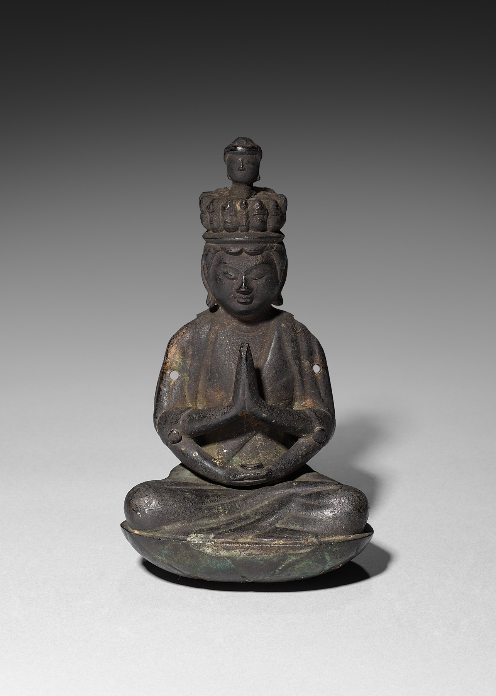

ア．如意輪観音／片膝を立て、頬に手を添える六臂の観音

イ．千手観音／多数の手を身の周囲に広げる観音

ウ．聖観音／頭上に小面を重ねない通常の一面の観音

エ．十一面観音／本面の上に複数の小面を重ねる観音

### 問46

『源氏物語絵巻』から『紫式部日記絵巻』へ継承された室内描写を、吹抜屋台に即して説明したものはどれか。

ア．屋根を省いて斜め上から室内を見せ、人物と部屋・庭の関係を一画面に組む

イ．柱や壁も省いて人物を同じ線上に並べ、部屋ごとの位置の違いを消す

ウ．屋根を省く描写は鎌倉期に初めて現れ、源氏の絵巻では室外から見る

エ．屋根を透ける材質として描き、建物の構造を正面から実測図のように示す

### 問47

『平家納経』と『一遍聖絵』の資料としての性格を適切に比較したものはどれか。

ア．平家納経：平氏の合戦の戦功を絵で記録／一遍聖絵：祖師の遊行と各地の景観を描く

イ．平家納経：一門の結縁による厳島への写経奉納／一遍聖絵：祖師の遊行と各地の景観を描く

ウ．平家納経：一門の結縁による厳島への写経奉納／一遍聖絵：祖師の教えを上下二段の経文と絵で示す

エ．平家納経：各地を遊行する祖師の伝記／一遍聖絵：一門の結縁による厳島への写経奉納

## 大問15 中世から近世への表現

日本の作品と美術の活動を取り上げる。作品の形や材料、制作と受容の記録を、問われた事項へ対応させて考えなさい。

### 問48

建長寺と比叡山延暦寺の伽藍を、配置と地形の関係から比較した説明はどれか。

ア．建長寺：主要堂舎を一つの塔の周囲に放射状に配す／延暦寺：三地域に堂が分かれる

イ．建長寺：主要堂舎を軸上に並べる／延暦寺：山内の東塔・西塔・横川に堂が分かれる

ウ．建長寺：山中の三地域へ主要堂舎が分散／延暦寺：門・仏殿・法堂が一つの軸上に並ぶ

エ．建長寺：主要堂舎を軸上に並べる／延暦寺：主要堂舎が一つの平坦な敷地へ集まる

### 問49

衣装、手の持物、足元を観察し、図の尊格と働きに合う説明を選べ。

図1

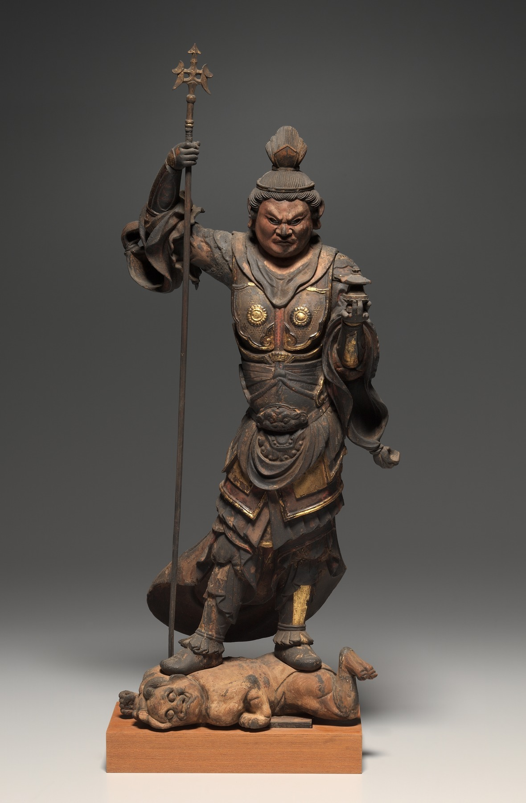

ア．広目天／西方を守る護法神で、筆と巻物を持つ姿を示す

イ．毘沙門天／武装し宝塔を持つ護法神として仏法を守る

ウ．増長天／南方を守る護法神で、ここでは剣を構える姿を示す

エ．持国天／東方を守る護法神で、刀を持つ姿を示す

### 問50

龍安寺方丈庭園と桂離宮の庭園を、水の表し方と鑑賞法の関係から比較した説明はどれか。

ア．龍安寺：舟で池を渡る／桂離宮：石砂による枯山水を園路から観る

イ．龍安寺：石砂の庭を方丈側から観る／桂離宮：池泉の周囲を巡り景の変化を味わう

ウ．龍安寺：実際の池を巡る／桂離宮：石砂の庭を方丈から観る

エ．龍安寺：石砂の庭を方丈側から観る／桂離宮：実際の池を一つの方丈から観ることを中心とする

### 問51

一休宗純によるこの掛幅の文字と線について、適切な説明はどれか。

図1

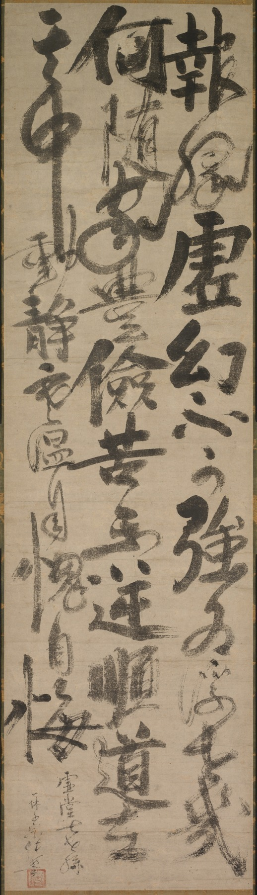

ア．文字の大きさと線幅を均等にそろえた墨蹟で、整然とした字列を主に見せる

イ．上に文字、下に人物の絵を配した掛幅で、詩と絵を一体にする

ウ．文字の大小と線の強弱に変化をつけた仮名の消息で、和歌の交換を伝える

エ．文字の大小と線の強弱に変化をつけた肉筆の墨蹟で、禅僧の書として尊ばれた

### 問52

図1の画面の形と二人の人物を確かめ、主題と旧構成を組み合わせた説明を選びなさい。目録では、同形の絵二十面を配した屏風から、この一面が掛幅へ改装されたとされる。

図1

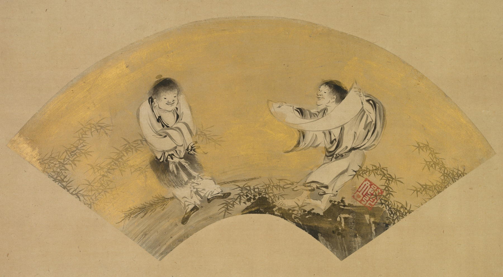

ア．寒山・拾得を描く扇形の画面で、旧来は扇面散らしの構成をなした。

イ．布袋と唐子を描く扇形の画面で、旧来は扇面散らしの構成をなした。

ウ．布袋と唐子を描く短冊形の画面で、旧来は短冊散らしの構成をなした。

エ．寒山・拾得を描く短冊形の画面で、旧来は短冊散らしの構成をなした。

## 大問16 近世の制作と生活

日本の作品と美術の活動を取り上げる。作品の形や材料、制作と受容の記録を、問われた事項へ対応させて考えなさい。

### 問53

図の幹にみられる彩色の状態と、その制作法の組合せとして適切なものはどれか。

図1

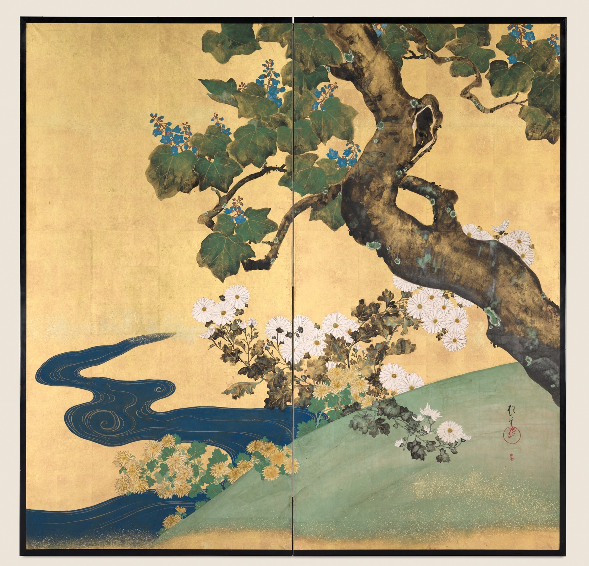

ア．色の境ににじみやたまりがある／先の墨や絵具が乾かぬうちに別の色を加える

イ．裏側から透ける色で淡く見せる／絹の裏面に彩色を施す

ウ．線の内側に均一な色を置く／乾いてから輪郭を描き起こす

エ．輪郭に沿って段階的に濃くする／乾いた面へ細い線を重ねて肉付けする

### 問54

本殿と拝殿を「石の間」と呼ばれる空間でつなぎ、一体の社殿とする建築形式はどれか。

ア．神明造

イ．春日造

ウ．権現造

エ．大社造

## 大問17 江戸時代の絵画と出版

日本の作品と美術の活動を取り上げる。作品の形や材料、制作と受容の記録を、問われた事項へ対応させて考えなさい。

### 問55

二幅に描かれた植物・動物と、吉祥的な意味の組合せとして最も適切なものはどれか。

図1

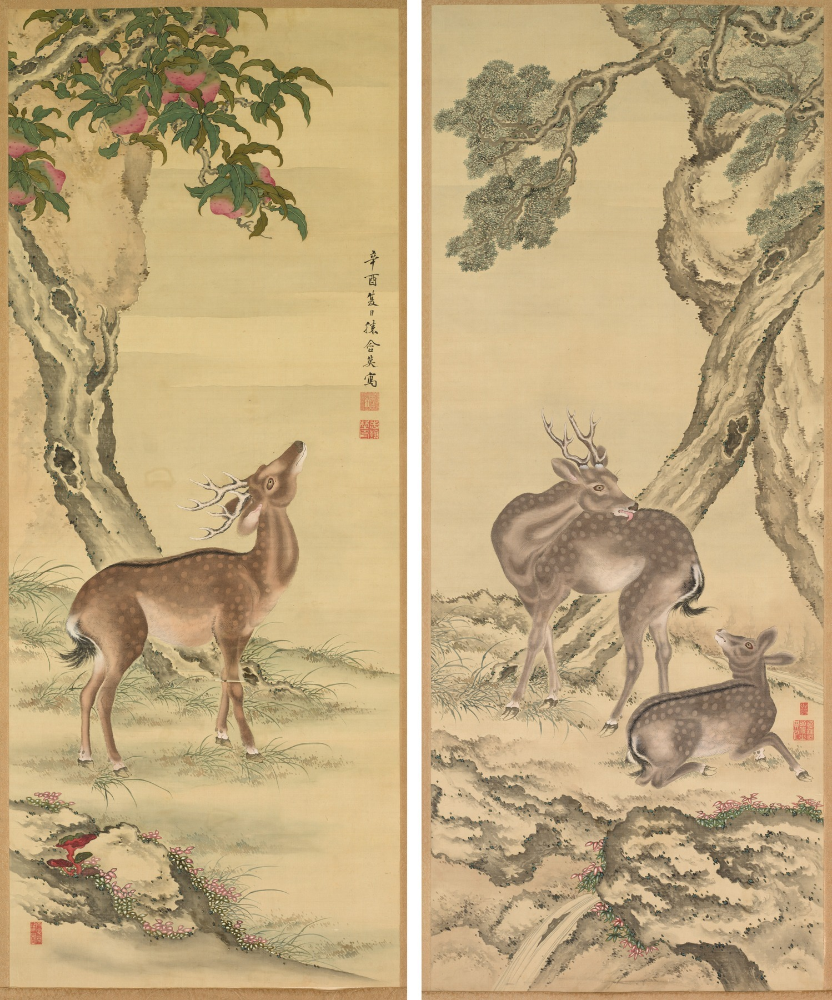

ア．梅・竹と鶴／寒さに耐える節操と長寿

イ．松・桃と鹿／長寿や不老を願う吉祥

ウ．松・牡丹と孔雀／富貴と華やかさを願う吉祥

エ．柳・蓮と鴛鴦／男女の和合を願う吉祥

### 問56

『十便十宜図』の作者の分担と主題の対応として適切なものはどれか。

ア．池大雅：十便／与謝蕪村：十宜／蘇軾の赤壁の遊びを詠む賦

イ．池大雅：十宜／与謝蕪村：十便／李漁の山荘生活と自然を詠む詩

ウ．池大雅：十宜／与謝蕪村：十便／陶淵明の桃源郷を描く記

エ．池大雅：十便／与謝蕪村：十宜／李漁の山荘生活と自然を詠む詩

### 問57

図の浮世絵の画面形式を表す名称として適切なものはどれか。

図1

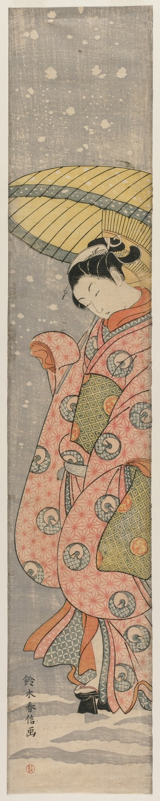

ア．大判の三枚続

イ．大判の縦絵

ウ．大判の横絵

エ．柱絵

### 問58

本を読む人物、傍らの植物、題「蘇仙公」の関係から、この版画の表現として適切なものはどれか。

図1

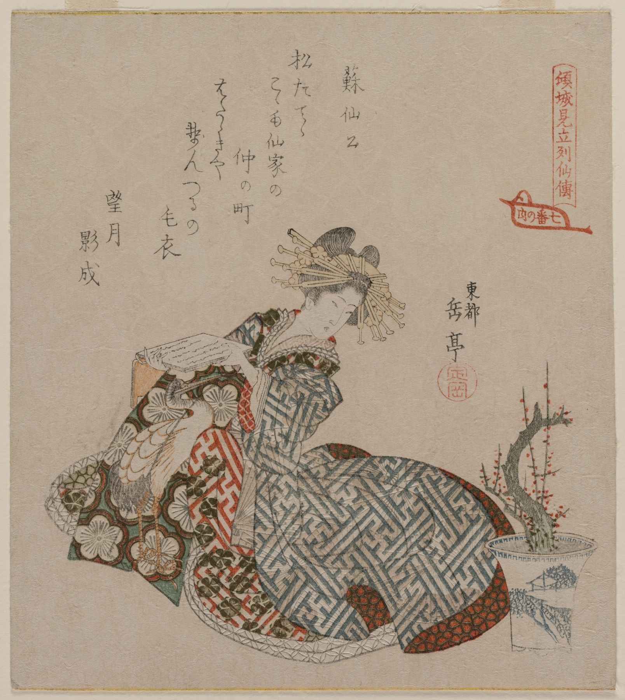

ア．中国の仙人の主題を当世の遊女の姿へ移す見立て

イ．梅の名所を特定し、当地の人々の読書を紹介する名所絵

ウ．仙人の伝記を、当時の中国の衣装と住居に忠実に描く故事画

エ．遊女を描いた役者の似顔から、実際の上演を記録する役者絵

## 大問18 近代日本の制度と制作

日本の作品と美術の活動を取り上げる。作品の形や材料、制作と受容の記録を、問われた事項へ対応させて考えなさい。

### 問59

近代彫刻の展開について、作家と活動の対応が適切なものはどれか。

ア．高村光雲―木彫と美術学校の指導／荻原守衛―官展での写実的な人物像／朝倉文夫―ロダンに学ぶ塑造

イ．高村光雲―ロダンに学ぶ塑造／荻原守衛―木彫と美術学校の指導／朝倉文夫―官展での写実的な人物像

ウ．高村光雲―木彫と美術学校の指導／荻原守衛―ロダンに学ぶ生命感ある塑造／朝倉文夫―官展での写実的な人物像

エ．高村光雲―官展での写実的な人物像／荻原守衛―木彫と美術学校の指導／朝倉文夫―ロダンに学ぶ塑造

### 問60

梅原龍三郎の油彩に見られる、日本的・東洋的な色彩感覚と油彩の融合を説明したものはどれか。

ア．滑らかな乳白色の下地に繊細な墨線を用い、パリの裸婦像で独自の画肌を確立する。

イ．落ち着いた土色の明暗で、農作業をする人々と農村の日常を自然主義的に捉える。

ウ．対象の細部を古典的な写実で描き込み、岸田劉生らと草土社の活動を進める。

エ．厚みのある絵具と鮮やかな色の対比を生かし、東洋の造形感覚とも結び付く力強い画面を作る。

### 問61

二科展の開始と春陽会の結成を、文展から帝展への歩みと関連付けた説明はどれか。

ア．二科展は文展開始後・帝展への改組前に始まり、春陽会は文展開始前に結成された

イ．二科展は文展開始後・帝展への改組前に始まり、春陽会は帝展への改組後に結成された

ウ．二科展は文展開始前に始まり、春陽会は帝展への改組後に結成された

エ．二科展は帝展への改組後に始まり、春陽会は帝展への改組前に結成された

### 問62

「会場芸術」を掲げ、大画面の日本画で広く観衆に訴えようとした川端龍子が結成した団体はどれか。

ア．白馬会

イ．国画創作協会

ウ．青龍社

エ．草土社

### 問63

草土社における岸田劉生らの表現として、最も近い説明はどれか。

ア．細密な観察に基づき、身近な人物や静物の質感・存在感を追究する

イ．光の下の色を小さな筆触に分け、明るい空気の揺らぎを捉える

ウ．幾何学的な形へ対象を分解し、多方向からの見えを組み立てる

エ．鮮烈な色と大きな変形を使い、輪郭や比例を自由に組み替える

## 大問19 戦後日本の美術活動

日本の作品と美術の活動を取り上げる。作品の形や材料、制作と受容の記録を、問われた事項へ対応させて考えなさい。

### 問64

戦後の前衛について、九州派とハイレッド・センターの活動の特徴を適切に対応させたものはどれか。

ア．九州派―身体で絵具を広げる絵画制作／ハイレッド・センター―都市での集団的行為

イ．九州派―身体で絵具を広げる絵画制作／ハイレッド・センター―アスファルトなどを統一画材とする絵画

ウ．九州派―アスファルトなどの身近な異素材／ハイレッド・センター―都市での集団的行為

エ．九州派―アスファルトなどの身近な異素材／ハイレッド・センター―身体で絵具を広げる絵画制作

### 問65

元永定正が1950年代から展開した空間造形について、素材と設置の説明が適切なものはどれか。

ア．透明なビニールの袋やチューブへ色水を入れ、吊るしたり樹木の間へ渡したりする

イ．張った紙へ身体で飛び込み、裂けた紙と行為の関係を見せる

ウ．アスファルトに廃物や新聞紙を取り込み、黒く重い物質の表面を作る

エ．電球やコードを服の形へ組み、点滅する光を身にまとう

### 問66

仏教的な主題や力強い人物像を木版に刻み、自ら「板画」という呼び方を用いた作家は誰か。

ア．山本鼎

イ．棟方志功

ウ．恩地孝四郎

エ．川上澄生

## 大問20 現代美術の媒体と批評

現代美術の実践と批評について、媒体、制作の過程、鑑賞や社会との関係に注目して考えなさい。

### 問67

アニッシュ・カプーアが石材に暗い空洞を設ける彫刻で探る問題として、最も適切なものはどれか。

ア．石の産地ごとの地層を断面に並べ、材質の差を地質標本の分類に対応させる。

イ．表面にも奥へ続く空間にも感じられる空洞を通し、物質の存在と空虚の知覚を揺さぶる。

ウ．石の外形を人体の比率へ近づけ、内側の空洞を人物の表情の説明として用いる。

エ．削った各面の形を同じ単位へそろえ、反復する量塊の規格を空間の基準として示す。

### 問68

ジェフ・クーンズが、玩具や家庭の消費物などの見慣れたイメージを扱う方法を選ぶ。キッチュや消費社会との関係でも論じられる、この作家の活動を説明するものとして最も適切なのはどれか。

ア．商品のような形を拡大し、光沢をもつ彫刻などへ作り替えて価値や欲望を問いかける。

イ．廃棄された機械の部品を組み合わせ、回転や騒音を発する装置として動かす。

ウ．市販の用具へ署名を加えて出品し、完成品を選ぶ行為そのものを作品とする。

エ．商品の包装を図案化し、シルクスクリーンで同じ平面像を反復することを中心とする。

### 問69

シェリー・レヴィーンの《アフター・ウォーカー・エヴァンズ》では、先行する写真家の写真を再撮影する。この制作法の美術史上の位置づけと批評上の焦点を結びつけた説明はどれか。

ア．アプロプリエーション。先行写真が記録した時代や人々を検証し、歴史資料としての証拠能力を主に高める。

イ．レディメイド。撮影済みの原版をそのまま出品し、工業的な既製物の用途を変更する。

ウ．フォトモンタージュ。複数の先行写真を切り合わせ、新しい場面の物語を写真上で組み立てる。

エ．アプロプリエーション。既存の像を制作へ取り込み、最初に撮影したことと、新たな作品の作者であることとの関係を問う。

## 大問21 日本とアジアの表現活動

### 問70

徐冰（シュー・ビン）の《天書》には、漢籍を思わせる大量の文字が印刷され、書籍や巻物などとして展開される。この作品で用いられる文字の特徴として、最も適切なのはどれか。

ア．英単語の綴りを漢字風の一字に収め、英語として読み解ける書体を用いる。

イ．歴史的な石碑から文字を採り、年代別の実際の字形を対照する資料にする。

ウ．漢字に似た字形を新たに創作し、通常の文章としては読めない文字を用いる。

エ．古い辞書から現存する異体字を選び、専門家なら読める漢文へ組み立てる。

## 大問22 作品と社会の関係

### 問71

村上隆が提唱した「スーパーフラット」を、伝統絵画と現代の視覚文化のつながりから紹介する。平面的な画面の構成と併せて、特に関係を示す現代の表現として最も適切なのはどれか。

ア．漫画やアニメーションの図像・表現

イ．工業規格に従う立体部品の組立図

ウ．国際様式建築の平面図と断面図

エ．報道写真の連続記録と写真週刊誌

## 大問23 アジアの書画と工芸

アジアの造形と文化の交流について、材料、主題、表現や資料の役割を照合して考えなさい。

### 問72

正倉院に伝わる、円形の切り込みをもつガラス碗を東西交流の観点から紹介する。カット装飾の技術や造形と関係の深い地域・王朝はどれか。

ア．ササン朝のペルシア

イ．高麗時代の朝鮮半島

ウ．東ローマ帝国の首都

エ．唐代の中国南部

### 問73

図は14世紀初頭、絹に墨と彩色で描かれた中国の山水画である。水辺に沿う建物と岸の輪郭も確認する。山・岩と水辺の表し方を観察し、画法と作者の組合せが合うものを選べ。

図1

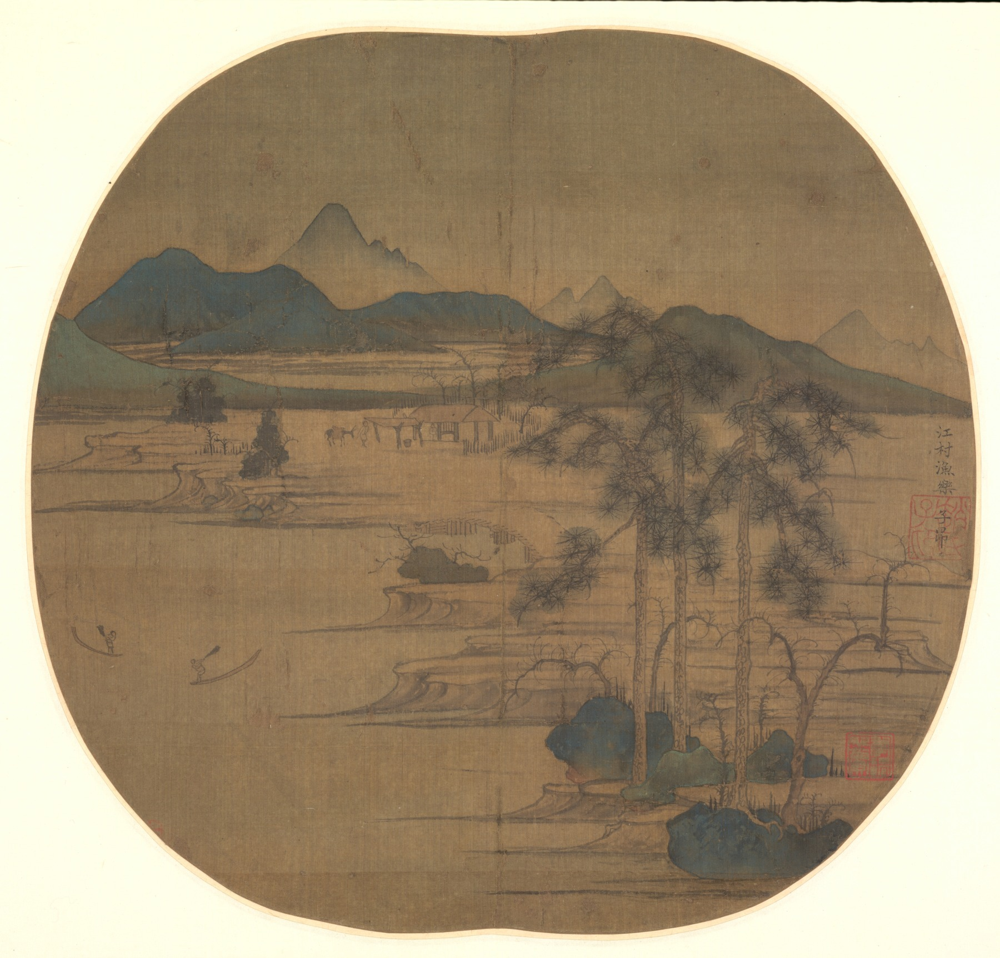

ア．青緑の彩色と細い線を併用する―趙孟頫

イ．青緑の彩色と細い線を併用する―沈周

ウ．山の量感を主に墨の大きな塊へまとめる―趙孟頫

エ．山の量感を主に墨の大きな塊へまとめる―沈周

### 問74

高麗仏画に見られる支持体と衣の表現を説明するものとして、最も適切なのはどれか。

ア．紙に水墨で描き、衣の量感を主に破れた墨線と淡墨で表す。

イ．紙に墨線を写し、衣の色面を同じ版木の墨の濃淡で刷り分ける。

ウ．絹に彩色し、衣の細密な文様や装身具に金を用いる。

エ．絹に彩色するが、衣の文様を描かず金地の光で姿を浮かべる。

## 大問24 工芸の技法とデザイン

工芸とデザインを取り上げる。制作の工程、材料、形や文様を、資料の記録と区別しながら考えなさい。

### 問75

螺鈿と平文を併用した漆器の装飾を調べる。二つの技法の文様材を正しく説明するものはどれか。

ア．螺鈿は金銀の粉、平文は貝の真珠層を漆へ混ぜて用いる。

イ．螺鈿は貝の真珠層、平文は金銀等の薄板を文様の形に切って用いる。

ウ．螺鈿は金銀等の薄板、平文は貝の真珠層を文様の形に切って用いる。

エ．螺鈿は貝の真珠層、平文は金銀の粉を文様に沿って蒔いて用いる。

### 問76

有線七宝の器胎・文様の輪郭・色の材料の関係が合う説明はどれか。

ア．金属の器胎に細い金属線で境界をつくり、区画へガラス質の釉を入れて焼き付ける。

イ．金属の器胎に細い金属線で境界をつくり、区画へ別の金属板を嵌めて色を分ける。

ウ．陶磁器の器胎に絵具の線で境界を描き、区画の釉を器胎と同じ材料で埋める。

エ．金属の器胎に紙の型で境界を残し、区画へ漆と金属粉を入れて乾燥させる。

### 問77

1925年のパリの装飾美術博覧会と結びつき、幾何学的な文様や流線的な形を含む20世紀前半のデザインを紹介する。最も適切な見出しはどれか。

ア．アール・ヌーヴォー

イ．アール・デコ

ウ．ユーゲントシュティール

エ．グラスゴー派

### 問78

図はモリスがデザインした綿布《チューリップ》である。目録には文様をローラーで布へ転写したとある。図の植物のつながりと、この制作法の分類が合うものを選べ。

図1

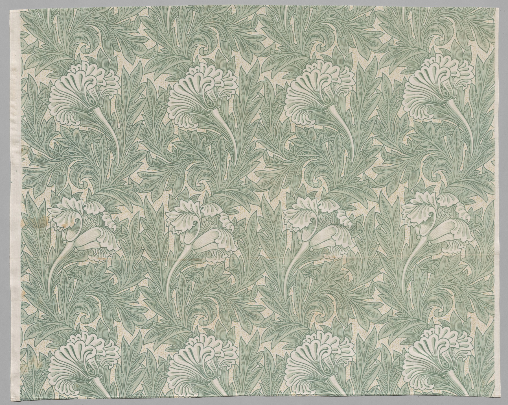

ア．植物の単位が隣へ連なって反復する―捺染

イ．中央の一本の幹へ左右の植物を集める―捺染

ウ．植物の単位が隣へ連なって反復する―綴織

エ．中央の一本の幹へ左右の植物を集める―綴織

## 大問25 美術館の成立と収集

### 問79

自然物から書籍・古物までを含むハンス・スローンの収集が、1753年の設立の基礎となった施設を選ぶ。美術品の展示にとどまらず、自然や文化を横断する公共的な博物館の成立という観点から、該当するのはどれか。

ア．ヴィクトリア・アンド・アルバート博物館

イ．テート・ブリテン

ウ．大英博物館

エ．ナショナル・ギャラリー

## 大問26 展覧会とコレクションの制度

### 問80

ヴェネツィア・ビエンナーレの歩みを、①最初の国際的な美術展、②ジャルディーニ（庭園会場）に外国の独立した国別館が加わる出来事に分ける。独立した国別館とは、参加国が会場に設ける建物を指し、中央の共通建物への出品とは区別する。年代・国との対応が合うものはどれか。

ア．①1955年／②1907年の日本館

イ．①1895年／②1907年のベルギー館

ウ．①1955年／②1907年のベルギー館

エ．①1895年／②1907年の日本館

## 大問27 図録の実物寸法と掲載計画を照合する

### 問81

二つの彫刻を載せる図録を編集する。目録①は「人物の頭部、ブロンズ、16.5×20.9×18.1cm（高さ×幅×奥行）」、目録②は「犬と貝、象牙、高さ3.9cm」である。図録の実物寸法欄はmmに統一し、掲載写真内の作品の高さはA・Bとも39mmにする計画である。図の対応、実物の寸法欄、掲載写真の縮小・原寸・拡大の別がすべて合う編集案はどれか。

図A

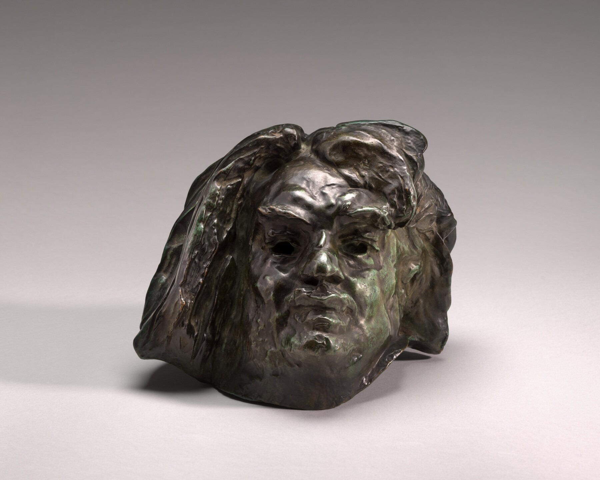

図B

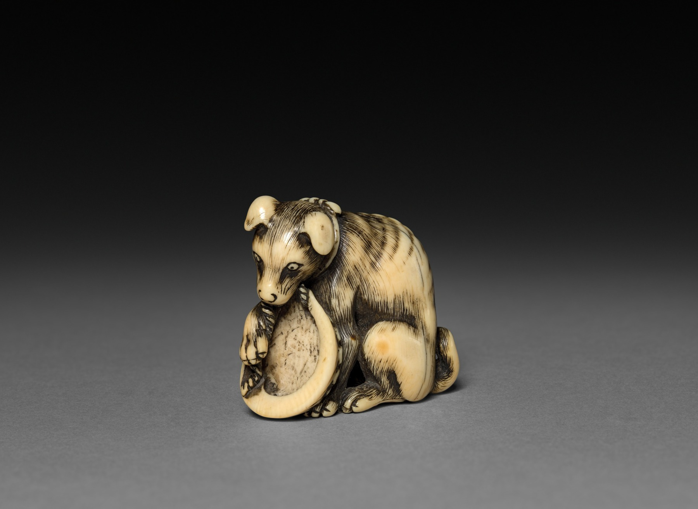

ア．Aは高さ165×幅209×奥行181mmで縮小掲載。Bは高さ39mmで原寸掲載とする。

イ．Aは高さ16.5×幅20.9×奥行18.1mmで拡大掲載。Bは高さ3.9mmで拡大掲載とする。

ウ．Aは高さ39mmで原寸掲載。Bは高さ165×幅209×奥行181mmで縮小掲載とする。

エ．Aは高さ209×幅165×奥行181mmで縮小掲載。Bは高さ39mmで原寸掲載とする。

## 大問28 動物の動きと切り取られた瞬間

### 問82

二点の動物画を、向きと重なりから比較する。Aの二羽のくちばしの向き、Bの前景と奥の頭部の位置を追い、図で確かめられる記録を選べ。

図A

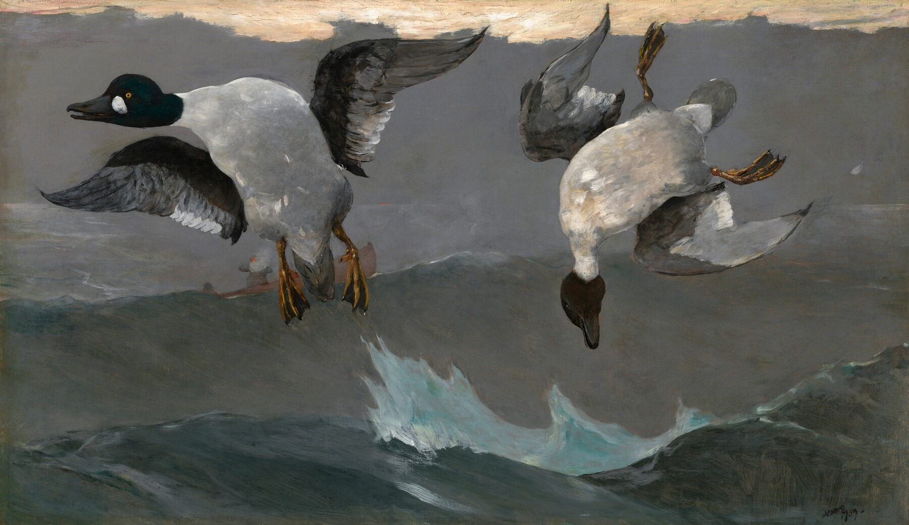

図B

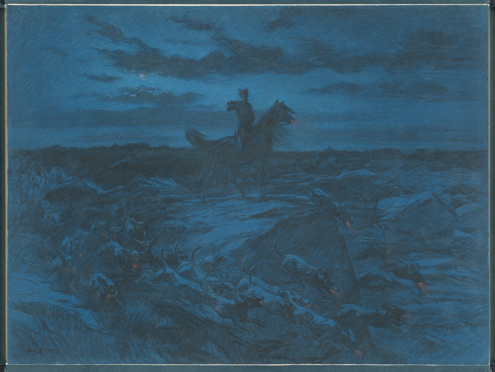

ア．Aは左のくちばしが左、右のくちばしが下へ向く。Bは奥の二頭の頭部が前景の背より低い位置に収まる。

イ．Aは左のくちばしが左、右のくちばしが下へ向く。Bは身体が重なり、奥の二頭の頭部が高い位置に出る。

ウ．Aは左のくちばしが左、右のくちばしが上へ向く。Bは奥の二頭の頭部が前景の背より低い位置に収まる。

エ．Aは左のくちばしが左、右のくちばしが上へ向く。Bは身体が重なり、奥の二頭の頭部が高い位置に出る。

## 大問29 配置と全体寸法・掲載範囲の照合

### 問83

目録①は「紙に墨と彩色の絵巻、全体35.5×339.5cm」、②は「円形の銅製品、直径18.5cm」と記す。掲載写真の文字・人物・鳥の配置と寸法を照合する。図の観察と、写真が示す範囲を区別した図録の注記はどれか。

図A

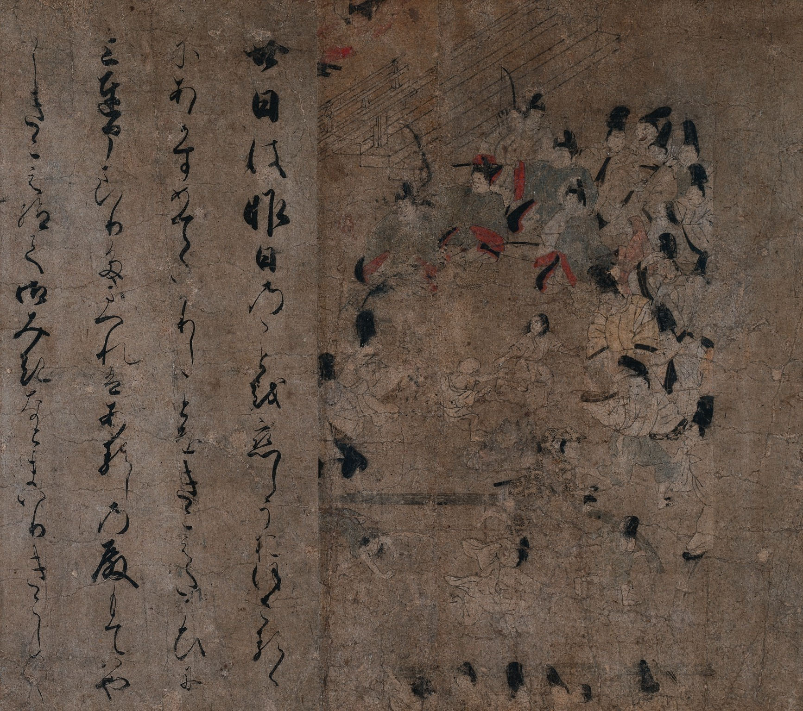

図B

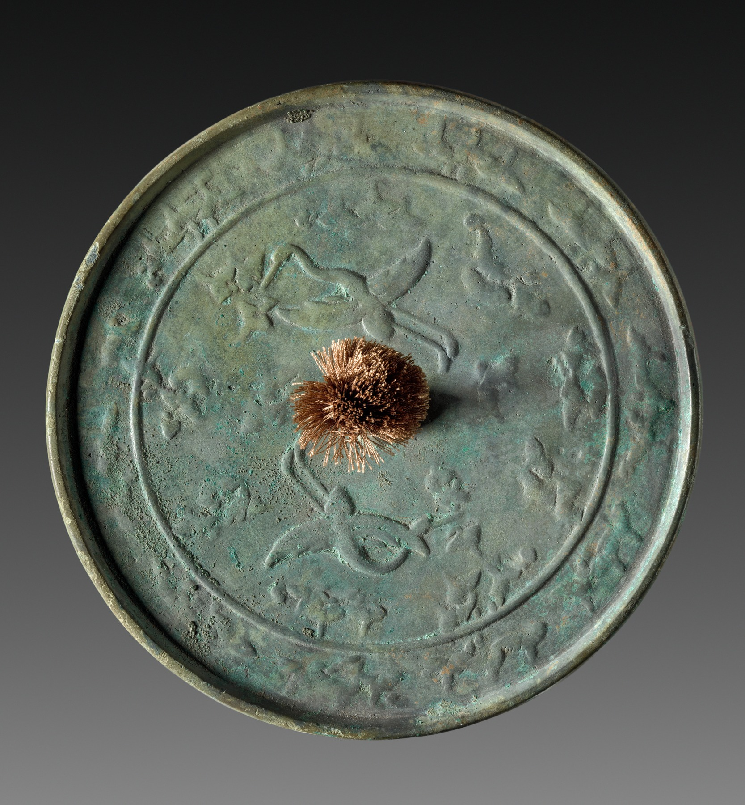

ア．A→①、B→②。Aは左に文字、右に人物群があり、Bの鳥は中央を挟んで上下にある。①の全体寸法をAの写真の縦横比に合う数値へ補正する。

イ．A→①、B→②。Aは左に文字、右に人物群があり、Bの鳥は中央を挟んで左右にある。①の全体寸法をAの写真の縦横比に合わせて変更しない。

ウ．A→①、B→②。Aは右に文字、左に人物群があり、Bの鳥は中央を挟んで上下にある。①の全体寸法をAの写真の縦横比に合わせて変更しない。

エ．A→①、B→②。Aは左に文字、右に人物群があり、Bの鳥は中央を挟んで上下にある。①の全体寸法をAの写真の縦横比に合わせて変更しない。

## 大問30 主題の時代と制作の時代

### 問84

資料①は「聖ベネディクトの古い故事、15世紀制作、板にテンペラ」、②は「1821〜22年、雲の研究、紙に油彩、カンヴァスに貼付」と記す。図録で主題の時代・制作年・一次支持体を分ける。図の対応と編集判断が合うものを選べ。

図A

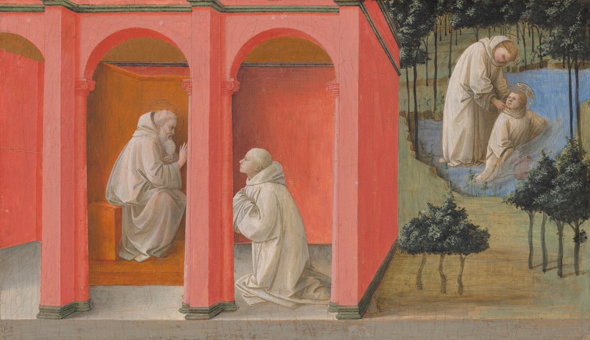

図B

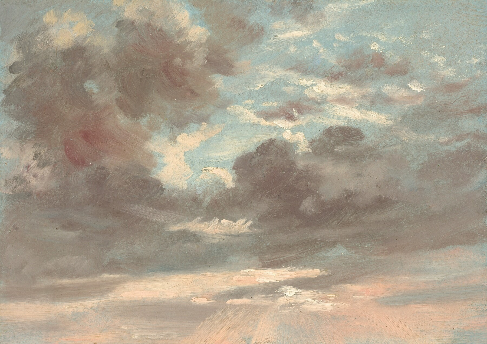

ア．A→①、B→②。Aは故事の時代に制作年を変更しない。Bは貼付先のカンヴァスを一次支持体と記す。

イ．A→①、B→②。Aは故事の時代へ制作年を変更する。Bは貼付先でなく紙を一次支持体と記す。

ウ．A→①、B→②。Aは故事の時代に制作年を変更しない。Bは貼付先でなく紙を一次支持体と記す。

エ．A→②、B→①。Bは故事の時代に制作年を変更しない。Aは貼付先でなく紙を一次支持体と記す。

## 大問31 物の輪郭と水面の描写

### 問85

静物と水景の画面を、輪郭の強弱と物の前後関係から比べる。Aでは果物・布・台の縁、Bでは帆柱と水面の境を見て、両方の観察が合う記録を選べ。

図A

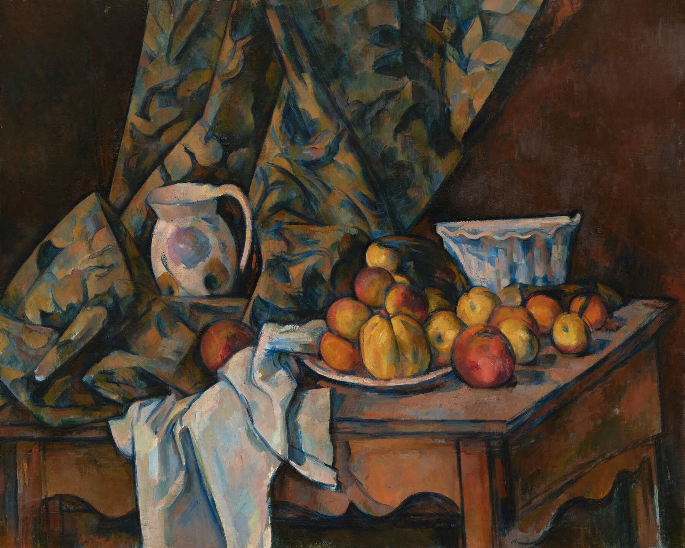

図B

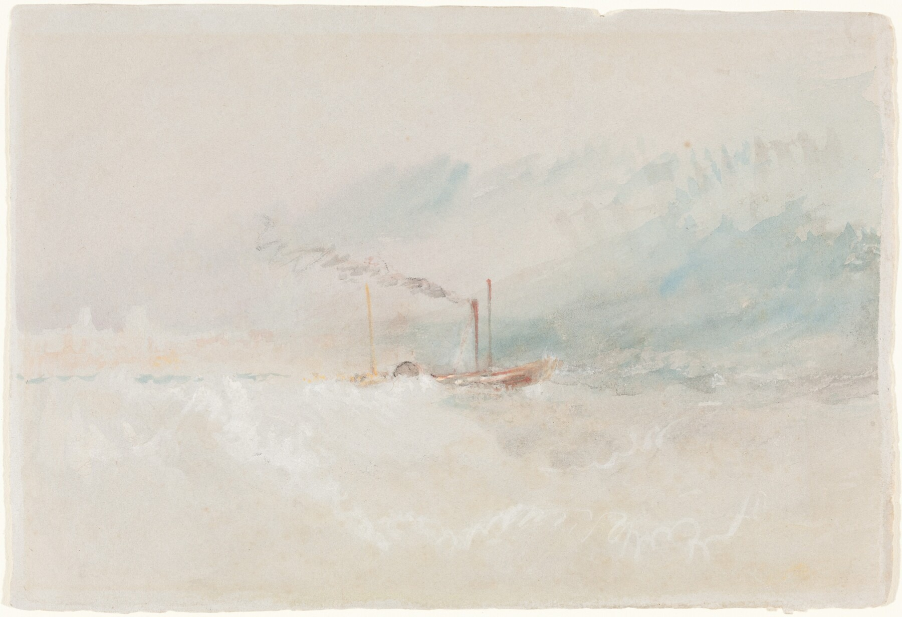

ア．Aの白い布は台の縁を越えて手前へ垂れる。Bは帆柱の線が周囲の水面と同じ程度に溶け、形を線で追えない。

イ．Aの白い布は台の縁より奥へ収まる。Bは帆柱の線が周囲の水面と同じ程度に溶け、形を線で追えない。

ウ．Aの白い布は台の縁より奥へ収まる。Bは帆柱の細い線を追えるが、周囲の水面との境は淡い。

エ．Aの白い布は台の縁を越えて手前へ垂れる。Bは帆柱の細い線を追えるが、周囲の水面との境は淡い。
