# 美術検定2級 模擬試験4（非公式）

全85問・4択・60分。美術史80問＋活用5問。図版はカラー表示・印刷を推奨。

## 大問1 古代と中世の造形・役割

作品や活動の記録を読み、時代、素材、主題、表現の方法を対応させて考えなさい。図版がある問いは、その画面も確かめなさい。

### 問1

エーゲ海のクレタ文明を代表する宮殿で、島の海洋交易による繁栄とも関わる遺跡はどれか。

ア．クノッソス宮殿

イ．ペルセポリスの宮殿

ウ．アクロポリスのパルテノン神殿

エ．ローマのパンテオン

### 問2

ギリシア陶器の黒絵式を赤絵式と区別する。黒く塗られる部分と、人物の細部を表す基本的な方法の組合せとして適切なものはどれか。

ア．人物のシルエット――赤く残した人物へ筆の線で細部を表す。

イ．人物の周りの背景――黒い層を刻んだ線で細部を表す。

ウ．人物の周りの背景――赤く残した人物へ筆の線で細部を表す。

エ．人物のシルエット――黒い層を刻んだ線で細部を表す。

### 問3

ビザンティン美術で、キリスト・聖母・聖人を描き礼拝に用いた聖像画の一般的な名称はどれか。

ア．イコン

イ．パントクラトール

ウ．デイシス

エ．ミニアチュール

### 問4

図1の聖人と足元の人物群の大きさは、どのような関係として理解できるか。

図1

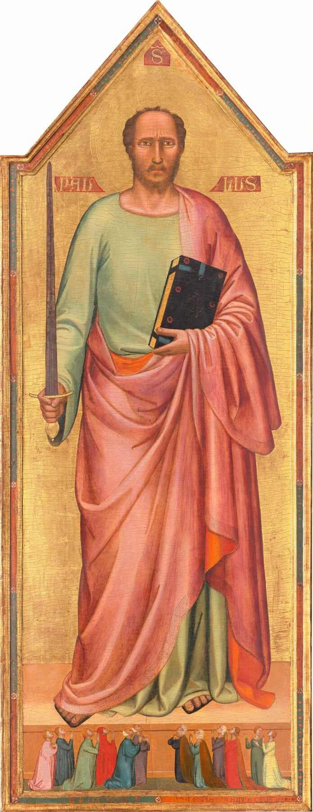

ア．大きな聖人と小さな礼拝者を、同じ種類の人物の実際の身長差として結びつける。

イ．聖人を手前の礼拝者より奥に置き、人物群の列が奥へ進むにつれて像が大きくなる関係を示す。

ウ．聖人の大きな身体と小さな礼拝者を、意味上の序列を示す尺度として結びつける。

エ．近くの聖人と遠くの礼拝者を、同じ地面の奥行きに従う遠近の尺度として結びつける。

## 大問2 ルネサンスの素材と表現

作品や活動の記録を読み、時代、素材、主題、表現の方法を対応させて考えなさい。図版がある問いは、その画面も確かめなさい。

### 問5

フレスコの基本的な制作方法を述べたものを選びなさい。

ア．乾いた板に、卵などで練った顔料を用いて描く。

イ．布や板に、乾性油で練った顔料を用いて描く。

ウ．生乾きの漆喰に、水で溶いた顔料を用いて描く。

エ．温めた蝋と顔料を混ぜ、固まる性質を用いて描く。

### 問6

図1の女性が座る位置に注目しなさい。この聖母子像の姿と結び付く主題として、最も適切な説明を選びなさい。

図1

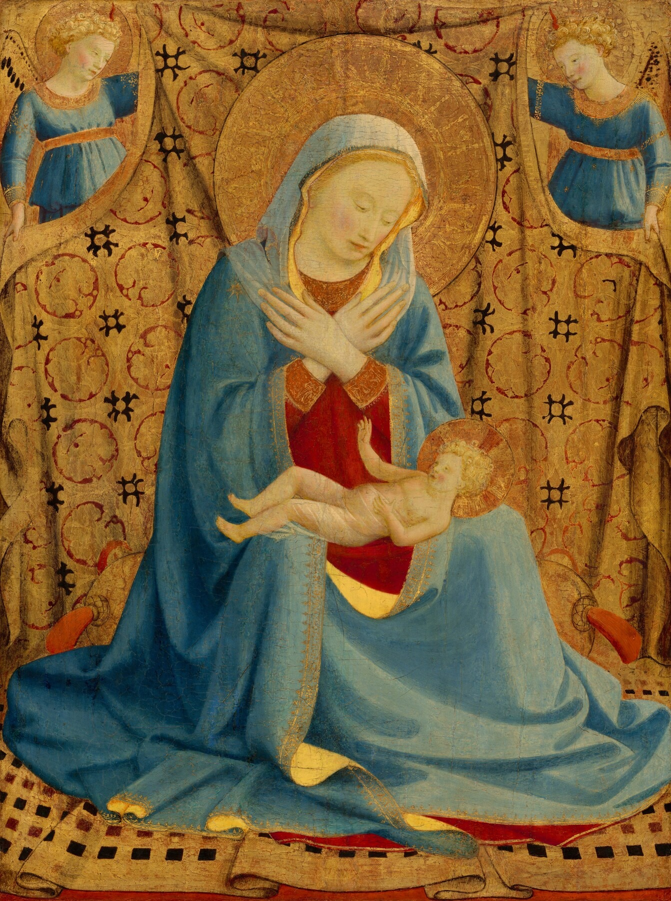

ア．空へ上昇する身体と空の墓によって、聖母の被昇天を示す。

イ．地面に近い低い位置に座る姿によって、聖母の謙譲を示す。

ウ．高い玉座と冠によって、天上の女王としての聖母を示す。

エ．十字架から下ろされた成人を抱く姿によって、聖母の悲嘆を示す。

### 問7

図1の頭部の方向、眼差し、手の身振りの関係として、実際の画面に最もよく合う説明を選びなさい。

図1

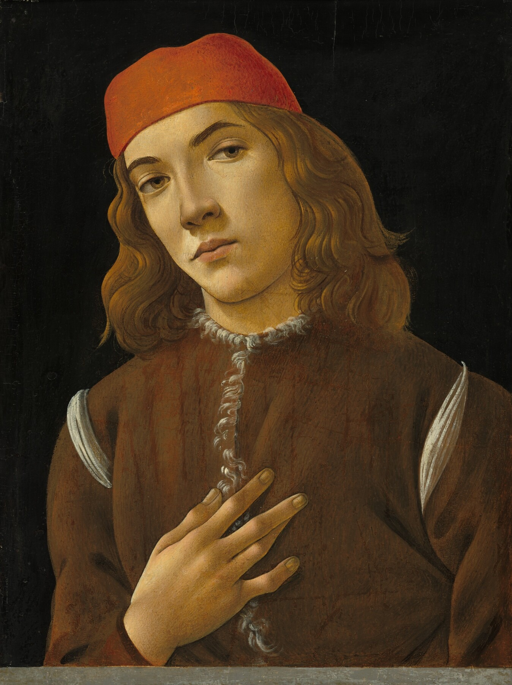

ア．頭部を斜めに向けながら眼差しを顔の向きから横へずらし、片手を胸から離して鑑賞者へ差し出す。

イ．頭部を斜めに向けながら眼差しを顔の向きにそろえ、片手を胸から離して鑑賞者へ差し出す。

ウ．頭部を斜めに向けながら眼差しを顔の向きから横へずらし、片手を胸に置く。

エ．頭部を斜めに向けながら眼差しを顔の向きにそろえ、片手を胸に置く。

### 問8

図1の肩、頭部、視線の関係を説明したものはどれか。

図1

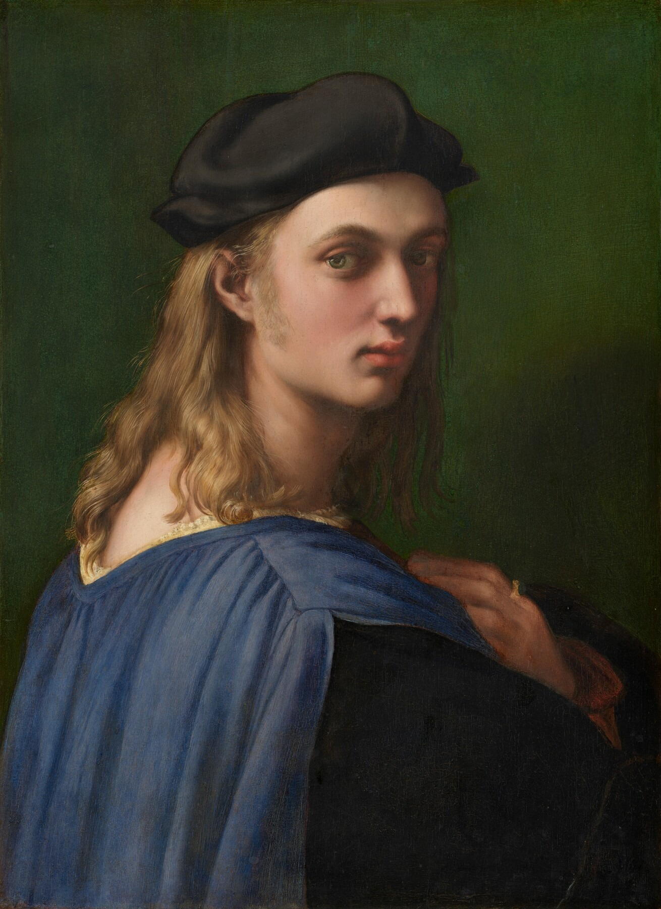

ア．背を斜めに見せる肩と頭部を同じ方向へそろえ、視線を画面の奥へ向ける。

イ．背を斜めに見せる肩に対して頭部を振り返らせ、視線を鑑賞者へ向ける。

ウ．胸と頭部を同じ横へ向けながら、目だけを鑑賞者の側へ返す。

エ．胸を鑑賞者の正面へそろえたまま頭部を横へ向け、視線を画面の外へ流す。

## 大問3 16世紀の技法と活動

作品や活動の記録を読み、時代、素材、主題、表現の方法を対応させて考えなさい。図版がある問いは、その画面も確かめなさい。

### 問9

図1の人物と衣装の関係について、最も適切な説明はどれか。

図1

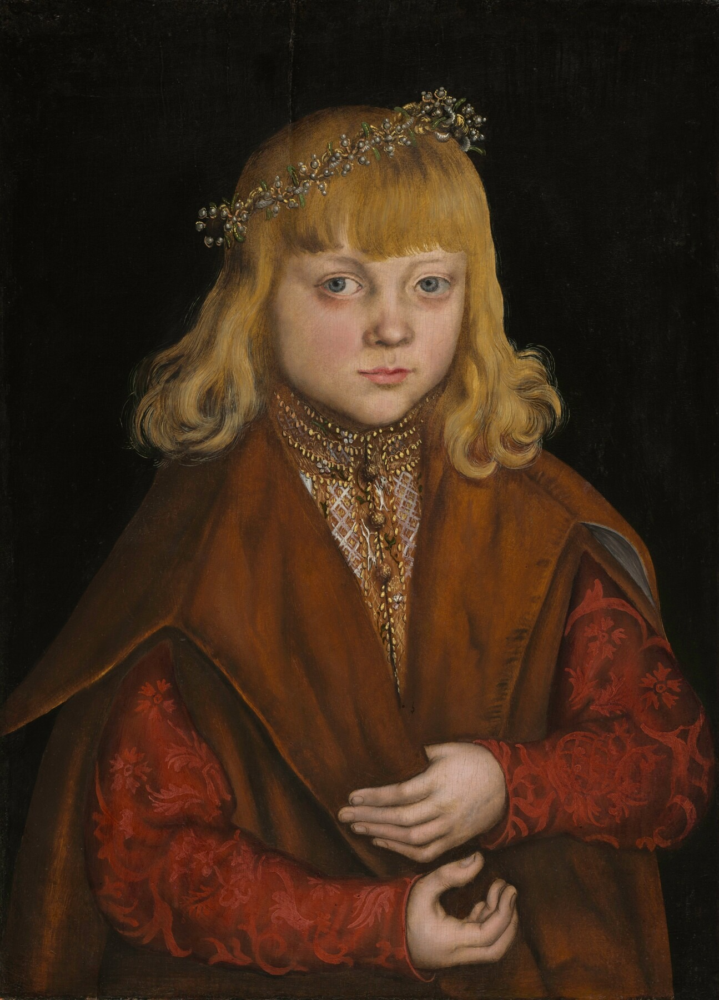

ア．幼い顔立ちと豪華な衣装・宝飾を組み合わせ、子どもに公的な地位を示す装いを与える。

イ．幼い顔立ちを豪華な衣装へ添え、手に持つ物を職業上の技能の証拠として見せる。

ウ．幼い顔立ちに軽い普段着を合わせ、手の動作を遊びの場面として強調する。

エ．幼い顔立ちと宝飾を、別の成人の姿を模した仮装の場面として見せる。

### 問10

デューラーをめぐる北方とイタリアの交流を、教科書が述べる人体・空間の研究と、図像を広めた主な媒体から整理した組合せはどれか。

ア．教会入口の彫刻の正面性―一点ずつ制作する油彩の連作を主な媒介とする図像

イ．教会入口の彫刻の正面性――デューラーらの版画による図像

ウ．人体の比例や遠近法の研究―一点ずつ制作する油彩の連作を主な媒介とする図像

エ．人体の比例や遠近法の研究――デューラーらの版画による図像

## 大問4 17世紀の主題と制作

作品や活動の記録を読み、時代、素材、主題、表現の方法を対応させて考えなさい。図版がある問いは、その画面も確かめなさい。

### 問11

図1の下方と上方に描かれた物や人物の関係から、キリスト教の主題を選びなさい。

図1

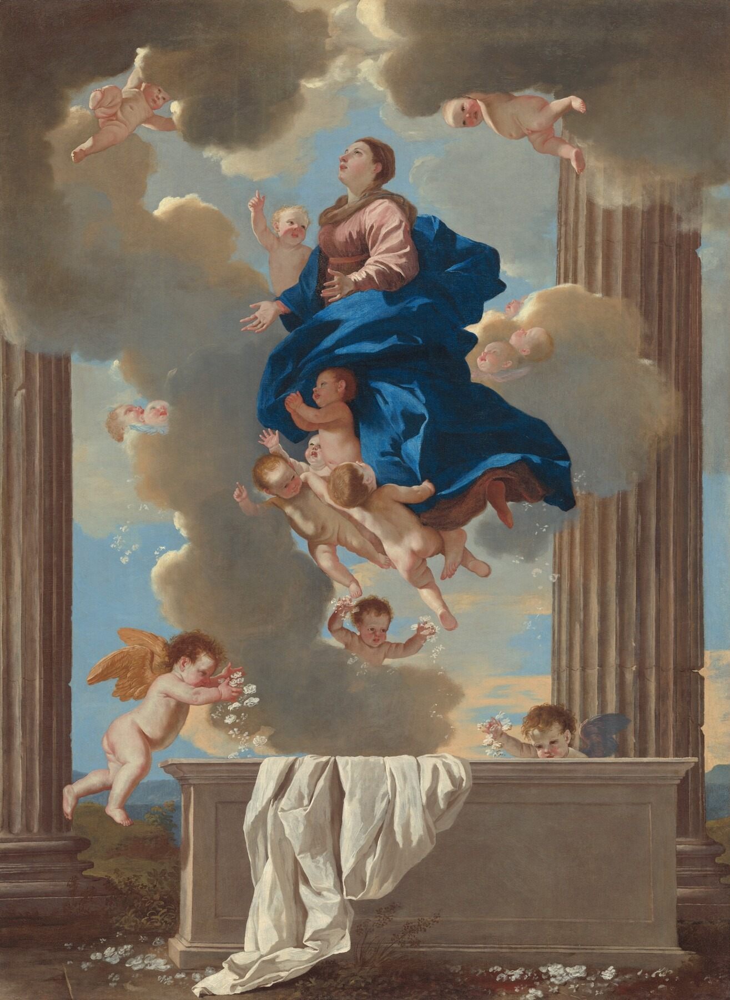

ア．聖母の被昇天

イ．キリストの降誕

ウ．洗礼者ヨハネによるキリストの洗礼

エ．マグダラのマリアの悔悛

### 問12

図1を、17世紀の貴族の肖像形式と人物の見せ方から考える。作者と、衣装・手・表情の関係について、実際の画面と制作上の位置づけの両方に合う説明はどれか。

図1

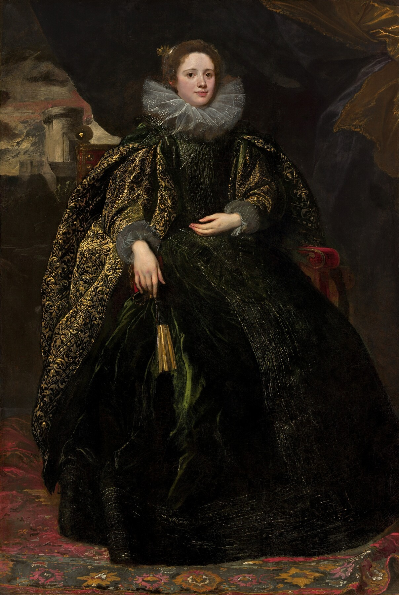

ア．ルーベンス。ヴァン・ダイクがジェノヴァで確立した全身肖像の形式を後に学び、衣装の広がりと自然な手の置き方によって、格式と親しみを両立する。

イ．ハルス。衣装と手を短く切れた速い筆触で同じように描き、わずかな身体の傾きや表情の変化から、都市の人物の一瞬の活気をとらえる。

ウ．ヴァン・ダイク。ルーベンスにも通じる壮麗な全身肖像の形式を受け継ぎ、衣装の広がりで格式を示しながら、力を抜いた手と表情によって人物を親しく見せる。

エ．レンブラント。衣装の縁を暗部へ沈め、顔と手に厚い絵具の起伏を集めることで、全身の格式よりも光の中に現れる顔と手の存在を中心とする。

### 問13

図1の樹木と邸宅の配置を、画面の構成として説明したものを選びなさい。

図1

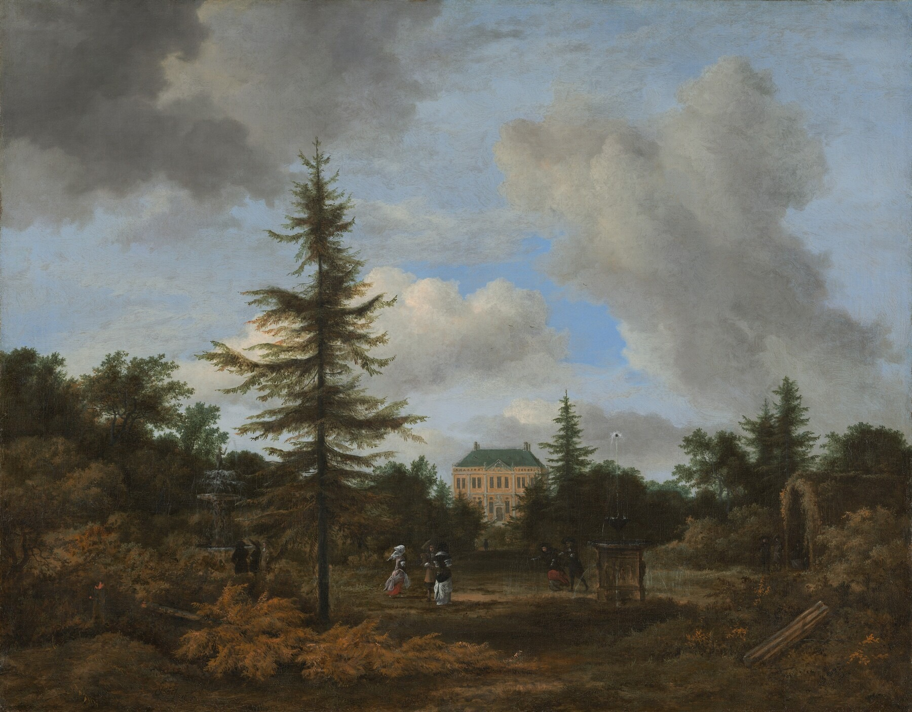

ア．邸宅の正面を左右対称に大きく置き、同じ高さの樹木を両側へ一列に並べる。

イ．低い樹木を邸宅の手前に横へ並べ、建物の正面を画面の中央の軸にする。

ウ．中央の高い樹木を左右同じ大きさの樹木で囲み、邸宅を前景へ押し出す。

エ．中央近くの高い樹木を縦の軸とし、その右に小さく見える邸宅や前方の人々を配する。

### 問14

ヴェルサイユで建築・庭園・室内装飾を一つの計画へまとめることは、王権の表現にどう関わるか。

ア．諸芸術を個別の収集品へ分け、王の私的な好みを公的な儀礼空間から独立させる。

イ．建築を儀礼の背景へ退け、装飾の個々の場面の親密な娯楽を宮殿全体の主眼にする。

ウ．庭園の秩序を室内から切り離し、王権の統一より各貴族の独立した居所を表す。

エ．諸芸術を大きな秩序へ組み込み、宮殿の空間全体で絶対王政の権威を示す。

## 大問5 18世紀の社会と表現

作品や活動の記録を読み、時代、素材、主題、表現の方法を対応させて考えなさい。図版がある問いは、その画面も確かめなさい。

### 問15

図1の人物の姿や周囲の生き物から、最も適切な絵画の主題の種類を選びなさい。

図1

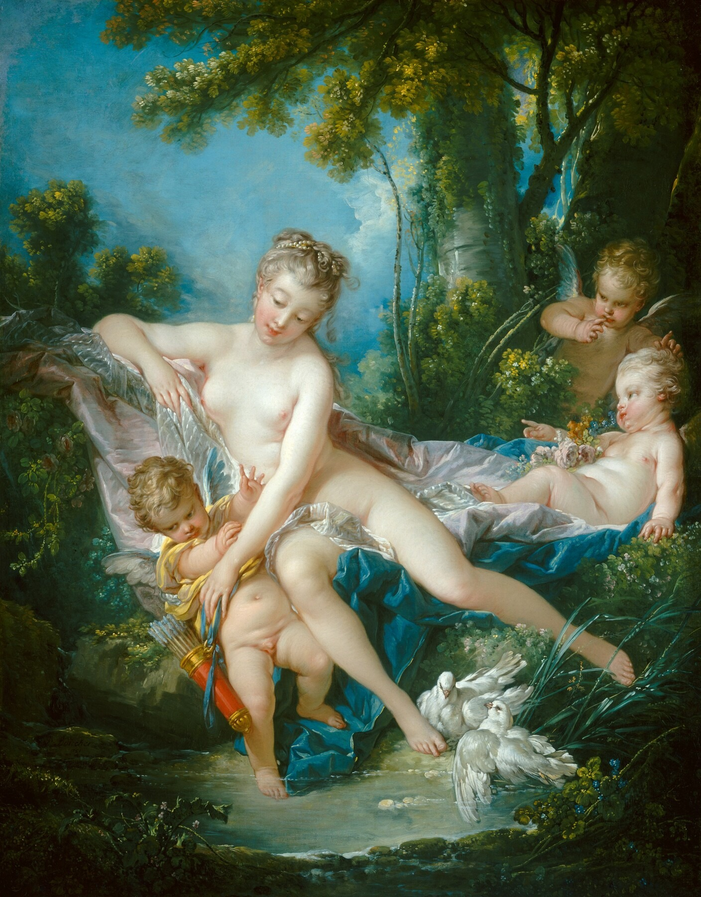

ア．女神と愛の神を扱う神話画

イ．人物と動物を狩猟の儀礼へ組み込み、貴族の生活を扱う風俗画

ウ．王族の儀礼を記録する歴史画

エ．市民の仕事を扱う風俗画

### 問16

図1の人物の髪・衣服と、背後の風景の描き方の関係を選びなさい。

図1

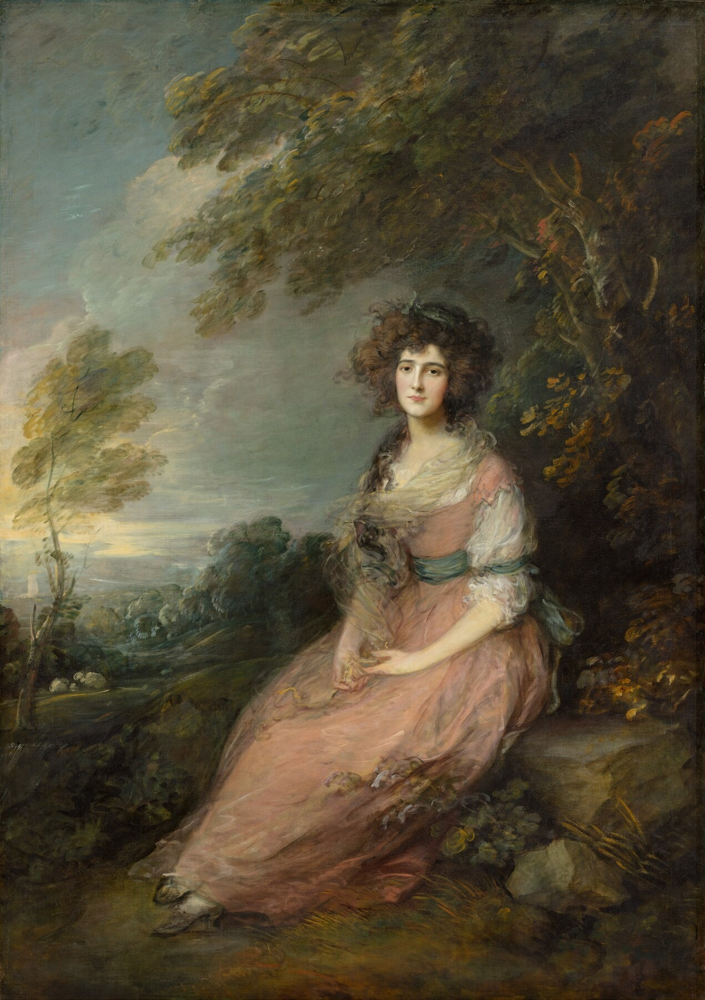

ア．髪と衣服を背景へ溶かし、樹木と雲を顔よりも硬い中心の軸としてまとめる。

イ．髪と衣服の曲線を抑え、身体の直立する方向を背後の樹木へ平行に繰り返す。

ウ．髪と衣服の流れる曲線や筆触が、樹木や雲の動きと響き合う。

エ．髪と衣服を細かな輪郭へ閉じ、樹木と雲はその方向に関わらず静かな水平線へそろえる。

### 問17

ロココの室内装飾に関わる「ロカイユ」の特徴を選びなさい。

ア．貝殻や岩の形を自然の標本に近づけ、室内の装飾と分けて正確に写す。

イ．貝殻や岩の曲線を壁の支持構造の線へ置き換え、装飾より架構を表す。

ウ．貝殻や岩の曲線を左右同じ形へ整え、古典的な柱と梁の区画へ従わせる。

エ．貝殻や岩を思わせる複雑で非対称な曲線を、室内の装飾へ展開する。

## 大問6 19世紀前半の美術

作品や活動の記録を読み、時代、素材、主題、表現の方法を対応させて考えなさい。図版がある問いは、その画面も確かめなさい。

### 問18

カノーヴァの新古典主義彫刻に対応する、人体表現の傾向を選びなさい。

ア．身体の均衡を崩した細い手脚を強調し、古代の規範から離れた不安な存在をつくる。

イ．古代の理想美に学び、静けさや均衡をもつ神話的な人体をつくる。

ウ．身体の断片や荒い表面を用い、歩く行為の緊張を強める。

エ．激しくねじれる人体と翻る衣文で、宗教的な法悦の瞬間をつくる。

### 問19

図1の人物と自然の関係を、19世紀のロマン主義の風景表現と結び付けた説明として適切なものを選びなさい。

図1

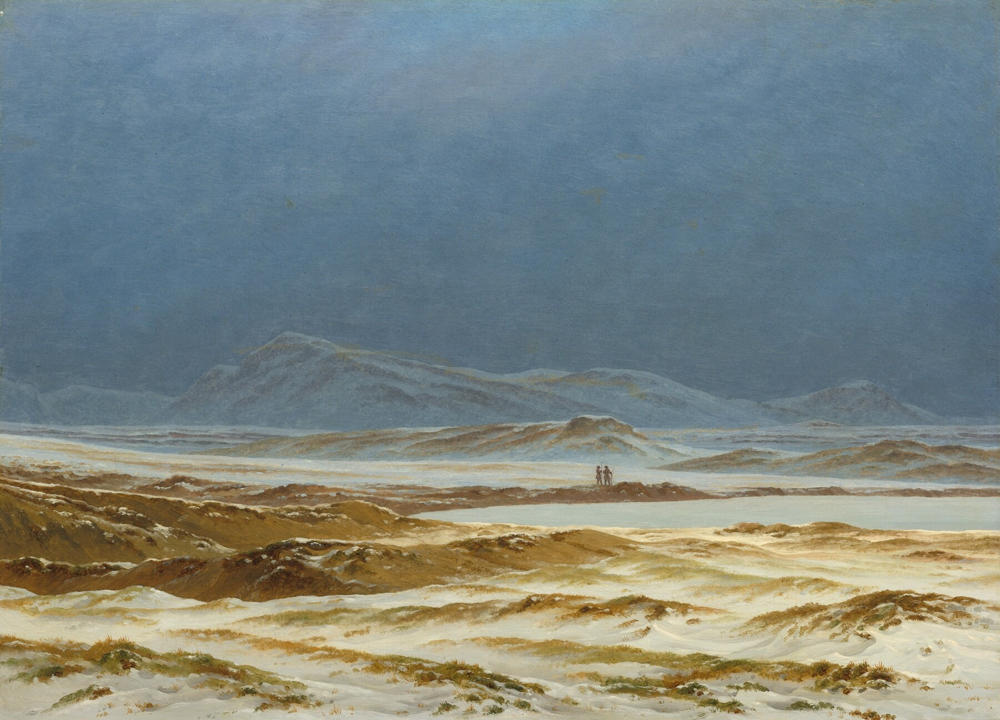

ア．広大な雪景に人物を小さく置き、人間を超える自然に精神的な意味を見いだす。

イ．人物を置かず、修道院の廃墟と葉を落とした森によって、死や再生を暗示する。

ウ．嵐に遭う船を波の中へ置き、乗り手が自然の力にさらされる危険を表す。

エ．大きな後ろ姿の人物を前景へ置き、その向こうに雲に覆われた山々を見渡す。

### 問20

図1の騎兵の身体軸、重なり、画面の端の関係を選びなさい。

図1

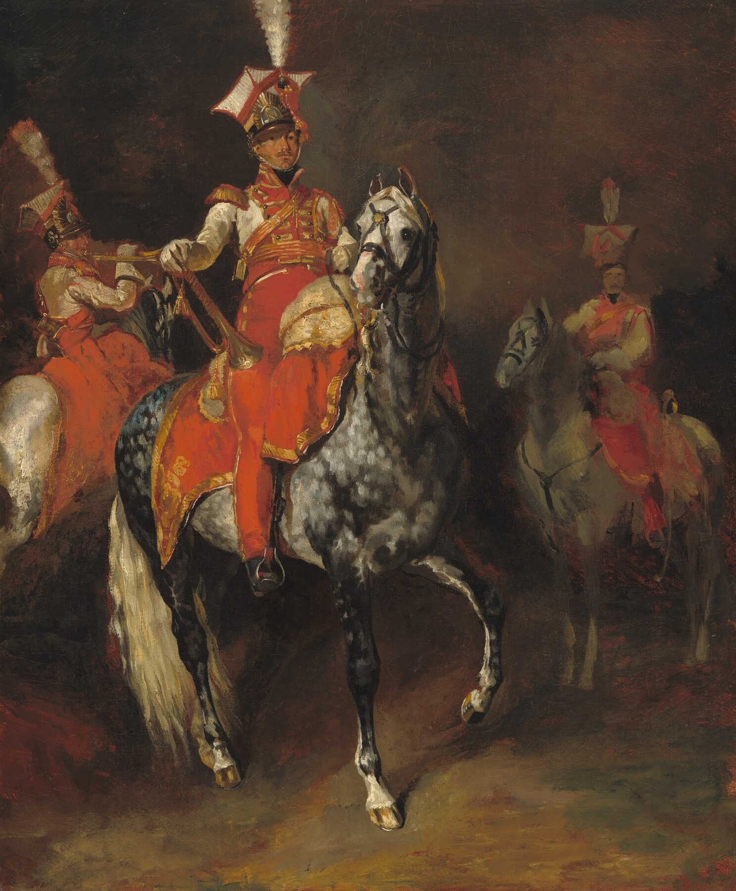

ア．馬や人物の斜めの向きと重なり、端で切れる人物が、騎兵集団の動勢を強める。

イ．馬と人物の向きを横へそろえ、前後の重なりより一頭ずつの間隔の反復を強める。

ウ．前景の馬を正面へ向け、背景の人物を左右同じ高さへそろえて記念像の安定を強める。

エ．端の人物を全身まで収め、前景と背景の馬を同じ大きさへ近づけて集団の平面性を強める。

### 問21

19世紀の画家の戸外での油彩制作を助けた、道具や材料の組合せを選びなさい。

ア．チューブ入り油絵具と、折り畳み式のイーゼル

イ．棒状のパステルと、色のついた紙

ウ．携帯用の水彩絵具箱と、水彩紙

エ．感光板を収める暗箱と、撮影用の三脚

## 大問7 近代の都市と鑑賞

作品や活動の記録を読み、時代、素材、主題、表現の方法を対応させて考えなさい。図版がある問いは、その画面も確かめなさい。

### 問22

図1の水平線と空・海の面積は、画面の広がりにどう働くか。

図1

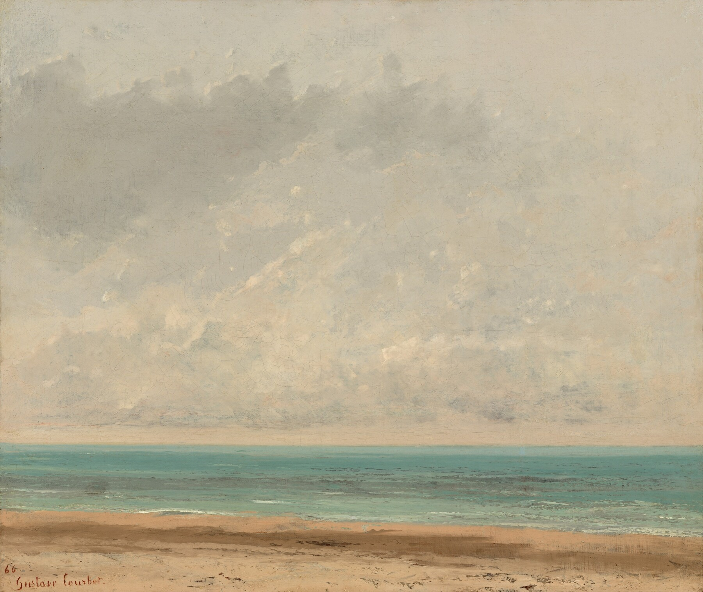

ア．水平線を低く置き、空の大きな面積と小さな海面を対照させ、静かな広がりをつくる。

イ．水平線を中央へ置き、空と海をほぼ同じ面積に分け、二つの面を均衡させる。

ウ．水平線を低く置き、海面の細かな波頭を空の雲より強い密度で画面全体へ反復する。

エ．水平線を高く置き、手前へ広がる海面と小さな空の面積を対照させる。

### 問23

図1の人物、石の縁、舟、対岸の建物は、どのような前後関係をつくるか。

図1

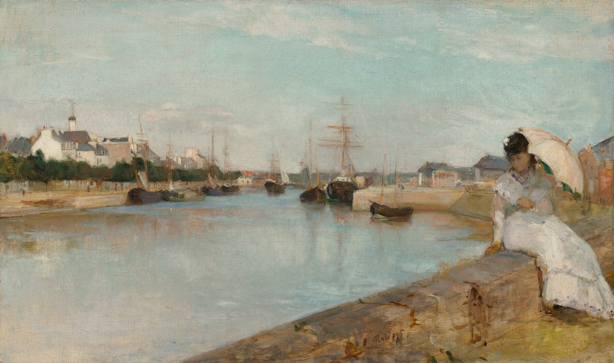

ア．人物と石の縁を近くに置き、舟や水面を挟んで対岸の建物へ奥行きを広げる。

イ．人物を舟と同じ距離へ置き、手前の石の縁から離して、水面上の一群へまとめる。

ウ．人物を石の縁の向こう側へ置き、舟と対岸を近い同じ面の背景へそろえる。

エ．人物と石の縁を近くに置き、対岸の建物を舟より手前へ大きく張り出させる。

### 問24

図1の異素材の使い分けが見える箇所について、図版に即した説明はどれか。

図1

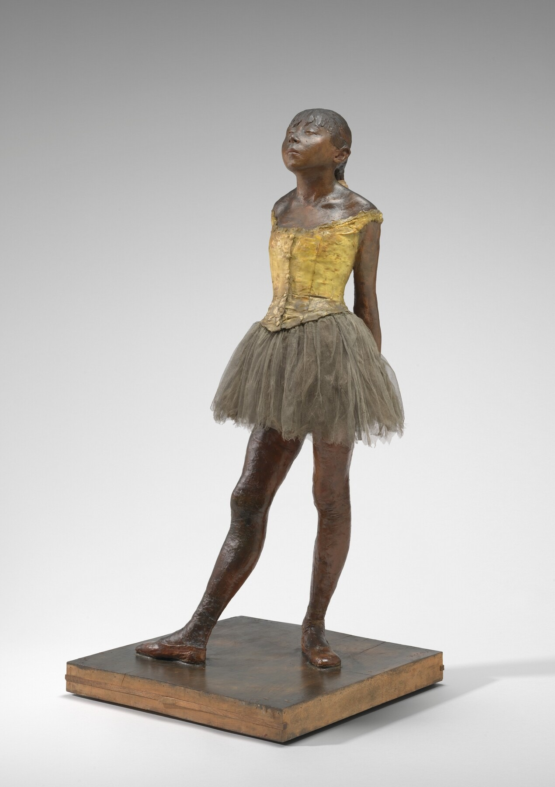

ア．胸の胴衣から薄布が大きく広がり、スカートは脚へ密着した形になっている。

イ．腰から薄い布のスカートが広がり、蝋で表した脚とは異なる質感が見える。

ウ．頭から垂れた薄布が肩を広く包み、腰のスカートより大きく身体を覆っている。

エ．足元の薄布が左右へ広がり、腰のスカートは蝋の表面へ一体化している。

## 大問8 世紀末の多様な制作

作品や活動の記録を読み、時代、素材、主題、表現の方法を対応させて考えなさい。図版がある問いは、その画面も確かめなさい。

### 問25

近代彫刻の異なる方向を比較する。筋力や動勢を強く表す作家と、静的で豊かな肉体の量感を重視する作家を、それぞれ対応させたものを選びなさい。

ア．動勢＝ブールデル、静的な量感＝マイヨール

イ．動勢＝ジャコメッティ、静的な量感＝マイヨール

ウ．動勢＝ジャコメッティ、静的な量感＝ブランクーシ

エ．動勢＝ブールデル、静的な量感＝ブランクーシ

### 問26

図1の人物と周囲の地面や水の色について、絵画の方法に最もよく対応する説明を選びなさい。

図1

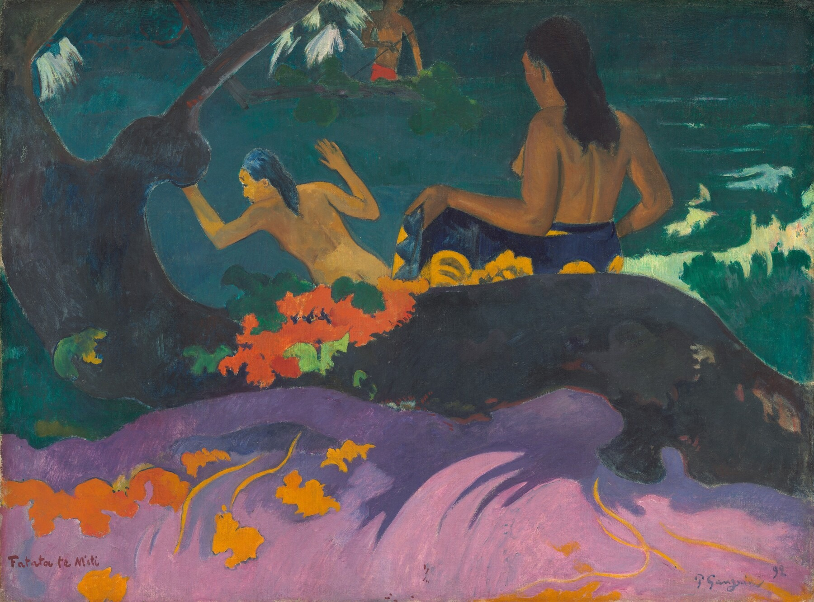

ア．小さな色面を多方向へずらし、建物の面や幹の量感を組み立てることを中心にする。

イ．短く厚い筆触を同じ方向へ重ね、表面全体を波打つような線の流れにする。

ウ．細かな純色の点を規則的に並べ、離れて見たときの光学的混合を求める。

エ．輪郭を強めた大きな色面を組み合わせ、紫など実景の再現に限らない色を用いる。

### 問27

19世紀後半の象徴主義が重視した、現実や表現への態度として適切なものを選びなさい。

ア．光学的混合の理論に基づき、画面を細かな純色へ分割する。

イ．夢や不安、文学的なイメージなど、目に見える現実だけではない世界を暗示する。

ウ．古代の歴史を理性と市民的な義務の模範として、明晰な構成で描く。

エ．戸外の光を一瞬の知覚として捉え、短い筆触で変化を描く。

## 大問9 20世紀初頭の変化

作品や活動の記録を読み、時代、素材、主題、表現の方法を対応させて考えなさい。図版がある問いは、その画面も確かめなさい。

### 問28

フォーヴィスムの鮮やかな色彩を経たのち、暗く重厚な色調の風景へ向かった画家は誰か。

ア．アンドレ・ドラン

イ．ラウル・デュフィ

ウ．モーリス・ド・ヴラマンク

エ．ジョルジュ・ルオー

### 問29

未来派の絵画や彫刻が、機械文明と結び付けて重視したものを選びなさい。

ア．穏やかな田園で暮らす農民の日常の写生

イ．速度や連続する運動、都市や機械のダイナミズム

ウ．古代の比例に基づく静的な人体の理想

エ．夢に現れる物を不意に結び付ける無意識の世界

### 問30

モディリアーニとユトリロの主な画題の組合せを選びなさい。

ア．モディリアーニ＝花や果物を置く静物、ユトリロ＝パリの街路の風景

イ．モディリアーニ＝人物や裸体、ユトリロ＝パリの街路の風景

ウ．モディリアーニ＝人物や裸体、ユトリロ＝花や果物を置く静物

エ．モディリアーニ＝パリの街路の風景、ユトリロ＝人物や裸体

### 問31

キュビスムから展開し、太陽や月を手掛かりにした円形の連作で、色面の同時対比によって光の変化やリズムを表そうとした画家は誰か。

ア．ピエト・モンドリアン

イ．ワシリー・カンディンスキー

ウ．フェルナン・レジェ

エ．ロベール・ドローネー

## 大問10 制作と教育の試み

作品や活動の記録を読み、時代、素材、主題、表現の方法を対応させて考えなさい。図版がある問いは、その画面も確かめなさい。

### 問32

1924年の宣言と、夢や無意識を重視するシュルレアリスムの成立に関わった人物を選びなさい。

ア．トリスタン・ツァラ

イ．アンドレ・ブルトン

ウ．フィリッポ・トンマーゾ・マリネッティ

エ．テオ・ファン・ドゥースブルフ

### 問33

ジャコメッティの1930年代のオブジェで、単純な形や日常物を組み合わせる意味はどれか。

ア．物の通常の意味を切り離し、形同士の非合理な関係から心理的な緊張を生む。

イ．物の用途を組合せから復元し、日常の道具として使う順序を明確にする。

ウ．物の連想を一つの自然な身体の外形へまとめ、断片同士の不連続を解消する。

エ．物の意味を共通の幾何学的比率へ均し、配置を客観的な測定の結果として示す。

### 問34

インターナショナル・スタイルの展示で、左右非対称の建物を「共通する秩序に反する」として除く案が出た。様式の原理に照らし、この判断を修正する説明はどれか。

ア．非対称を認める代わりに、面が囲む空間より厚い壁の重さを前面に出すことを共通原理にする。

イ．共通原理には中央軸の左右対称が必要で、非対称は薄い面で空間を囲んでも地域固有の例外として扱う。

ウ．非対称を認める代わりに、構造の反復を地域ごとの歴史装飾へ替えることを共通原理にする。

エ．構造に伴う反復と柔軟な非対称は両立し、薄い面で囲む空間や付加装飾の抑制にも共通原理を見いだす。

## 大問11 戦後美術の展開

作品や活動の記録を読み、時代、素材、主題、表現の方法を対応させて考えなさい。図版がある問いは、その画面も確かめなさい。

### 問35

第二次世界大戦前後の美術の中心の移動と、背景となる出来事を適切に組み合わせたものを選びなさい。

ア．ニューヨークからパリへ――ヨーロッパの作家がアメリカへ移住した。

イ．ニューヨークからパリへ――アメリカの作家がパリへ集まって新しい中心を築いた。

ウ．パリからニューヨークへ――アメリカの作家がパリへ集まって新しい中心を築いた。

エ．パリからニューヨークへ――ヨーロッパの作家がアメリカへ移住した。

### 問36

ウォーホルが、商品や有名人の写真イメージを繰り返す際に用いた代表的な技法を選びなさい。

ア．リトグラフ

イ．シルクスクリーン

ウ．木版画

エ．エッチング

### 問37

オルデンバーグの日用品を題材とする立体に対応する方法を選びなさい。

ア．絵画の平面に実物を取り付け、描かれた面と立体を混在させる。

イ．見慣れた日用品を柔らかな素材や巨大な寸法に変え、物の感覚を変える。

ウ．光る工業製品を壁へ設置し、色の光で周囲の空間を変える。

エ．日用品の表面をそのまま写し取り、写真のような精密な絵画へ戻す。

### 問38

アルテ・ポーヴェラで、身近な粗末な素材と作品の成立はどのように関わるか。

ア．素材の種類を共通の表面へ覆い、物の違いより規格化した同じ単位を反復する。

イ．素材を置く関係やその状態の変化も含め、日常の物と芸術の関係を問い直す。

ウ．粗末な素材を耐久性の高い外観へ仕上げ、素材の変化を完成した形から分ける。

エ．素材を生活の用途に沿って配置し、既知の道具としての使いやすさを完成の規準にする。

## 大問12 作品と鑑賞の関係

作品や活動の記録を読み、時代、素材、主題、表現の方法を対応させて考えなさい。図版がある問いは、その画面も確かめなさい。

### 問39

ナム・ジュン・パイクが美術の媒体として展開した代表的な装置や表現を選びなさい。

ア．蛍光灯とその光

イ．釣合いで動く金属片

ウ．テレビ受像機と映像

エ．商品写真の反復印刷

### 問40

キーンホルツが古い日用品や人の像で生活場面を組み立てるとき、物と主題はどう結びつくか。

ア．物と人の像を同じ規格の単位へそろえ、社会的な連想より均等な配置の秩序を示す。

イ．物の用途を互いに切り離し、人の像を取り除いた素材の分類で生活の秩序を示す。

ウ．物の古さを年代の資料へ統一し、生活場面を過去の習慣の正確な復元として提示する。

エ．物の古さや配置に生活の痕跡を伴わせ、場面の中へ社会の矛盾や不安を浮かび上がらせる。

### 問41

ロングの野外制作を「残された石の形が作品の中心で、歩行は材料集めの準備にあたる」と説明する案が出た。これを修正する理解として適切なものはどれか。

ア．歩行そのものを制作へ含め、現地の素材の選択や配置とともに、場所に応じた一時的な介入として考える。

イ．歩行を完成形の寸法を測る準備へ戻し、現地の素材の配置を恒久的な記念物の設計として考える。

ウ．歩行の経路を自然の変化の記録へ移し、石の配置は人の行為を示さない風景の一部として考える。

エ．歩行を素材の搬出の手段とし、野外の場所より、移した石が展示室内で完結する形を中心に考える。

## 大問13 古代日本の素材と形

日本の作品と美術の活動を取り上げる。作品の形や材料、制作と受容の記録を、問われた事項へ対応させて考えなさい。

### 問42

古墳から出土する銅鏡について、適切な説明はどれか。

ア．金属の反射面を持ち、背面には神獣や幾何学文様などを表したものがある。

イ．鉄板を打ち延ばし、戦場で全身を覆う甲冑の部品として用いられた。

ウ．粘土を低温で焼き、古墳の周囲へ円筒形にして並べるために作られた。

エ．木をくり抜いて経文を納め、山中の経塚へ埋納するために作られた。

### 問43

法隆寺釈迦三尊像と山田寺仏頭の造形の比較として適切なものはどれか。

ア．釈迦三尊：顔に丸みと自然な動き／山田寺仏頭：正面性と古式の左右対称が強い

イ．釈迦三尊：正面性・左右対称性が強い／山田寺仏頭：丸みと人間的な表情が目立つ

ウ．釈迦三尊：自然な立体感をもつ白鳳様式／山田寺仏頭：鞍作止利の古式の様式

エ．釈迦三尊：土を盛った柔らかな量感／山田寺仏頭：漆の薄い殻を生かす造形

### 問44

木で大まかな像の形を作り、その表面に木屎漆などを盛って細部を整える造像法はどれか。

ア．一木造

イ．寄木造

ウ．脱活乾漆造

エ．木心乾漆造

## 大問14 信仰と物語の造形

日本の作品と美術の活動を取り上げる。作品の形や材料、制作と受容の記録を、問われた事項へ対応させて考えなさい。

### 問45

図の口元の表現と、それに対応する名称の組合せはどれか。

図1

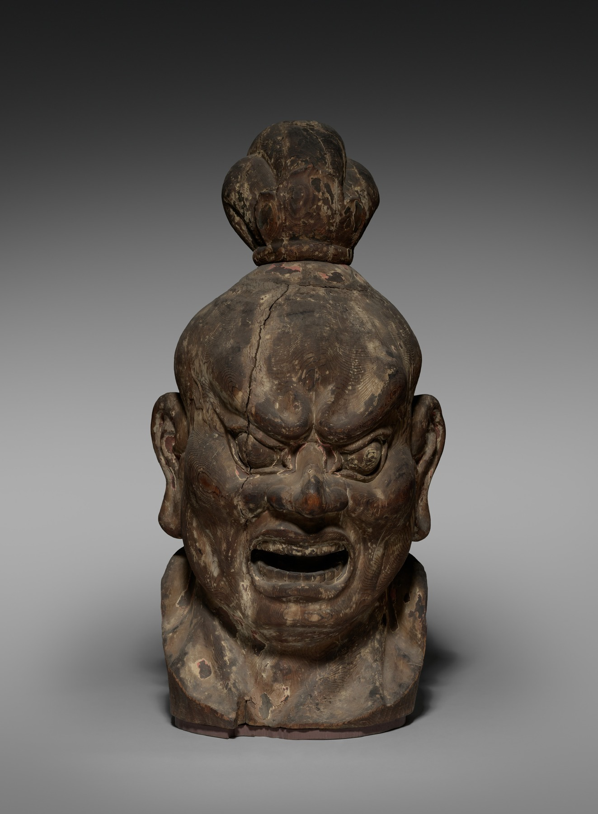

ア．口を閉じる／阿形

イ．口を開く／吽形

ウ．口を閉じる／吽形

エ．口を開く／阿形

### 問46

『源氏物語絵巻』などの作り絵で、下描き・彩色・仕上げの線の役割を適切に説明したものはどれか。

ア．輪郭線を完成させ、その上を厚く彩色して線を覆うことを仕上げとする

イ．下描きの濃淡を仕上げとして残し、墨のにじみで色面を肉付けする

ウ．紙の裏へ彩色し、表へ透けた色に沿って輪郭を仕上げる

エ．下描きの上に彩色を施し、最後に輪郭や衣文の線を描き起こす

### 問47

『平治物語絵巻』の成立時期と、『蒙古襲来絵詞』の中心となる人物の対応が適切なものはどれか。

ア．平治の乱と同じ12世紀の制作／蒙古襲来絵詞：竹崎季長の戦いと事績

イ．平治の乱と同じ12世紀の制作／蒙古襲来絵詞：安達泰盛自身の出陣と戦功

ウ．乱より後の鎌倉期の制作／蒙古襲来絵詞：安達泰盛自身の出陣と戦功

エ．乱より後の鎌倉期の制作／蒙古襲来絵詞：竹崎季長の戦いと事績

## 大問15 中世から近世への表現

日本の作品と美術の活動を取り上げる。作品の形や材料、制作と受容の記録を、問われた事項へ対応させて考えなさい。

### 問48

平等院鳳凰堂と中尊寺金色堂が浄土への願いを表す方法として、適切な比較はどれか。

ア．鳳凰堂：池に臨む堂と来迎の壁画／金色堂：金や螺鈿を用いた堂内の荘厳

イ．鳳凰堂：金や螺鈿で覆う堂内／金色堂：大きな池に臨む翼廊と楼閣

ウ．鳳凰堂：池に臨む堂と来迎の壁画／金色堂：多くの阿弥陀を横一列に安置する長い堂

エ．鳳凰堂：軸上に門・仏殿・法堂を配す／金色堂：金や螺鈿による堂内の荘厳

### 問49

図は法燈円明国師の像である。顔と衣体の表し方を、肖像の役割と結び付けた説明はどれか。

図1

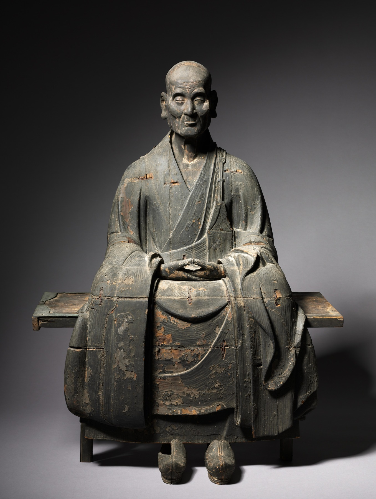

ア．老いた顔の個性を示し、衣体を抑えて、実在の師の面影を伝える

イ．顔を若く左右対称に整え、衣体を抑えて、実在の師の面影を伝える

ウ．老いた顔と抑えた衣体を用い、伝説の祖師の姿を想像して表す

エ．老いた顔の個性を示し、衣の細部も同じ密度で刻んで、師の面影を伝える

### 問50

二条城二の丸御殿について、A・Bに当たる棟と、Aの一の間・二の間の障壁画を描いた絵師の組合せとして適切なものはどれか。
A：一の間（上段）・二の間（下段）をもち、将軍と大名や公卿衆との最も公的な対面の場となった棟。
B：「御座の間」と呼ばれ、将軍の居間や寝室であったと考えられる棟。

ア．A：大広間／B：白書院／絵師：狩野探幽

イ．A：大広間／B：白書院／絵師：狩野尚信

ウ．A：黒書院／B：白書院／絵師：狩野探幽

エ．A：大広間／B：黒書院／絵師：狩野探幽

### 問51

図1の文字と人物の上下関係、および人物が手に持つ物を正しく組み合わせた説明はどれか。

図1

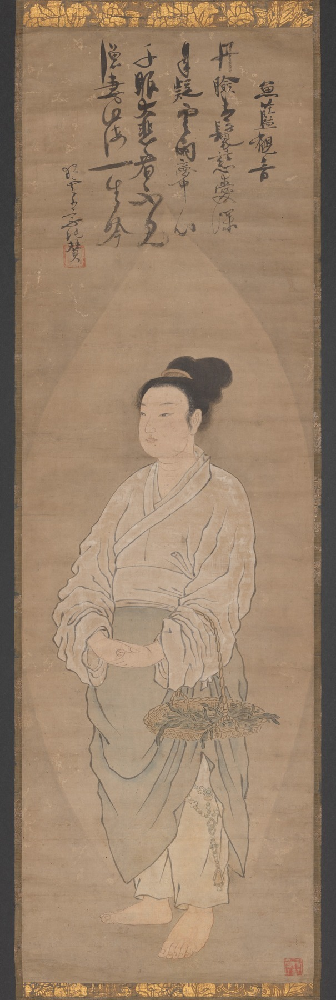

ア．文字を上部、人物を下部に配し、人物は籠を手に持つ。

イ．文字を上部、人物を下部に配し、人物は開いた巻物を手に持つ。

ウ．人物を上部、文字を下部に配し、人物は開いた巻物を手に持つ。

エ．人物を上部、文字を下部に配し、人物は籠を手に持つ。

### 問52

鳥や岸辺の描写と墨の使い方から、図の屏風に合う説明を選べ。

図1

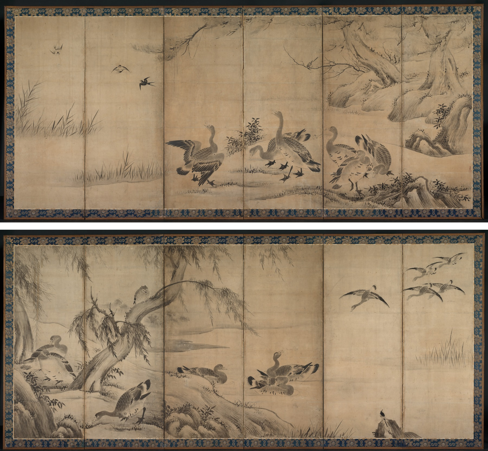

ア．彩色の細線で鳥の羽を描き込み、画面を左右対称の花鳥で埋める

イ．水鳥や芦を線と墨の濃淡で描き、漢画の花鳥画を障壁画へ生かす

ウ．水鳥を金の地に彩色で並べ、平面的な文様の反復を中心にする

エ．上半に大きく漢詩を配し、下の小さな水鳥図と呼応させる

## 大問16 近世の制作と生活

日本の作品と美術の活動を取り上げる。作品の形や材料、制作と受容の記録を、問われた事項へ対応させて考えなさい。

### 問53

馬、人物、建物の配置と動作から、二隻の行事に合う説明を選べ。

図1

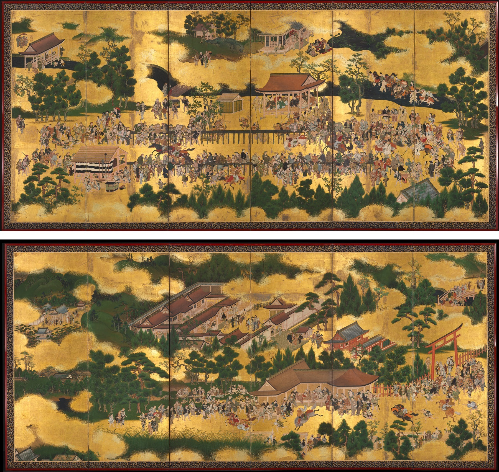

ア．馬と装束の人々が同じ向きに並び、街路を進む祭礼行列

イ．馬上の射手が弓を構え、道沿いの的を射る流鏑馬

ウ．社の境内で馬が走り、周囲の人々が見守る競馬の行事

エ．馬上の人物が鹿を追い、山野で獲物を狙う狩猟

### 問54

寝殿造の住宅や寺院などで用いられ、上から吊って外へ跳ね上げるように開ける板格子の建具はどれか。

ア．蔀戸

イ．襖

ウ．舞良戸

エ．障子

## 大問17 江戸時代の絵画と出版

日本の作品と美術の活動を取り上げる。作品の形や材料、制作と受容の記録を、問われた事項へ対応させて考えなさい。

### 問55

長沢蘆雪による図1について、小動物や草花と余白の配置、および蘆雪が学んだ画家を正しく組み合わせたものはどれか。

図1

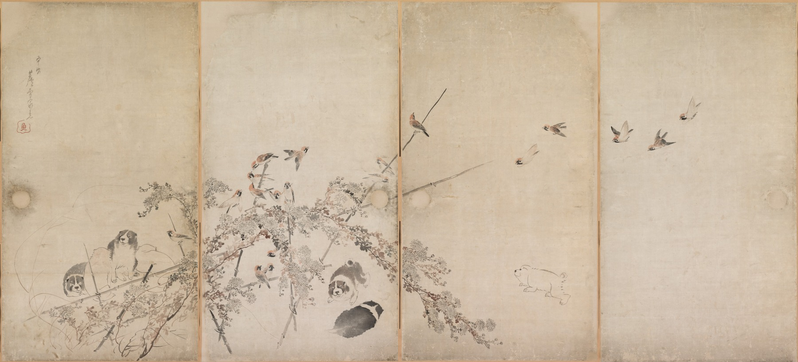

ア．小動物や草花を上端まで密に配して余白を埋め、学んだ画家は円山応挙である。

イ．小動物や草花を上端まで密に配して余白を埋め、学んだ画家は池大雅である。

ウ．小動物や草花を下部寄りに配して上方に広い余白をとり、学んだ画家は円山応挙である。

エ．小動物や草花を下部寄りに配して上方に広い余白をとり、学んだ画家は池大雅である。

### 問56

渡辺崋山《鷹見泉石像》と谷文晁《公余探勝図》の制作の背景と表現に合う比較はどれか。

ア．崋山：実在の人物の個性を写す肖像／文晁：中国の赤壁の賦を絵画化する画帖

イ．崋山：松平定信の海岸巡視の記録／文晁：実在の人物の個性を写す肖像

ウ．崋山：実在の人物の個性を写す肖像／文晁：松平定信の海岸巡視に同行した実景の記録

エ．崋山：古人の図様を用いた理想の高士像／文晁：松平定信の海岸巡視に同行した実景の記録

### 問57

図の人物の動きや姿、画中の記名を観察し、この版画の主題による浮世絵の分類として最も適切なものを選べ。

図1

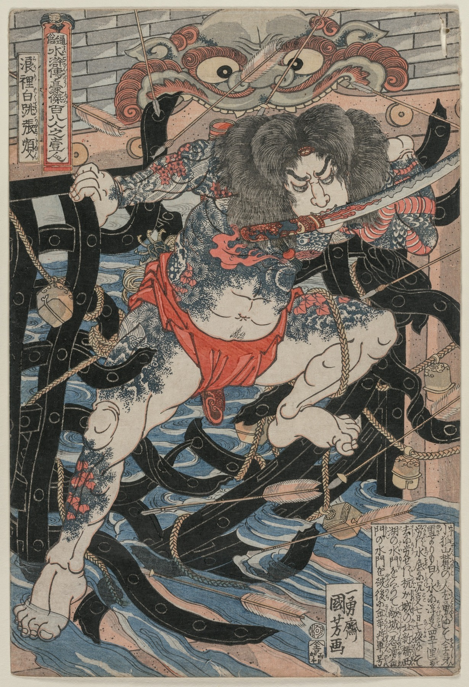

ア．役者絵

イ．名所絵

ウ．武者絵

エ．花鳥画

### 問58

眼、口元、手の表現と人物の印象の関係を、図に即して説明したものはどれか。

図1

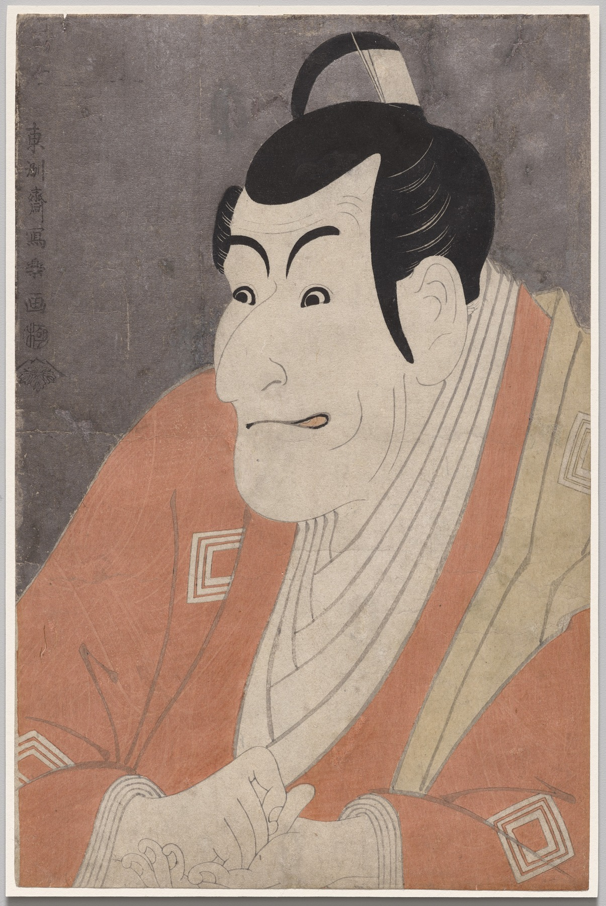

ア．細かい陰影で顔の凹凸を連続させ、彫像のような滑らかさを示す

イ．眼や口を小さく整え、左右対称の穏やかな顔へまとめる

ウ．顔の違いより装束の文様へ力点を置き、手を袖の中へ隠す

エ．眼や口元、手を強調し、役者の個性的な顔と緊張した身振りを示す

## 大問18 近代日本の制度と制作

日本の作品と美術の活動を取り上げる。作品の形や材料、制作と受容の記録を、問われた事項へ対応させて考えなさい。

### 問59

藤田嗣治の画肌の特徴、および安井曾太郎と小出楢重の代表作の対応が適切なものはどれか。

ア．藤田―土色の農村自然主義／安井―Nの家族／小出―金蓉

イ．藤田―土色の農村自然主義／安井―金蓉／小出―Nの家族

ウ．藤田―乳白色の肌と繊細な輪郭／安井―金蓉／小出―Nの家族

エ．藤田―乳白色の肌と繊細な輪郭／安井―Nの家族／小出―金蓉

### 問60

速水御舟《名樹散椿》の制作姿勢として、最も適切なものはどれか。

ア．均等な小さな筆触へ色を分け、光のもとで揺れる色彩を捉える

イ．植物の細部の観察を基に、形と配置、地の効果を選び直して装飾的に構成する

ウ．筆の速度と墨の濃淡を中心に、古典の山水の型を即興的に組み直す

エ．輪郭を目立たせず、色のぼかしで湿った大気の中へ樹木を溶け込ませる

### 問61

国画創作協会から国画会への部門の歩みを適切に説明したものはどれか。

ア．日本画の第1部に洋画の第2部が加わり、第2部解散後に第1部が国画会として存続した

イ．日本画の第1部に洋画の第2部が加わり、両部を統合し直して国画会となった

ウ．日本画の第1部に洋画の第2部が加わり、第1部解散後に第2部が国画会として存続した

エ．洋画の第1部に日本画の第2部が加わり、第1部解散後に第2部が国画会として存続した

### 問62

1930年、里見勝蔵や林武らによって結成され、フォーヴィスムなどを踏まえた自由な洋画を展開した団体はどれか。

ア．白馬会

イ．青龍社

ウ．国画創作協会

エ．独立美術協会

### 問63

1937年に結成された自由美術家協会の初期の動きを説明するものはどれか。

ア．小野竹喬や土田麦僊らが日本画の改革を目指して集まった。

イ．川端龍子が会場で映える大画面の日本画を掲げて集まった。

ウ．長谷川三郎や村井正誠ら、抽象表現に取り組む画家が集まった。

エ．黒田清輝らが明るい外光表現を広めるために集まった。

## 大問19 戦後日本の美術活動

日本の作品と美術の活動を取り上げる。作品の形や材料、制作と受容の記録を、問われた事項へ対応させて考えなさい。

### 問64

戦後関西のパンリアル美術協会とデモクラート美術家協会の志向に合う比較はどれか。

ア．パンリアル：日本画の素材・表現を問い直す／デモクラート：公募展の審査に拠らぬ自由な活動を求める

イ．パンリアル：日本画の素材・表現を問い直す／デモクラート：陶芸を実用の器から解放する

ウ．パンリアル：陶芸を実用の器から解放する／デモクラート：公募展の審査に拠らぬ自由な活動を求める

エ．パンリアル：陶芸を実用の器から解放する／デモクラート：日本画の素材・表現を問い直す

### 問65

高松次郎の《影》のシリーズで、表象と存在の関係を適切に説明したものはどれか。

ア．写真の人物と同じ人を会場へ招き、像と実物の一致を示す

イ．影の形の板を空間へ立て、素材の重さと床との接点を示す

ウ．人の影を描き、主となる人物がいなくても残る像から存在と認識を問う

エ．観客を画面前へ立たせ、その場の投光で生じる影を毎回記録する

### 問66

自然を深く見つめた静謐な風景画や、唐招提寺御影堂の障壁画で知られる戦後の日本画家は誰か。

ア．川端龍子

イ．横山大観

ウ．棟方志功

エ．東山魁夷

## 大問20 現代美術の媒体と批評

現代美術の実践と批評について、媒体、制作の過程、鑑賞や社会との関係に注目して考えなさい。

### 問67

南アフリカのウィリアム・ケントリッジのドローイングを用いるアニメーションについて、完成した一枚の絵と撮影を重ねる時間の関係も考え、制作方法と画面に残る痕跡が合う説明を選べ。

ア．各コマを別の透明なシートへ描き、紙の汚れをシートの入れ替えの記録として残す。

イ．同じ紙の木炭画を消して描き直しながら撮影し、前の形の残像を次の画面へ持ち越す。

ウ．木炭画を切り抜いて少しずつ移動し、切り口の輪郭を過去の形の痕跡として見せる。

エ．完成した複数の素描を同じ順で繰り返し撮り、同じ紙を描き直した時間の連続として見せる。

### 問68

ダミアン・ハーストが1991年に発表した、サメをガラスのケース内に置いた作品を紹介する。素材の扱いと主題の関係を述べた説明として、最も適切なのはどれか。

ア．サメの骨格を部位ごとに分けて並べ、進化の順序を示す比較標本とする。

イ．樹脂で再現した身体を提示し、自然物の姿と複製の違いを問題にする。

ウ．保存液に浸した実物の身体を提示し、生きた姿と死の存在の関係を問いかける。

エ．生きたサメを飼育して移動を撮影し、環境に応じた行動の記録を蓄積する。

### 問69

ジェフリー・ショーの《レジブル・シティ》を、観客と映像の関係から説明するものとして最も適切なのはどれか。

ア．実在都市の道順を現場の標識に沿って進む。既存の都市空間を歩く行為を場所固有の作品とする。

イ．自転車に座った観客へ都市の同じ巡回映像を示す。身体の入力は記録するが表示を変えない参加型作品である。

ウ．観客が持ち寄った都市の文字資料を遠隔で共有する。参加者どうしが文章を書き換えるネットワーク作品である。

エ．自転車の操作で、文字が建物をなす仮想都市の経路を選ぶ。身体の入力が表示へ返るインタラクティヴな作品である。

## 大問21 日本とアジアの表現活動

### 問70

ポスターなどのグラフィックデザインで活動した後、1980年代初頭の「画家宣言」を経て絵画の制作を大きく展開した人物を選ぶ。デザインで培った図像や多様な視覚文化との関わりを、絵画にも発展させた経歴に対応するのは誰か。

ア．大竹伸朗

イ．横尾忠則

ウ．田名網敬一

エ．岡本太郎

## 大問22 作品と社会の関係

### 問71

大きな頭をもつ子どもや動物の像に、親しみとともに反抗的な視線などを与えることで知られる日本の美術家は誰か。青森県立美術館のコレクションとも関連づけて選べ。

ア．大竹伸朗

イ．奈良美智

ウ．舟越桂

エ．宮島達男

## 大問23 アジアの書画と工芸

アジアの造形と文化の交流について、材料、主題、表現や資料の役割を照合して考えなさい。

### 問72

石碑に刻まれた文字や金石の文様を調べるため、紙を表面の凹凸へ密着させ、墨などでその形を紙へ写し取った資料を用いる。筆で字形を写す方法と区別し、表面の凹凸を直接記録する点に注目する。この資料の名称はどれか。

ア．模刻

イ．臨書

ウ．双鉤填墨

エ．拓本

### 問73

図は清の雍正年間の磁器皿である。桃の実や花の色を観察し、彩色技法との対応が合う記述を選べ。

図1

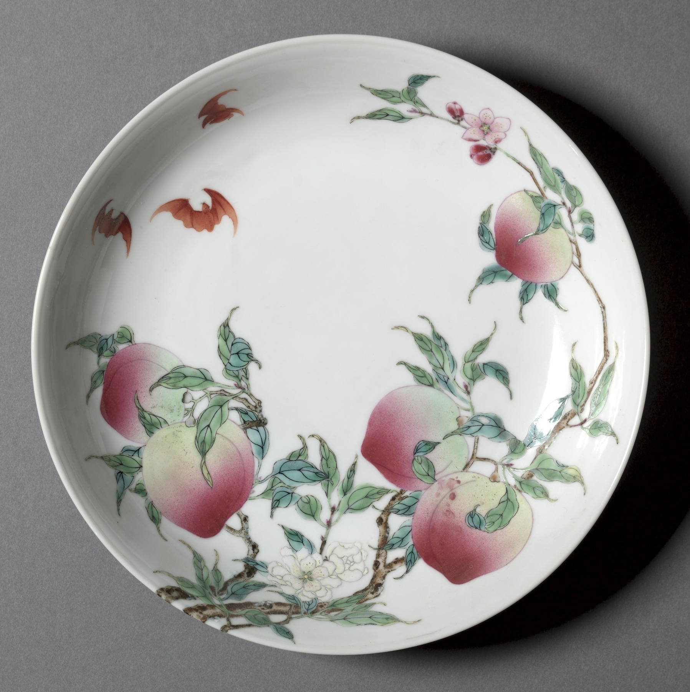

ア．桃色は実の周囲を囲む線に限られ、花弁の内側は白い余白である―粉彩による上絵付

イ．桃色と淡い緑が同じ実の中で移り変わり、花弁にも濃淡がある―粉彩による上絵付

ウ．桃色は実の周囲を囲む線に限られ、花弁の内側は白い余白である―青花による釉下彩

エ．桃色と淡い緑が同じ実の中で移り変わり、花弁にも濃淡がある―青花による釉下彩

### 問74

1731年に長崎へ渡り、写実的で精緻な花鳥画によって江戸時代の画壇に影響した清の画家は誰か。長崎で熊斐が学んだ画法は、精緻な彩色の花鳥表現として日本側の画家にも受け継がれた。

ア．伊孚九

イ．費漢源

ウ．沈南蘋

エ．張秋穀

## 大問24 工芸の技法とデザイン

工芸とデザインを取り上げる。制作の工程、材料、形や文様を、資料の記録と区別しながら考えなさい。

### 問75

金属の文様をつくる方法A「地金に彫った溝へ別の金属を嵌める」、B「表面へ金の薄い層を付ける」に合う名称はどれか。

ア．A：鍍金／B：象嵌

イ．A：象嵌／B：鋳金

ウ．A：象嵌／B：鍍金

エ．A：彫金／B：鍛金

### 問76

絞り染の記録A「点状の下絵を中心に布を四つ折りし、その角を糸で括る」、B「布を縫った糸を引き締め、線状の防染模様をつくる」に合う技法名はどれか。

ア．A：縫締絞／B：鹿の子絞

イ．A：板締絞／B：縫締絞

ウ．A：鹿の子絞／B：縫締絞

エ．A：鹿の子絞／B：板締絞

### 問77

1903年にホフマンやモーザーらによって設立され、家具・金工・布などを通して生活空間を総合的に構成することを目指した組織はどれか。活動した都市と名称を対応させて選べ。

ア．ミュンヘンのドイツ工作連盟

イ．ウィーンのウィーン工房

ウ．ヴァイマルのバウハウス

エ．グラスゴーのグラスゴー派

### 問78

図はガレの1900年頃のガラス花器である。地と文様の色、輪郭の段差を観察し、この作品の装飾工程と合う説明を選べ。

図1

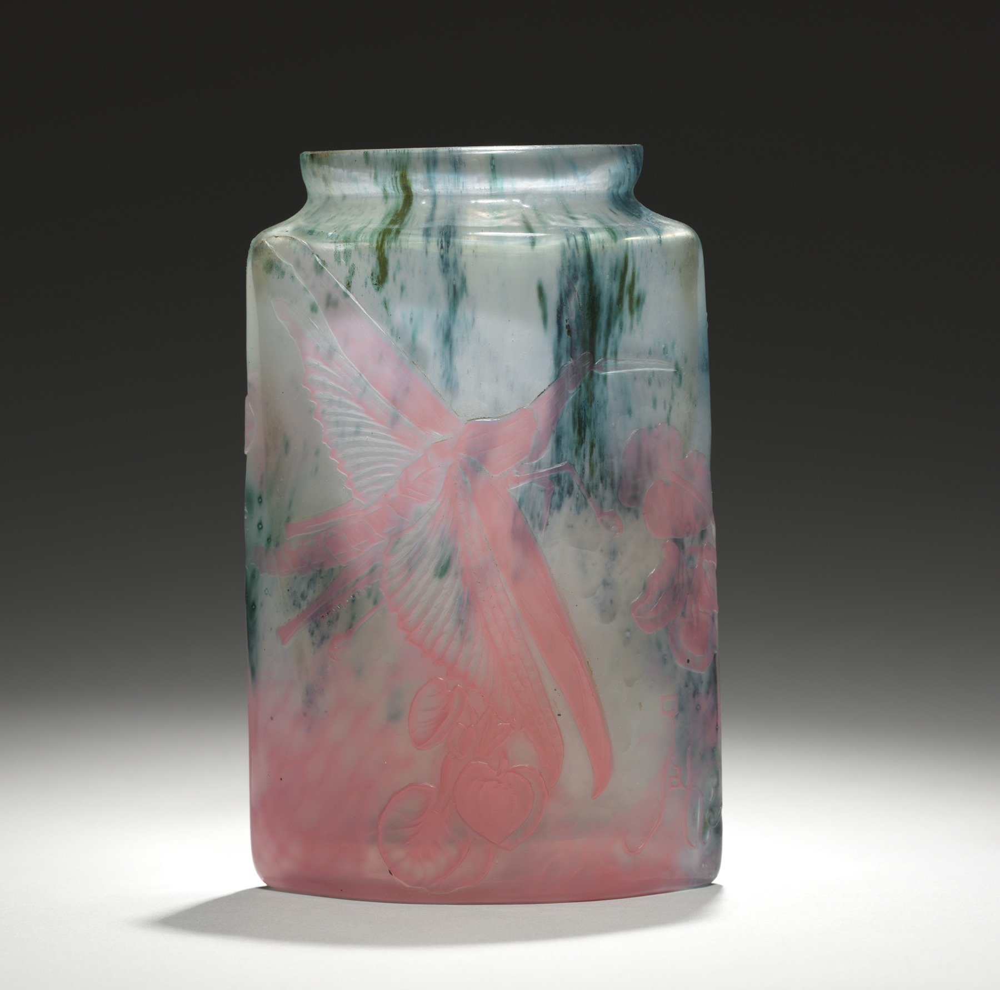

ア．ピンクの筋が入る地に緑系の文様が浮く―透明な器面へ絵具の線を重ねる

イ．ピンクの筋が入る地に緑系の文様が浮く―異なる色のガラス層を彫り分ける

ウ．緑系の筋が入る地に淡いピンクの文様が浮く―透明な器面へ絵具の線を重ねる

エ．緑系の筋が入る地に淡いピンクの文様が浮く―異なる色のガラス層を彫り分ける

## 大問25 美術館の成立と収集

### 問79

1929年に開館したニューヨーク近代美術館（MoMA）のコレクション形成を説明する。絵画・彫刻との関係も含め、この館が近代美術の対象をどう捉えてきたかを示す文章として、最も適切なのはどれか。

ア．古代の遺物と自然物の大規模な収集を基礎とし、人類史全体を通覧する博物館へ発展した。

イ．写真・映画・建築・デザインなども部門として扱い、近現代の視覚表現へ対象を広げた。

ウ．1848〜1914年を主な対象とし、19世紀フランス美術を横断する収集を形成した。

エ．工芸品や生活用品を歴史と地域別に集め、世界各地の装飾美術の変遷を中心に紹介した。

## 大問26 展覧会とコレクションの制度

### 問80

ドクメンタの1955年の初回企画について、その背景と1972年以後の原則的な開催周期が合う説明を選べ。

ア．各国の代表作品を独立した国別館へ集める―5年周期

イ．各国の代表作品を独立した国別館へ集める―4年周期

ウ．ナチス期に排斥された近代美術を再び紹介する―5年周期

エ．ナチス期に排斥された近代美術を再び紹介する―4年周期

## 大問27 身体の接触と立体構成

### 問81

二点の彫刻の身体の組み立てを比較する。Aでは二人の腕がどこを通るか、Bでは頬へ寄せた手と頭の傾きがどう関わるかを見て、正しい記録を選べ。

図A

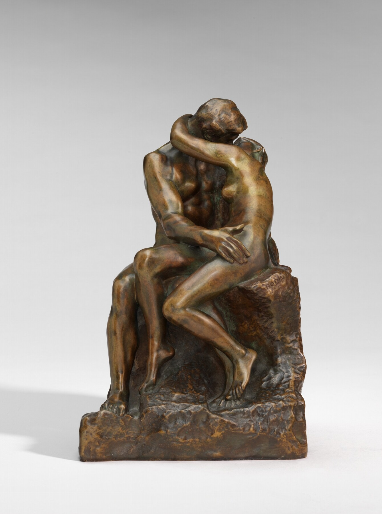

図B

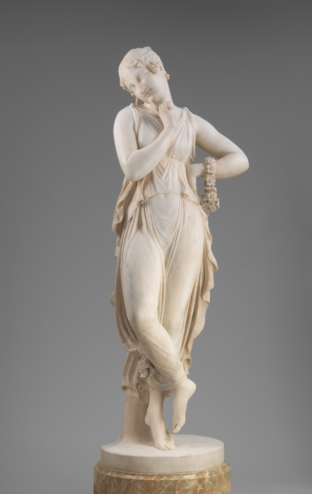

ア．Aは一方の腕が相手の肩から首の後ろへ回る。Bは頬へ寄せた手と逆側に頭を傾ける。

イ．Aは一方の腕が相手の胸の前を横に通る。Bは頬へ寄せた手と逆側に頭を傾ける。

ウ．Aは一方の腕が相手の肩から首の後ろへ回る。Bは頬へ寄せた手の側に頭を傾ける。

エ．Aは一方の腕が相手の胸の前を横に通る。Bは頬へ寄せた手の側に頭を傾ける。

## 大問28 建物をとらえる線と色

### 問82

建物を描く紙の作品を、目録①「グラファイト」、②「黒チョークの上に水彩」と照合する。Aの塔の窓、Bの橋の下の水面を見て、媒体と観察が合う記録を選べ。

図A

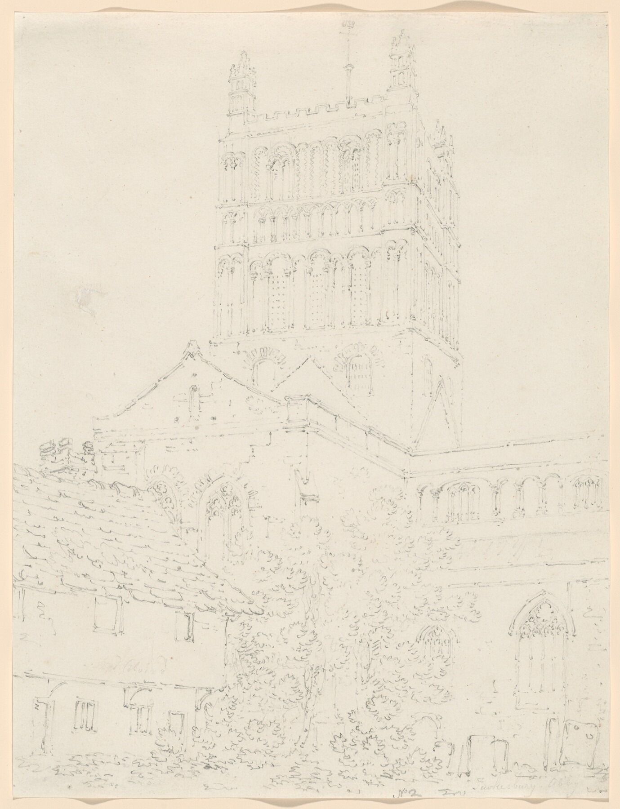

図B

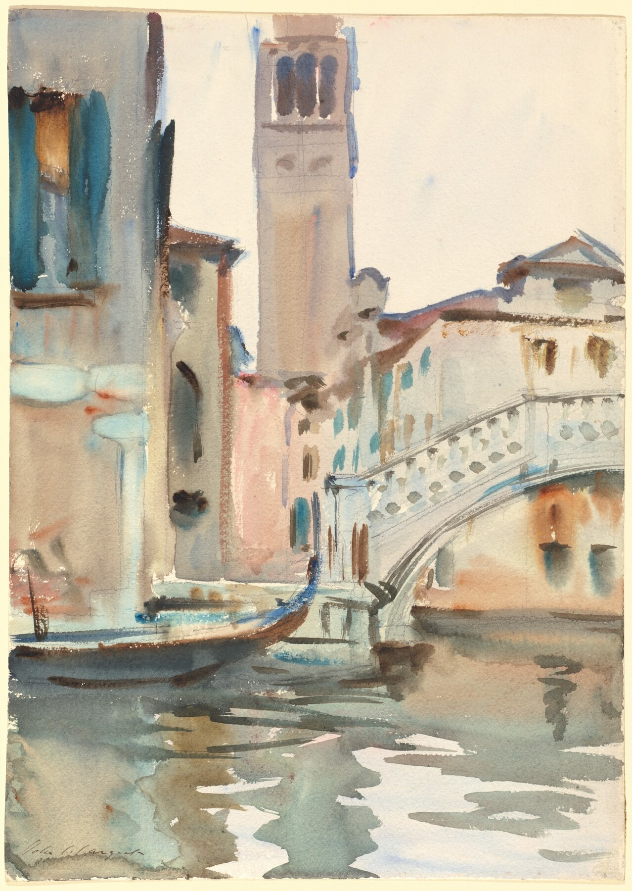

ア．A→②、B→①。Aは窓や塔の外周に細線を重ね、Bは着色の間に明るい紙の部分を残して水面を示す。

イ．A→①、B→②。Aは窓や塔の外周に細線を重ね、Bは着色の間に明るい紙の部分を残して水面を示す。

ウ．A→①、B→②。Aは窓の線を省いて外周線へ集約し、Bは着色の間に明るい紙の部分を残して水面を示す。

エ．A→①、B→②。Aは窓や塔の外周に細線を重ね、Bは水面の明部を細い黒線の密集で示す。

## 大問29 能の面と装束の資料

### 問83

目録①は「彩色した木彫の能面」、②は「絹・金属糸等を用いる唐織」と記す。目や口の形、地と大小の文様の関係を実図で確かめ、観察と目録の対応が合う記述を選べ。

図A

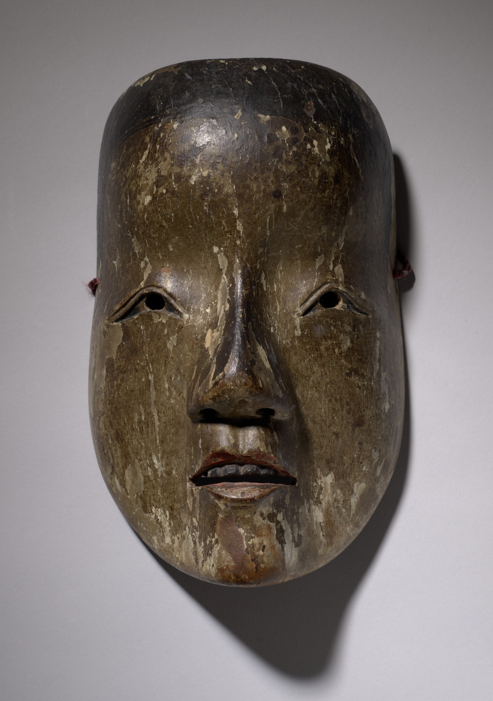

図B

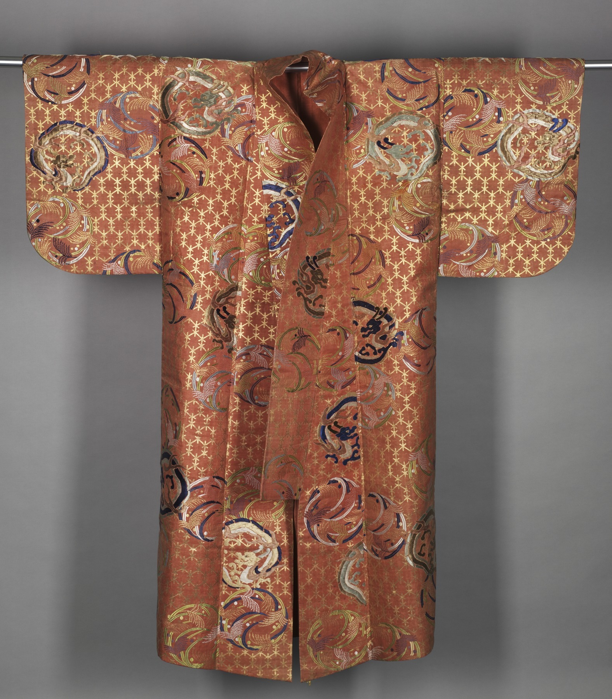

ア．A→①、B→②。Aは目と口に暗い開口があり、Bは小さな金色の反復文の上に大きな曲線形の文様を配す。

イ．A→①、B→②。Aは目を開口させず表面の黒い彩色で示し、Bは小さな金色の反復文の上に大きな曲線形の文様を配す。

ウ．A→①、B→②。Aは目と口に暗い開口があり、Bは小さな金色の反復文を袖口の帯状部分へ集める。

エ．A→②、B→①。Aは目と口に暗い開口があり、Bは小さな金色の反復文の上に大きな曲線形の文様を配す。

## 大問30 物の重なりと推定制作年の編集判断

### 問84

図と目録①《コーラー夫人》1887〜88年（推定）、②《花瓶の花》1900〜03年（推定）を照合し、図録の説明を点検する。物の重なり、二作品の制作の先後、世紀別索引への記載について、記録から確定できる範囲を守った案はどれか。

図A

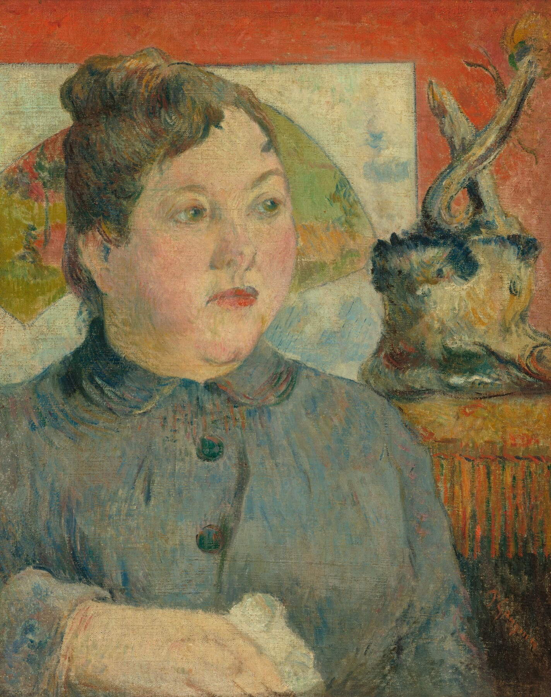

図B

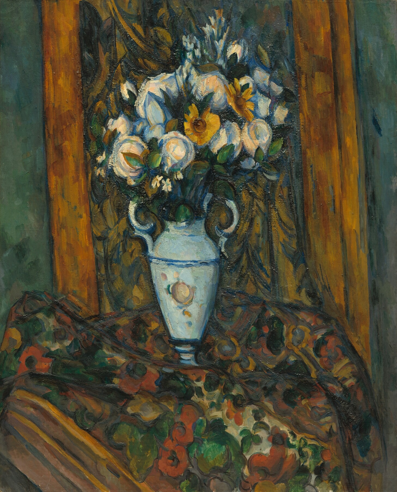

ア．Aでは右側の立体物が人物の一部を、Bでは器が文様の布の一部を遮る。AはBより早い。Bは19・20世紀の双方に制作年の候補を置けるが、両世紀を通した制作は確定しない。

イ．Aでは人物が右側の立体物の一部を、Bでは器が文様の布の一部を遮る。両作とも年に幅があるためA・Bの先後は確定しない。Bは19・20世紀の双方に制作年の候補を置ける。

ウ．Aでは人物が右側の立体物の一部を、Bでは器が文様の布の一部を遮る。AはBより早い。Bは19・20世紀を通して制作を継続した作品として、両世紀の索引へ載せる。

エ．Aでは人物が右側の立体物の一部を、Bでは器が文様の布の一部を遮る。AはBより早い。Bは19・20世紀の双方に制作年の候補を置けるが、両世紀を通した制作は確定しない。

## 大問31 黒い調子と二つの版種

### 問85

黒い調子を使う紙の作品二点を、目録①「エッチングとアクアチント、眠る人物と鳥獣」、目録②「リトティント、夜の川と船」へ対応させる。リトティントは石版の面に液状の描画材を用いる技法である。実図の人物や空間を確かめ、目録の対応と、凹版・平版の分類がともに合うものを選べ。

図A

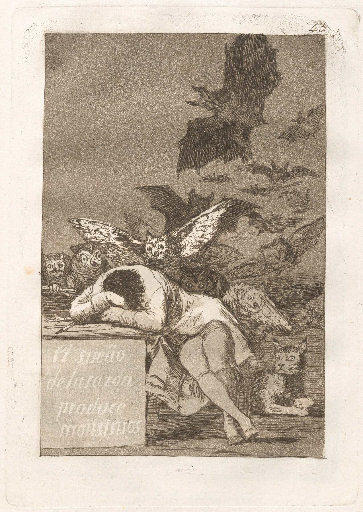

図B

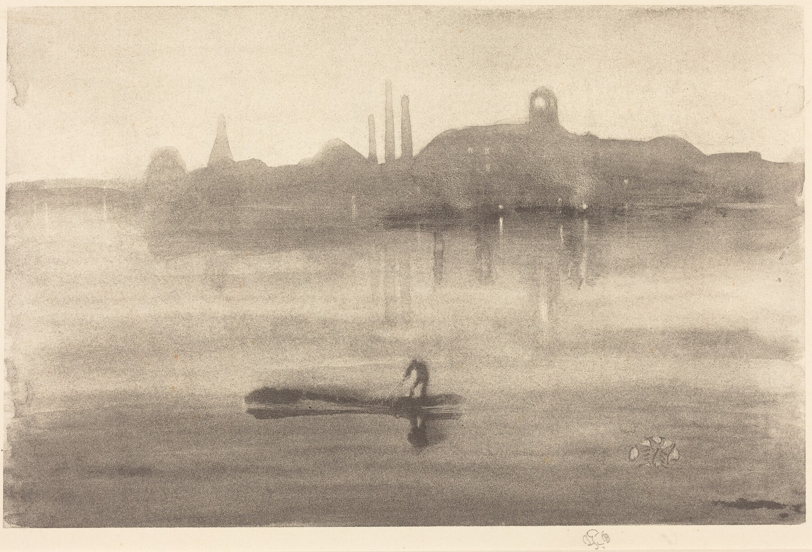

ア．A→①・凹版、B→②・平版。黒い調子が似ていても、版の仕組みを分けて記す。

イ．A→②・平版、B→①・凹版。黒い調子が似ていても、版の仕組みを分けて記す。

ウ．A→①・平版、B→②・凹版。黒い調子が似ていても、版の仕組みを分けて記す。

エ．A→②・凹版、B→①・平版。黒い調子が似ていても、版の仕組みを分けて記す。
