# 美術検定2級 模擬試験5（非公式）

全85問・4択・60分。美術史80問＋活用5問。図版はカラー表示・印刷を推奨。

## 大問1 古代と中世の造形・役割

作品や活動の記録を読み、時代、素材、主題、表現の方法を対応させて考えなさい。図版がある問いは、その画面も確かめなさい。

### 問1

ローマ以前のイタリア半島中部で栄え、テラコッタによる人物像などを制作した文化を選びなさい。

ア．クレタ

イ．エトルリア

ウ．アケメネス朝ペルシア

エ．メソポタミア

### 問2

ローマ帝政初期と末期の皇帝像を大きな傾向で比較する。それぞれの時期に対応する人体や顔の表し方の組合せとして、適切なものを選びなさい。

ア．初期＝均衡ある理想的な身体、末期＝自然な重心と運動の再現

イ．初期＝大きな目や様式化された正面性、末期＝自然な重心と運動の再現

ウ．初期＝大きな目や様式化された正面性、末期＝大きな目や様式化された正面性

エ．初期＝均衡ある理想的な身体、末期＝大きな目や様式化された正面性

### 問3

初期キリスト教美術のカタコンベについて、用途とそこに残る表現の説明として適切なものを選びなさい。

ア．競技や見世物の施設であり、観客席が楕円形に巡る。

イ．皇帝の戦勝を示す門であり、戦争の歴史浮彫が並ぶ。

ウ．市民の集会用の広場であり、公共の記念像が並ぶ。

エ．地下の墓所であり、キリスト教の主題を表す壁画などが残る。

### 問4

図1の人物の配置としぐさから、キリスト教の主題を選びなさい。

図1

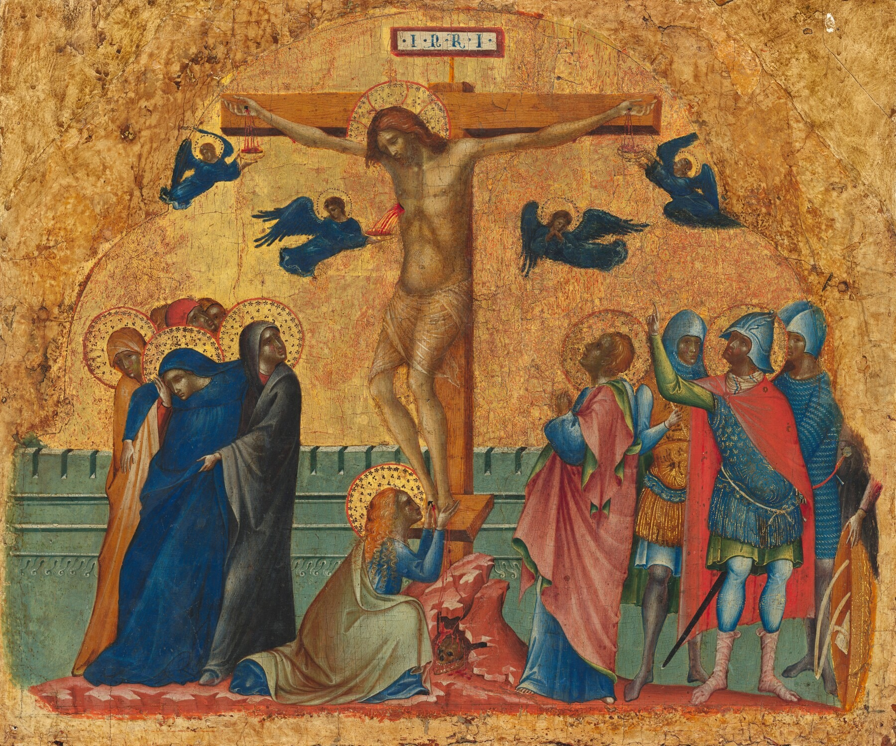

ア．十字架降下――十字架から下ろす身体を、人々が腕で支える。

イ．哀悼――地上に横たえたキリストの身体を、人々が囲む。

ウ．磔刑――十字架上のキリストの左右や足元に、嘆く人々が集まる。

エ．キリストの埋葬――キリストの身体を、人々が墓へ運ぶ。

## 大問2 ルネサンスの素材と表現

作品や活動の記録を読み、時代、素材、主題、表現の方法を対応させて考えなさい。図版がある問いは、その画面も確かめなさい。

### 問5

「ルネサンス」の再生という意味を、美術史の基本的な捉え方として説明したものを選びなさい。

ア．宮廷の親密な空間へ、優雅な遊戯や神話を曲線的な装飾とともに表す。

イ．教会の高い構造や大きな窓を発達させ、光の満ちる礼拝空間を重視する。

ウ．見る者の感覚に迫る宗教的な物語を、強い明暗や劇的な動勢で重視する。

エ．ギリシア・ローマの古典を参照し、人間性や現実的な表現を改めて重視する。

### 問6

図1の手元の書物と、右下にいる動物を手掛かりに、描かれた聖人を選びなさい。

図1

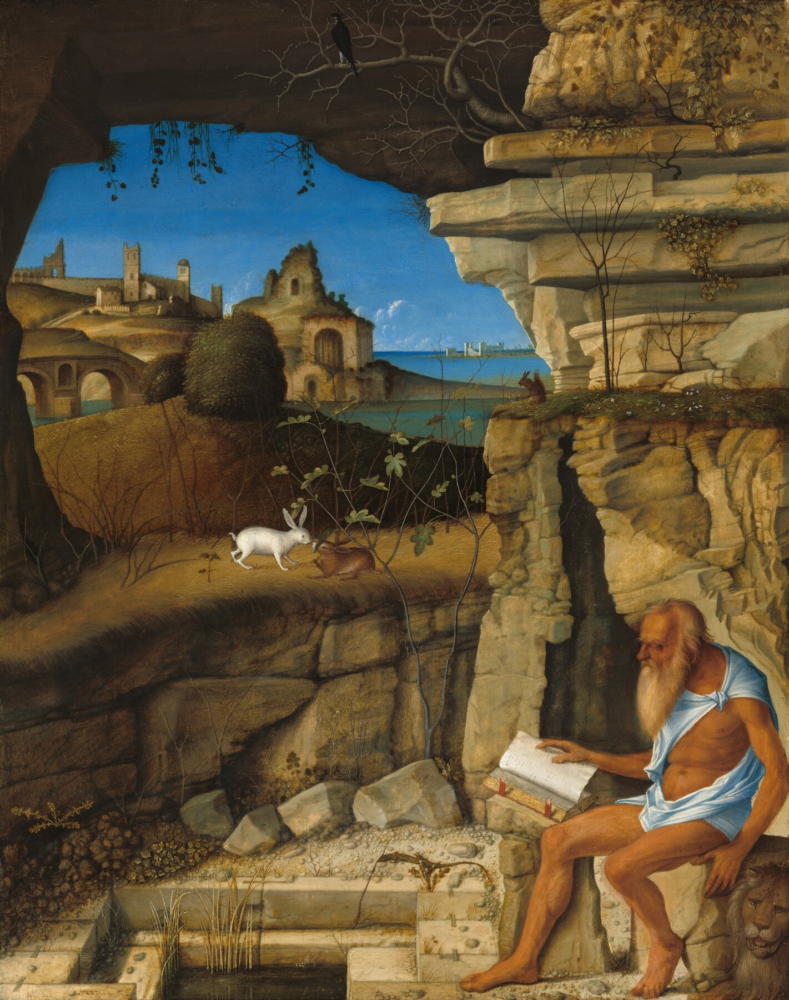

ア．ヒエロニムス――聖書の翻訳と獅子に結び付く聖人

イ．ペテロ――鍵を持つ使徒

ウ．アントニウス（隠修士）――隠修生活と豚に結び付く聖人

エ．ルカ――福音書と牛に結び付く聖人

### 問7

図1の肖像を「赤い帽子は聖職者の身分、動きの少ない身体は儀礼への従属を表す」と解説する案が出た。服装と身体表現を併せて修正する説明はどれか。

図1

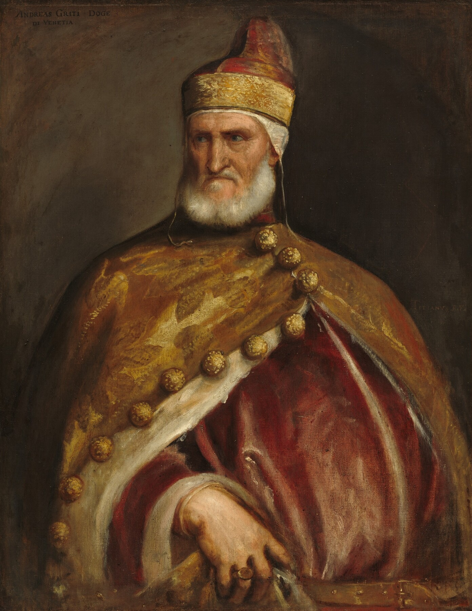

ア．ドージェの冠と公的な衣装を、正面へ左右均等に置いた頭と身体に結びつけ、元首の個性を抑えた静的な儀礼像と読む。

イ．ドージェの冠と公的な衣装を、向きを違える頭と身体、衣をつかむ手に結びつけ、ヴェネツィア共和国元首の威厳と意志の強さを読む。

ウ．軍の指揮官の帽子と衣装を、向きを違える頭と身体、衣をつかむ手に結びつけ、ヴェネツィア軍の戦場での指揮を読む。

エ．枢機卿の帽子と聖職の衣装を、向きを違える頭と身体、衣をつかむ手に結びつけ、教会の高位聖職者の威厳と読む。

### 問8

図1の幼児をめぐる行為と、衣装の扱いを述べた説明はどれか。

図1

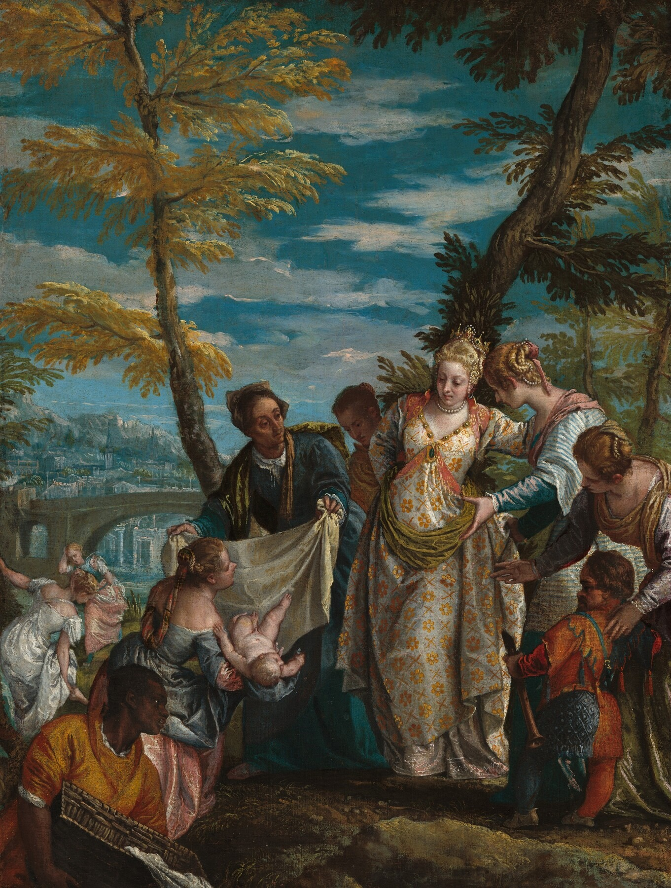

ア．川辺の幼児を祭壇へ差し出す人々を、神殿の祭司の儀礼服へそろえて表す。

イ．幼児を囲む人々の衣装を古代の簡素な長衣へそろえ、当時の生活の復元を重視する。

ウ．川辺に置かれた幼児へ人々が背を向け、豪華な衣装の集団を別の行列として表す。

エ．川辺で見つけられた幼児を人々が囲み、聖書の物語を画家と同時代の華やかな衣装で表す。

## 大問3 16世紀の技法と活動

作品や活動の記録を読み、時代、素材、主題、表現の方法を対応させて考えなさい。図版がある問いは、その画面も確かめなさい。

### 問9

図1のヴェールと、手や腕の配置がつくる形を説明したものはどれか。

図1

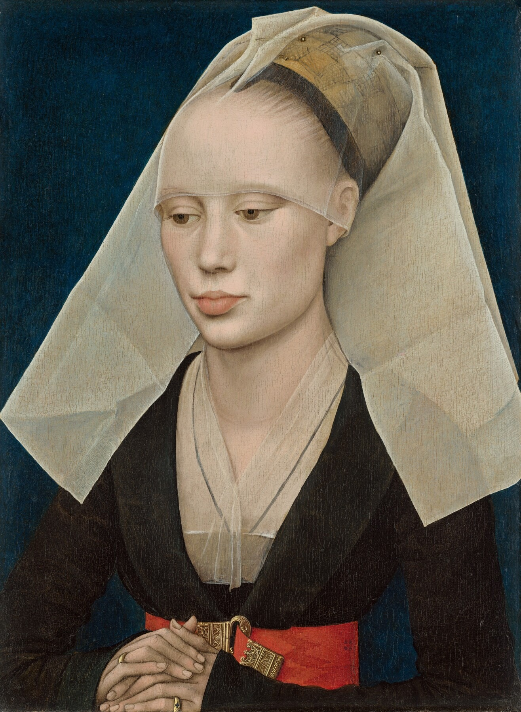

ア．ヴェールが両肩へ細く垂れ、顔の横へ上げた両手とともに、細長い縦のまとまりをつくる。

イ．ヴェールが円く頭を包み、左右へ開く手・腕とともに、同心円状のまとまりをつくる。

ウ．ヴェールの角張る輪郭と、下方で重ねた手・腕が、明瞭で幾何学的なまとまりをつくる。

エ．ヴェールが斜め後方へ流れ、前へ大きく差し出した腕とともに、強い対角線をつくる。

### 問10

ギベルティの《天国の門》に見られる浮彫の空間表現を整理する。近景と遠景の浮彫の深さ、建築による奥行きの表現を組み合わせた説明はどれか。

ア．近景を高く、遠景を浅くする――建築の線遠近法も用いる。

イ．近景を浅く、遠景を高くする――人物の重要性の差だけを尺度で示す。

ウ．近景を浅く、遠景を高くする――建築の線遠近法も用いる。

エ．近景を高く、遠景を浅くする――人物の重要性の差だけを尺度で示す。

## 大問4 17世紀の主題と制作

作品や活動の記録を読み、時代、素材、主題、表現の方法を対応させて考えなさい。図版がある問いは、その画面も確かめなさい。

### 問11

図1の馬と人物の身体がつくる動きを、画面全体の構成から説明したものはどれか。

図1

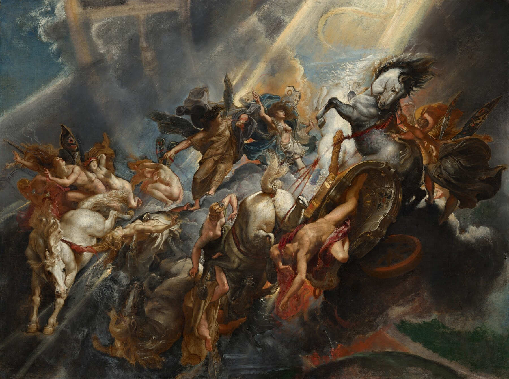

ア．人物の身体が画面下へ正面向きに並び、馬との距離を広く取って、静かな分離をつくる。

イ．馬の身体が水平に並び、人物がその上へ左右対称に重なって、安定した釣り合いをつくる。

ウ．馬と人物が同じ対角線に沿って上方へ進み、重なりの少ない身体が、整然とした上昇を強める。

エ．馬と人物が対角線に沿って崩れ落ち、ねじれや短縮された身体が、混乱と墜落を強める。

### 問12

図1の風車と周囲の明暗の関係を説明したものはどれか。

図1

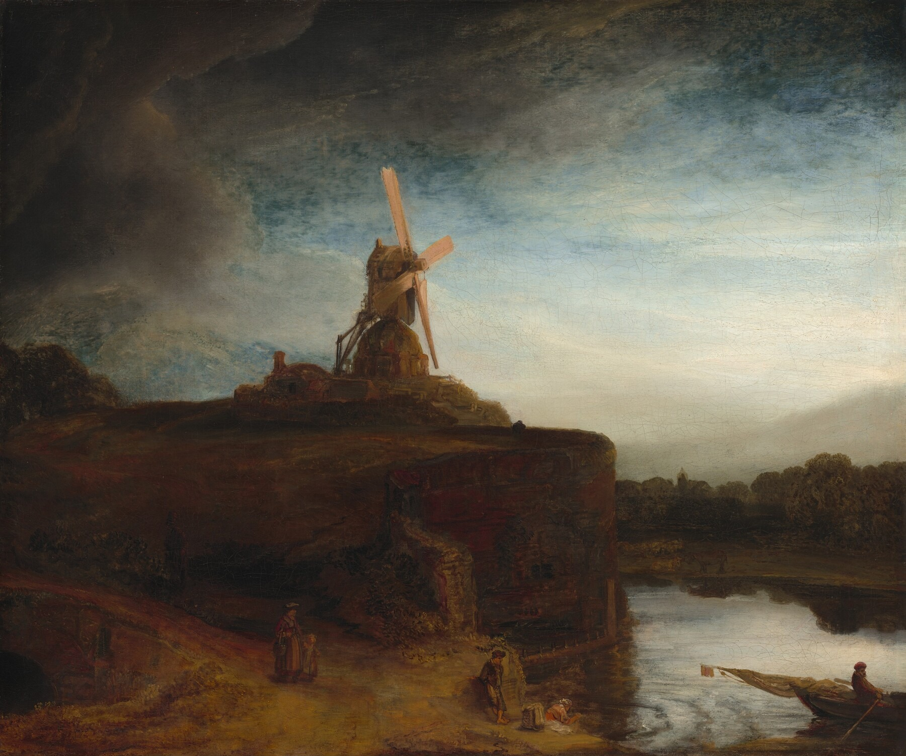

ア．暗い高台の上で、明るい空を背にした風車の輪郭が際立つ。

イ．明るい高台と空へ風車を同じ明度でなじませ、輪郭の差を弱める。

ウ．暗い空を背に風車の壁を画面で最も明るくし、周囲の地面へ光を広げる。

エ．風車と空をともに暗く沈め、水面の明るさへ画面の中心を移す。

### 問13

図1の風景を構成する要素の関係として適切なものはどれか。

図1

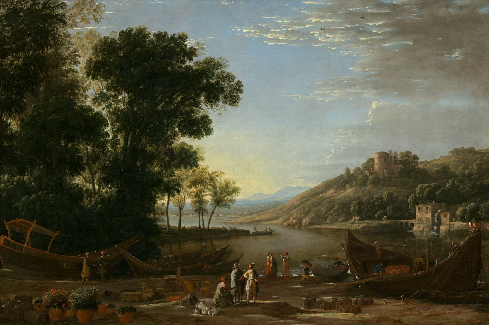

ア．水と樹木を画面手前で閉じ、遠方へ続く道筋を断って、人の活動と自然を分離する。

イ．水辺の荷と人々を前景から離し、建築の正面を画面全体へ広げて、平坦な街路の記録をつくる。

ウ．人々の交易を前景に置き、樹木や建築で水辺の奥行きを組み立て、理想化された広がりをつくる。

エ．人々の交易を画面中央へ大きく集め、建築と樹木を同じ大きさの背景装飾として横一列へそろえる。

### 問14

17世紀オランダで、肖像画や風俗画、風景画、静物画が発達した背景として適切なものを選びなさい。

ア．教会の信仰喚起のため、カトリックの都市で聖人や奇跡の大規模な絵画へ注文が集まった。

イ．共和制のもとで市民層が力をもち、個人や団体から世俗的な絵画への需要が広がった。

ウ．スペイン王家の宮廷で、君主やその家族の肖像が王政と儀礼の表現として求められた。

エ．絶対王政のもとで宮廷の儀礼が拡大し、国王の宮殿や庭園の装飾へ大きな注文が集まった。

## 大問5 18世紀の社会と表現

作品や活動の記録を読み、時代、素材、主題、表現の方法を対応させて考えなさい。図版がある問いは、その画面も確かめなさい。

### 問15

図1に描かれた人物の行為と身体の変化に対応する神話を選びなさい。

図1

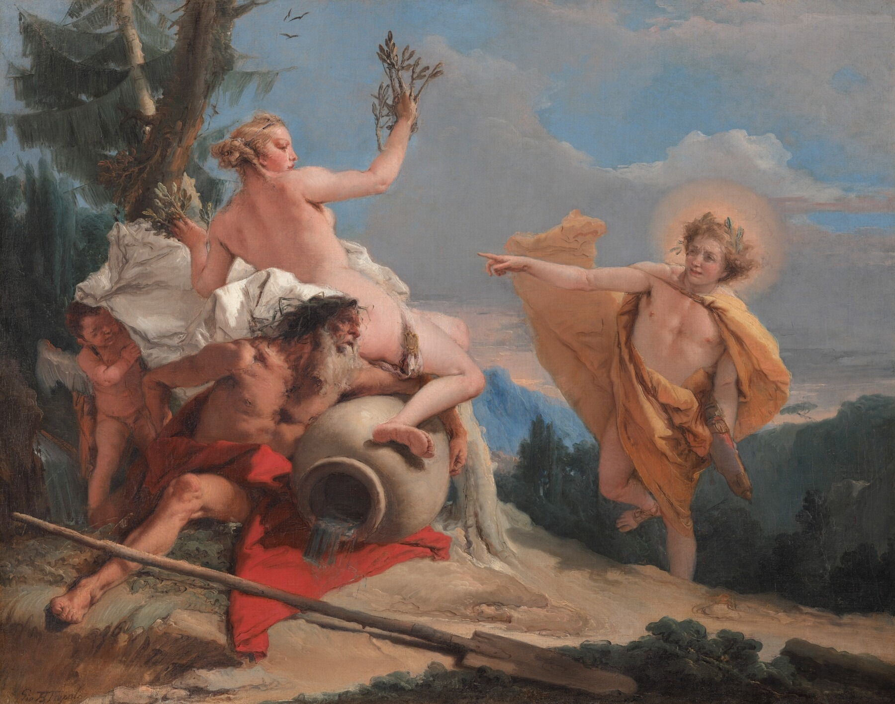

ア．ディアナの水浴を見て、鹿へ姿を変えられるアクタイオン

イ．アポロンの円盤が当たって死に、花になるヒュアキントス

ウ．アポロンから逃れ、月桂樹へ姿を変えるダフネ

エ．水に映る自分の姿に心を奪われ、花になるナルキッソス

### 問16

図1を主題により分類するとき、画面での物の役割に合う説明はどれか。

図1

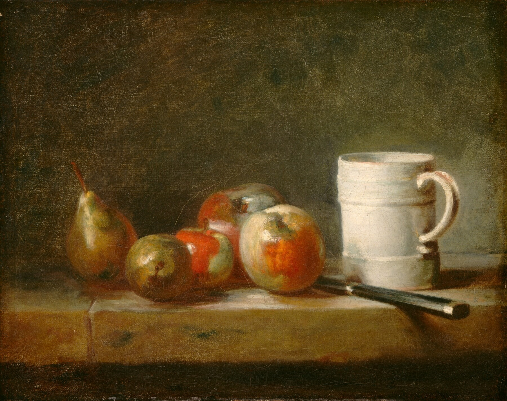

ア．器や果物の配置と質感自体を主役にする静物画で、人物の出来事を補わずに画面の関係を読む。

イ．器や果物を聖書の人物の持物と読む歴史画で、省略された聖なる物語を主題の中心にする。

ウ．器や果物から食事中の人物の行動を補う風俗画で、描かれない食卓の出来事を主題の中心にする。

エ．器や果物を持主の顔の代わりに読む肖像画で、特定の個人を同定する手掛かりを主題の中心にする。

### 問17

ゴヤの宮廷での活動と、社会へ向けた表現の関係として適切な説明を選びなさい。

ア．スペインの宮廷の仕事――ナポレオンの征服を理想の英雄として称える表現

イ．フランス革命政府の仕事――戦争の暴力を批判的に捉える表現

ウ．スペインの宮廷の仕事――戦争の暴力を批判的に捉える表現

エ．フランス革命政府の仕事――ナポレオンの征服を理想の英雄として称える表現

## 大問6 19世紀前半の美術

作品や活動の記録を読み、時代、素材、主題、表現の方法を対応させて考えなさい。図版がある問いは、その画面も確かめなさい。

### 問18

新古典主義の画家アングルが学んだ師を選びなさい。

ア．ジャック＝ルイ・ダヴィッド

イ．ウジェーヌ・ドラクロワ

ウ．アンヌ＝ルイ・ジロデ

エ．テオドール・ジェリコー

### 問19

図1で人物へ注意を集める仕組みを、背景と身体の収め方から説明したものはどれか。

図1

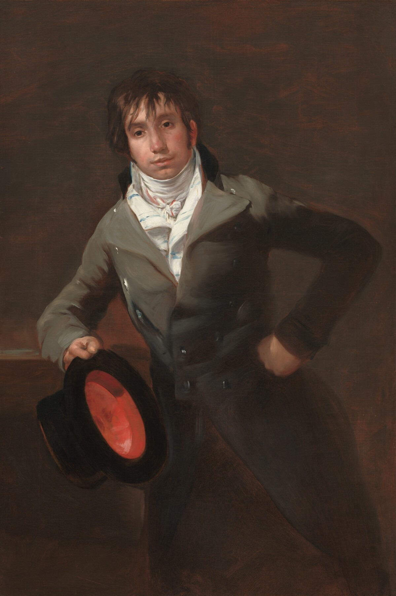

ア．暗く単純な背景に膝上までの人物を近く置き、顔・手・衣服を見せる。

イ．暗い背景に胸上だけの人物を置き、手と腰より下を画面から外す。

ウ．明るい室内へ全身を小さく置き、家具と床の広がりを詳しく見せる。

エ．明るい背景へ頭部を大きく寄せ、肩から下の身体と衣服を切り取る。

### 問20

図1の景物の組み合わせから読める、場所の性格はどれか。

図1

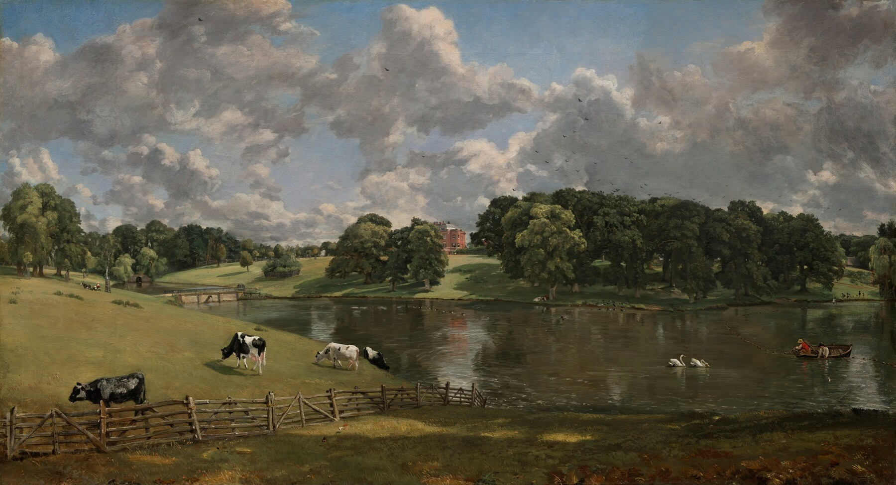

ア．邸宅を遠方へ置き、手前を作物の密な畝で埋めた、収穫作業の農園である。

イ．邸宅と水辺を囲む塀を大きく描き、領地を守る要塞の閉じた構えを中心にする。

ウ．邸宅の前へ幾何学的な花壇を左右対称に並べ、儀礼的な直線の軸を強調する庭園である。

エ．邸宅、放牧地、水辺を含み、人の営みと管理が調和して見える私有地の公園である。

### 問21

19世紀のジャポニスムで、浮世絵が西洋絵画へ与えた構図上の刺激として適切なものを選びなさい。

ア．左右対称の人体と単一の消失点を規範にするアカデミー的な構成

イ．非対称な配置や大胆な切取り、俯瞰などの自由な画面構成

ウ．教会の高い天井を開くように見せ、天上の群像へ仰ぎ見る構成

エ．古代の英雄を中央へ大きく置き、倫理的な模範として示す構成

## 大問7 近代の都市と鑑賞

作品や活動の記録を読み、時代、素材、主題、表現の方法を対応させて考えなさい。図版がある問いは、その画面も確かめなさい。

### 問22

図1の衣装、持物、身体の置き方から、最も適切な主題の説明を選びなさい。

図1

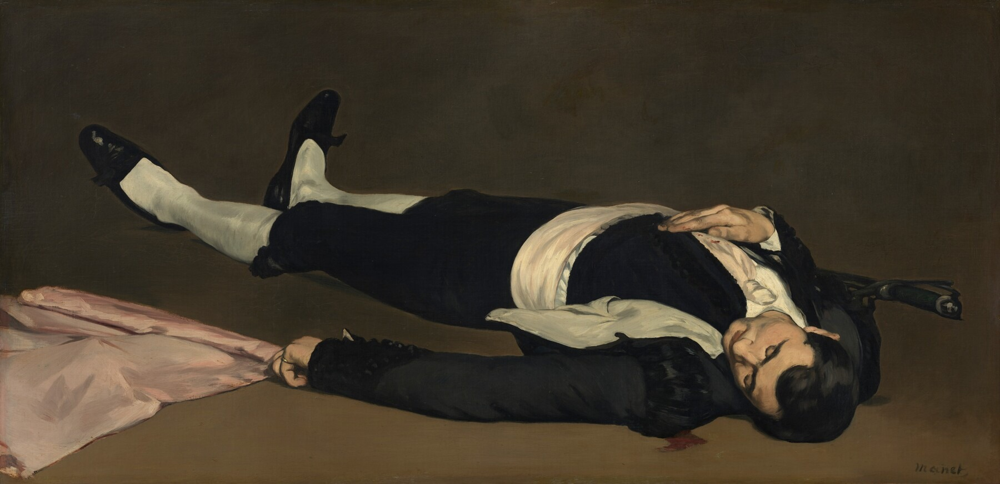

ア．修道服と聖人の持物を伴い、殺された修道者の殉教を表す。

イ．闘牛の衣装と布を伴い、倒れた闘牛士の死を表す。

ウ．軍服と軍旗を伴い、倒れた兵士の戦死を表す。

エ．裸の身体と十字架を伴い、降ろされたキリストの死を表す。

### 問23

図1の服装、舟、人物同士の関係から読める場面はどれか。

図1

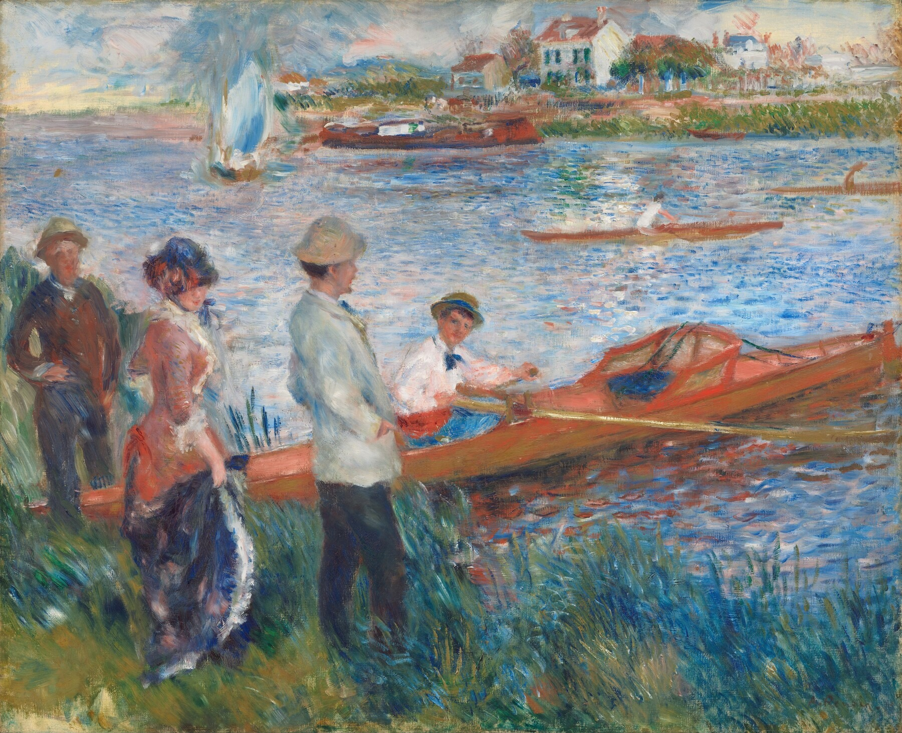

ア．競技服の選手が同じ向きに並び、号令に合わせて一斉に舟を漕ぎ出す。

イ．作業服の男女が川辺で荷を分け、漕ぎ手とともに品物の積み込みを進める。

ウ．漁具を持つ男女が漕ぎ手を囲み、舟から上げた魚を市場へ運ぶ準備をする。

エ．街着の男女が川辺で語らい、漕ぎ手と舟を伴う近代の余暇を楽しむ。

### 問24

図1の身体各部の関わりから、姿勢と表情を説明したものはどれか。

図1

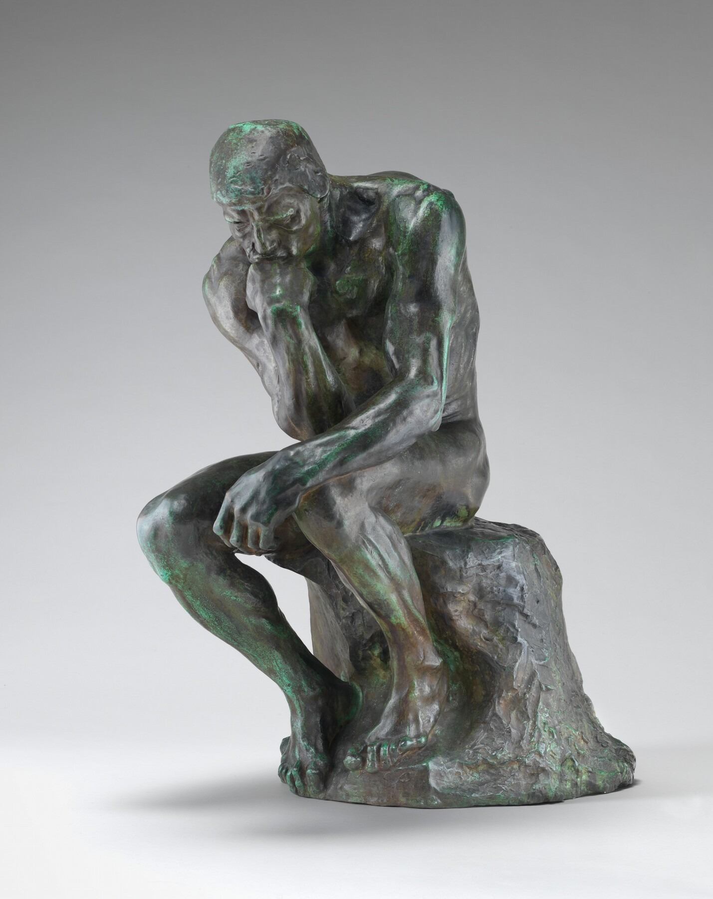

ア．手を顎から離して両膝へ置き、胸を大きく反らして、外へ呼びかける姿を表す。

イ．手を顎へ寄せ、背をまっすぐ起こして両脚をそろえ、筋肉を緩めた休息を表す。

ウ．手を顎へ寄せ、反対側の膝へ肘を渡す前屈の身体に、筋肉の緊張と集中を表す。

エ．手を頭の後ろへ回し、肘を左右に開いて、上体を伸ばす開放的な姿を表す。

## 大問8 世紀末の多様な制作

作品や活動の記録を読み、時代、素材、主題、表現の方法を対応させて考えなさい。図版がある問いは、その画面も確かめなさい。

### 問25

「ポスト印象主義の画家は、その名の共同綱領に合意して一斉に制作を始めた」という解説を改める。呼称の成立と作品の関係を踏まえた修正はどれか。

ア．印象派最後の展覧会での共同宣言が起源で、その綱領から離れた作品を後にフライが外した名称と考える。

イ．画家たちの共同展で成立した自称だが、共通綱領は後からフライが定めたため、各人の制作開始より呼称を先に置く。

ウ．フライの展覧会で一つの制作方式へ統一した呼称で、出品以前の各人の違いを、名称成立後の共同制作が解消したと考える。

エ．フライが後の展覧会で用いた呼称で、先行する多様な探究を括るため、制作当時の共通綱領や統一様式を逆算しない。

### 問26

図1の花や葉の表面を近くで観察した説明として、適切なものを選びなさい。

図1

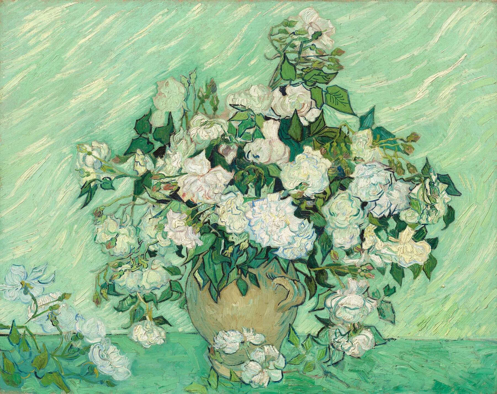

ア．厚みのある絵具と方向をもつ筆触が、花や葉の形と画面の動きをつくる。

イ．薄い油彩をなだらかにぼかし、表面の起伏と筆触を抑えて花や葉を整える。

ウ．均一な小さな円点を規則的に並べ、花や葉を光学的混合でつくる。

エ．強い輪郭で広い色面を区切り、面の内側から筆触の変化を抑える。

### 問27

アール・ヌーヴォーという呼称の由来として適切なものを選びなさい。

ア．1905年の展覧会での絵画を「野獣」と評した言葉

イ．1917年にオランダで創刊された雑誌の名称

ウ．パリの美術商ビングが開いた店の名前

エ．1925年のパリの装飾美術博覧会の名称

## 大問9 20世紀初頭の変化

作品や活動の記録を読み、時代、素材、主題、表現の方法を対応させて考えなさい。図版がある問いは、その画面も確かめなさい。

### 問28

フォーヴィスムにも関わり、明るい色と軽快な線で音楽、海辺、競馬などを描いた画家を選びなさい。

ア．アンドレ・ドラン

イ．ラウル・デュフィ

ウ．モーリス・ド・ヴラマンク

エ．ジョルジュ・ルオー

### 問29

《ゲルニカ》に描かれる惨禍の直接の契機となった出来事はどれか。

ア．スペイン共和国政府による壁画の依頼

イ．作品をスペインへ帰還させる展示計画の決定

ウ．スペイン内戦でのゲルニカ市街への爆撃

エ．パリ万国博覧会のスペイン館建設の決定

### 問30

エコール・ド・パリの作家たちの出身と結びつきを説明したものはどれか。

ア．多国籍の作家がパリに集まり、共通綱領で統一されず、各自の表現を展開した。

イ．多国籍の作家がパリで共同宣言を結び、同じ形式の制作へ合意した一団である。

ウ．パリの一つの教育機関で同じ課程を修了し、師の作風を継承する作家を指す。

エ．フランス出身の画家を中心に、外国から来た作家と区別するために定めた会員組織である。

### 問31

スイスに生まれ、ドイツでも活動し、児童画のような単純な線や記号を独自の画面へ展開した、バウハウスでも教えた画家を選びなさい。

ア．ロベール・ドローネー

イ．ワシリー・カンディンスキー

ウ．ジョアン・ミロ

エ．パウル・クレー

## 大問10 制作と教育の試み

作品や活動の記録を読み、時代、素材、主題、表現の方法を対応させて考えなさい。図版がある問いは、その画面も確かめなさい。

### 問32

シュルレアリスムなどで用いられたデカルコマニーの工程を選びなさい。

ア．絵具を塗った面へ別の紙などを押し付けて移し、偶然の形を得る。

イ．液状の絵具を画面へ滴らせ、支持体への落下の軌跡を重ねて形を得る。

ウ．写真や印刷物を切り抜き、一つの平面へ貼り合わせる。

エ．物の凹凸へ紙を当て、上から擦って模様を浮かび上がらせる。

### 問33

アルプのダダ期の紙片のコラージュについて、偶然と構成の関係を説明したものはどれか。

ア．紙片を下描きの輪郭に沿わせ、既に決めた具象の形を正確に再現する。

イ．紙片を同じ形と寸法へそろえ、規則的な間隔の反復を構成の成立条件にする。

ウ．紙片が落ちたり散らばったりした配置を、意図だけに頼らない構成の出発点にする。

エ．紙片を先に定めた格子へそろえ、偶然のずれは設計図に戻して構成を整える。

### 問34

バウハウスの教師と主な担当分野を整理する。イッテンとモホイ＝ナジを、それぞれ適切に対応させた組合せを選びなさい。

ア．イッテン＝舞台芸術、モホイ＝ナジ＝色彩学

イ．イッテン＝色彩学、モホイ＝ナジ＝写真・タイポグラフィ

ウ．イッテン＝舞台芸術、モホイ＝ナジ＝写真・タイポグラフィ

エ．イッテン＝色彩学、モホイ＝ナジ＝舞台芸術

## 大問11 戦後美術の展開

作品や活動の記録を読み、時代、素材、主題、表現の方法を対応させて考えなさい。図版がある問いは、その画面も確かめなさい。

### 問35

戦後フランスのスーラージュの絵画に対応する特徴を選びなさい。

ア．同じ形の工業製品を壁へ一定間隔に反復する立体

イ．太い黒い筆跡などを大胆に用いる抽象

ウ．漫画の一場面を印刷の網点に似せて拡大する表現

エ．写真と同じように見える精緻な街路の描写

### 問36

リキテンスタインがポップ・アートで展開したイメージの扱いを選びなさい。

ア．日用品を柔らかな布へ置き換え、通常と異なる巨大な立体にする。

イ．漫画や広告などの像を、印刷の網点を思わせる表現とともに大きく拡大する。

ウ．写真を参照せず、荒い筆触で黒い線の抽象を画面全体へ描く。

エ．既製の蛍光灯を使い、光の広がりを周囲の空間へ及ぼす。

### 問37

1960年代の資本主義リアリズムと関わる、地域・作家の組合せを選びなさい。

ア．イギリス――ギルバート＆ジョージ

イ．イタリア――クネリスとメルツ

ウ．ドイツ――リヒターとポルケ

エ．アメリカ――ジャッドとフレイヴィン

### 問38

カーロの《ある朝早く》で、金属の構成と観者の空間の関係を説明したものはどれか。

ア．彩色した金属の隙間を閉じ、一塊の輪郭を中心に、周囲の空間から構成を切り離す。

イ．彩色した金属を高い台座へまとめ、観者の床面から離れた一体の像として完結させる。

ウ．彩色した金属を台座なく床へ置き、開いた構成が観者の位置に応じて見え方を変える。

エ．彩色した金属を床へ置くが、構成を一つの正面へ集中させ、横からの見え方を従属させる。

## 大問12 作品と鑑賞の関係

作品や活動の記録を読み、時代、素材、主題、表現の方法を対応させて考えなさい。図版がある問いは、その画面も確かめなさい。

### 問39

カプローが1959年に展開し、身体の行為やその場の偶然、観客の反応も受け入れる出来事として成立させた表現を選びなさい。

ア．フォト・リアリズム

イ．ハプニング

ウ．ハード・エッジ

エ．シェイプト・キャンヴァス

### 問40

ボイスの「社会彫刻」で、人々の創造性と社会はどのように関わるか。

ア．社会についての創造的な思考を、専門の芸術家が完成した像へ表す主題としてまとめる。

イ．人々の意見を同じ形へそろえるため、制作に参加する判断を専門家へ委ねる。

ウ．人々の参加を完成品の鑑賞へ集め、社会の制度を変える行動は芸術の過程と分ける。

エ．人々の創造的な思考と行動を、社会をともにつくり変える芸術の過程へ含める。

### 問41

一時的なインスタレーションの解説案に「撤去されるため作品は売れず、写真が販売されれば商品化への批判は消える」とある。会場での経験と商品化の関係から、修正すべき点はどれか。

ア．会場の経験は撤去とともに作品から外れ、残る物が恒久保存される場合に商品化への批判が成立すると考えるべきである。

イ．一時的な配置や会場で過ごす経験も作品に含める問いであり、記録物が取引されることだけで、その問いが消えるとは決められない。

ウ．記録物の取引が可能なら、一時的な配置は制作の準備へ戻り、完成した写真の販売価値を作品成立の中心に置くべきである。

エ．一時的な配置がある限り、記録物の市場との関係は作品解釈に関わらず、撤去する形式を商品化批判の十分条件にするべきである。

## 大問13 古代日本の素材と形

日本の作品と美術の活動を取り上げる。作品の形や材料、制作と受容の記録を、問われた事項へ対応させて考えなさい。

### 問42

縄文時代に粘土で人の姿をかたどり、祈りや呪術的な行為との関わりが考えられている造形はどれか。

ア．人物埴輪

イ．木造の神像

ウ．土偶

エ．石製の経筒

### 問43

鳥毛立女屏風と伎楽面の造形に合う比較はどれか。

ア．屏風：貴族の邸内を吹抜屋台で示す／伎楽面：頭部を覆う大ぶりな面

イ．屏風：絵と経文を上下に配する／伎楽面：顔の前面へ当てる小ぶりな面

ウ．屏風：樹下の唐風の女性像／伎楽面：顔の前面へ当てる小ぶりな面

エ．屏風：樹下の唐風の女性像／伎楽面：頭部を覆う大ぶりな面

### 問44

木彫像の眼の部分を刳り抜き、内側から薄い水晶を当てて潤いを感じさせる眼を作る技法はどれか。

ア．玉眼

イ．彫眼

ウ．切金

エ．彩色眼

## 大問14 信仰と物語の造形

日本の作品と美術の活動を取り上げる。作品の形や材料、制作と受容の記録を、問われた事項へ対応させて考えなさい。

### 問45

図の太子像の姿に対応する呼称はどれか。

図1

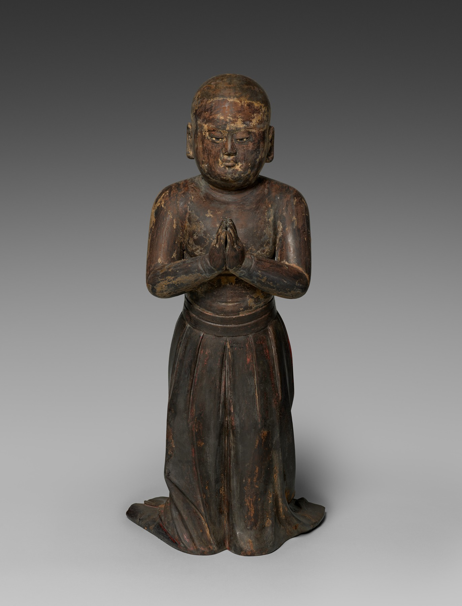

ア．南無仏太子像

イ．孝養太子像

ウ．摂政太子像

エ．勝鬘経講讃太子像

### 問46

葦手絵の文字と景物の関係を、装飾された書や調度の鑑賞に即して説明したものはどれか。

ア．和歌の字列を高さや間隔を変えて散らし、景物との形の重なりを作らず配置する

イ．文字の形を水流や草木などへ溶け込ませ、文字と絵の二つの読みを重ねる

ウ．画面の上部へ漢詩、下部へ絵を分けて置き、両者の主題を対応させる

エ．絵の場面ごとに独立した文章を置き、時間の進行を交互にたどらせる

### 問47

絵因果経の上下配置と、華厳宗祖師絵伝の祖師・伝承の対応が適切なものはどれか。

ア．上：経文・下：絵／義湘・元暁／朝鮮の祖師たちの物語

イ．上：絵・下：経文／義湘・元暁／朝鮮の祖師たちの物語

ウ．上：絵・下：経文／栄西・道元／中国から禅を伝えた物語

エ．上：絵・下：経文／法然・親鸞／日本の祖師たちの物語

## 大問15 中世から近世への表現

日本の作品と美術の活動を取り上げる。作品の形や材料、制作と受容の記録を、問われた事項へ対応させて考えなさい。

### 問48

浄瑠璃寺本堂と三仏寺投入堂の、仏像の安置や立地に応じた構成の比較はどれか。

ア．浄瑠璃寺：一体の仏を中央の塔に安置／投入堂：九体仏を横へ並べる長い堂を置く

イ．浄瑠璃寺：一体の仏を中央の塔に安置／投入堂：岩壁のくぼみに床を支える構架を組む

ウ．浄瑠璃寺：九体の阿弥陀を横に安置／投入堂：岩壁のくぼみに床を支える構架を組む

エ．浄瑠璃寺：九体の阿弥陀を横に安置／投入堂：池に囲まれた平地の基壇へ堂を置く

### 問49

頭部、腕、現存する持物を観察し、図像と信仰の意味に合う説明を選べ。

図1

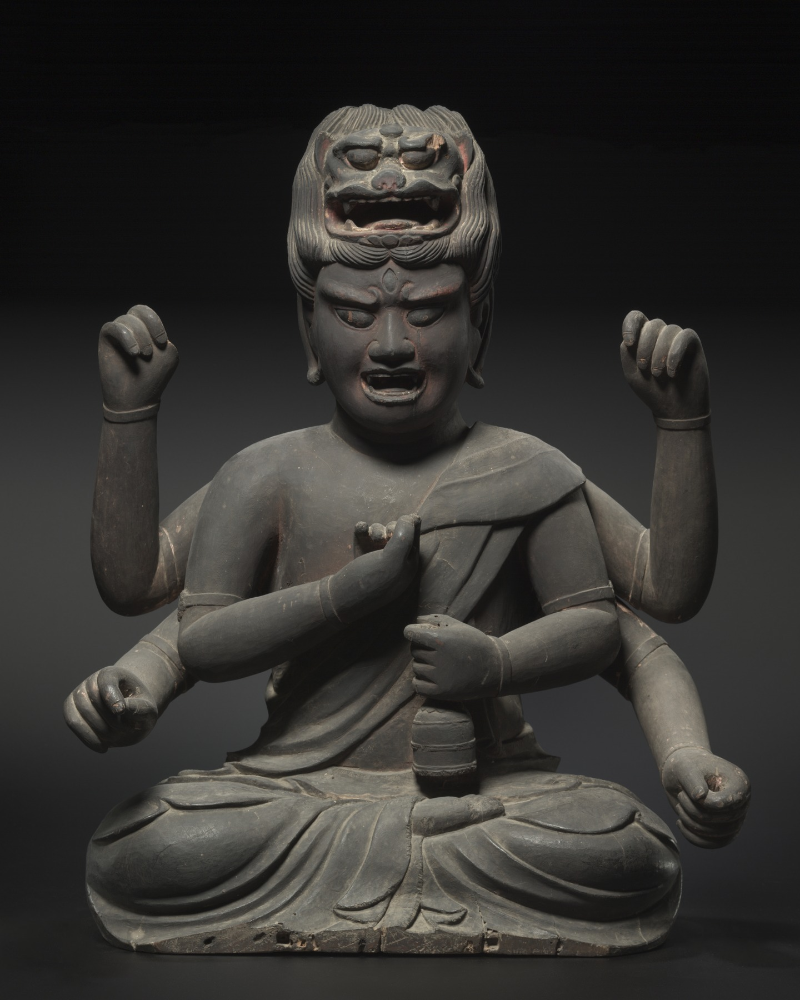

ア．六臂と獅子冠、鈴／欲望を禁欲によって取り除く姿としての愛染明王

イ．二臂と剣・羂索／迷う人を正しい道へ導く不動明王

ウ．六臂と獅子冠、宝珠／欲望を悟りへ向かう力に転ずる愛染明王

エ．六臂と獅子冠、鈴／欲望を悟りへ向かう力に転ずる愛染明王

### 問50

狩野派の真・行・草の画体と工房の制作を説明したものはどれか。

ア．探幽が体系化した筆法のモード／共通の手本を弟子が学び、大きな制作を分担する

イ．元信が体系化した筆法のモード／共通の手本を弟子が学び、大きな制作を分担する

ウ．元信が体系化した筆法のモード／共通の型を置かず各人が先人の筆様を選ぶ

エ．元信が定めた画家の技量の順位／共通の手本を弟子が学び、大きな制作を分担する

### 問51

図の人物が乗る足元のものや水の表現を観察する。この伝説の場面に描かれた、禅宗に関わる人物は誰か。

図1

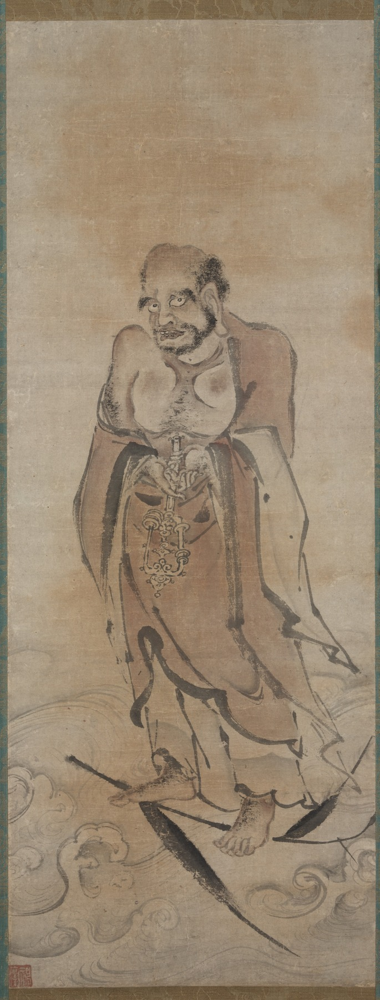

ア．寒山

イ．布袋

ウ．達磨

エ．拾得

### 問52

上下に掲載した二隻の季節と、木立・山・余白の関係を適切に述べたものはどれか。

図1

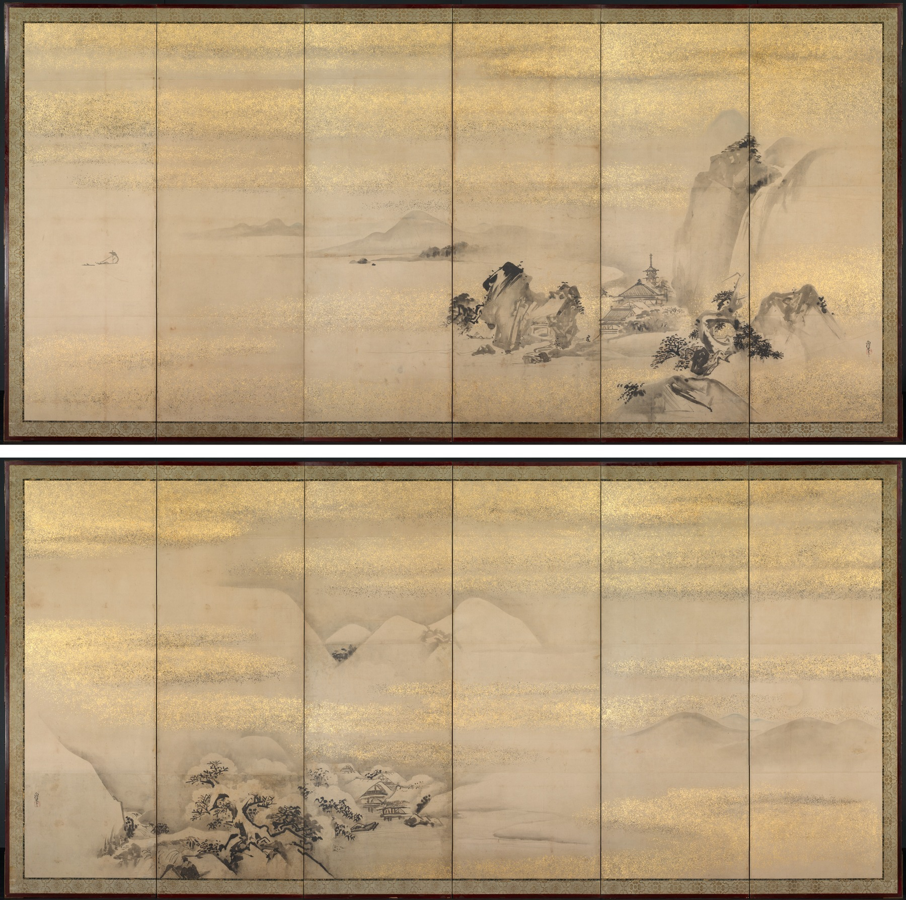

ア．上は冬・下は夏で、どちらも近景を中央に密集させる

イ．上は夏・下は冬で、濃い木立や岩と、淡い遠景・広い余白を取り合わせる

ウ．上は冬・下は夏で、余白を雲の輪郭線で細かく区切る

エ．上は夏・下は冬で、遠い山を最も濃くし、近い木立を淡く見せる

## 大問16 近世の制作と生活

日本の作品と美術の活動を取り上げる。作品の形や材料、制作と受容の記録を、問われた事項へ対応させて考えなさい。

### 問53

図の器の形・文様と、乾山・光琳の制作分担の組合せとして適切なものはどれか。

図1

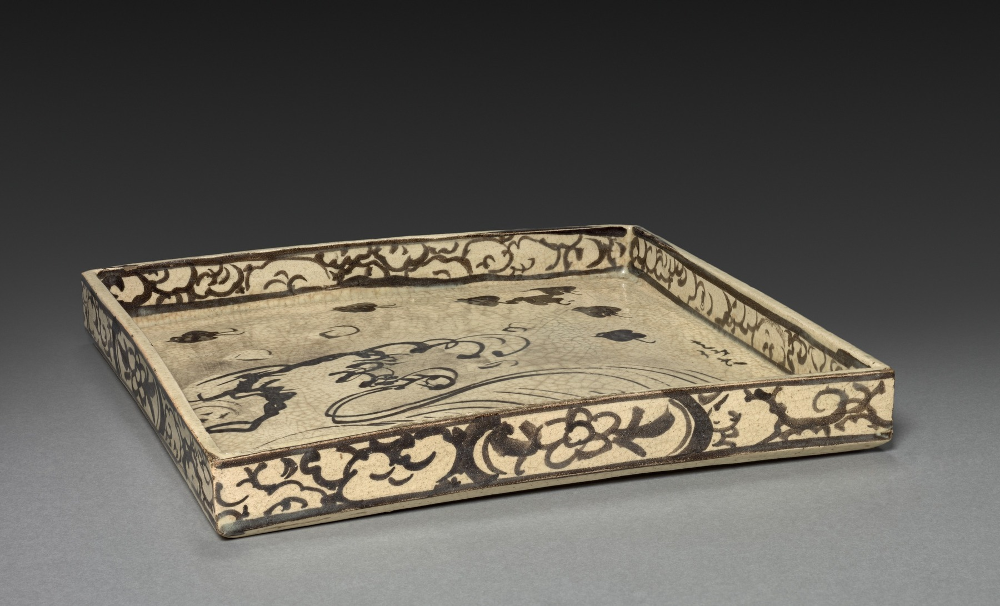

ア．角皿・波に千鳥／光琳が器を作り、乾山が鉄絵を描く

イ．角皿・花と流水／光琳が器を作り、乾山が鉄絵を描く

ウ．角皿・波に千鳥／乾山が器を作り、光琳が鉄絵を描く

エ．円皿・波に千鳥／乾山が器を作り、光琳が鉄絵を描く

### 問54

屋根や門に見られる破風のうち、中央が高くふくらみ、左右に反転する曲線を持つ形式はどれか。

ア．千鳥破風

イ．唐破風

ウ．切妻破風

エ．入母屋の妻

## 大問17 江戸時代の絵画と出版

日本の作品と美術の活動を取り上げる。作品の形や材料、制作と受容の記録を、問われた事項へ対応させて考えなさい。

### 問55

与謝蕪村の図1について、近景と遠景の墨の扱いと、所蔵館の解説が挙げる絵画の学習経路を正しく組み合わせたものはどれか。

図1

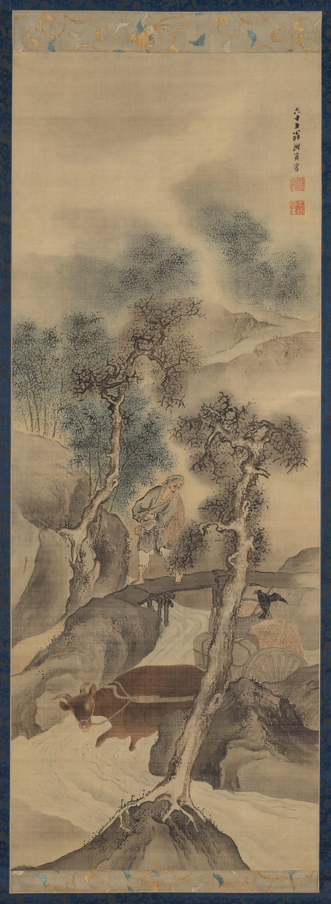

ア．近景の樹木を比較的濃く、遠景の山を淡く表し、中国の画家の工房で肉筆の粉本を直接模写して学んだ。

イ．近景の樹木を淡く、遠景の山を濃く表し、中国の画家の工房で肉筆の粉本を直接模写して学んだ。

ウ．近景の樹木を淡く、遠景の山を濃く表し、中国の木版画譜を手本として学んだ。

エ．近景の樹木を比較的濃く、遠景の山を淡く表し、中国の木版画譜を手本として学んだ。

### 問56

『北斎漫画』と『略画式』を近世の絵手本として比較するとき、後者の作者・二書の媒体・主な利用に合う組合せはどれか。

ア．鍬形蕙斎／腐食銅版の刊本／描法や画題を学ぶ手本

イ．橘守国／木版の刊本／描法や画題を学ぶ手本

ウ．鍬形蕙斎／木版の刊本／描法や画題を学ぶ手本

エ．鍬形蕙斎／木版の刊本／旅先の道筋を調べる名所案内

### 問57

図の人物の体格、装い、画中の記名を手がかりに、描かれた人物の職業に基づく浮世絵の分類として適切なものを選べ。

図1

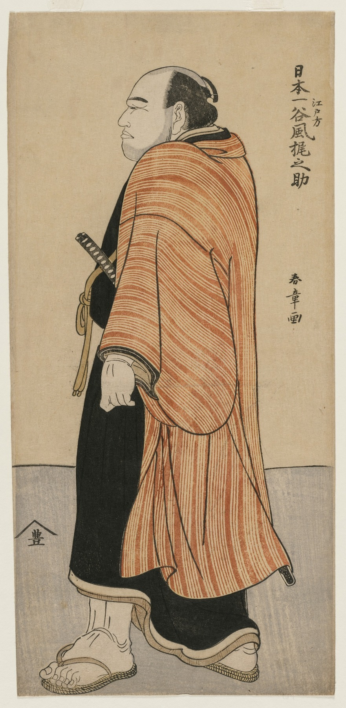

ア．美人画

イ．役者絵

ウ．相撲絵

エ．武者絵

### 問58

右側の人物、足元の紙、左側の人物の関係から、この版画の仕掛けに合う説明はどれか。

図1

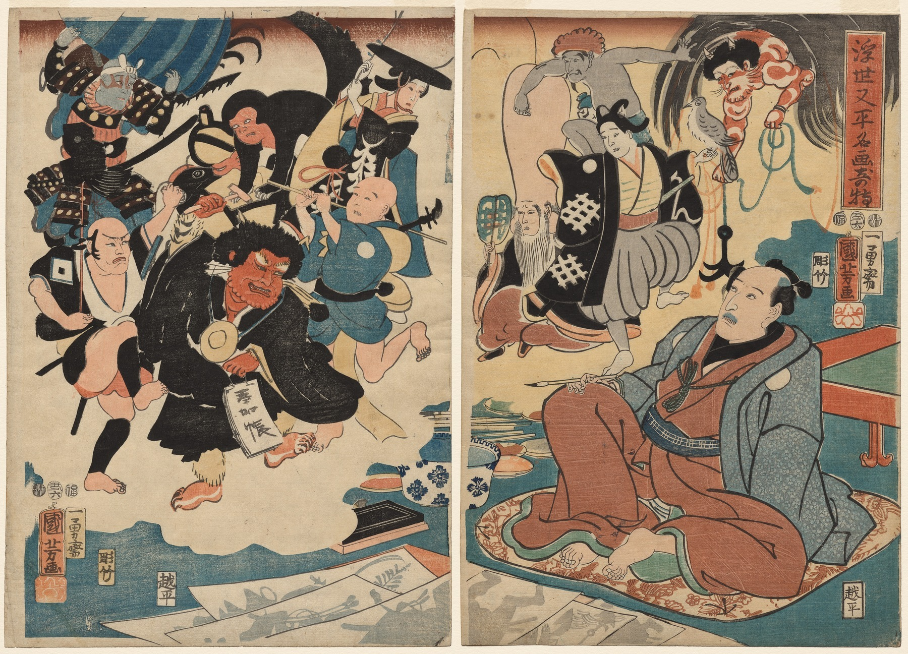

ア．紙上の下絵と大きな完成画を並べ、注文主に絵の仕上がりを比べさせる

イ．紙の人物を手本に、周囲の弟子たちが同じ図様をそれぞれ模写する

ウ．紙の台本を読み、衣装を着けた役者たちが芝居の稽古をする

エ．紙の上の図像が人の姿となって現れ、描く側と描かれる側の境を越える

## 大問18 近代日本の制度と制作

日本の作品と美術の活動を取り上げる。作品の形や材料、制作と受容の記録を、問われた事項へ対応させて考えなさい。

### 問59

近代の創作版画について、作家と活動の対応が適切なものはどれか。

ア．山本鼎―創作版画と自由画教育／恩地孝四郎―南蛮趣味を含む木版画／川上澄生―抽象的な版表現

イ．山本鼎―抽象的な版表現／恩地孝四郎―創作版画と自由画教育／川上澄生―南蛮趣味を含む木版画

ウ．山本鼎―創作版画と自由画教育／恩地孝四郎―抽象的な版表現／川上澄生―南蛮趣味を含む木版画

エ．山本鼎―南蛮趣味を含む木版画／恩地孝四郎―抽象的な版表現／川上澄生―創作版画と自由画教育

### 問60

萬鉄五郎《裸体美人》の表現として、最も適切なものはどれか。

ア．細密な線で皮膚の質感を追い、身近な対象の写実へ集中する

イ．薄い絵具と外光の明るい色を使い、輪郭を大気の中へ溶かす

ウ．光に応じる細かな明暗を重ね、人体を滑らかな量感へ整える

エ．肌や草地の色を主観的に強め、人体を大きな色面として組み立てる

### 問61

黒田清輝《読書》の制作地と、帰国後に東京美術学校西洋画科の指導者となった年の組合せはどれか。

ア．《読書》はフランスで制作／西洋画科での指導は1896年に始まる

イ．《読書》はフランスで制作／西洋画科での指導は帰国した1893年に始まる

ウ．《読書》は日本で制作／西洋画科での指導は帰国した1893年に始まる

エ．《読書》は日本で制作／西洋画科での指導は1896年に始まる

### 問62

1936年結成の新制作派協会の創設時の方針に最も近いものはどれか。

ア．抽象やシュルレアリスムを軸に、前衛的な表現を組織的に広める

イ．芸術家の良心と創造の自由を尊重し、新しい制作と発表の行動を起こす

ウ．日本画の伝統的な素材を起点に、従来の様式や支持体を問い直す

エ．細密な写実を通して、身近な人物や静物の質感を追究する

### 問63

1939年の美術文化協会の結成に関わり、シュルレアリスムを日本で展開した画家と表現の組合せはどれか。

ア．福沢一郎―現実では結び付きにくい像を組み合わせるシュルレアリスム

イ．長谷川三郎―伝統の書にも関心を持つ抽象表現

ウ．村井正誠―色面と形による無対象の抽象絵画

エ．川端龍子―展覧会場を意識する日本画の大画面

## 大問19 戦後日本の美術活動

日本の作品と美術の活動を取り上げる。作品の形や材料、制作と受容の記録を、問われた事項へ対応させて考えなさい。

### 問64

1953年制作の池田龍雄《網元（内灘連作の内）》を、戦後ルポルタージュ絵画の一例として説明したものはどれか。

ア．漁村の古い伝承の挿絵として、人物と漁具を古典の図様へ置き換える

イ．現地取材で得た漁民の印象を変形や風刺へ展開し、社会問題への視点を表す

ウ．漁民の顔と船を同じ縮尺にそろえ、漁業設備の正確な資料図として仕上げる

エ．既成の報道写真を同じ大きさで反復し、複製される視覚情報を示す

### 問65

山口勝弘の〈ヴィトリーヌ〉で、動きの見え方と作品・鑑賞者の関係を適切に説明したものはどれか。

ア．ガラスの屈折により、見る位置を変えると奥の図形が動くように見える

イ．風を受けた板が回転し、その速度に応じて模様が一つの形に見える

ウ．電球が順に点滅し、光源の移動を固定した画面へ投影する

エ．内部のモーターが図形を動かし、見る位置を固定しても同じ運動が続く

### 問66

1959年の《仏教伝来》を出発点に、後に仏教伝来の道を求めてシルクロード各地を取材した日本画家は誰か。

ア．岡本太郎

イ．東山魁夷

ウ．藤田嗣治

エ．平山郁夫

## 大問20 現代美術の媒体と批評

現代美術の実践と批評について、媒体、制作の過程、鑑賞や社会との関係に注目して考えなさい。

### 問67

アンゼルム・キーファーの絵画や立体について、素材と主題の関係を説明する。物質の性質や時間の痕跡を作品の意味と結び付ける、この作家の実践に最もよく対応するのはどれか。

ア．鉛や藁などを作品へ組み込み、その重さや変質をドイツの歴史や文化的記憶と結び付ける。

イ．建造物を布で包み、完成した建築の外観を一時的に変えて場所の経験をつくり直す。

ウ．規格化した工業部材を反復して配置し、部材の同一性と展示空間との関係を確かめる。

エ．日常の言葉を光る文字へ置き換え、都市で流通する情報と作品の境目を問い直す。

### 問68

アンドレアス・グルスキーは、現代の大規模な空間、商品や人々の集まりなどを大型の写真作品へ展開している。1990年代以降の制作で見られる、撮影像の扱いを説明するものとして最も適切なのはどれか。

ア．人物の演技を小さな写真の連作にし、字幕を付けて時間順の物語へ組み立てる。

イ．感光紙へ物を直接置いて露光し、カメラを使わず輪郭を残す方法を中心とする。

ウ．既存の写真の複製を再撮影し、作者やオリジナルの意味を問い直す。

エ．撮影した像を基にデジタル処理も用い、画面の配置や要素を再構成する。

### 問69

ゲリラ・ガールズの1989年のポスター《女性は裸にならなければメトロポリタン美術館に入れないのか》について、集団の活動と図像の使い方を捉えた説明はどれか。

ア．ポップ・アートの立場から、広告の女性像を原作とし、美術館で女性作家の人気が高いことを宣伝する。

イ．アプロプリエーションの立場から、引用した裸体画を女性作家へ帰属し直し、美術史上の作者の署名を修正する。

ウ．フェミニズムの立場から、匿名の集団が統計と広告的な表現を用い、女性の作り手の少なさと裸体像の多さを問いにする。

エ．フェミニズムの立場から、個々の女性作家名の顕彰を中心に据え、作家の自画像を広告媒体へ展開する。

## 大問21 日本とアジアの表現活動

### 問70

松井みどりが展覧会で提示した「マイクロポップ」という視点に最も近い制作の捉え方はどれか。

ア．作家が既成の製品の形を反復し、工業的な同一性を作品の中心的な尺度にする。

イ．作家が大衆文化の図像を宣伝の効果から評価し、消費動向を制作の統一基準にする。

ウ．作家が公的な歴史の代表図像を引用し、国家を単位とする集団の記憶を記念碑へ統合する。

エ．作家が身近な物や経験の断片を組み合わせ、自分の小さな生きる場の意味を組み立て直す。

## 大問22 作品と社会の関係

### 問71

里山や集落、廃校などを会場とし、地域の暮らしや人と自然の関係も作品とともに体験する芸術祭を紹介する。新潟県の越後妻有地域を主な舞台として始まった、この活動の名称はどれか。

ア．大地の芸術祭

イ．瀬戸内国際芸術祭

ウ．横浜トリエンナーレ

エ．札幌国際芸術祭

## 大問23 アジアの書画と工芸

アジアの造形と文化の交流について、材料、主題、表現や資料の役割を照合して考えなさい。

### 問72

仏教建築のストゥーパを、成立当初の中心的な役割から説明する。寺院内の僧房や講堂などと区別した展示文として、最も適切なのはどれか。

ア．僧侶や学徒が集まり、教えを講説するための施設

イ．僧侶が居室を分け、共同生活を送るための施設

ウ．仏舎利などを納め、礼拝と供養の中心となる施設

エ．仏典や経巻を収め、書写と保管を行うための施設

### 問73

図は清代の惲寿平による1685年の《芍薬図》である。花群と茎葉の配置を観察し、この花卉画の表現と結びつく用語を選べ。

図1

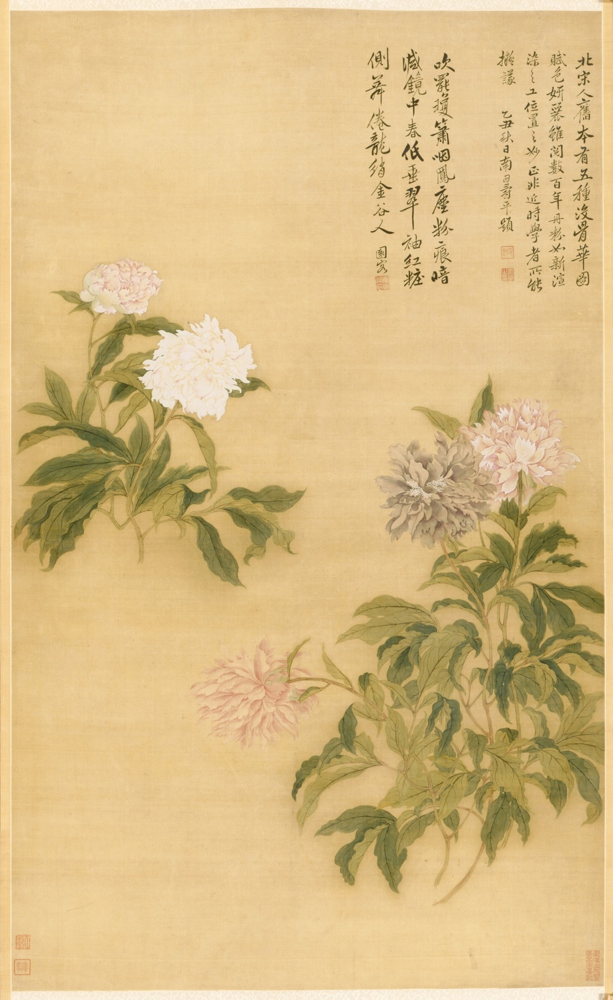

ア．花群を左右の異なる高さへ配し、花と茎葉の間に広い地の余白を残す―没骨

イ．中央に立つ一本の茎の左右へ、同じ高さで対になるように花を並べる―没骨

ウ．花群を左右の異なる高さへ配し、花と茎葉の間に広い地の余白を残す―鉤勒填彩

エ．中央に立つ一本の茎の左右へ、同じ高さで対になるように花を並べる―鉤勒填彩

### 問74

江戸時代の日本の浮絵を、西洋からの一方向の伝来と決めつけず、東アジアの版画交流から説明する。西洋式の透視遠近法や陰影法を取り入れた18世紀の版画が、日本での奥行き表現にも関わった中国の都市を選ぶ。

ア．蘇州

イ．敦煌

ウ．景徳鎮

エ．洛陽

## 大問24 工芸の技法とデザイン

工芸とデザインを取り上げる。制作の工程、材料、形や文様を、資料の記録と区別しながら考えなさい。

### 問75

金工の成形と加飾の区別について適切な説明はどれか。

ア．鍛金は板を打ち延ばすが、鋳金は成形後の金属を彫って文様をつくる加飾の名称である。

イ．鍛金は板を打ち延ばして形をつくり、鋳金は溶融金属を型へ流す。成形後に彫金で文様を加える場合もある。

ウ．鍛金は溶融金属を型へ流し、鋳金は板を打ち延ばす。両者へ彫金で文様を加える場合もある。

エ．鍛金と鋳金は表面装飾の差で、器の形をつくる工程はいずれも金属板を削り出す方法である。

### 問76

防染して染める技法のうち、表面の防染層に生じた割れ目へ染液が入り、細い線が文様に加わることがある技法と、その防染材の組合せはどれか。

ア．ろうけつ染―糸

イ．型染―糸

ウ．絞り染―蝋

エ．ろうけつ染―蝋

### 問77

1980年代初頭のミラノを拠点に活動したメンフィスを、家具の造形に対する考え方から説明する。モダンデザインとの関係も考慮し、このグループの傾向として最も適切なものを選べ。

ア．無彩色の単純な形へ構成を絞り、素材や図柄の違いが目立たない均質な室内を目指す。

イ．機能に加え、鮮やかな色や装飾、意外な素材の組合せを通して家具の意味を捉え直す。

ウ．部品や寸法を統一し、装飾を減らして合理的な大量生産へ向く標準型を追求する。

エ．古典的な家具の原作を測量し、当時の材料と加工法に従う忠実な復元を中心にする。

### 問78

図は江戸時代の鍋島の《椿文皿》である。幹や葉の配置と、この磁器の制作背景がともに合う説明を選べ。

図1

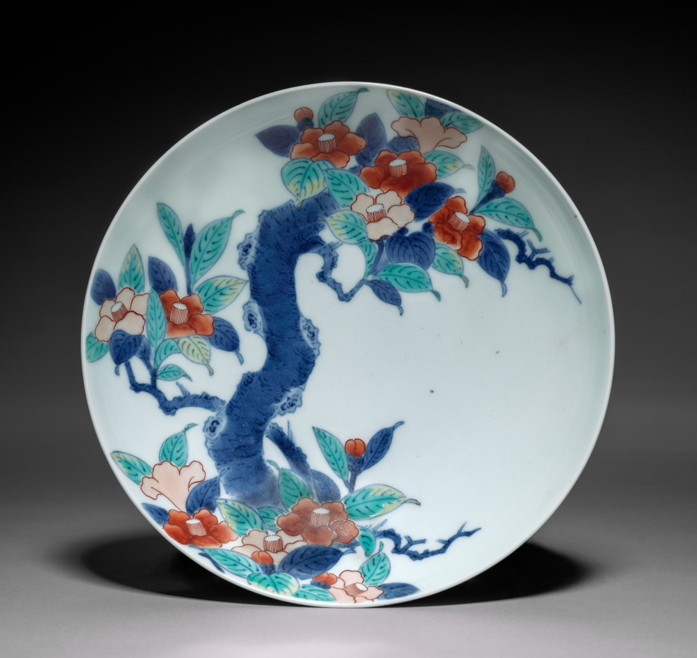

ア．幹と葉が非対称に広がる―藩窯の献上品等として制作

イ．幹を中央軸にして葉を左右対称に配す―藩窯の献上品等として制作

ウ．幹と葉が非対称に広がる―主に海外輸出向けに制作

エ．幹を中央軸にして葉を左右対称に配す―主に海外輸出向けに制作

## 大問25 美術館の成立と収集

### 問79

オルセー美術館のコレクションを紹介する年表をつくる。館の主な対象年代を、作品を調べる出発点として選ぶとどれか。例外を含む個々の収蔵品の全範囲でなく、美術館が案内する主要な西洋美術の年代に対応する範囲を問う。

ア．主に1848〜1914年

イ．主に1789〜1848年

ウ．主に1914〜1945年

エ．主に1945〜2000年

## 大問26 展覧会とコレクションの制度

### 問80

1959年に開館した国立西洋美術館の成立を、コレクションの形成と戦後の移管の二点から整理する。Aは基礎となった収集家、Bはフランスに残されていた作品の日本への移管を示す説明である。正しい組合せはどれか。

ア．A：松方幸次郎／B：日本政府が一般の美術市場で競売購入

イ．A：大原孫三郎／B：フランス政府による寄贈返還

ウ．A：大原孫三郎／B：日本政府が一般の美術市場で競売購入

エ．A：松方幸次郎／B：フランス政府による寄贈返還

## 大問27 有色紙の地と白い描画材

### 問81

目録①は「人物、タン色紙に木炭・パステル」、②は「牛の群れ、褐色紙に白黒チョークと少量のパステル」と記す。図の白い描線の位置と有色紙の記録を照合した説明はどれか。

図A

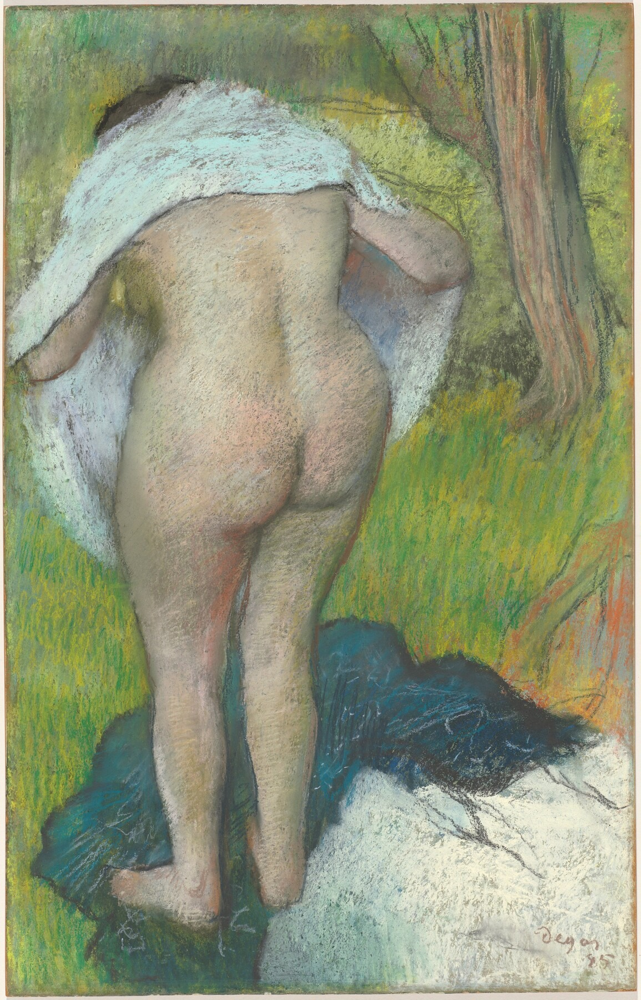

図B

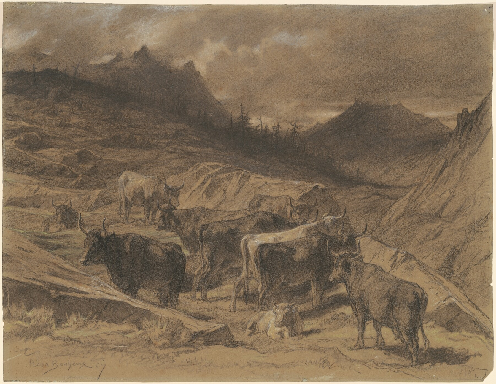

ア．A→②、B→①。Aは頭にかかる布と足元に白い描線があり、Bは前景の牛の背・腰に明るい描線がある。紙地の白とはしない。

イ．A→①、B→②。Aは頭にかかる布と足元に白い描線があり、Bの牛の背の白は褐色紙を塗らずに残した箇所とする。

ウ．A→①、B→②。Aは頭にかかる布と足元に白い描線があり、Bは前景の牛の背・腰に明るい描線がある。紙地の白とはしない。

エ．A→①、B→②。Aの白い布は腰より下にだけかかり、Bは前景の牛の背・腰に明るい描線がある。紙地の白とはしない。

## 大問28 河岸の建物と水面の構成

### 問82

川辺を描く二点について、Aの高い木と塔の重なり、Bの近い草地の縁と対岸の方向を図で追い、近景と遠景のつながりを正しく記したメモを選べ。

図A

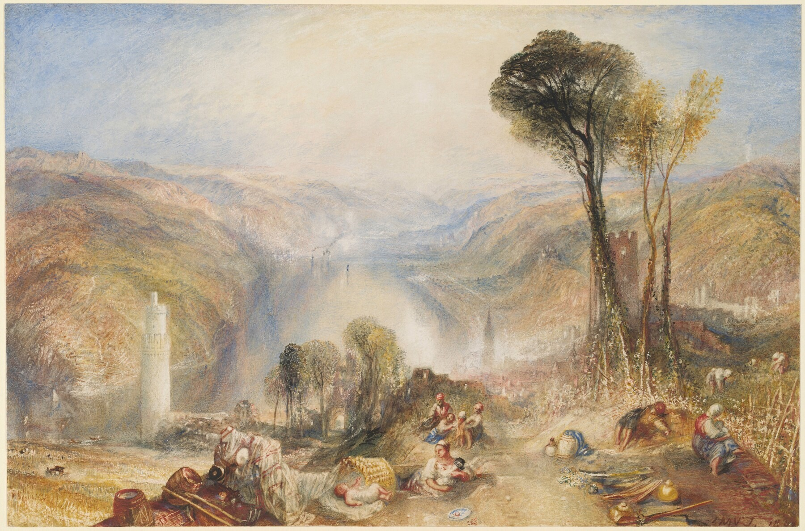

図B

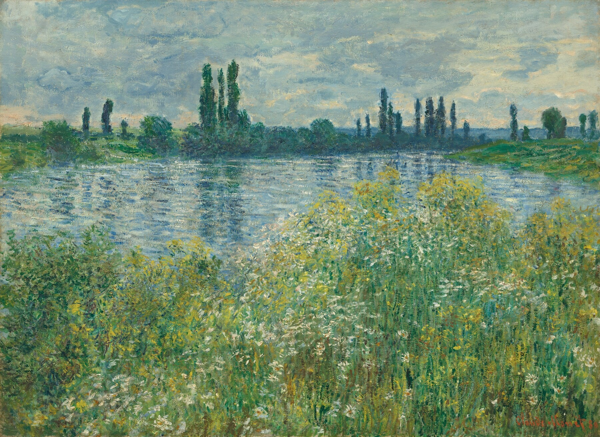

ア．Aは高い木が川の対岸の最遠部に収まり、Bは近い岸が左下から右奥へ斜めに延び、その先で対岸が横へ続く。

イ．Aは手前の高い木が画面右側の塔の一部を隠し、Bは近い岸が左下から右奥へ斜めに延び、その先で対岸が横へ続く。

ウ．Aは高い木が川の対岸の最遠部に収まり、Bは近い岸が右下から左奥へ斜めに延び、その先で対岸が横へ続く。

エ．Aは手前の高い木が画面右側の塔の一部を隠し、Bは近い岸が右下から左奥へ斜めに延び、その先で対岸が横へ続く。

## 大問29 小箱の形と道具の用途

### 問83

目録①は「椿文香合、木に黒漆・赤漆」、②は「松・椿・竹文硯箱、木に蒔絵、石・金属」と記す。蓋を閉じた写真を図録へ載せる。外装の観察と、図だけで確認できる範囲を守る注記はどれか。

図A

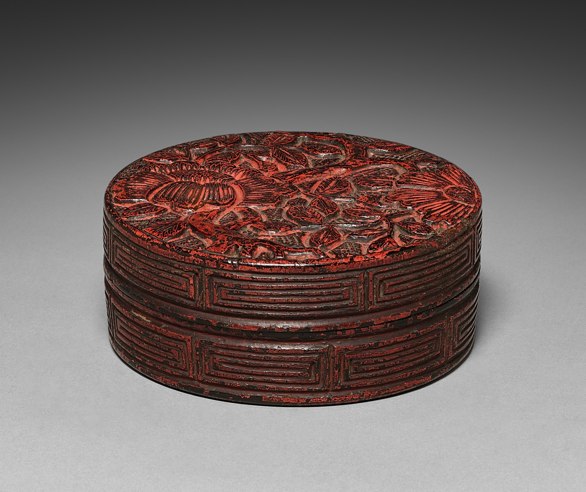

図B

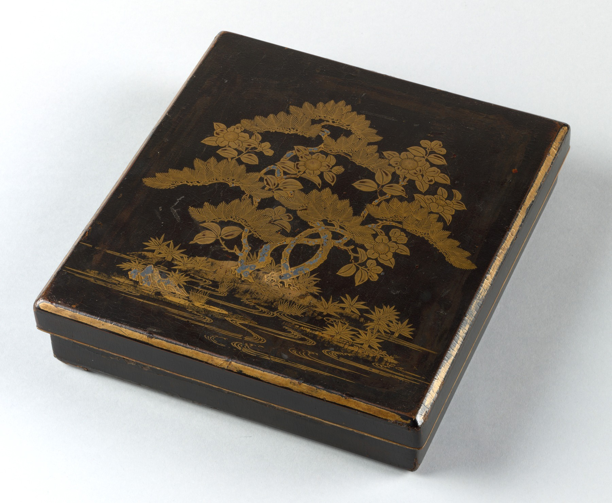

ア．A→①、B→②。Aは赤と黒の文様に凹凸、Bは蓋に金色の植物文がある。Bの内部の石・金属の配置は、この写真で確認済みとしない。

イ．A→①、B→②。Aは平らな赤地の上へ黒線で文様を描き、Bは蓋に金色の植物文がある。Bの内部の石・金属の配置は、この写真で確認済みとしない。

ウ．A→①、B→②。Aは赤と黒の文様に凹凸、Bは蓋に金色の植物文がある。Bの内部の石・金属の配置も、この写真で確認済みとする。

エ．A→②、B→①。Aは赤と黒の文様に凹凸、Bは蓋に金色の植物文がある。Bの内部の石・金属の配置は、この写真で確認済みとしない。

## 大問30 象徴と伝聞にもとづく図像

### 問84

デューラーの目録①は「1514年、寓意の版画」、②は「1515年、現地からの報告と他者の素描を原図に用いた犀の版画」と記す。両図の細部を確認し、図から見えることと情報の裏付けを区別する記録を選べ。

図A

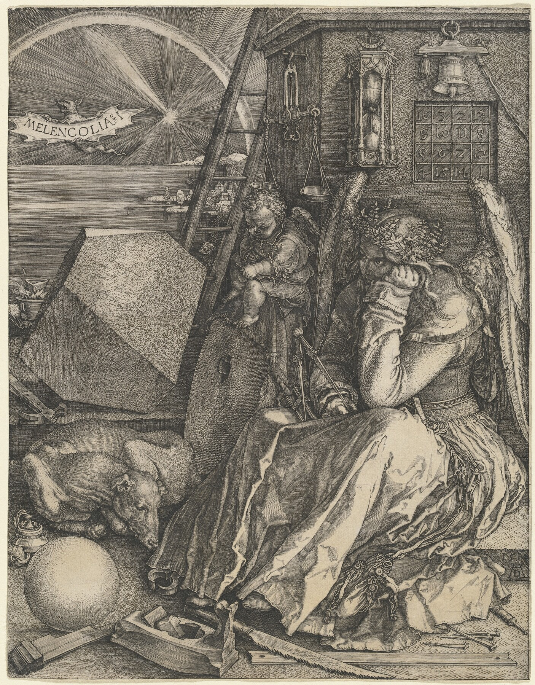

図B

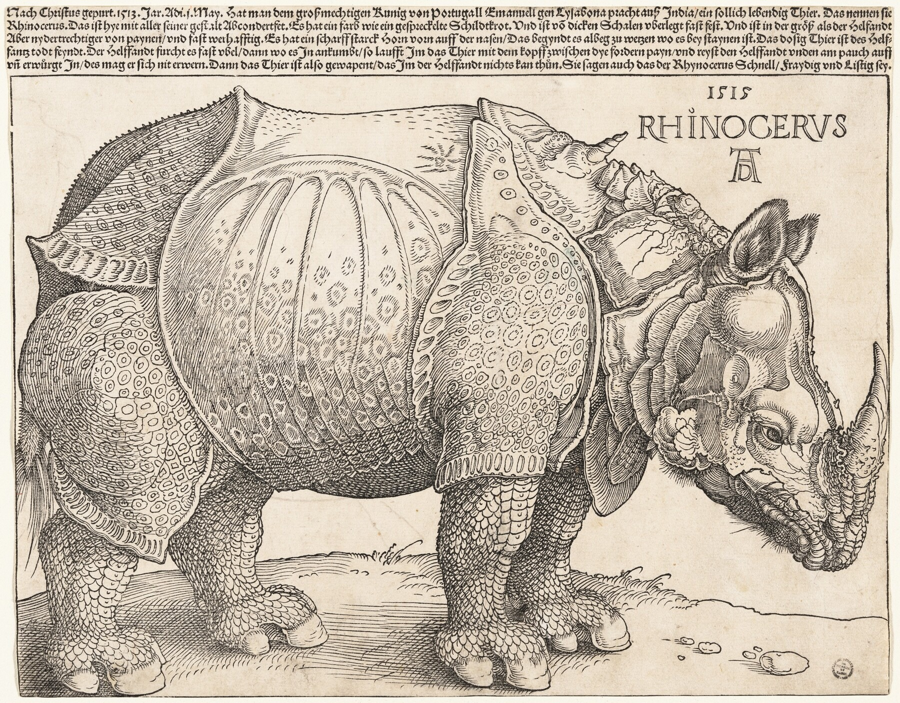

ア．A→②、B→①。Aの人物は頬に手を当て、Bは肩にも小さな角を描く。Bの角を作者の実見で確認された形態とは記録しない。

イ．A→①、B→②。Aの人物は頬に手を当て、Bは肩にも小さな角を描く。Bの角は精密に描かれるため、実見で確認された形態として記録する。

ウ．A→①、B→②。Aの人物は頬から手を離し、Bは鼻の角だけを描く。Bの角を作者の実見で確認された形態とは記録しない。

エ．A→①、B→②。Aの人物は頬に手を当て、Bは肩にも小さな角を描く。Bの角を作者の実見で確認された形態とは記録しない。

## 大問31 室内の人物と鑑賞の記述

### 問85

二点の室内人物画で、手・視線・家具の接触を観察する。Aの手が置かれる高さとBの視線の先を確かめ、図から直接記録できる説明を選べ。

図A

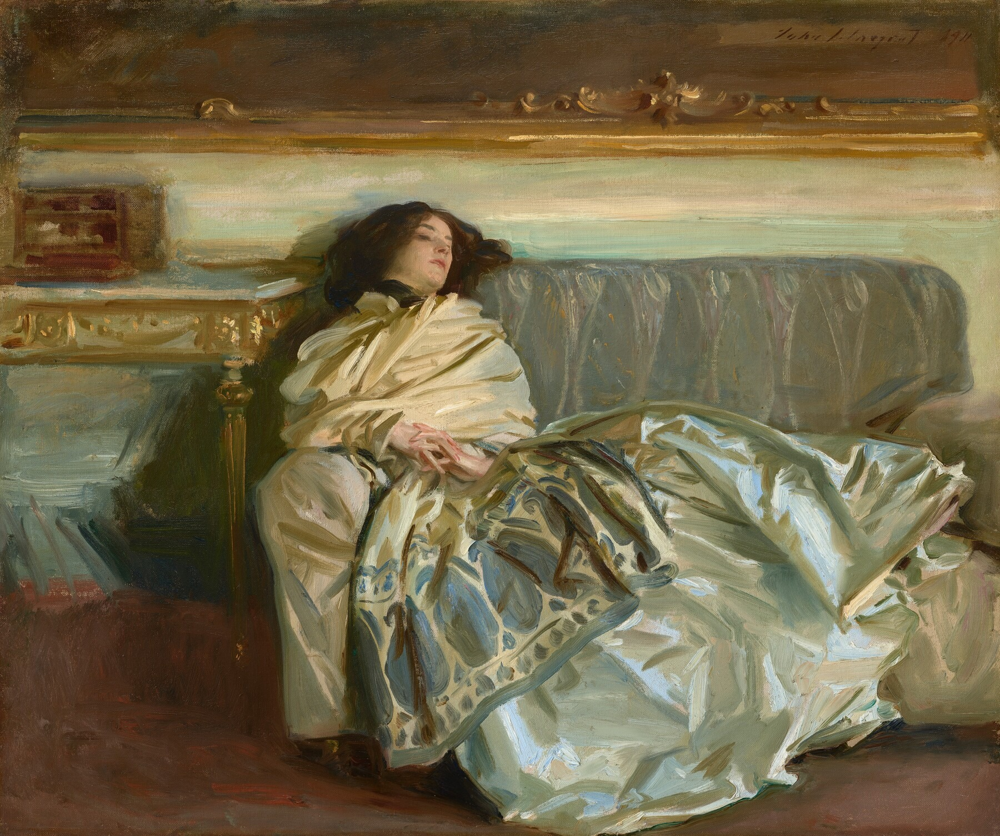

図B

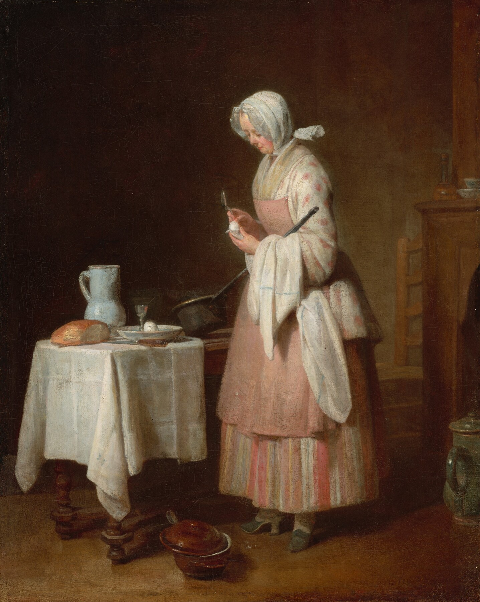

ア．Aは手を膝近くの布の上へ重ね、Bは手中の小物でなく卓の水差しへ視線を向ける。

イ．Aは手を膝近くの布の上へ重ね、Bは手中の小物へ視線を落とす。

ウ．Aは片手を長椅子の背の上へ伸ばし、Bは手中の小物でなく卓の水差しへ視線を向ける。

エ．Aは片手を長椅子の背の上へ伸ばし、Bは手中の小物へ視線を落とす。
