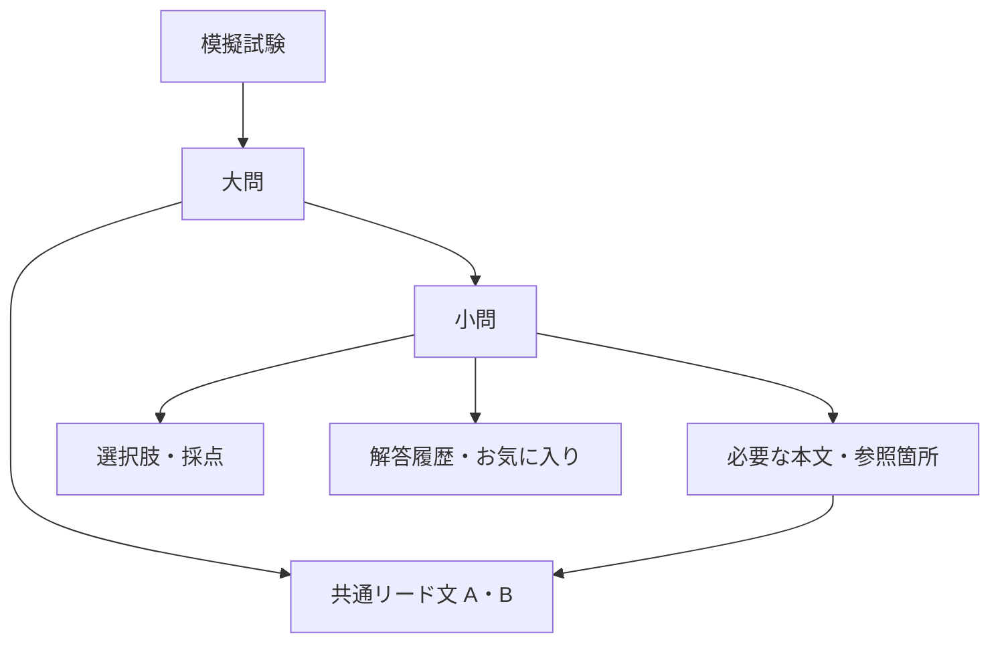

# API・DB・運用の概要

## 構成

| 層 | 構成・役割 |
| --- | --- |
| 画面 | Nuxt 4。問題演習・会員画面・管理画面 |
| API | Nuxt同梱のNitro / TypeScript。問題管理・採点・利用権限・決済処理 |
| 認証 | Better Auth。メールとパスワード、DBセッション、HttpOnly Cookie |
| 回数制限 | Better Auth標準の認証ルールと`rate-limiter-flexible`公式PostgreSQLストア |
| 障害通知 | 公式`@sentry/node` SDK。許可した固定データだけを送信 |
| DB操作 | Prisma Client。型付きクエリ・関連データ・トランザクション。Better Authも公式Prismaアダプターを利用 |
| マイグレーション | Prisma Migrate。SQLの適用履歴・チェックサム・排他制御・実行管理 |
| DB | PostgreSQL。問題・選択肢・利用者・履歴・会員資格等 |
| 共通設定 | `config/exam.json`。試験固有の公開設定 |
| 初期問題 | `content/questions.json`。空のDB向けの明示的な初期データ |

各派生サービスは独立したリポジトリ・環境変数・DB・配信先を持ちます。`site.id`をサービスごとに変え、ログインCookieの名前も分離します。元のサービスの環境やDBへ接続する設定は含めません。開発用Composeは`frontend`（画面・API）と`db`で構成します。APIの接続先は同一オリジンの`/api/v1`です。Ruby/Railsのプロセスは起動しません。

トップや試験概要はサーバー側で本文を生成します。問題演習・履歴・管理画面等はブラウザ側で動作します。APIの権限検査は表示方法に依存しません。

ホームの「利用にあたって」は、項目名と説明を細い横線で区切る案内欄です。PCでは左右、スマートフォンでは上下に配置し、カードや装飾アイコンは使いません。無料範囲・金額・プレミアム案内の表示は共通設定に従います。

## 基本動作と認証

- 問題演習URLは`/practice/{examNumber}/{questionNumber}`です。
- 未ログインの回答はDBへ保存しません。ログインユーザーの回答は履歴へ保存します。
- 一般画面と管理画面は同じログイン情報を使います。管理APIは`role=admin`だけが利用できます。
- APIの問題取得レスポンスは、回答前に正答・解説を含めません。回答APIで判定結果を返します。
- 無料モードでは全公開問題とログイン後のお気に入りを利用できます。
- 課金機能を有効にした場合は、問題一覧・取得・回答・履歴・お気に入りの各APIで利用資格を確認します。

## APIの入口

認証のネイティブAPIは`/api/auth`以下、業務APIは`/api/v1`以下です。業務APIは`frontend/server/api/v1/`内のメソッド別ファイルをNitroが自動登録します。例えば`questions/next.get.ts`と`questions/[id]/answer.post.ts`がそれぞれのURL・HTTPメソッドに対応し、URLを手動で分割する振り分け処理は置きません。業務処理は`frontend/server/services/`、共通の認証・DB・エラー処理は`frontend/server/core/`にあります。回帰テストは`frontend/server-tests/`を参照してください。

| 用途 | メソッド・パス |
| --- | --- |
| 稼働確認 | `GET /health` |
| 会員登録・ログイン・ログアウト | `POST /api/auth/sign-up/email`・`POST /api/auth/sign-in/email`・`POST /api/auth/sign-out` |
| 認証セッション | `GET /api/auth/get-session` |
| 自分の情報・退会 | `GET /me`・`DELETE /me` |
| 利用可能な試験セット | `GET /exams` |
| 問題取得・次問取得 | `GET /questions/:id`・`GET /questions/next` |
| 回答 | `POST /questions/:id/answer` |
| 回答履歴 | `GET /answer_histories`・`GET /answer_histories/:id` |
| お気に入り一覧 | `GET /favorites` |
| お気に入り登録・解除 | `PUT /questions/:question_id/favorite`・`DELETE /questions/:question_id/favorite` |
| 管理用問題一覧・作成 | `GET /admin/questions`・`POST /admin/questions` |
| 管理用問題取得・更新・削除 | `GET`・`PATCH`・`PUT`・`DELETE /admin/questions/:id` |
| 決済設定・購入開始 | `GET /payments/config`・`POST /payments/checkout_sessions` |
| Stripeイベント受信 | `POST /webhooks/stripe` |

認証行以外の上表のパスには`/api/v1`を付けます。認証はBetter Authの標準scryptハッシュとDBセッションを使用し、CookieはHttpOnly・SameSite=Lax、本番HTTPSではSecureです。セッションの期限は24時間で、ログアウトでDB上のセッションを失効します。`site.id`でCookie名を分離します。独自署名トークンと旧Bearer認証は廃止しています。

ブラウザの認証操作はBetter Auth Vue clientを使用します。管理者権限と課金資格は業務APIがDBの現在値を確認します。会員情報・お気に入り等をセッションCookieへ格納しません。標準のユーザー削除・パスワード再設定などのAPIは公開せず、退会はパスワード確認とStripe購入待ちの失効を行う`DELETE /api/v1/me`に集約します。

認証APIはライブラリのOrigin・CSRF対策を維持します。Cookieを使う業務APIのPOST・PUT・PATCH・DELETEも、設定したOriginからのJSONリクエスト（本文なしの操作を含む）に限定します。Stripe Webhookはこの検査の対象外で、Stripeの署名を検証します。

画面のURLは試験番号と問題番号を使用します。APIの`:id`には問題IDを使います。試験番号を指定して順に取得する場合は、例えば`GET /questions/next?exam_number=1&after_question_number=0`でセット1の最初の公開問題を取得します。

共通の`defineApiHandler`が、no-store・CORS・Origin/JSON検査、必要な認証・管理者権限、JSON形式のエラーと障害通知を適用します。GETに対応するHEADは同じ処理とレスポンスヘッダーを使用し、本文を返しません。フォールバックは未知のURL・未対応メソッドのエラーとOPTIONSの処理だけを担い、業務処理への振り分けはしません。Stripe Webhookは本文を加工せず、従来どおり署名を確認します。

## フォームの検証とエラー表示

会員登録・一般/管理ログイン・退会・問題作成/編集は、導入済みのNuxt UI `UForm`・`UFormField`へZodスキーマを渡します。認証フォームは`shared/schemas/auth.ts`、管理問題フォームは既存の共通問題スキーマを使用します。入力に誤りがあれば送信を止めて項目の近くに表示し、APIから返された項目別エラーも同じ場所へ表示します。通信失敗やログイン拒否などはフォーム全体の日本語メッセージで案内します。

Better Authのサーバー側検証と管理APIの問題検証も引き続き実行し、ブラウザの検証だけに依存しません。パスワードはtrimしません。パスワード長の設定はBetter Authとフォームで同じ定数を参照します。

## 操作回数の制限

認証APIはBetter Auth標準の`rateLimit.customRules`で会員登録・ログインの上限を定義し、公式の`customStorage.consume`拡張から共通ストアへ接続します。業務APIも同じ`frontend/server/core/rate-limit.ts`を使用します。カウンターと有効期限の処理は`rate-limiter-flexible` 11.2.3の`RateLimiterPostgres`へ委ね、同時リクエストの加算を公式アダプターの原子的な更新で処理します。Redisは不要です。

| 対象 | 単位 | 上限・区間 |
| --- | --- | --- |
| 会員登録 | IP | 10回・900秒 |
| ログイン | IP | 30回・300秒 |
| 購入開始 | IP | 20回・300秒 |
| 購入開始 | ユーザーID | 10回・300秒 |
| 回答 | IP | 120回・60秒 |

従来と同じ時刻にそろえた固定区間と、`api-rate-limit-v1`のHMACキーを使用します。区間の開始をキーに含め、ライブラリの`customDuration`へ区間の残り時間を渡します。回数制限テーブルにはHMACキー・回数・有効期限だけを保存し、生のIPやユーザーIDを格納しません。認証のIPはBetter Authが正規化し、IPv6は128ビットのアドレス単位です。

ストアは同じPostgreSQLの`rate_limiter_flexible`を共有し、DDLはPrisma Migrateが管理します。Prismaの業務用接続とは別に、ライブラリ用の`pg`プールをプロセス当たり最大2接続で使用します。接続待ちとSQL実行の期限は各1秒で、NuxtとCLIの終了時にプールを閉じます。ライブラリの自動タイマーは無効にし、操作時に公開メソッド`clearExpired`で期限切れを削除します。

上限に達すると日本語の429と秒単位の`Retry-After`を返します。ストアに接続できない場合は安全側に停止し、日本語の503と`Retry-After: 60`を返します。DBエラーの本文・接続先・対象キーはレスポンスやログへ渡しません。

## 障害通知

通知を有効にした環境では、公式`@sentry/node` 11.9.0のSDKを使用します。`ERROR_NOTIFICATIONS_ENABLED`・`SENTRY_ERROR_DSN`・`ERROR_NOTIFICATION_ENVIRONMENT`を環境ごとに設定します。環境は`production`又は`verification`、送信先は許可したSentryのHTTPS取り込み先に限定します。

送信データはAPI・Stripe API接続・Stripe Webhook処理の固定メッセージ、分類、環境、イベントID、時刻、エラーレベルだけです。リクエスト本文・URL・ヘッダー・Cookie・利用者情報・問題・解答・Stripeイベント・例外本文・スタック・添付・トレースを送りません。自動計測は無効にし、送信前にも許可した項目だけへ組み直します。

DSNの解釈、認証、エンベロープの生成はSDKへ委ねます。送信はSDKの`createTransport`へ中断期限付きの`fetch`処理を渡し、1秒で打ち切ります。通知失敗で元のAPI処理を失敗させません。同じ環境・分類の通知はプロセス内で1時間に1回へ抑制し、想定された利用停止の503は除きます。回数制限ストアの障害は実際の障害として通知対象です。

## DBの主なテーブル

| テーブル | 内容 |
| --- | --- |
| `users` | 会員・管理者。役割は一般ユーザーと管理者 |
| `questions` | 試験番号・問題番号、分類、本文、解説、出典、公開状態 |
| `question_choices` | 選択肢、表示順、正答フラグ |
| `answer_histories` | 利用者の回答と判定 |
| `favorites` | 利用者と問題のお気に入り関係 |
| `memberships` | 有料会員の利用資格 |
| `payments` | 決済状態とStripeとの照合情報 |
| `stripe_webhook_events` | 受信イベントの処理状態・重複処理防止 |
| `verification_access_grants` | 期限付きの運用確認用利用資格 |
| `rate_limiter_flexible` | 認証・業務API共通の操作回数制限。ライブラリ用のHMACキー・回数・期限 |
| `api_rate_limit_buckets` | 初期スキーマと移行互換のために保持する旧回数制限テーブル。稼働時には使用しない |
| `auth_sessions`・`auth_accounts`・`auth_verifications` | Better Authのセッション・認証情報・検証情報 |
| `_prisma_migrations` | Prisma Migrateが管理する適用履歴とチェックサム |

型付きDBモデルの正本は`frontend/prisma/schema.prisma`、適用するDDLは`frontend/prisma/migrations/*/migration.sql`です。`npm run db:generate`でPrisma Clientを生成し、`npm run db:migrate`が`prisma migrate deploy`で未適用のSQLを実行します。変更時は`npm run db:migrate:dev -- --name 変更名`で新しいマイグレーションを作成し、CHECK制約・部分一意インデックス等のPostgreSQL固有のDDLも確認します。適用済みファイルを編集しません。

空のDBには初期マイグレーションと以後の未適用分を適用します。既存テンプレートのDBでは、バックアップを取り、固定の`frontend/prisma/baseline.prisma`へ照合してから、明示的な`npm run db:baseline`で初期マイグレーションを適用済みとして記録します。その後の`db:migrate`で新しい回数制限テーブル等を追加します。通常起動で既存スキーマを自動採用・resetしません。旧`pgmigrations`・`nitro_schema_migrations`とRailsの管理用テーブルは既存DBにある場合も削除しません。[移行手順](migration.md)を参照してください。

Prisma Migrateがマイグレーションの排他ロックと履歴を管理します。サービスの書込はPrismaのトランザクションを使用します。問題の書込・一括取込は共通ライターとアドバイザリロックを使い、回答時は問題行、購入・退会処理はユーザー行をロックして整合を保ちます。これらのPostgreSQL固有のロックと復元演習のカタログ照合には限定的にパラメーター付きSQLを使います。回数制限の更新SQLは公式ライブラリが管理します。

同じ試験セット内の問題番号、同じ問題内の選択肢ラベルと表示順は一意です。正答フラグには、複数の正答を登録しないためのDB制約があります。試験ごとの問題数・選択肢数と分類の対応は共通設定を使ってAPI側で検査します。

## 表示ブロック

問題・解説・選択肢はHTML文字列ではなく、配列の表示ブロックで保存します。

| 種類 | 用途・主な属性 |
| --- | --- |
| `text` | 通常文。`text` |
| `quote` | 引用文。`text`、任意の`source` |
| `fill_in_text`・`fill_in_quote` | 空欄付き本文。`text`内に`{{①}}`等を記載 |
| `table` | 表。文字列配列の`headers`、同じ列数の`rows` |
| `code` | プログラム。`code`、任意の`title` |
| `code_group` | 複数プログラムの比較。`items`に`code`と任意の`title` |
| `fill_in_choice` | 空欄に対応する選択肢の語句。文字列配列の`cells` |

問題本文は上記のうち`fill_in_choice`以外、解説は`text`・`quote`・`table`・`code`、選択肢は`text`・`table`・`fill_in_choice`を利用できます。穴埋めの空欄ラベルと、全選択肢のセル数をそろえます。

## 初期データ・アーカイブ

`content/questions.json`は手で編集するための初期問題です。`npm run operations -- questions:import_content`で空のDBへ取り込み、既存問題は上書きしません。

DBからの問題データ書き出しには`npm run operations -- questions:export`、書き出した検証値付きアーカイブの取込には`npm run operations -- questions:import`を利用します。いずれも入力・出力先を明示する操作です。問題アーカイブは利用者・履歴・決済を含まないため、DB全体のバックアップの代わりにはなりません。

```bash
# コンテナ内に新しいファイルを作成する。既存ファイルへの上書きは拒否する。
docker compose exec \
  -e OUTPUT=/tmp/questions-export.json frontend npm run operations -- questions:export

# ファイルをホストへ回収する。
docker compose cp \
  frontend:/tmp/questions-export.json ./questions-export.json
```


運用CLIの入口は`frontend/server/operations/cli.ts`です。`node --experimental-strip-types`で同じTypeScriptのサービス・DB処理を呼び出し、件数・安全な状態情報だけを出力します。認証情報、問題本文、利用者のメールアドレス、Stripeイベント本文は結果に含めません。

| 操作名（`npm run operations --`の後に指定） | 入力する環境変数 |
| --- | --- |
| `db:migrate` | DB接続。未適用のPrismaマイグレーションを適用 |
| `db:baseline` | DB接続。バックアップ済みの既存DBに対する明示的な初回履歴登録 |
| `db:seed` | 開発環境のみ。任意の`INPUT` |
| `questions:import_content` | `CONFIRM=IMPORT_INTO_EMPTY_DATABASE`、任意の`INPUT` |
| `questions:import` | `CONFIRM=IMPORT_INTO_EMPTY_DATABASE`、`INPUT` |
| `questions:export` | 未使用の出力先`OUTPUT` |
| `admin:create` | `ADMIN_EMAIL`・`ADMIN_PASSWORD`、任意の`ADMIN_NAME` |
| `verification_access:grant` | `USER_EMAIL`・`EXPIRES_AT`・`REASON`・`GRANTED_BY` |
| `verification_access:revoke` | `USER_EMAIL` |
| `payments:expire_pending_checkouts` | `USER_EMAIL`、対象環境のStripe秘密鍵とモード設定 |
| `operations:audit` | DB接続と対象環境の設定。更新やStripe通信は行わない |
| `operations:restore_drill` | ローカルtest用接続、販売・外部通知を無効にする |

検証用資格は付与時から7日以内の期限付きで、監査用の理由・担当者を必須とします。同じユーザーに再付与せず、解除しても記録を維持します。pending決済の期限切れ処理はStripeの状態を照合してから実行し、支払済み資格を直接作成しません。

`operations:audit`は24時間超のpending、直近1日の返金失敗、異議申立て中、失効済み決済に紐づくactive資格等を件数で報告します。問題アーカイブ・DBバックアップ・復元演習の役割と操作は[移行・復元手順](migration.md)を参照してください。

## 検証と配信

画面の単体テストは`npm test`、API・運用のテストは`npm run test:server`、型検査と本番ビルドは`npm run typecheck`・`npm run build`です。APIの統合テストはPostgreSQLに接続して実行します。DB接続がない場合に統合テストがスキップされるため、成功件数だけでDB検証済みと判断しないでください。

本番の配信先・DB・ドメイン・秘密情報・監視先は、派生サービスごとに設定します。テンプレートには自動的に既存サービスへ配信する設定を持たせません。配信前には実際の公開URLとAPIの接続、PC・スマートフォン表示、認証と管理権限を確認します。課金する場合は購入からWebhook・利用資格・返金まで対象環境で確認します。


## 模擬試験・大問・小問と共通本文

世界史ラボの階層・共通本文の契約を、当サービスのPrisma・Better Auth・共有Zodへ移植しています。世界史側の記述式・論述式、独自認証、7/8小問・4大問30問等の専用条件は含めません。



| 保存先 | 役割 |
| --- | --- |
| `exam_sets` | 模試の名称・公開状態・編集バージョン。番号や問数・選択肢設定の範囲はconfigで検査 |
| `question_groups` | 同一模試内の大問番号・タイトル・予定小問数・公開状態 |
| `group_passages` | 大問に一度だけ保存する本文・ラベル・順序 |
| `questions.group_id / group_question_number` | 所属と大問内番号。従来の内部番号・IDは維持 |
| `question_passage_references` | 同じ大問の本文と、その中の安定した参照IDへのリンク。NULLは本文全体 |

複合外部キーと共有Writerで所属・参照の一致を守ります。下書き・非公開の模試や大問の小問は、直接URL・採点・カタログ・履歴・お気に入りからも一般利用できません。回答前のDTOには、その小問が参照する本文だけを返し、正答・解説・出典は返しません。

本文内の下線・空欄・参照箇所は、限定した構造化インライン要素としてZodで検査し、Vueで描画します。任意HTMLは保存・実行しません。大問や本文の管理は編集バージョンで競合を検知し、公開前に予定小問・参照先を検査します。

共通本文の内容変更は参照小問の`content_version`を増やします。古い画面からの回答は409で再読込を案内し、以前の履歴は更新前として識別します。階層の付与・表示順変更では問題・選択肢IDと履歴を保持します。通常の問題本文・正答等の変更に伴う既存Writerの履歴削除方針を、今回全面変更したものではありません。

階層付き問題は文書・アーカイブv2で保存し、本文・大問の輸送用IDを取込時にDBのIDへ写像します。旧v1文書・チェックサムの読込は維持し、構成のないデータを自動で大問化しません。
